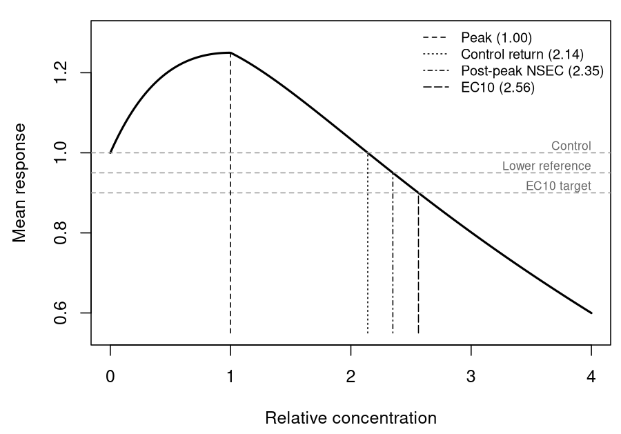

# Introduction

Low concentrations can increase a measured biological response before higher concentrations reduce it, a pattern termed hormesis [@calabrese2008]. For a threshold hormesis equation, the `nec` parameter identifies the peak of that rise, where the fitted response differs from the control. Its interpretation differs from the breakpoint of a monotone threshold equation. `bayesnec` calculates a no-significant-effect concentration (NSEC) on the declining limb, using a lower quantile of the posterior control response as the reference [@fisherfox2023].

Australian and New Zealand guideline methods prefer defensible NECs and NSECs as chronic inputs, although their NSEC definition describes a monotonically decreasing model [@warne2025]. Guidance for stimulated responses from Environment Canada and OECD TG 201 supports retaining the observations, fitting an appropriate curve and assessing inhibition relative to the control [@canada2005stats; @oecd2026tg201]. The post-peak NSEC extends that control-based comparison to hormetic curves. It is an interpolated statistical no-effect estimate and can have a nonzero associated effect, as a NOEC can [@fisherfox2023; @fisher2023ieam]. This example shows how to obtain and assess it with `bayesnec`, using marine growth rates and lettuce biomass.

# Methods

## Control-based locations

For an endpoint where a decrease represents poorer performance, let $m(c)$ be the fitted mean at concentration $c$, with $m(0)$ the fitted unexposed control. The peak is the maximum fitted response, and the control return is the first crossing of $m(0)$ after that peak. A control-based ECx is a specified percentage decline from $m(0)$; the post-peak NSEC is the first descending crossing of a lower posterior quantile of the control response. These locations differ even when estimated from one equation (Figure 1).


``` r
m <- function(z) 1 + 0.25 * z * exp(1 - z) - 0.15 * pmax(z - 1, 0)
x <- seq(0, 4, length.out = 400)
crossing <- function(target) uniroot(function(z) m(z) - target, c(1.01, 4))$root
locations <- c(Peak = 1, `Control return` = crossing(1),
               `Post-peak NSEC` = crossing(0.95), EC10 = crossing(0.9))
op <- par(mar = c(4.3, 4.4, 1, 0.5))
plot(x, m(x), type = "l", lwd = 2, xlab = "Relative concentration",
     ylab = "Mean response", ylim = c(0.55, 1.3))
abline(h = c(1, 0.95, 0.9), lty = 2, col = "grey60")
text(4, c(1, 0.95, 0.9), c("Control", "Lower reference", "EC10 target"),
     adj = c(1, -0.3), cex = 0.7, col = "grey40")
segments(locations, 0.55, locations, m(locations), lty = 1:4 + 1)
legend("topright", legend = sprintf("%s (%.2f)", names(locations), locations),
       lty = 1:4 + 1, bty = "n", cex = 0.8)
```

<div class="figure" style="text-align: center">

<p class="caption">Figure 1. A theoretical hormetic curve, $m(c)=1+0.25c\exp(1-c)-0.15\max(c-1,0)$, showing the four candidate locations, with each concentration given in the legend. The grey dashed lines mark the control response $m(0)=1$, a lower reference of 0.95 standing in for a lower posterior quantile of the control, and the EC10 target of 0.9.</p>
</div>

``` r
par(op)
```

In `bayesnec`, `curve_params()` returns the sampled `nec` parameter for a threshold hormesis equation, while `nec()` returns the NSEC as its default no-effect estimate. `nsec()` uses `sig_val` to set the control reference, and `ecnsec()` gives the percentage effect associated with an NSEC. The NSEC uses the fitted curve between tested concentrations, whereas a NOEC must be one of the tested concentrations [@fisherfox2023]. For example, compare a control-based NSEC and its associated ECNSEC across candidate equations. A posterior draw without stimulation can cross the reference without an intervening peak, so the equation and reported location should both be identified.

## Observations

The [public workbook](https://data.aims.gov.au/data-download/615e208d-f6c7-4b2f-b99e-d4fc50614e48/Negri_etal_2021_Experimental-data_Toxicity-thresholds-gas-condensate-oils.xlsx) accompanying @negri2021condensate contains 65 individual growth rates of *Cladocopium goreaui*: ten unexposed controls and five replicates at each of 11 concentrations [@aims2020condensatedata]. The workbook codes controls at 1 $\mu$g/L total aromatic hydrocarbons (TAH). We subtracted this source value and divided by 1000 to express concentrations in mg/L relative to the source-coded control. The workbook is [CC BY-NC 3.0 Australia](https://researchdata.edu.au/condensate-toxicity-testing/1702929), so `data-raw/hormesis_negri.R` imports the individual observations locally without redistributing them.

The `drc::lettuce` data contain 14 shoot-biomass observations at seven isobutyl alcohol concentrations, with two observations per concentration [@vanewijk1993; @Ritz2016]. The observations are included in `inst/extdata/hormesis_lettuce_1993.csv` (Figure 2). This small terrestrial assay provides a fitting example, not an aquatic guideline input.


``` r
lettuce <- read.csv(system.file("extdata", "hormesis_lettuce_1993.csv",
                                package = "bayesnec"))
op <- par(mar = c(4.3, 4.4, 1, 0.5))
plot(lettuce$weight ~ log10(lettuce$conc + 0.1), pch = 16,
     col = "#A25D3A88", xaxt = "n", xlab = "Isobutyl alcohol (mg/L)",
     ylab = "Shoot biomass")
axis(1, at = log10(sort(unique(lettuce$conc)) + 0.1),
     labels = sort(unique(lettuce$conc)), cex.axis = 0.75)
with(aggregate(weight ~ conc, lettuce, mean),
     lines(log10(conc + 0.1), weight, lwd = 2))
```

<div class="figure" style="text-align: center">

<p class="caption">Figure 2. The 14 individual lettuce shoot biomass observations. The concentration axis is log10(concentration + 0.1), and the line joins treatment means for visual orientation; it is not a fitted model.</p>
</div>

``` r
par(op)
```

## Fitting and checks

We fitted Gaussian responses with an identity link. For the marine data, we fitted monotone `neclin` and five hormesis equations: `neclinhorme`, `nechorme`, `nechorme4`, `ecxhormebc4` and `ecxhormebc5`. We fitted the five hormesis equations to lettuce biomass using `log(concentration + 0.1)` because the recorded concentrations span more than two orders of magnitude; the offset retains the control. All returned concentrations below are in mg/L. Each fit used four chains of 2000 iterations, including 1000 warm-up iterations. We combined the fitted equations with `c()` so that `bayesnec` could estimate pseudo-BMA model weights from Pareto-smoothed importance sampling leave-one-out cross-validation (PSIS-LOO) and form model-averaged predictions [@vehtari2017; @fisher2023ieam]. We compared observed treatment means with fitted and model-averaged means, used `check_fit()` with 1000 posterior predictive datasets and examined sampler and PSIS-LOO diagnostics.

The following calls show how to fit both candidate sets, inspect their weights and extract the NSEC and ECNSEC for `neclinhorme`. They are not evaluated when the vignette is built; the displayed results were prepared from the separately saved fits, with model-specific initial values documented in the research compendium.


``` r
library(bayesnec)
source("data-raw/hormesis_negri.R") # run from a source checkout
negri <- read.csv("ignore/hormesis_data/hormesis_negri_2021.csv")
negri$conc <- (negri$source_conc_ug_l_tah - 1) / 1000
marine_models <- c("neclin", "neclinhorme", "nechorme", "nechorme4",
                   "ecxhormebc4", "ecxhormebc5")
marine_set <- bnec(sgr ~ crf(conc, model = marine_models),
                   data = negri, family = gaussian(),
                   chains = 4, cores = 4, iter = 2000, warmup = 1000,
                   seed = 570, init = 0,
                   control = list(adapt_delta = 0.995, max_treedepth = 12))
summary(marine_set, check_fit = FALSE)$mod_weights
nec(marine_set) # N(S)EC: NEC from neclin and NSECs from the other equations
fit_marine <- pull_out(marine_set, model = "neclinhorme")
curve_params(fit_marine) # sampled peak parameter
nsec_marine <- nsec(fit_marine, sig_val = 0.01)
attr(nsec_marine, "ecnsec_relativeP") # ECNSEC for the NSEC draws
ecnsec(fit_marine, nsec = nsec_marine[1])
check_fit(fit_marine, ndraws = 1000, seed = 570)
autoplot(marine_set, nec = FALSE) # model-averaged fitted curve

lettuce <- read.csv(system.file("extdata", "hormesis_lettuce_1993.csv",
                                package = "bayesnec"))
lettuce_models <- c("neclinhorme", "nechorme", "nechorme4",
                    "ecxhormebc4", "ecxhormebc5")
lettuce_set <- bnec(weight ~ crf(log(conc + 0.1), model = lettuce_models),
                    data = lettuce, family = gaussian(),
                    chains = 4, cores = 4, iter = 2000, warmup = 1000,
                    seed = 570, init = 0,
                    control = list(adapt_delta = 0.999, max_treedepth = 12))
summary(lettuce_set, check_fit = FALSE)$mod_weights
nsec(lettuce_set, sig_val = 0.01) # model-averaged NSEC
fit_lettuce <- pull_out(lettuce_set, model = "neclinhorme")
nsec_lettuce <- nsec(fit_lettuce, sig_val = 0.01)
attr(nsec_lettuce, "ecnsec_relativeP")
ecnsec(fit_lettuce, nsec = nsec_lettuce[1])
check_fit(fit_lettuce, ndraws = 1000, seed = 570)
autoplot(lettuce_set, nec = FALSE)
```


# Fitted examples

## *Cladocopium goreaui* growth rates

The ten marine controls had a mean growth rate of 0.108 d^-1^. Treatment means at 0.58 and 1.17 mg/L TAH were 22% and 18% above that mean, followed by declines at higher concentrations. For `neclinhorme`, the peak parameter was 0.91 mg/L TAH (95% credible interval 0.59–1.47), while the NSEC was 2.01 mg/L (1.81–2.20; Table 2). The associated ECNSEC was 10.8% (2.3–18.2%). The peak describes maximum stimulation; the NSEC is the statistical no-effect estimate obtained by interpolation on the declining limb.

| Equation | Pseudo-BMA weight | Fitted control (d^-1^) | NSEC, mg/L TAH (95% CrI) | ECNSEC, % (95% CrI) | EC10, mg/L TAH (95% CrI) | Difference in ELPD (SE) | Divergent transitions |
| --- | --- | --- | --- | --- | --- | --- | --- |
| `neclin`, monotone | 0.001 | 0.119 | 1.71 (1.42–2.04) | 7.9 (1.4–13.3) | 1.77 (1.49–2.23) | −7.7 (2.9) | 0 |
| `neclinhorme`, linear threshold | 0.191 | 0.111 | 2.01 (1.81–2.20) | 10.8 (2.3–18.2) | 1.98 (1.64–2.29) | −3.3 (3.8) | 1 |
| `nechorme`, exponential threshold | <0.001 | 0.109 | 2.90 (2.73–3.15) | 7.9 (1.2–13.3) | 2.91 (2.75–3.17) | −15.2 (4.4) | 0 |
| `nechorme4`, four-parameter threshold | <0.001 | 0.109 | 2.18 (1.90–2.94) | 10.2 (1.8–16.8) | 2.27 (1.81–2.94) | −7.9 (2.2) | 0 |
| `ecxhormebc4`, smooth hormesis | 0.030 | 0.112 | 2.33 (1.82–2.66) | 6.9 (0.9–12.4) | 2.50 (2.08–2.85) | −7.4 (3.9) | 0 |
| `ecxhormebc5`, five-parameter smooth | 0.777 | 0.114 | 2.12 (1.76–2.41) | 8.7 (1.8–14.0) | 2.19 (1.75–2.56) | 0 (reference) | 3 |

Table 2. Four-chain fits to individual *C. goreaui* growth rates. The fitted control is the posterior median of the mean at zero concentration, against an observed control mean of 0.108 d^-1^. ECNSEC is the posterior percentage decline associated with each draw of the NSEC; its interval describes uncertainty in that effect. NSEC was calculated for all equations to compare a common control-based location; the usual default for monotone `neclin` is its sampled NEC. Divergent transitions remained despite `adapt_delta = 0.995`; their estimates warrant caution. Weights use pseudo-BMA applied to PSIS-LOO; ELPD is expected log predictive density. Exposure checks and a fuller posterior predictive assessment would be needed before using these estimates for a guideline.

<div class="figure" style="text-align: center">

<p class="caption">Figure 3. Model-averaged fitted mean and the means of six candidate equations (blue), with 95% credible bands (shaded), for individual *C. goreaui* growth rates. Candidate panel headings give pseudo-BMA weights. The purple line in the model-average panel marks the N(S)EC. Black points are treatment means calculated from the Negri et al. (2021) workbook (CC BY-NC 3.0 Australia); individual observations are not redistributed with the package. TAH concentrations are relative to the source-coded control.</p>
</div>

The marine model average combines the `neclin` NEC with NSECs from five hormesis equations, so `nec()` calls its result an N(S)EC [@fisher2023ieam]. The five-parameter Brain–Cousens equation had a pseudo-BMA weight of 0.777 and `neclinhorme` had 0.191 (Table 2). Their weighted posterior gave an N(S)EC of 2.09 mg/L TAH (1.77–2.43), with an estimated 8.7% decline at its median concentration (0.1–19.0%; Figure 3). The leading equation had three divergent transitions, and its ELPD advantage over `neclinhorme` was 3.3 (SE 3.8), so the weight should be read with those diagnostics.

The `neclinhorme` declining limb overpredicted growth at 1.75 mg/L (fitted 0.108 d^-1^, observed 0.092 d^-1^) and underpredicted it at 2.92 mg/L (fitted 0.068 d^-1^, observed 0.085 d^-1^; Figure 3). Its NSEC is above the 1.75 mg/L treatment, whose observed mean was 15% below the control. This discrepancy concerns the fit near the crossing, not the definition of an NSEC. The other equations changed the estimated location but did not resolve the local fit. In 1000 posterior predictive datasets, the observed 1.75 mg/L mean lay outside the central 95% range for `neclinhorme` (`check_fit()` upper-tail probability 0.986). The observed control residual standard deviation was 0.0076 d^-1^, compared with a median simulated value of 0.0145 d^-1^. These checks limit interpretation of the numerical estimates from this series.

## Lettuce biomass

The lettuce mean at 1 mg/L was 1.250, approximately 28% above the control mean of 0.979, although the two control observations differed substantially (Figure 2). The three threshold equations reproduced a low-dose rise, with fitted means of 1.095–1.154 at 1 mg/L; the smooth Brain–Cousens fits showed less of the rise (Figure 4). All five equations estimated an NSEC between tested concentrations, with a nonzero associated ECNSEC (Table 3).

| Equation | Pseudo-BMA weight | Fitted control | Fitted mean at 1 mg/L | NSEC, mg/L (95% CrI) | ECNSEC, % (95% CrI) | Divergent transitions |
| --- | --- | --- | --- | --- | --- | --- |
| `neclinhorme` | 0.188 | 1.044 | 1.095 | 5.90 (2.98–10.20) | 20.7 (4.7–31.0) | 0 |
| `nechorme` | 0.538 | 1.026 | 1.154 | 4.74 (2.95–8.11) | 19.0 (4.1–29.3) | 0 |
| `nechorme4` | 0.178 | 1.029 | 1.145 | 4.96 (2.68–9.35) | 20.8 (4.4–30.8) | 3 |
| `ecxhormebc4` | 0.063 | 1.054 | 1.062 | 6.86 (2.80–13.83) | 22.8 (4.9–35.1) | 0 |
| `ecxhormebc5` | 0.032 | 1.042 | 1.077 | 6.32 (2.66–14.61) | 23.1 (5.5–35.5) | 24 |
| **Model average** | — | — | — | **5.04 (2.82–9.95)** | **19.9 (4.6–30.7)** | — |

Table 3. Posterior median fitted means, NSECs and paired ECNSECs for lettuce shoot biomass. The model-average row combines the five candidate equations with their pseudo-BMA weights; its ECNSEC is paired with the sampled NSEC. Observed treatment means were 0.979 at the control and 1.250 at 1 mg/L. The `nechorme4` and `ecxhormebc5` fits had divergent transitions, and all five fits had at least one PSIS-LOO Pareto $k$ value above 0.7. These diagnostics limit the precision of the weights and model-averaged result.

<div class="figure" style="text-align: center">

<p class="caption">Figure 4. Model-averaged fitted mean and the means of five candidate equations (brown), with 95% credible bands (shaded), for lettuce biomass. Candidate panel headings give pseudo-BMA weights. The purple line in the model-average panel marks the NSEC. Pale points are individual observations and black points are treatment means. The `nechorme4` and `ecxhormebc5` fits had divergent transitions; all five fits had PSIS-LOO Pareto k values above 0.7.</p>
</div>

The model-averaged NSEC was 5.04 mg/L (2.82–9.95), with an ECNSEC of 19.9% (4.6–30.7%). `nechorme` received the largest weight, 0.538, followed by `neclinhorme` at 0.188 and `nechorme4` at 0.178. The observed 1 mg/L mean was above each fitted mean; with only two observations per concentration, these comparisons have limited power. The high Pareto $k$ values and sampler divergences make the weights and numerical NSEC less secure for this series. They do not change the interpretation of NSEC as an interpolated statistical no-effect estimate with a corresponding ECNSEC.

# Interpretation

The hormesis equations in `bayesnec` retain the stimulated observations and allow the NSEC to be read from a decline relative to the fitted control. This statistical no-effect location can have an associated nonzero ECNSEC, just as a NOEC can represent a nonzero effect [@fisher2023ieam]. Unlike the NOEC, the NSEC uses the fitted concentration–response curve to interpolate between tested treatments [@fisherfox2023]. The marine example also shows why a numerical estimate must be read with its fitted curve and posterior predictive checks: the local `neclinhorme` mismatch affects confidence in its reported value. For guideline assessment, the exposure measurements, endpoint relevance and fit around the crossing also need examination.

# Reproducibility

The marine observations are imported locally by `data-raw/hormesis_negri.R`; the fitting code above is not run during a vignette build. The marine fits used seed 570 on `bayesnec` commits `a1fcf719` and `0b8acbdd`. The lettuce fits used seed 570 on commits `0b8acbdd` and `98c76be8` (`brms` 2.23.0, `rstan` 2.32.7, R 4.6.1). `data-raw/hormesis_fit_plots.R` recreates Figures 3 and 4 from saved fits and prints the `check_fit()` summaries. The [research compendium](https://github.com/open-AIMS/hormesis-nsec-compendium) contains the complete fitting script, broader literature review and exploratory simulation.

# References
