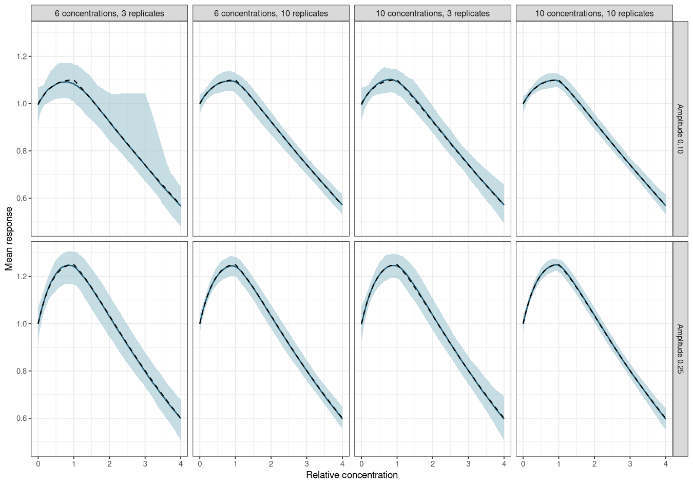
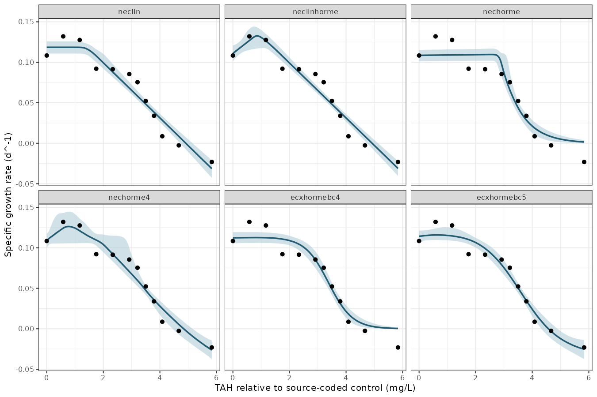

# Abstract

Low concentrations of a toxicant can increase a measured biological response before higher concentrations reduce it, a pattern termed hormesis. A threshold equation that allows this pattern can place its breakpoint at the response maximum, although the response at that concentration already differs from its unexposed value. Where that breakpoint is used as a no-effect concentration in deriving water quality guideline values, it marks a stimulated response and not an absence of effect. We distinguish four locations on a hormetic curve: the peak, the descending return to the control (the limiting dose for stimulation), a control-based effect concentration (ECx) and a post-peak no-significant-effect concentration (NSEC). The first three have been defined and estimated in the hormesis literature, and we propose the fourth as an extension of the NSEC. We review how international and jurisdictional methods treat stimulation, conduct an exploratory design simulation, and fit a monotone comparator and five hormesis equations to individual growth rates of the tropical marine symbiont *Cladocopium goreaui*. We fit the five hormesis equations to lettuce shoot biomass, with an additional log-dose sensitivity fit. Most of the methods reviewed retain stimulated observations and measure inhibition against the true control, although none defines a regression-based no-effect estimate for a hormetic curve. For *C. goreaui*, the threshold hormesis equation `neclinhorme` placed its peak at 0.91 mg/L total aromatic hydrocarbons and its post-peak NSEC at 2.01 mg/L. However, its linear declining limb overpredicted growth at 1.75 mg/L, where the observed mean was 15% below the control, and Gaussian posterior predictions gave nearly twice the observed control spread. None of the broader set resolved the local lack of fit. The lettuce models fitted on raw concentration likewise missed much of the low-dose rise; a log-dose fit gave a different NSEC. A control-based NSEC is a more coherent default no-effect estimand for a hormetic curve than its peak parameter. However, the Australian and New Zealand definition of the NSEC applies to monotone curves, and evidence from these case studies cannot establish that the proposed extension is safe for guideline derivation.

# Introduction

Water quality guideline values for toxicants are commonly derived by fitting a species sensitivity distribution to a chronic toxicity estimate for each tested species. The Australian and New Zealand method prefers no-effect concentrations (NECs) and no-significant-effect concentrations (NSECs) as those estimates, where the estimate is defensible [@warne2025]. An NEC is the breakpoint of a threshold model, below which the expected response does not differ from the control response [@Fox2010]. An NSEC is the concentration at which a smooth curve falls below a lower quantile of the posterior distribution of the control response (i.e. the highest concentration at which the fitted response is statistically indistinguishable from the control) [@fisherfox2023]. Both quantities were developed for a response that declines monotonically with concentration, and the glossary of the Australian and New Zealand method defines the NSEC using a *monotonically decreasing* model [@warne2025].

Not all concentration–response data decline monotonically. At low concentrations a measured response can rise above the control before falling at higher concentrations, a biphasic pattern termed hormesis [@calabrese2008; @canada2007alga; @usepa2012plants]. Environment Canada's algal test method uses the term only for a rise that is followed by inhibition, and calls an isolated rise stimulation [@canada2007alga], while its statistical guidance prefers the more general term low-dose stimulation, which also includes solvent effects and experimental error [@canada2005stats]. Such responses are common in the algal and aquatic plant tests that supply many chronic guideline inputs. For example, @cedergreen2007 found at least one treatment above 105% of the control in 25–76% of the growth-rate curves for each of *Lemna minor*, *Pseudokirchneriella subcapitata* and two terrestrial plants, and Environment Canada describes low-dose stimulation as perhaps the most common hindrance to the analysis of well-designed sublethal toxicity tests [@canada2005stats]. Literature surveys put the maximum stimulation at about 30–60% above the control [@calabrese2008], and Canadian laboratories regard about 30% as a more likely maximum [@canada2005stats]. However, prevalence estimates drawn from such surveys have been criticised for inadequate control of false positives [@crump2001].

The pattern is descriptive, and it does not by itself establish a beneficial effect or identify a mechanism. A growth factor introduced with the exposure can increase growth; for example, @negri2021condensate suggested that microalgae may use compounds from oil as a source of organic carbon. An organism may also allocate resources to the measured trait at the expense of reproduction or another trait [@forbes2000; @jager2013], and a stimulation of growth can be transient [@cedergreen2008]. The measured endpoint, the true control and any other available endpoints should therefore be examined before the rising limb is interpreted as ecologically harmless. That biological judgement can, however, be made separately from the statistical treatment of the curve.

Test guidelines and statistical guidance from several jurisdictions address stimulation, and most agree on two points. First, stimulated observations are retained and modelled. The revised OECD growth-inhibition test guideline (TG 201), which applies to freshwater algae and cyanobacteria, calls for fitting a standard monotone model and a suitable hormesis model, selecting between them using fit diagnostics and reporting the choice (paragraph 62); it also favours regression on individual replicate responses, uncertainty intervals for effect concentrations and reporting the observed stimulation [@oecd2026tg201]. Environment Canada's statistical guidance recommends fitting a hormesis model to all observations (Option 1 in section 10.3.3) and finds no statistical basis for omitting stimulated concentrations (Option 3) [@canada2005stats]. Similarly, Commission Regulation (EU) 2016/266 advises against deleting stimulated responses where possible [@eu2016alga], and US EPA plant-test guidance favours retaining individual replicates and analysing the influence of stimulation instead of discarding stimulated data [@usepa2012plants]. Second, inhibition is measured against the control. Environment Canada estimates the ICp of a hormesis model in relation to the *true control* and rejects smoothing the control upwards (Option 2), because that creates a reference response not observed in the test [@canada2005stats]. In its metals appendix, the European Chemicals Agency similarly advises that positive effects should not be considered in the derivation of an ECx [@echa2008metals].

These documents differ on when stimulation may be set aside. OECD TG 201 allows stimulation to be ignored only when it is less than 10% above the control and is not statistically significant in an appropriate post hoc test, and recommends a nonparametric method (e.g. linear interpolation with bootstrapping) where neither the monotone nor the hormesis model fits adequately [@oecd2026tg201]. The EU regulation allows small stimulation to be ignored when estimating an EC50, but calls for a special procedure for low ECx values or extreme stimulation, for which it identifies interpolation with bootstrapping and, for extreme stimulation, a hormesis model [@eu2016alga]. Environment Canada's algal method substitutes control responses for stimulated concentrations (Option 4) only where regression is unsuitable and the ICPIN interpolation method is used, so this is a method-specific fallback and not a recommendation to alter the primary observations [@canada2007alga]. US EPA plant-test guidance defines an ICx as a reduction from the smoothed mean control response [@usepa2012plants]. In the ICp procedure that smoothing averages the control with adjacent treatment means until the means no longer increase, and US EPA's whole-effluent guidance notes that it may result in a large upward adjustment in the control mean where low concentrations are stimulated [@usepa2000wet], which is the procedure Environment Canada rejects. The European Chemicals Agency's advice is narrower in scope: it concerns hormesis observed with *essential nutrients* where an EC10 is extrapolated below the lowest tested concentration, for which it recommends a model other than the log-logistic [@echa2008metals].

For no-effect estimates, the guidance addresses hypothesis tests and not regression. Environment Canada treats low-dose stimulation as non-harmful in hypothesis testing (Option 5), so that only effects significantly worse than the true control are considered in designating the NOEC and LOEC [@canada2005stats]. OECD guidance on the statistical analysis of ecotoxicity data recommends pairwise comparison procedures for nonmonotone concentration–response data [@oecd2006stats]. US EPA whole-effluent guidance regards stimulation at low concentrations followed by a decline as a valid concentration–response relationship, for which hypothesis testing and point estimation provide reliable results, whereas an interrupted pattern can severely compromise the identification of a NOEC and LOEC and calls for checks of test conditions, randomisation, within-treatment variability and test sensitivity [@usepa2000wet]. Environment Canada also acknowledges that the calculation cannot decide whether stimulation is biologically adverse [@canada2005stats]. None of these documents defines a regression-based no-effect estimate for a hormetic curve. Across these jurisdictions, the control reference and the retention of observations therefore have stronger support than any particular no-effect definition for a hormetic curve.

Several equations have been proposed to describe a hormetic curve. Brain and Cousens modified the log-logistic model to allow a rising limb [@braincousens1989], and later reparameterisations estimate effect concentrations, the concentration of maximum stimulation and the concentration at which the response returns to the control directly, with their standard errors [@vanewijk1993; @schabenberger1999; @belzpiepho2012]. Cedergreen and colleagues proposed a more flexible empirical form, which detected significant hormesis in 18 of 51 macrophyte curves for which the Brain–Cousens model detected none [@cedergreen2005]. The choice of equation also changes these estimates: across 23 datasets, @belzpiepho2012 found differences of up to 1768% between the estimates from two equations where one was misspecified, compared with up to 26% where both fitted the data. In a Bayesian setting, @kim2015 averaged over monotone and hormetic models to estimate a benchmark dose, whereas the EFSA benchmark-dose guidance recommends Bayesian model averaging over monotone models only, and was not developed for ecotoxicological data [@efsa2022bmd]. `bayesnec` includes two smooth equations based on the Brain–Cousens form (`ecxhormebc4` and `ecxhormebc5`) and six threshold equations with a rising limb (`nechorme`, `nechorme4`, `neclinhorme`, `nechormepwr`, `nechorme4pwr` and `nechormepwr01`) [@fisher2024]. In a monotone threshold equation such as `nec3param`, the `nec` parameter locates the concentration at which a declining response starts. In a threshold hormesis equation, this parameter locates the maximum of the initial rise, where the fitted response already differs from the control. If that value is passed to guideline derivation as a no-effect concentration, its name and its biological interpretation disagree. We encountered this in a mercury growth-rate series for a freshwater alga, in which several low concentrations exceeded the control before a decline. That series is privately shared and is excluded here while permission for its redistribution is sought.

A hormetic curve has at least four locations that could be reported as a no-effect or low-effect concentration (Figure 1). The peak is the concentration of the maximum fitted response, termed M in the reparameterised Brain–Cousens and Cedergreen equations [@schabenberger1999; @belzpiepho2012]. The control return is the first concentration beyond the peak at which the fitted response falls back to the fitted control; Brain and Cousens called it the limiting dose for stimulation (LDS) [@braincousens1989], and Calabrese the zero equivalent point [@calabrese2008; @calabrese2019]. A control-based ECx is the concentration at which the response has fallen x% below the fitted control, measured from the control and not from the stimulated peak, as in the reparameterised hormesis equations [@vanewijk1993; @belzpiepho2012]. The post-peak NSEC, which we propose here, is the concentration on the declining limb at which the fitted response falls below a lower quantile of the posterior distribution of the control, and so extends the definition of @fisherfox2023 to a nonmonotone curve. Only the last two of these locate a decline below the control, and only the NSEC is defined by a statistical comparison with it, which makes it the regression counterpart of Environment Canada's rule for hypothesis tests. A threshold hormesis equation makes the peak an explicit parameter, whereas a smooth Brain–Cousens curve generally has no parameter named `nec`, so a comparison across equations requires a common control-based estimand.


``` r
m <- function(z) 1 + 0.25 * z * exp(1 - z) - 0.15 * pmax(z - 1, 0)
x <- seq(0, 4, length.out = 400)
crossing <- function(target) uniroot(function(z) m(z) - target, c(1.01, 4))$root
locations <- c(Peak = 1, `Control return` = crossing(1),
               `Post-peak NSEC` = crossing(0.95), EC10 = crossing(0.9))
op <- par(mar = c(4.3, 4.4, 1, 0.5))
plot(x, m(x), type = "l", lwd = 2, xlab = "Relative concentration",
     ylab = "Mean response", ylim = c(0.55, 1.3))
abline(h = c(1, 0.95, 0.9), lty = 2, col = "grey60")
text(4, c(1, 0.95, 0.9), c("Control", "Lower reference", "EC10 target"),
     adj = c(1, -0.3), cex = 0.7, col = "grey40")
segments(locations, 0.55, locations, m(locations), lty = 1:4 + 1)
legend("topright", legend = sprintf("%s (%.2f)", names(locations), locations),
       lty = 1:4 + 1, bty = "n", cex = 0.8)
```

<div class="figure" style="text-align: center">

<p class="caption">Figure 1. A theoretical hormetic curve, $m(c)=1+0.25c\exp(1-c)-0.15\max(c-1,0)$, showing the four candidate locations, with each concentration given in the legend. The grey dashed lines mark the control response $m(0)=1$, a lower reference of 0.95 standing in for a lower posterior quantile of the control, and the EC10 target of 0.9.</p>
</div>

``` r
par(op)
```

Here we define these four locations formally and examine how well a design resolves them, using an exploratory simulation. We then fit monotone and hormetic equations to two publicly available datasets. The first is a series of individual growth rates of the marine dinoflagellate symbiont *Cladocopium goreaui*, released with @negri2021condensate, which @fisher2023ieam excluded from their comparison of no-effect estimators because of its hormetic shape. The second is the small `lettuce` dataset distributed with `drc` [@Ritz2016], which we use as a transparent comparison. These assays differ in organism, chemical, endpoint and replication, so they illustrate estimation questions without serving as interchangeable guideline inputs.

# Methods

## Candidate estimands

Let $m(c)$ be the fitted mean at concentration $c$ of an endpoint for which a decrease represents poorer performance. We use the fitted mean at the unexposed treatment (the true control), $m(0)$, as the control response. A hormetic curve has an initial region with $m(c)>m(0)$ and a subsequent region in which the mean falls. The four locations shown in Figure 1 are then defined as follows (Table 1).

| Location | Definition | Interpretation |
| --- | --- | --- |
| Peak (M) | $c_{peak}=\arg\max m(c)$ | Maximum fitted response; the `nec` parameter in a threshold hormesis equation may locate it. |
| Control return (LDS, zero equivalent point) | First descending $c>c_{peak}$ with $m(c)=m(0)$ | The fitted response has returned to the unexposed mean. |
| Control-based ECx | First descending $c$ with $m(c)=m(0)(1-x/100)$ when zero is the effect target | A specified loss from the fitted control, not from the stimulated peak. |
| Post-peak NSEC | First descending $c$ at which $m(c)$ falls to a lower posterior quantile of $m(0)$ | Proposed extension of the NSEC to a nonmonotone response. |

Table 1. Candidate locations on a hormetic curve for an endpoint in which a decrease represents poorer performance, with the names used in the hormesis literature in parentheses.

For a positive peak and a control reference whose lower quantile is below $m(0)$, the peak precedes the control return, which in turn precedes the post-peak NSEC, provided all three crossings occur within the searched concentration range. This ordering follows from the definitions, and it does not imply that the unexposed mean is an ecological safety boundary. The NSEC also depends on the specified tail probability (`sig_val`) and on the precision of the experiment [@fisherfox2023]. For example, an imprecise control response places the lower reference further below $m(0)$, so that the crossing occurs at a higher concentration. The NSEC is therefore a statistical no-effect estimate, not a biological proof of no harm.

@fisherfox2023 defined the NSEC from a monotonically decreasing model as the highest concentration at which the predicted response does not differ significantly from the predicted response at zero concentration. Applied to a hormetic curve, that wording already selects a concentration on the declining limb, because a significant rise is also a significant difference from the control. The post-peak NSEC makes the comparison one-sided, so that only a decline counts as an effect, which matches Environment Canada's treatment of low-dose stimulation as non-harmful in hypothesis tests [@canada2005stats].

In `bayesnec`, `ecx()` measures an effect from the fitted control for each equation in a model set. `nsec()` likewise takes the `sig_val` quantile of the posterior of the control as its reference and returns the first decreasing crossing of that reference. For a threshold hormesis equation, `nec()` returns this NSEC as the no-effect estimate, and `curve_params()` returns the sampled `nec` parameter, which describes the peak. The crossing is post-peak for posterior draws with a fitted rise, whereas a draw without stimulation may cross the reference without an intervening peak. The equation and the location reported should therefore both be identified in a guideline data table.

## Exploratory simulation

We generated a continuous response with a known peak and a declining limb,

$$m(c)=1+a(c/p)\exp(1-c/p)-b\max(c-p,0),$$

where the peak location $p=1$, the decline coefficient $b=0.15$, and the stimulation amplitude $a$ was either 0.10 or 0.25. Gaussian observation error had a standard deviation of 0.08. We varied the number of positive concentrations (five or nine) and the number of replicates per concentration (three or ten), and generated 250 independent datasets for each of the eight designs. The positive concentrations were logarithmically spaced from 0.1 to 4, and each design also contained an unexposed control.

We fitted the generating equation to each dataset by bounded least squares and calculated its peak, its descending return to the fitted control and its control-based EC10. We also located a lower-reference crossing at the fitted control minus 2.326 standard errors (an approximate one-sided 1% Gaussian reference). This last calculation is a plug-in proxy for the NSEC, not `bayesnec`'s posterior NSEC. The simulation therefore checks the separation of the locations and whether a design resolves them; for example, a design whose highest treatment remains above the control cannot identify a descending control return. It cannot establish posterior coverage, model selection performance or guideline protection. The script is `data-raw/hormesis_simulation.R` in the package source.

## Case-study observations

The [public workbook](https://data.aims.gov.au/data-download/615e208d-f6c7-4b2f-b99e-d4fc50614e48/Negri_etal_2021_Experimental-data_Toxicity-thresholds-gas-condensate-oils.xlsx) accompanying @negri2021condensate contains 65 individual specific growth rates of *C. goreaui* (ten no-WAF controls and five replicates at each of 11 exposure concentrations) [@aims2020condensatedata]. The workbook codes the total aromatic hydrocarbon (TAH) concentration of the controls as 1 $\mu$g/L. We retained that source value and subtracted 1 $\mu$g/L from all concentrations to set the no-WAF treatment at zero, then divided by 1000 to report estimates in mg/L TAH relative to this source-coded control. This shift is an analysis convention, because the workbook does not by itself establish that 1 $\mu$g/L was a measured background. The dataset catalogue labels the workbook [CC BY-NC 3.0 Australia](https://researchdata.edu.au/condensate-toxicity-testing/1702929), so the individual observations are imported locally by `data-raw/hormesis_negri.R` and are not redistributed with the GPL-2 package.

The `drc::lettuce` dataset contains shoot biomass after 21 days of exposure to isobutyl alcohol in a nutrient solution, with two observations at each of seven concentrations from zero to 100 mg/L (Figure 2). We copied those 14 observations from the current CRAN source of `drc` (GPL-2). Under the installed `drc` licence text its datasets are not copyright, and no separate restriction appeared with `lettuce.rda`. We cite the original dataset context and `drc` [@vanewijk1993; @Ritz2016]. The small sample and terrestrial endpoint make this a methods example and not an aquatic guideline-value input.


``` r
lettuce <- read.csv(system.file("extdata", "hormesis_lettuce_1993.csv",
                                package = "bayesnec"))
op <- par(mar = c(4.3, 4.4, 1, 0.5))
plot(lettuce$weight ~ log10(lettuce$conc + 0.1), pch = 16,
     col = "#A25D3A88", xaxt = "n", xlab = "Isobutyl alcohol (mg/L)",
     ylab = "Shoot biomass")
axis(1, at = log10(sort(unique(lettuce$conc)) + 0.1),
     labels = sort(unique(lettuce$conc)), cex.axis = 0.75)
with(aggregate(weight ~ conc, lettuce, mean),
     lines(log10(conc + 0.1), weight, lwd = 2))
```

<div class="figure" style="text-align: center">

<p class="caption">Figure 2. The 14 individual lettuce shoot biomass observations. The concentration axis is log10(concentration + 0.1), and the line joins treatment means for visual orientation; it is not a fitted model.</p>
</div>

``` r
par(op)
```

## Model fitting and comparison

We fitted a Gaussian response family with an identity link to both datasets, which permits negative fitted values where the measured endpoint can be negative, as it is for the *C. goreaui* growth rates. On the recorded concentration scale, we fitted five hormesis equations: the linear-limb threshold `neclinhorme`, the exponential threshold forms `nechorme` and `nechorme4`, and the four- and five-parameter smooth Brain–Cousens forms `ecxhormebc4` and `ecxhormebc5`. The marine analysis also included monotone `neclin`. As a sensitivity analysis for the lettuce concentrations, which span more than two orders of magnitude, we fitted `neclinhorme` to `log(concentration + 0.1)`; the offset retains the control. Both unscaled power threshold forms (`nechormepwr` and `nechorme4pwr`) add a fixed rising term of one response unit at 1 mg/L before decline, larger than the observed rise on either response scale. The bounded form `nechormepwr01` cannot represent lettuce biomass above one or negative marine growth. We therefore did not fit these three forms. Each fit used four chains of 2000 iterations, including 1000 warm-up iterations. The five-parameter Brain–Cousens fit needed zero initial values after automatic starts failed. We compared the individual-observation predictive fit of the six marine fits using Pareto-smoothed importance sampling leave-one-out cross-validation (PSIS-LOO) [@vehtari2017]. We also compared posterior fitted means with observed treatment means at each concentration. For each fit, `check_fit()` compared the observed mean and residual standard deviation at each concentration with 1000 posterior predictive datasets. The following code gives the fitted estimates; `curve_params()` returns sampled curve parameters independently of the no-effect summary.


``` r
library(bayesnec)
source("data-raw/hormesis_negri.R") # run from a source checkout
negri <- read.csv("ignore/hormesis_data/hormesis_negri_2021.csv")
negri$conc <- (negri$source_conc_ug_l_tah - 1) / 1000
fit_negri <- bnec(sgr ~ crf(conc, model = "neclinhorme"),
                  data = negri, family = gaussian(),
                  chains = 4, cores = 4, iter = 2000, warmup = 1000,
                  seed = 570,
                  control = list(adapt_delta = 0.995, max_treedepth = 12))
curve_params(fit_negri)
nec(fit_negri) # the reported no-effect estimate
nsec(fit_negri, sig_val = 0.01)
ecx(fit_negri, ecx_val = 10)

fit_negri_smooth <- bnec(sgr ~ crf(conc, model = "ecxhormebc4"),
                         data = negri, family = gaussian(),
                         chains = 4, cores = 4, iter = 2000, warmup = 1000,
                         seed = 570, control = list(adapt_delta = 0.995,
                                                    max_treedepth = 12))
nsec(fit_negri_smooth, sig_val = 0.01)
ecx(fit_negri_smooth, ecx_val = 10)

fit_negri_monotone <- bnec(sgr ~ crf(conc, model = "neclin"),
                           data = negri, family = gaussian(),
                           chains = 4, cores = 4, iter = 2000, warmup = 1000,
                           seed = 570, control = list(adapt_delta = 0.995,
                                                      max_treedepth = 12))
nsec(fit_negri_monotone, sig_val = 0.01)
ecx(fit_negri_monotone, ecx_val = 10)
fit_marine_nechorme <- bnec(sgr ~ crf(conc, model = "nechorme"),
                            data = negri, family = gaussian(), chains = 4,
                            cores = 4, iter = 2000, warmup = 1000, seed = 570,
                            control = list(adapt_delta = 0.995,
                                           max_treedepth = 12))
fit_marine_nechorme4 <- bnec(sgr ~ crf(conc, model = "nechorme4"),
                             data = negri, family = gaussian(), chains = 4,
                             cores = 4, iter = 2000, warmup = 1000, seed = 570,
                             control = list(adapt_delta = 0.995,
                                            max_treedepth = 12))
fit_marine_bc5 <- bnec(sgr ~ crf(conc, model = "ecxhormebc5"),
                       data = negri, family = gaussian(), chains = 4,
                       cores = 4, iter = 2000, warmup = 1000, seed = 570,
                       init = 0, control = list(adapt_delta = 0.995,
                                                max_treedepth = 12))
marine_fits <- list(neclin = fit_negri_monotone,
                    neclinhorme = fit_negri,
                    nechorme = fit_marine_nechorme,
                    nechorme4 = fit_marine_nechorme4,
                    ecxhormebc4 = fit_negri_smooth,
                    ecxhormebc5 = fit_marine_bc5)
loo::loo_compare(list(
  neclin = loo::loo(fit_negri_monotone$fit),
  neclinhorme = loo::loo(fit_negri$fit),
  nechorme = loo::loo(fit_marine_nechorme$fit),
  nechorme4 = loo::loo(fit_marine_nechorme4$fit),
  ecxhormebc4 = loo::loo(fit_negri_smooth$fit),
  ecxhormebc5 = loo::loo(fit_marine_bc5$fit)
))

# Fitted and observed means at each tested concentration
treatments <- data.frame(conc = sort(unique(negri$conc)))
fitted_mean <- sapply(marine_fits, function(f) {
  apply(brms::posterior_epred(f$fit, newdata = treatments), 2, median)
})
cbind(treatments, observed = tapply(negri$sgr, negri$conc, mean), fitted_mean)

fit_lettuce <- bnec(weight ~ crf(conc, model = "neclinhorme"),
                    data = lettuce, family = gaussian(),
                    chains = 4, cores = 4, iter = 2000, warmup = 1000,
                    seed = 570, control = list(adapt_delta = 0.99))
curve_params(fit_lettuce)
nsec(fit_lettuce, sig_val = 0.01)
ecx(fit_lettuce, ecx_val = 10)
fit_lettuce_nechorme <- bnec(weight ~ crf(conc, model = "nechorme"),
                             data = lettuce, family = gaussian(), chains = 4,
                             cores = 4, iter = 2000, warmup = 1000, seed = 570,
                             control = list(adapt_delta = 0.99,
                                            max_treedepth = 12))
fit_lettuce_nechorme4 <- bnec(weight ~ crf(conc, model = "nechorme4"),
                              data = lettuce, family = gaussian(), chains = 4,
                              cores = 4, iter = 2000, warmup = 1000, seed = 570,
                              control = list(adapt_delta = 0.99,
                                             max_treedepth = 12))
fit_lettuce_ecxhormebc4 <- bnec(weight ~ crf(conc, model = "ecxhormebc4"),
                                data = lettuce, family = gaussian(), chains = 4,
                                cores = 4, iter = 2000, warmup = 1000,
                                seed = 570, control = list(adapt_delta = 0.99,
                                                           max_treedepth = 12))
fit_lettuce_bc5 <- bnec(weight ~ crf(conc, model = "ecxhormebc5"),
                        data = lettuce, family = gaussian(), chains = 4,
                        cores = 4, iter = 2000, warmup = 1000, seed = 570,
                        init = 0, control = list(adapt_delta = 0.99,
                                                 max_treedepth = 12))
fit_lettuce_log_neclinhorme <- bnec(
  weight ~ crf(log(conc + 0.1), model = "neclinhorme"),
  data = lettuce, family = gaussian(), chains = 4, cores = 4,
  iter = 2000, warmup = 1000, seed = 570,
  control = list(adapt_delta = 0.99, max_treedepth = 12)
)

saveRDS(fit_negri, "ignore/hormesis_data/fit_neclinhorme.rds")
saveRDS(fit_negri_smooth, "ignore/hormesis_data/fit_ecxhormebc4.rds")
saveRDS(fit_negri_monotone, "ignore/hormesis_data/fit_neclin.rds")
saveRDS(fit_marine_nechorme, "ignore/hormesis_data/fit_marine_nechorme.rds")
saveRDS(fit_marine_nechorme4, "ignore/hormesis_data/fit_marine_nechorme4.rds")
saveRDS(fit_marine_bc5, "ignore/hormesis_data/fit_marine_bc5.rds")
saveRDS(fit_lettuce, "ignore/hormesis_data/fit_lettuce.rds")
saveRDS(fit_lettuce_nechorme, "ignore/hormesis_data/fit_lettuce_nechorme.rds")
saveRDS(fit_lettuce_nechorme4, "ignore/hormesis_data/fit_lettuce_nechorme4.rds")
saveRDS(fit_lettuce_ecxhormebc4,
        "ignore/hormesis_data/fit_lettuce_ecxhormebc4.rds")
saveRDS(fit_lettuce_bc5, "ignore/hormesis_data/fit_lettuce_bc5.rds")
saveRDS(fit_lettuce_log_neclinhorme,
        "ignore/hormesis_data/fit_lettuce_log_neclinhorme.rds")
source("data-raw/hormesis_fit_plots.R")
```

# Results

## Simulation study


``` r
sim <- read.csv(system.file("extdata", "hormesis_simulation_summary.csv",
                            package = "bayesnec"))
sim$cell <- sprintf("%.2f (%.2f–%.2f)", sim$median, sim$q025, sim$q975)
wide <- reshape(sim[, c("amplitude", "levels", "replicates", "metric", "cell")],
                idvar = c("amplitude", "levels", "replicates"),
                timevar = "metric", direction = "wide")
wide <- wide[order(wide$amplitude, wide$levels, wide$replicates), ]
knitr::kable(
  wide[, c("amplitude", "levels", "replicates", "cell.peak", "cell.return",
           "cell.lower_crossing", "cell.ec10")],
  row.names = FALSE,
  col.names = c("Amplitude", "Concentrations", "Replicates", "Peak",
                "Control return", "Lower-reference crossing", "EC10"),
  caption = paste("Table 2. Median (2.5–97.5% range) of the fitted locations",
                  "across 250 simulated datasets per design. Concentrations",
                  "include the control. The ranges are simulation quantiles,",
                  "not credible intervals. The true peak is 1; the true control",
                  "return is 1.59 (amplitude 0.10) or 2.14 (0.25), and the true",
                  "EC10 is 2.13 or 2.56. Between 98.8% and 100% of fits",
                  "converged in each design.")
)
```


Table: Table 2. Median (2.5–97.5% range) of the fitted locations across 250 simulated datasets per design. Concentrations include the control. The ranges are simulation quantiles, not credible intervals. The true peak is 1; the true control return is 1.59 (amplitude 0.10) or 2.14 (0.25), and the true EC10 is 2.13 or 2.56. Between 98.8% and 100% of fits converged in each design.

| Amplitude| Concentrations| Replicates|Peak             |Control return   |Lower-reference crossing |EC10             |
|---------:|--------------:|----------:|:----------------|:----------------|:------------------------|:----------------|
|      0.10|              6|          3|1.01 (0.57–3.00) |1.62 (0.82–3.02) |2.06 (1.39–3.20)         |2.15 (1.54–3.24) |
|      0.10|              6|         10|1.00 (0.72–1.32) |1.60 (1.24–1.91) |1.85 (1.53–2.15)         |2.14 (1.85–2.41) |
|      0.10|             10|          3|1.00 (0.66–1.54) |1.66 (1.09–2.10) |2.07 (1.54–2.51)         |2.16 (1.72–2.57) |
|      0.10|             10|         10|1.00 (0.80–1.29) |1.62 (1.35–1.83) |1.85 (1.59–2.05)         |2.14 (1.93–2.33) |
|      0.25|              6|          3|0.98 (0.72–1.42) |2.13 (1.66–2.52) |2.51 (2.02–2.97)         |2.56 (2.14–2.93) |
|      0.25|              6|         10|1.00 (0.82–1.24) |2.13 (1.89–2.37) |2.32 (2.11–2.57)         |2.55 (2.32–2.77) |
|      0.25|             10|          3|1.00 (0.80–1.34) |2.16 (1.76–2.50) |2.48 (2.10–2.84)         |2.57 (2.23–2.93) |
|      0.25|             10|         10|1.00 (0.86–1.15) |2.14 (2.00–2.30) |2.33 (2.19–2.49)         |2.56 (2.42–2.71) |


``` r
sim_curves <- read.csv(system.file("extdata", "hormesis_simulation_fitted_curves.csv",
                                   package = "bayesnec"))
sim_curves$design <- factor(
  sprintf("%d concentrations, %d replicates",
          sim_curves$levels, sim_curves$replicates),
  levels = c("6 concentrations, 3 replicates",
             "6 concentrations, 10 replicates",
             "10 concentrations, 3 replicates",
             "10 concentrations, 10 replicates")
)
sim_curves$amplitude <- factor(sim_curves$amplitude,
                               levels = c(0.1, 0.25),
                               labels = c("Amplitude 0.10", "Amplitude 0.25"))
ggplot2::ggplot(sim_curves, ggplot2::aes(x = conc)) +
  ggplot2::geom_ribbon(ggplot2::aes(ymin = fitted_q025, ymax = fitted_q975),
                       fill = "#A9CAD5", alpha = 0.65) +
  ggplot2::geom_line(ggplot2::aes(y = fitted_median),
                     colour = "#245D73", linewidth = 0.6) +
  ggplot2::geom_line(ggplot2::aes(y = true_mean), linetype = "dashed",
                     linewidth = 0.5) +
  ggplot2::facet_grid(amplitude ~ design) +
  ggplot2::labs(x = "Relative concentration", y = "Mean response") +
  ggplot2::theme_bw(base_size = 9) +
  ggplot2::theme(strip.text.x = ggplot2::element_text(size = 8))
```

<div class="figure" style="text-align: center">

<p class="caption">Figure 3. Generating curves (dashed black) and median fitted curves (blue) across 250 simulated datasets per design. Shading gives the 2.5–97.5% range of the fitted mean at each concentration across datasets, excluding observation error. Each panel names the stimulation amplitude, total number of concentrations including the control, and replicates per concentration.</p>
</div>

Across the eight designs, the median fitted peak was within 0.02 of its true value, and the median control return and EC10 were within 0.07 of theirs (Table 2). Their spread depended mainly on the stimulation amplitude and on replication. With weak stimulation, three replicates and six concentrations, the 2.5–97.5% range of the peak extended from 0.57 to the upper bound of the fit (3), and that of the control return from 0.82 to 3.02. With strong stimulation, ten replicates and ten concentrations, the corresponding ranges were 0.86–1.15 and 2.00–2.30, and the median return of 2.14 matched the true return of the generating curve. Increasing the number of concentrations from six to ten narrowed these ranges with weak stimulation and three replicates, but changed the medians by less than 0.04.

Across the 250 fits in each design, the median fitted mean followed the generating curve (Figure 3). The between-dataset range was wider with three replicates, particularly when the stimulation amplitude was 0.10; ten replicates narrowed it around the peak and on the declining limb. These bands describe uncertainty across simulated experiments, not a posterior predictive interval for one observation.

The lower-reference crossing depended on replication as well as on the curve. With weak stimulation and six concentrations, its median was 2.06 with three replicates and 1.85 with ten; with strong stimulation the corresponding medians were 2.51 and 2.32. With three replicates the median crossing was 0.05–0.10 below the median EC10, whereas with ten replicates it was 0.23–0.30 below it. These contrasts show the ordering implied by the definitions, and why a peak cannot be substituted for a control-based no-effect location. They also suggest, at least for this generating curve, that the precision of the control response largely determines how far beyond the control return the NSEC falls. They do not measure how well the Bayesian NSEC performs, because the proxy uses a Gaussian plug-in uncertainty calculation.

## *Cladocopium goreaui* growth rates

The ten *C. goreaui* controls had a mean specific growth rate of 0.108 d^-1^. The treatment means at 0.58 and 1.17 mg/L TAH were 22% and 18% above the control mean, and the means from 1.75 to 2.92 mg/L were 79–85% of it, before a steep decline to negative growth rates at the highest concentrations. The 22% rise exceeds the 10% size condition in OECD TG 201, although that test guideline applies to freshwater algae and also requires a statistical test before stimulation can be ignored.

The threshold hormesis fit (`neclinhorme`) gave a peak parameter of 0.91 mg/L TAH relative to the source-coded control (95% credible interval 0.59–1.47), while its NSEC was 2.01 mg/L TAH (1.81–2.20; Table 3). The fitted curve at this NSEC was 10.8% below the fitted control at the posterior median. The five-parameter Brain–Cousens equation (`ecxhormebc5`) had the highest expected log predictive density, but exceeded `neclinhorme` by only 3.3 (standard error 3.8), so that difference is unresolved. It also had three divergent transitions. All PSIS-LOO Pareto $k$ estimates were below 0.5.

| Equation | Fitted control (d^-1^) | NSEC, mg/L TAH (95% CrI) | Effect at NSEC | EC10, mg/L TAH (95% CrI) | Difference in ELPD (SE) | Divergent transitions |
| --- | --- | --- | --- | --- | --- | --- |
| `neclin`, monotone | 0.119 | 1.71 (1.42–2.04) | 7.9% | 1.77 (1.49–2.23) | −7.7 (2.9) | 0 |
| `neclinhorme`, linear threshold | 0.111 | 2.01 (1.81–2.20) | 10.8% | 1.98 (1.64–2.29) | −3.3 (3.8) | 1 |
| `nechorme`, exponential threshold | 0.109 | 2.90 (2.73–3.15) | 7.9% | 2.91 (2.75–3.17) | −15.2 (4.4) | 0 |
| `nechorme4`, four-parameter threshold | 0.109 | 2.18 (1.90–2.94) | 10.2% | 2.27 (1.81–2.94) | −7.9 (2.2) | 0 |
| `ecxhormebc4`, smooth hormesis | 0.112 | 2.33 (1.82–2.66) | 6.9% | 2.50 (2.08–2.85) | −7.4 (3.9) | 0 |
| `ecxhormebc5`, five-parameter smooth | 0.114 | 2.12 (1.76–2.41) | 8.7% | 2.19 (1.75–2.56) | 0 (reference) | 3 |

Table 3. Four-chain fits to individual *C. goreaui* growth rates. The fitted control is the posterior median of the mean at zero concentration, against an observed control mean of 0.108 d^-1^. The effect at the NSEC is the posterior median decline from the fitted control. NSEC was calculated for all equations to compare a common control-based location; the usual default for monotone `neclin` is its sampled NEC. Divergent transitions remained despite `adapt_delta = 0.995`; their estimates warrant caution. ELPD, expected log predictive density from PSIS-LOO. These fits do not establish a guideline input without exposure checks and a fuller posterior predictive assessment.

<div class="figure" style="text-align: center">

<p class="caption">Figure 4. Fitted means (blue) and their 95% credible bands (shaded) for six equations fitted to individual *C. goreaui* growth rates. Black points are treatment means calculated from the Negri et al. (2021) workbook (CC BY-NC 3.0 Australia); individual observations are not redistributed with the package. TAH concentrations are relative to the source-coded control.</p>
</div>

The six equations represented the stimulated region differently (Figure 4). The monotone `neclin` fit placed the control response at 0.119 d^-1^, 9% above the observed control mean, because its constant upper limb was fitted to the control and the two stimulated treatments together. `nechorme` and both smooth Brain–Cousens fits showed little rise. The `neclinhorme` linear declining limb overpredicted growth at 1.75 mg/L (fitted 0.108 d^-1^, observed 0.092 d^-1^) and underpredicted it at 2.92 mg/L (fitted 0.068 d^-1^, observed 0.085 d^-1^); its NSEC of 2.01 mg/L is above a treatment with an observed 15% decline from the control. `nechorme4` and `ecxhormebc5` also missed the 1.75 mg/L treatment mean. The additional equations therefore change the estimated locations and overall predictive ranking without resolving the fit near the control crossing.

In 1000 posterior predictive datasets for the marine `neclinhorme` fit, the observed mean was outside the central 95% predictive range at 1.75, 2.92, 3.21 and 4.08 mg/L TAH (`check_fit()` upper-tail probabilities 0.986, 0.007, 0.007 and 0.995, respectively). For `ecxhormebc5`, the corresponding probabilities were 0.016 at 0.58 mg/L and 0.994 at 1.75 mg/L, so its better overall predictive score did not resolve the low-dose pattern. At the control, the observed residual standard deviation was 0.0076 d^-1^, compared with a median simulated value of 0.0145 d^-1^ for `neclinhorme` and 0.0135 d^-1^ for `ecxhormebc5` (upper-tail probabilities 0.985 and 0.970). The constant Gaussian residual standard deviation thus overstates variation at the control. The five observations per positive concentration provide limited evidence about the shape of the within-treatment error distribution.

@negri2021condensate reported an NEC of 3.1 mg/L TAH (95% credible interval 2.9–3.4) and an EC10 of 2.67 mg/L (2.31–2.95) for these data from fits with `jagsNEC`, and used the EC10, the lower of the two, as the *C. goreaui* input to their species sensitivity distribution. The published EC10 is above the EC10 from five of the six equations fitted here; the exception is `nechorme`, which fits this series poorly by PSIS-LOO. Both published values exceed 2.33 mg/L, where the observed mean growth rate was 16% below the control. We have not reproduced the published fits, so the cause of the difference is not established here.

## Lettuce biomass

The lettuce mean at 1 mg/L was approximately 28% above the control mean, followed by lower biomass at higher concentrations (Figure 2). However, the two control observations (0.83 and 1.13) differed by more than the rise from the control mean to the 1 mg/L mean, so the control response is imprecise. The lettuce assay falls outside the scope of OECD TG 201, and its rise and the marine rise may reflect different processes, which these observations cannot identify. On the raw concentration scale, all five fitted equations allowed hormesis, yet none reproduced much of the observed rise from 0.98 at the control to 1.25 at 1 mg/L (Table 4; Figure 5). The `neclinhorme` fit had 16 divergent transitions and an uncertain peak parameter (2.3 mg/L, 95% credible interval 0.2–23.7). Its fitted mean was 0.95 at both zero and 1 mg/L. The low concentrations occupy only about 3% of the tested linear range, and its post-peak linear limb must also cover the decline through 100 mg/L.

| Equation and predictor | Fitted control | Fitted mean at 1 mg/L | NSEC, mg/L (95% CrI) | Divergent transitions |
| --- | --- | --- | --- | --- |
| `neclinhorme`, raw concentration | 0.951 | 0.953 | 35.11 (13.94–81.32) | 16 |
| `nechorme`, raw concentration | 1.009 | 1.010 | 13.47 (4.84–28.76) | 0 |
| `nechorme4`, raw concentration | 1.063 | 1.087 | 4.60 (1.90–13.85) | 2 |
| `ecxhormebc4`, raw concentration | 1.000 | 0.989 | 15.71 (4.02–36.27) | 0 |
| `ecxhormebc5`, raw concentration | — | — | — | 187 |
| `neclinhorme`, log(concentration + 0.1) | 1.044 | 1.095 | 5.90 (2.98–10.20) | 0 |

Table 4. Posterior median fitted means and control-based NSECs for lettuce shoot biomass. Observed treatment means were 0.979 at the control and 1.250 at 1 mg/L. The 187 divergent transitions in `ecxhormebc5` make its summaries unsuitable for interpretation or plotting. NSEC values from the other fits are shown to expose model sensitivity, not as guideline estimates.

<div class="figure" style="text-align: center">

<p class="caption">Figure 5. Fitted means (brown) and 95% credible bands (shaded) for five lettuce fits. Pale points are individual observations and black points are treatment means. The display axis is log10(concentration + 0.1); only the last panel uses this transformed predictor in the fitted equation. The five-parameter Brain–Cousens fit is omitted because it had 187 divergent transitions.</p>
</div>

The log-dose `neclinhorme` sensitivity fit produced a modest hump, with fitted means of 1.044 and 1.095 at zero and 1 mg/L, but still fell short of the observed mean of 1.250 at 1 mg/L. Its NSEC of 5.90 mg/L differed greatly from the raw-dose fit's 35.11 mg/L. In 1000 posterior predictive datasets, `check_fit()` gave upper-tail probabilities of 0.061 for the raw-dose fit and 0.086 for the log-dose fit at 1 mg/L; neither treatment mean fell outside the central 95% predictive range. With only two observations per treatment, this check has little power. The log-dose fit also had a PSIS-LOO Pareto $k$ estimate of 0.85, so we do not rank lettuce models by their approximate predictive scores. The response scale, divergent transitions and uncertain declining shapes prevent these NSEC values from serving as guideline estimates.

# Discussion

For a hormetic growth response, the Canadian statistical guidance and the OECD freshwater algal test guideline support retaining stimulated observations in an appropriate model and assessing subsequent inhibition relative to the unexposed control [@canada2005stats; @oecd2026tg201]. Neither defines an NSEC for a nonmonotone curve. The peak is a useful shape parameter, especially when a threshold equation makes it explicit, but it cannot represent a concentration at which the endpoint remains unchanged. A post-peak NSEC has a more relevant statistical meaning for guideline-value work because it locates a decline beyond the lower reference bound of the control. The ECx and the percent effect at the NSEC should also be reported, since a statistically defined crossing may correspond to a nontrivial reduction in response (10.8% for the *C. goreaui* `neclinhorme` fit).

The *C. goreaui* fits suggest that the choice of equation changes the reference as well as the curve. A monotone equation fitted to a stimulated series raises its fitted control towards the stimulated means, which is in effect the upward smoothing of the control that Environment Canada rejects. Environment Canada notes that applying common techniques to stimulated data often overestimates the control performance and lowers the endpoint [@canada2005stats], and the `neclin` fit followed that pattern: its fitted control was the highest of the six and its NSEC and EC10 the lowest (Table 3). Excluding hormesis equations from a candidate set therefore does not avoid the problem of stimulation, and it may make the reference less faithful to the observed control. The shape of the declining limb near the control level also determines where the NSEC falls. For example, agreement in EC10 does not establish agreement in NSEC if the descending limbs differ near the control response, and in the *C. goreaui* case the linear declining limb of `neclinhorme` placed the NSEC above a treatment with an observed 15% decline. The sensitivity of estimates to curve shape is consistent with the large differences between misspecified and well-fitting hormesis equations reported by @belzpiepho2012. The overpredicted control spread also indicates that a constant Gaussian residual standard deviation is inadequate for these data. The published EC10 for these data is a further example, because it entered a species sensitivity distribution at a concentration above treatments with observed declines of 15–16%. Model comparison should therefore use a common control-based estimand across candidate equations, and should report the fit of each equation to the stimulated and declining regions, in particular at the treatments nearest the crossing. A different error model or a more flexible declining limb may resolve such data better, but neither has been tested here. The strong sensitivity of the lettuce NSEC to the predictor transformation reinforces the need to check the fitted curve against the actual low-dose pattern.

The preference for a control-based NSEC does not resolve the ecological meaning of stimulation. If increased growth draws resources from reproduction, a growth-based NSEC could miss an adverse effect below the peak [@forbes2000; @jager2013]. If the stimulus comes from nutrients or an organic carbon source in a mixture, the curve may describe a mixture effect whose relevance changes with receiving-water chemistry. @kefford2008 argued that incorporating stimulation into ecotoxicology requires assumptions and value judgements, could lower water quality standards, and is not clearly necessary except perhaps in fitting concentration–response curves, and @chapman2002 placed its consideration in detailed, not screening-level, ecological risk assessment. The post-peak NSEC is a proposal of the limited kind Kefford and colleagues allow: it changes where a fitted curve is read, and it does not treat stimulation as a benefit. A chemical-specific guideline must therefore examine exposure measurement, endpoint relevance, other traits and the evidence for the mechanism. For metals, the European Chemicals Agency's advice to use measured concentrations and to document how medium chemistry and background affect bioavailability is relevant to this examination, although its essential-nutrient advice cannot be assumed to apply to a non-essential metal such as mercury [@echa2008metals]. An estimate censored above the tested concentrations or dependent on a poorly fitting declining limb should be reported as unresolved, even if a point value can be calculated; US EPA plant-test guidance similarly assigns lower confidence to endpoints extrapolated beyond the tested concentrations [@usepa2012plants].

The Australian and New Zealand NSEC definition refers to a monotonically decreasing model [@warne2025]. Before a hormetic extension is used as a routine chronic input to an Australian and New Zealand species sensitivity distribution, a full Bayesian simulation should evaluate bias, posterior coverage, censoring, model misspecification, weak stimulation, concentration placement and replicate allocation. Design should be part of that evaluation. @calabrese1998 associated high to moderate evidence for hormesis with studies of more than six doses, more than three of them in the hormetic zone, and the estimated maximum stimulation increases with the number of doses below the zero equivalent point [@calabrese2019]. Optimal designs for detecting hormesis and for estimating the threshold dose and the zero equivalent point have been derived [@dette2011; @casero2018], and a simulation of the post-peak NSEC should compare such designs with those of standard test guidelines. The exploratory simulation here isolates the geometric and design question. The marine case supplies an analysis previously deferred because of its hormetic shape, and lettuce exposes the limitations of a small, freely available example. Together they provide a reproducible basis for the additional validation, and a clear distinction between a curve parameter and the guideline estimand.

# Reproducibility

The *C. goreaui* fits were run outside the vignette build, because the individual observations are not redistributed with the package, and their code is shown but not evaluated here. The original four fitted objects were sampled with `seed = 570` on `bayesnec` commit `a1fcf719`; the additional fits used the same seed and unchanged equation code on commit `0b8acbdd` (`brms` 2.23.0, `rstan` 2.32.7, R 4.6.1). The saved fits were checked with `check_fit()` using 1000 posterior predictive draws per fit and seed 570; `data-raw/hormesis_fit_plots.R` recreates Figures 4 and 5 and prints the checks from those fits. The simulation summary in Table 2 and fitted curves in Figure 3 are stored in `inst/extdata/hormesis_simulation_summary.csv` and `inst/extdata/hormesis_simulation_fitted_curves.csv`, generated together by `data-raw/hormesis_simulation.R` with seed 570. The lettuce observations in Figure 2 are read from `inst/extdata/hormesis_lettuce_1993.csv`.

# References
