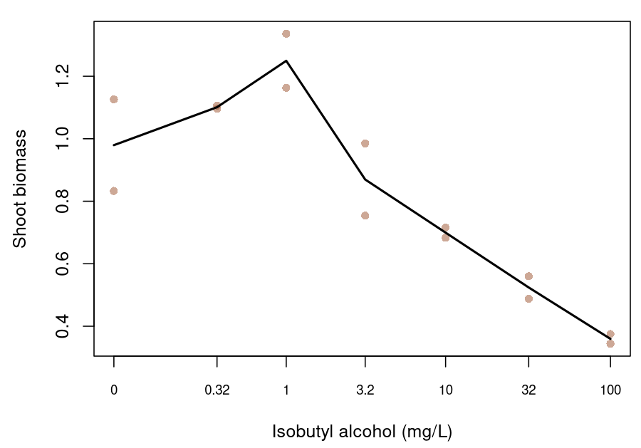

# Introduction

Low concentrations of a toxicant can increase a measured biological response before higher concentrations reduce it, a biphasic pattern termed hormesis [@calabrese2008]. Environment Canada's algal test method reserves the term for a rise that is followed by inhibition at higher concentrations, and its statistical guidance prefers the more general term low-dose stimulation, which also covers solvent effects and experimental error [@canada2007alga; @canada2005stats]. Stimulation is frequent in the algal and aquatic plant growth tests that supply many chronic inputs to water quality guideline values. For example, among curves for nine herbicides and a fungicide, @cedergreen2007 found at least one treatment above 105% of the control in 25–76% of the growth-rate curves for each of four plant and algal species, and Environment Canada describes low-dose stimulation as perhaps the most common hindrance to the analysis of well-designed sublethal toxicity tests [@canada2005stats]. Reviews of the literature put the maximum stimulation at about 30–60% above the control [@calabrese2008; @calabrese2019], although Canadian laboratories regard about 30% as a more likely maximum [@canada2005stats].

The pattern is descriptive, and it does not by itself establish a beneficial effect. A nutrient or other growth factor added with the test material can increase growth [@canada2005stats]; for example, @negri2021condensate suggested that microalgae may use compounds from oil as a source of organic carbon. An organism may also allocate resources to growth at the expense of reproduction or another trait [@forbes2000; @jager2013], and a stimulation of growth can be transient [@cedergreen2008]. @braincousens1989 also cautioned that apparent stimulation may often be an illusion where responses are standardised to a control mean that is treated as known without error, so the uncertainty in the control is part of any comparison with it. The biological meaning of a rise is therefore a question for the endpoint and the test system, and it can be kept separate from the statistical question of where a fitted curve should be read.

`bayesnec` fits hormetic data with two kinds of equation [@fisher2024]. The threshold hormesis equations (`nechorme`, `nechorme4`, `neclinhorme`, `nechormepwr`, `nechorme4pwr` and `nechormepwr01`) add a rising term at every concentration and start a declining term at the `nec` parameter, whereas the smooth equations `ecxhormebc4` and `ecxhormebc5` are based on the Brain–Cousens form [@braincousens1989] and have no `nec` parameter. In a monotone threshold equation such as `nec3param`, the fitted response is at its control level up to the `nec` parameter, which is therefore a no-effect concentration (NEC) [@Fox2010]. In a threshold hormesis equation, by contrast, a positive fitted rise places the response at `nec` above the control. In `neclinhorme` the rise and the decline are both linear, so a curve that declines beyond `nec` has its maximum there. In `nechorme` and `nechorme4` the rise can continue for a short distance beyond `nec` before the exponential decline overtakes it, so the parameter is at or below the peak. Reporting the `nec` parameter of these equations as an NEC would therefore report a concentration at which the response is stimulated. Below we describe what `bayesnec` returns instead, and apply it to two published datasets.

Test guidelines and statistical guidance from several jurisdictions agree on two points about stimulation. First, stimulated observations are retained and modelled. OECD TG 201 calls for fitting a monotone and a hormesis model and choosing between them on fit diagnostics [@oecd2026tg201], Environment Canada recommends fitting a hormesis model to all observations and finds no statistical basis for omitting stimulated concentrations [@canada2005stats], and EU and US EPA guidance advise against deleting stimulated responses [@eu2016alga; @usepa2012plants]. Second, inhibition is measured against the true control. Environment Canada rejects smoothing the control upwards towards the stimulated treatments, because that creates a reference response not observed in the test [@canada2005stats], and the European Chemicals Agency advises that positive effects should not be considered in deriving an ECx [@echa2008metals]. For no-effect estimates from stimulated data, the guidance addresses hypothesis tests only. Environment Canada treats stimulation as non-harmful, so that only effects significantly worse than the true control count in designating a no-observed-effect concentration (NOEC) [@canada2005stats], and the OECD recommends pairwise comparisons for nonmonotone data [@oecd2006stats]. None of these documents defines a regression-based no-effect estimate for a hormetic curve, and the Australian and New Zealand method, which prefers the NEC and the no-significant-effect concentration (NSEC) as guideline inputs, defines the NSEC using a monotonically decreasing model [@warne2025].

A hormetic curve has at least four locations that could be reported as a no-effect or low-effect concentration (Figure 1; Table 1). The peak, and the descending return to the control that Brain and Cousens called the limiting dose for stimulation (LDS), are established hormesis quantities [@braincousens1989; @belzpiepho2012]. A control-based ECx measures a decline from the fitted control and not from the peak [@vanewijk1993; @belzpiepho2012]. The post-peak NSEC extends the NSEC of @fisherfox2023 to a hormetic curve: it is the first concentration on the declining limb at which the fitted mean falls below a lower quantile of the posterior distribution of the control. Only the ECx and the NSEC locate a decline below the control, and only the NSEC is defined by a statistical comparison with it, which makes it the regression counterpart of Environment Canada's rule for hypothesis tests.

<div class="figure" style="text-align: center">

<p class="caption">Figure 1. A theoretical hormetic curve, $m(c)=1+0.25c\exp(1-c)-0.15\max(c-1,0)$, showing the four candidate locations, with each concentration given in the legend. The grey dashed lines mark the control response $m(0)=1$, a lower reference of 0.95 standing in for a lower posterior quantile of the control, and the EC10 target of 0.9. The peak is labelled with the `nec` parameter because, in a threshold hormesis equation, that parameter is where the decline starts: at the peak in `neclinhorme`, and at or just below it in `nechorme` and `nechorme4`. This applies only to the threshold hormesis equations; the smooth equations `ecxhormebc4` and `ecxhormebc5` have no `nec` parameter.</p>
</div>

| Location | Definition, for fitted mean $m(c)$ and fitted control $m(0)$ |
| --- | --- |
| Peak (M) | Concentration of the maximum fitted response |
| Control return (LDS) | First descending concentration with $m(c)=m(0)$ |
| Control-based ECx | First descending concentration with $m(c)=m(0)(1-x/100)$ |
| Post-peak NSEC | First descending concentration at which $m(c)$ falls to a lower posterior quantile of $m(0)$ |

Table 1. Candidate locations on a hormetic curve for an endpoint in which a decrease represents poorer performance.

@fisherfox2023 defined the NSEC as the highest concentration at which the predicted response does not differ significantly from the predicted response at zero concentration. Applied to a hormetic curve, that wording already selects a concentration on the declining limb, because a significant rise is also a significant difference from the control. The post-peak NSEC makes the comparison one-sided, so that only a decline counts as an effect. The NSEC is a statistical no-effect estimate in the sense that a NOEC is one. However, it is interpolated from the fitted curve between the tested concentrations, so it does not depend directly on where the treatments were placed, and it has a credible interval [@fisherfox2023; @fisher2023ieam]. Like a NOEC, it also has a non-zero effect associated with it [@fisher2023ieam], which we call the ECNSEC: the percentage decline of the fitted mean at the NSEC from the fitted control. The Australian and New Zealand method asks for this effect size to be considered, and suggests that an NSEC with an effect above 20% should probably not be used to derive a guideline value [@warne2025]. The ECNSEC depends on the precision of the control response, because an imprecise control places the lower quantile further below the fitted control, and the NSEC then falls at a higher concentration.

The formal definitions, an exploratory design simulation and a fuller review of the guidance are given in the accompanying [research compendium](https://github.com/open-AIMS/hormesis-nsec-compendium).

## Implementation in `bayesnec`

`bayesnec` returns these quantities as follows. `nsec()` estimates the NSEC of any equation or model set, with the lower quantile set by `sig_val` (0.01 by default), and returns the paired ECNSEC in its `ecnsec_relativeP` attribute. The ECNSEC is calculated draw by draw: each posterior draw's fitted control is compared with the lower reference, which is crossed by that draw's curve at that draw's NSEC. For a threshold hormesis equation, `nec()` returns this NSEC as the no-effect estimate, and `curve_params()` returns the sampled `nec` parameter, which describes the peak. `ecnsec()` gives the percentage decline of the fitted curve at any concentration supplied, for example a tested concentration or a published estimate. On a model set, `nsec()` mixes the NSEC draws of the equations in proportion to their model weights. Where the set also includes a monotone threshold equation, `nec()` returns the model-averaged N(S)EC of @fisher2023ieam, which mixes the sampled NEC draws of the monotone equation with the NSEC draws of the others, and `summary()` labels the estimate accordingly.

# Case-study data

The first dataset contains 65 individual specific growth rates of the marine dinoflagellate symbiont *Cladocopium goreaui*, with ten no-WAF controls and five replicates at each of 11 exposure concentrations, released with @negri2021condensate in a [public workbook](https://data.aims.gov.au/data-download/615e208d-f6c7-4b2f-b99e-d4fc50614e48/Negri_etal_2021_Experimental-data_Toxicity-thresholds-gas-condensate-oils.xlsx) [@aims2020condensatedata]. @fisher2023ieam excluded this series from their comparison of no-effect estimators because of its hormetic shape. The workbook codes the total aromatic hydrocarbon (TAH) concentration of the controls as 1 $\mu$g/L, so we subtracted 1 $\mu$g/L from each concentration to place the controls at zero and report estimates in mg/L TAH relative to this source-coded control. The data record labels the workbook [CC BY-NC 3.0 Australia](https://researchdata.edu.au/condensate-toxicity-testing/1702929), so its observations are not redistributed with this GPL-2 package. `data-raw/hormesis_negri.R` in the package source downloads the workbook and writes the observations locally, and the code below is therefore shown but not evaluated.

The second dataset is the `lettuce` series distributed with `drc` [@Ritz2016; @vanewijk1993]: shoot biomass after 21 days of exposure to isobutyl alcohol, with two observations at each of seven concentrations from zero to 100 mg/L (Figure 2). It is distributed with `bayesnec` as `inst/extdata/hormesis_lettuce_1993.csv`. Its small sample and terrestrial endpoint make it a methods example and not an aquatic guideline input.

<div class="figure" style="text-align: center">

<p class="caption">Figure 2. The 14 individual lettuce shoot biomass observations. Concentrations are labelled in mg/L on a logarithmic axis offset by 0.1 mg/L, and the line joins treatment means for visual orientation; it is not a fitted model.</p>
</div>

# Fitting the candidate sets

Both datasets were fitted with a Gaussian family and an identity link, which permits the negative fitted values that the marine growth rates require. The marine set contains five hormesis equations (`neclinhorme`, `nechorme`, `nechorme4`, `ecxhormebc4` and `ecxhormebc5`) and the monotone threshold equation `neclin` as a comparator, on recorded concentration. The lettuce set contains the five hormesis equations with `log(conc + 0.1)` as the predictor, because exposure spans more than two orders of magnitude; the offset retains the control, and `bayesnec` returns estimates in mg/L. The candidate equations differ in how their declining limbs end: `nechorme` and `ecxhormebc4` decline towards zero, `nechorme4` and `ecxhormebc5` estimate a lower asymptote that can be negative, and `neclin` and `neclinhorme` decline linearly. The power threshold equations were not fitted. `nechormepwr` and `nechorme4pwr` add one response unit at a marine concentration of 1 mg/L, far more than the observed rise, and their fractional powers are undefined at the negative transformed lettuce control, whereas `nechormepwr01` is bounded between zero and one and so cannot represent negative growth or lettuce biomass above one.


``` r
library(bayesnec)
negri <- read.csv("ignore/hormesis_data/hormesis_negri_2021.csv")
negri$conc <- (negri$source_conc_ug_l_tah - 1) / 1000
lettuce <- read.csv(system.file("extdata", "hormesis_lettuce_1993.csv",
                                package = "bayesnec"))
```

Each candidate set is built with one `bnec()` call. `ecxhormebc5` is fitted separately because it starts from zero initial values, and `c()` adds it to the set.


``` r
marine_set <- bnec(sgr ~ crf(conc, model = c("neclin", "neclinhorme",
                                             "nechorme", "nechorme4",
                                             "ecxhormebc4")),
                   data = negri, family = gaussian(), chains = 4, cores = 4,
                   iter = 2000, warmup = 1000, seed = 570,
                   control = list(adapt_delta = 0.995, max_treedepth = 12))
# The default initial-value search fails for ecxhormebc5 on these data.
marine_bc5 <- bnec(sgr ~ crf(conc, model = "ecxhormebc5"), data = negri,
                   family = gaussian(), chains = 4, cores = 4, iter = 2000,
                   warmup = 1000, seed = 570, init = 0,
                   control = list(adapt_delta = 0.995, max_treedepth = 12))
set.seed(570)
marine_set <- c(marine_set, marine_bc5)

lettuce_set <- bnec(weight ~ crf(log(conc + 0.1),
                                 model = c("neclinhorme", "nechorme",
                                           "nechorme4", "ecxhormebc4")),
                    data = lettuce, family = gaussian(), chains = 4,
                    cores = 4, iter = 2000, warmup = 1000, seed = 570,
                    control = list(adapt_delta = 0.99, max_treedepth = 12))
lettuce_bc5 <- bnec(weight ~ crf(log(conc + 0.1), model = "ecxhormebc5"),
                    data = lettuce, family = gaussian(), chains = 4,
                    cores = 4, iter = 2000, warmup = 1000, seed = 570,
                    init = 0,
                    control = list(adapt_delta = 0.999, max_treedepth = 12))
set.seed(570)
lettuce_set <- c(lettuce_set, lettuce_bc5)
```

`check_sampling()` tests each equation against a screen of $\widehat{R}$ at most 1.01, an effective sample size of at least 400 and no divergent transitions [@Vehtari2021]. An equation that failed was not abandoned: it was refitted for longer, under the same prior and with a higher `adapt_delta`, and `screen_models()` dropped it only if the refit also failed. The model weights are pseudo-BMA weights computed from leave-one-out predictive densities [@vehtari2017; @Yao2018], and for lettuce `amend()` recomputes them with exact refits for the influential observations.

The code below shows these steps on whole sets. The estimates reported here come from `analysis/hormesis_case_fits.R` in the [research compendium](https://github.com/open-AIMS/hormesis-nsec-compendium), which fits each equation separately with the settings recorded there.


``` r
check_sampling(marine_set, divergence_cutoff = 0)
check_sampling(lettuce_set, divergence_cutoff = 0)

# thin = 2 keeps 4000 draws, as in the first fits, so that the model weights
# compare leave-one-out scores from equal numbers of draws.
refit_longer <- function(set, model, adapt_delta) {
  update(pull_out(set, model = model), iter = 6000, warmup = 4000, thin = 2,
         seed = 570, refresh = 0,
         control = list(adapt_delta = adapt_delta, max_treedepth = 15))
}
# c() keeps the first copy of an equation it is given twice, so the refits
# come first.
set.seed(570)
marine_set <- c(refit_longer(marine_set, "neclinhorme", 0.999),
                refit_longer(marine_set, "nechorme4", 0.995),
                refit_longer(marine_set, "ecxhormebc5", 0.999),
                marine_set)
set.seed(570)
lettuce_set <- c(refit_longer(lettuce_set, "nechorme4", 0.999),
                 refit_longer(lettuce_set, "ecxhormebc4", 0.9999),
                 refit_longer(lettuce_set, "ecxhormebc5", 0.9999),
                 lettuce_set)

set.seed(570)
marine_set <- screen_models(marine_set, divergence_cutoff = 0)
set.seed(570)
lettuce_set <- screen_models(lettuce_set, divergence_cutoff = 0)
set.seed(570)
lettuce_set <- amend(lettuce_set,
                     loo_controls = list(fitting = list(reloo = TRUE)))
```

The estimates are then extracted from each set. `summary()` prints the model weights with the no-effect estimate, and the NSEC of a single equation is obtained from the set with `pull_out()`.


``` r
summary(marine_set)
curve_params(marine_set)

marine_nsec <- nsec(marine_set, sig_val = 0.01)
marine_nsec
attr(marine_nsec, "ecnsec_relativeP")
nsec(pull_out(marine_set, model = "neclinhorme"), sig_val = 0.01)
ecx(marine_set, ecx_val = 10)
# The set includes neclin, so nec() returns the N(S)EC, which mixes the NEC
# draws of neclin with the NSEC draws of the other equations.
nec(marine_set)
# The decline of the averaged curve at a tested concentration.
ecnsec(marine_set, nsec = 2.33)
autoplot(marine_set, model = marine_set$success_models)

summary(lettuce_set)
curve_params(lettuce_set)
lettuce_nsec <- nsec(lettuce_set, sig_val = 0.01)
lettuce_nsec
attr(lettuce_nsec, "ecnsec_relativeP")
ecx(lettuce_set, ecx_val = 10)
autoplot(lettuce_set, model = lettuce_set$success_models, x_scale = "fitted")
```

# *Cladocopium goreaui* growth rates

The ten controls had a mean specific growth rate of 0.108 d^-1^. The treatment means at 0.583 and 1.17 mg/L TAH were 22% and 18% above the control mean, and the means at 1.75, 2.33 and 2.92 mg/L were 85%, 84% and 79% of it. Growth then declined steeply, to 48% of the control at 3.50 mg/L, and the mean growth rates at 4.67 and 5.84 mg/L were negative. The series therefore shows hormesis in Environment Canada's sense [@canada2007alga], a rise at the two lowest concentrations followed by inhibition, with a plateau about 15% below the control across the next three treatments.

The screen excluded `nechorme4`, and Figure 3 shows the remaining five equations with their model weights (Table 2). Most of the weight went to `ecxhormebc5` (0.776) and `neclinhorme` (0.191): the lower asymptote of `ecxhormebc5` follows the negative growth rates at the highest concentrations, whereas `nechorme` and `ecxhormebc4` level off at zero.

`neclinhorme` reproduces the hormesis. Its fitted mean at 0.583 and 1.17 mg/L is 114% of its fitted control, and its curve peaks at 0.914 mg/L, with a rise of 22% (95% credible interval 1.5–39%). `curve_params()` gives its sampled `nec` parameter as 0.918 mg/L (0.559–1.46), which is that peak: a concentration at which the fitted mean is well above the control, and which `nec()` therefore does not return as a no-effect estimate. `ecxhormebc5` shows little rise (a median of 0.21%), and so does the model-averaged curve, most of whose weight it has.

Under the post-peak NSEC, the two equations with 0.967 of the weight nonetheless give similar no-effect estimates: 2.00 mg/L (1.80–2.18) for `neclinhorme` and 2.09 mg/L (1.73–2.41) for `ecxhormebc5` (Table 2). Each NSEC is read on the declining limb against the equation's own control, so it depends on where the curve falls below its lower reference and not on whether the curve first rises. These data therefore suggest that the NSEC can be estimated consistently across equations that represent the rise differently, whereas the `nec` parameter exists only in the threshold equations and marks a peak only where a rise is fitted. The model-averaged NSEC from `nsec(marine_set)` is 2.07 mg/L (1.74–2.42), between the 1.75 and 2.33 mg/L treatments, with an ECNSEC of 8.62% (1.46–15.2%). In each equation's panel the ECNSEC is the gap between the dashed and dotted lines; ten controls estimate the control precisely, so the gap is small and the model-averaged NSEC is just below the model-averaged EC10 of 2.16 mg/L (1.71–2.58). `nec(marine_set)` returns the N(S)EC of 2.07 mg/L, equal to the NSEC to three figures, because `neclin` has 0.002 of the weight.

<div class="figure" style="text-align: center">

<p class="caption">Figure 3. Model-averaged (first panel) and candidate fits to individual *C. goreaui* growth rates, with each equation's model weight in its panel title. Each panel shows the posterior median fitted mean (line) and its 95% credible band (shading), the median fitted control (dashed line), the lower 0.01 quantile of the posterior of the fitted control (dotted line), and the NSEC as a purple line (median) with purple shading (95% credible interval). The model-average panel has no dotted line, because its NSEC mixes the equations' posterior draws, each read against its own control. Black points are treatment means calculated from the Negri et al. (2021) workbook (CC BY-NC 3.0 Australia); individual observations are not redistributed with the package. TAH concentrations are relative to the source-coded control.</p>
</div>

| Equation | Model weight | `nec` parameter, mg/L | Rise at peak, % | NSEC, mg/L | ECNSEC, % | EC10, mg/L |
| --- | --- | --- | --- | --- | --- | --- |
| Model average | 1 | — | 0.78 (0–33) | 2.07 (1.74–2.42) | 8.62 (1.46–15.2) | 2.16 (1.71–2.58) |
| `neclin` | 0.002 | 1.43 (1.10–1.94) (NEC) | 0 | 1.71 (1.42–2.04) | 7.90 (1.42–13.2) | 1.77 (1.49–2.23) |
| `neclinhorme` | 0.191 | 0.918 (0.559–1.46) | 22 (1.5–39) | 2.00 (1.80–2.18) | 10.6 (2.25–17.8) | 1.98 (1.65–2.28) |
| `nechorme` | <0.001 | 2.83 (2.64–3.12) | 0.43 (0.001–5.7) | 2.90 (2.73–3.15) | 7.92 (1.20–13.3) | 2.91 (2.75–3.17) |
| `ecxhormebc4` | 0.031 | — | 0.056 (0–3.7) | 2.33 (1.82–2.66) | 6.94 (0.929–12.4) | 2.50 (2.08–2.85) |
| `ecxhormebc5` | 0.776 | — | 0.21 (0–15) | 2.09 (1.73–2.41) | 8.37 (1.58–13.7) | 2.19 (1.74–2.57) |

Table 2. Pseudo-BMA model weights and estimates for the *C. goreaui* candidate set, as posterior medians with 95% credible intervals, with TAH concentrations relative to the source-coded control. The rise at peak is the maximum of each draw's curve above that draw's fitted control, and the ECNSEC is the decline from the fitted control at the NSEC, calculated draw by draw. For monotone `neclin` the `nec` parameter is its NEC.

The `neclin` panel shows the consequence of leaving the rise out of a candidate set. Its flat upper limb is fitted to the control and the stimulated treatments together, so its fitted control (0.119 d^-1^) is 10% above the observed control mean, and its NSEC (1.71 mg/L) and EC10 (1.77 mg/L) are the lowest in Table 2. This is likely to occur whenever a monotone equation is fitted to a stimulated series, and is in effect the upward smoothing of the control that Environment Canada rejects [@canada2005stats]. In these data the monotone equation received 0.002 of the model weight.

@negri2021condensate reported an NEC of 3.1 mg/L TAH and an EC10 of 2.67 mg/L for these data from fits with `jagsNEC`.

# Lettuce shoot biomass

The lettuce control observations were 0.833 and 1.126 (a mean of 0.98). The means at 0.32 and 1 mg/L were 12% and 28% above the control mean, although the controls differed from each other by more than the rise to 1 mg/L (0.29 against 0.27), so the control response is imprecise relative to the rise. Biomass then declined, to 89% of the control mean at 3.2 mg/L, 71% at 10 mg/L and 37% at 100 mg/L.

The screen excluded `ecxhormebc5`, and Figure 4 shows the remaining four equations with their model weights (Table 3). The three threshold hormesis equations had 0.932 of the weight, and each of their curves rises above its fitted control to a peak near 1 mg/L, with sampled `nec` parameters of 0.919 mg/L for `neclinhorme`, 1.10 mg/L for `nechorme` and 1.12 mg/L for `nechorme4`. The model-averaged curve peaks at 1.02 mg/L, 11% (0.0004–46%) above its fitted control.

<div class="figure" style="text-align: center">

<p class="caption">Figure 4. Model-averaged (first panel) and candidate fits to lettuce shoot biomass, with each equation's model weight in its panel title. Each panel shows the posterior median fitted mean (line) and its 95% credible band (shading), the median fitted control (dashed line), the lower 0.01 quantile of the posterior of the fitted control (dotted line), and the NSEC as a purple line (median) with purple shading (95% credible interval). The model-average panel has no dotted line, because its NSEC mixes the equations' posterior draws, each read against its own control. Pale points are individual observations and black points are treatment means. Concentrations are labelled in mg/L on the axis of Figure 2.</p>
</div>

| Equation | Model weight | `nec` parameter, mg/L | Rise at peak, % | NSEC, mg/L | ECNSEC, % | EC10, mg/L |
| --- | --- | --- | --- | --- | --- | --- |
| Model average | 1 | — | 11 (0.0004–46) | 5.07 (2.90–9.90) | 20.0 (4.19–30.2) | 3.14 (1.02–8.25) |
| `neclinhorme` | 0.238 | 0.919 (0.201–2.46) | 5.3 (0.003–38) | 5.90 (2.98–10.2) | 20.7 (4.66–31.0) | 3.01 (0.804–8.88) |
| `nechorme` | 0.435 | 1.10 (0.484–2.87) | 15 (0.006–47) | 4.74 (2.95–8.11) | 19.0 (4.09–29.3) | 3.17 (1.34–7.71) |
| `nechorme4` | 0.259 | 1.12 (0.337–3.42) | 14 (0.009–49) | 4.85 (2.73–8.66) | 20.2 (4.40–30.1) | 3.05 (1.31–7.74) |
| `ecxhormebc4` | 0.068 | — | 2.5 (0–33) | 6.97 (2.89–13.9) | 23.0 (4.89–35.0) | 2.94 (0.344–10.4) |

Table 3. Pseudo-BMA model weights and estimates for the lettuce candidate set, as posterior medians with 95% credible intervals. The rise at peak is the maximum of each draw's curve above that draw's fitted control, and the ECNSEC is the decline from the fitted control at the NSEC, calculated draw by draw.

The ECNSEC of each lettuce fit is set by its control. For each posterior draw it equals (control − reference)/control, where the reference is the lower 1% quantile of the posterior of the fitted control, so in Figure 4 it is the gap between the dashed and dotted lines, expressed as a percentage of the dashed line. The lettuce control observations differ by 0.29, more than the observed rise to 1 mg/L, and with only two observations the posterior of the fitted control is wide. Its lower 1% quantile is therefore about 20% below the fitted control (0.822 against 1.03 for the model average), and the model-averaged ECNSEC is 20.0% (4.19–30.2%), against 8.62% for the ten *C. goreaui* controls. The model-averaged NSEC of 5.07 mg/L (2.90–9.90) is the concentration at which the averaged curve has declined by that amount, between the 3.2 and 10 mg/L treatments. Because that decline is more than 10%, the NSEC is beyond the model-averaged EC10 of 3.14 mg/L, whereas for *C. goreaui* the NSEC (2.07 mg/L) is just below the EC10 (2.16 mg/L). The Australian and New Zealand method screens NOECs and NSECs on this effect size, and states that any with an effect size above 20% should probably not be used to derive guideline values [@warne2025]. The lettuce NSEC is at that limit, with a median ECNSEC of 20.0% and an upper credible bound of 30.2%, so it may not be suitable as a guideline input under that screen. A larger control group would narrow the posterior of the fitted control, and so lower both the ECNSEC and the NSEC [@fisherfox2023].

# Reporting a no-effect estimate for a hormetic curve

In both datasets the threshold hormesis equations placed their `nec` parameter at the rise. Reported as a no-effect concentration, that parameter would have given 0.92 mg/L TAH for *C. goreaui* and 0.92–1.12 mg/L for lettuce, concentrations at which the fitted response is above the control. A guideline data table that lists only a concentration cannot show whether it came from a peak parameter, an NSEC or a mixed N(S)EC. We therefore recommend reporting the NSEC of a hormetic curve with its ECNSEC, the `sig_val` it was calculated at, and the equation or model set it was estimated from. The `nec` parameter of a threshold hormesis equation, from `curve_params()`, is better reported as a description of the shape of the curve. Where the ECNSEC is large, as an imprecise control makes it (for example, the two lettuce controls), the NSEC can be compared with a relevant ECx and the lower value adopted [@fisher2023ieam], and under the Australian and New Zealand method an NSEC with an effect above 20% should probably not be used [@warne2025]. An estimate censored above the tested concentrations, or one that depends on a poorly fitting declining limb, should be reported as unresolved.

These choices concern where a fitted curve is read, and they do not establish whether stimulation is beneficial. If increased growth draws resources from reproduction [@forbes2000; @jager2013], a growth-based NSEC could miss an adverse effect. A stimulus from organic carbon in a mixture, as @negri2021condensate suggested for the marine series, may also change with receiving-water chemistry. The endpoint, the true control and other available endpoints should therefore be examined before a hormetic NSEC is used as a guideline input.

# Reproducibility

The candidate sets were fitted outside the vignette build, because the marine observations are not redistributed and the fits are slow. The full run, including the import of the marine workbook, the sampler screen and the figures, is `analysis/hormesis_case_fits.R` in the [research compendium](https://github.com/open-AIMS/hormesis-nsec-compendium), and `analysis/hormesis_fit_plots.R` there recreates Figures 3 and 4 and the estimates in Tables 2 and 3 from the saved fits. Each fit used `seed = 570`, and the weights were computed after `set.seed(570)`.
The fits used `bayesnec` at commit `9b99f600` with R 4.6.1, `brms` 2.23.0 and `rstan` 2.32.7.
The lettuce observations in Figure 2 are read from `inst/extdata/hormesis_lettuce_1993.csv`.

# References
