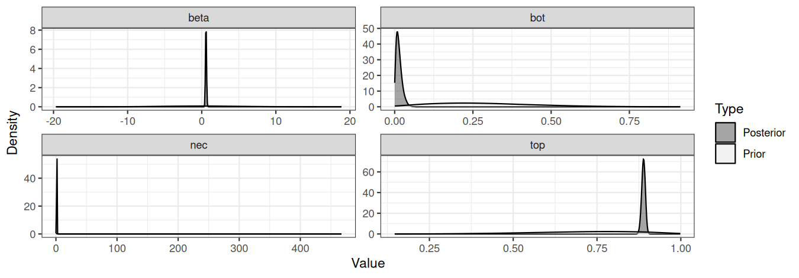
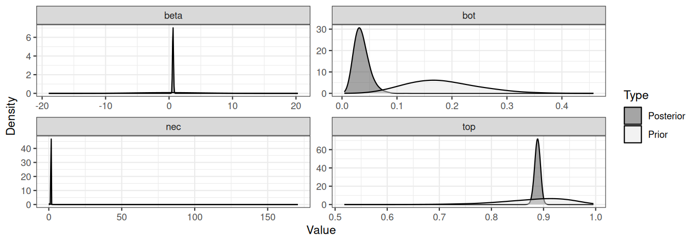
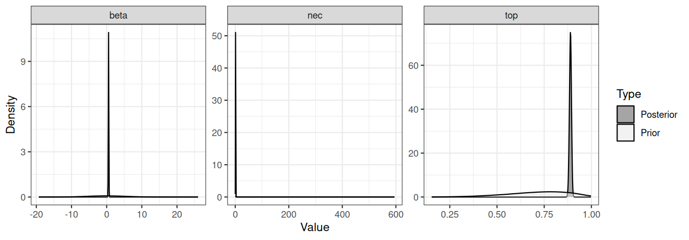

## Overview

The main focus here is to explain the default priors used in `bayesnec` and to showcase how the user can interrogate the priors used in a `bayesec` model and alternatively specify their own priors, should they wish to. This might be needed depending on the model and the data because `bayesnec` tries to find reasonable and yet only weakly informative priors for the model parameters by default. First we describe the default priors used in `bayesnec` (including the `"uninformative"` and `"regularizing"` sets, which can be selected through the `prior_type` argument), and then follow up with a demonstration of how the user can specify priors in multiple ways for objects of class `bayesnecfit` and `bayesmanecfit`.

## Default priors in `bayesnec`

The default priors used in `bayesnec` can generally be considered "weakly informative". They are constructed for each parameter of each model being fitted based on the characteristics of either the input response and predictor data, depending on which is relevant to the specific parameter scaling. In the case of parameters that scale with the response, priors are constructed based on the relevant link scaling, whether that be identity or the default (or user specific) link function for a specific distribution. The priors are constructed by `bnec` internally based on the chosen model, the distribution (including the relevant link function), the predictor and the response.

### Priors for response-scaled parameters

Only the parameters **top** and **bot** scale specifically with the response. The priors given here are those of the default `"uninformative"` set (see **Selecting the default prior set** below for the alternative `"regularizing"` set). For Gaussian-distributed response data (or any response data for which the link ensures valid values of the response can take from `+Inf` to `-Inf`, including `log` and `logit`) priors are `normal` with a standard deviation of `2.5` times the standard deivation of the response data, and a mean set at the 90^th^ and 10^th^ quantiles for **top** and **bot** respectively. For Poisson-, Negative Binomial- and Gamma-distributed data the response is bounded by `0` and thus priors are `Gamma`, with a mean scaled to correspond to the 75^th^ and 25^th^ quantiles for **top** and **bot** respectively. Because zeros would pull those quantiles towards zero, the probability of each quantile is rescaled for the share of zeros where the response contains any (a response with no zeros is unaffected). The mean is linked mathematically to the shape (*s*) and rate parameters (*r*) by the equation $mean = s \times (1/r)$ with the Gamma shape parameter set at 2. For the Binomial, Beta, and Beta Binomial families estimates for **top** and **bot** must necessarily be constrained between `0` and `1` when modelled on the `"identity"` link (the default in `bayesnec`). Because of this constraint there is no need to adjust scaling based on the response. `bayesnec` uses `beta(5, 2)` and `beta(2, 5)` priors to provide a broad density centred across the upper and lower `0` to `1` range for the **top** and **bot** parameters, respectively.

### Priors for predictor-scaled parameters

The parameters **nec** and **ec50** scale with respect to the predictor because both of these are parameters in concentration-response curves that are estimated in units of concentration. The prior on each is a `normal` distribution on the *logarithm* of the predictor, which is the scale on which a dilution series is designed. Where the predictor is supplied on the concentration scale the prior is written as a `lognormal`, whereas a predictor that spans negative values is treated as having already been log transformed by the user, and the prior is written as a `normal`. These two routes (concentration-scale and logged) apply one rule, written on two scales. The choice between them is made from the sign of the predictor under the default `predictor_scale = "auto"`, and the user can instead declare the scale with `predictor_scale = "concentration"` or `predictor_scale = "log"` (see `?bnec`).

Both entries are bounded to the tested range of the predictor (from its lowest value to its highest, on the scale on which the predictor is supplied). This bound reflects the assumption on which both default prior sets are built, i.e. that the concentrations tested reached the lower asymptote of the response, so that the decline begins, and passes its midpoint, within that range. Where this assumption fails, the upper bound is not conservative. A threshold above the highest concentration tested is then outside the support of the prior, not in its tail, so the posterior can place no mass there and instead concentrates against the bound. In this case `nec()` returns the highest concentration tested with a narrow credible interval around it, which appears to be a precise estimate of something the experiment did not measure.

Before fitting anything, `bnec()` gives a message where the response is still declining at the top of the series, and the user can declare such a design with `asymptote_observed = FALSE`. Under this declaration the upper bound is removed and the lower bound is kept. Removing the upper bound does not identify a threshold above the series. Instead, it changes the shape of the posterior, whose mass spreads over the region the data cannot distinguish, so that the credible interval becomes wide. A reported estimate is then kept inside the tested range by the censoring of the posterior at the range over which the model was predicted, together with the `extrapolate` argument of `nec()` and `nsec()`, which releases that censoring (see `?nec`). All of the estimators mark and count this censoring.

For a predictor supplied on the concentration scale, the mean of the prior on the log scale is the median of the *distinct* positive predictor values, logged. Distinct values are used (not the observations themselves) so that the prior describes the series of concentrations that was tested, and not how many replicates each concentration received. Where the number of distinct positive concentrations is odd, taking the median after logging gives the log of the median concentration. Where it is even, it gives the log of the geometric mean of the two central concentrations, which is their midpoint on the log axis (not on the concentration axis). The maximum density of the prior is therefore at that concentration on the log scale, and the median of the untruncated prior on the concentration scale is also that concentration, which is the convention described by Fisher et al. (2024). Both of these properties apply to the untruncated prior. Under the default the entry is truncated to the tested range, so the part of the upper tail above the highest concentration is lost and the median is pulled down (to `0.579` on `nec_data`, against a median concentration of `0.876`).

The standard deviation is set so that the central 95% interval of the untruncated prior includes all of the concentrations tested. It is the larger of the half-widths from the mean to each end of the logged series, divided by `qnorm(0.975)`. This rule is based on one criterion only: a prior on a threshold should not place a concentration the experiment applied in its far tail, at either end. The criterion fixes the width of the prior, but not its support. Where the highest concentration is the farther end of the series from the location (on the log scale), the untruncated prior places `0.025` of its mass above it, and otherwise more. For example, it places `0.220` above it on `nec_data`, whose series extends much further below its median than above it. These figures apply to the `"uninformative"` set, whereas the `"regularizing"` set applies the rule at the 98% level, which gives `0.01` and `0.179` on that series. Under the default this mass is removed by the bound. Under `asymptote_observed = FALSE` only the lower bound is kept, and the share above the highest concentration on `nec_data` (renormalised over the support above the lowest concentration) is `0.225` under `"uninformative"` and `0.181` under `"regularizing"`.

The width is therefore given by the rule, not chosen, and it adapts to the design. Expressed as a multiple of `sd(log(x))`, it was between `0.73` and `1.18` across five designs, `0.92` to `1.03` on the four `nassarius` series, and `1.75` on `nec_data` (whose predictor is continuous and densely sampled). Because the width is set by the extreme concentrations at each end, and not by the spread of the series between them, it is sensitive to how a control is recorded. The prior is built from the concentrations as recorded, so a control entered as a nominal small positive value is treated as a concentration that was applied, and the prior widens to include it. For example, on the `nassarius` contaminant A series the standard deviation is `2.30` with the control recorded as `0`, `2.59` with it recorded as `0.001` and `6.11` with it recorded as `1e-6`. We therefore recommend recording a control as `0`.

For a predictor supplied already logged, the prior is `normal` with a mean at the median of the distinct predictor values and a standard deviation of `10` times their standard deviation, which is the multiplier described by Fisher et al. (2024). This multiplier is a fixed constant (not a coverage width), and it gives the only combination of route and prior set that is wide once the upper bound is removed. On `log(herbicide$concentration)`, for example, the entry is `normal(2.30, 31.5)`, which places `0.116` of its mass inside the tested range and `0.442` above the highest concentration. Under the default the bound confines this prior to the tested range, across which its density is close to flat. However, under `asymptote_observed = FALSE` only the lower bound remains, and `0.792` of the mass above it is above the highest concentration. A threshold above the series is then barely in the tail, and the prior does correspondingly little to locate one.

This width is a property of the `"uninformative"` set on this route, and not of the route itself. The `"regularizing"` entry on the `herbicide` data is `normal(2.30, 1.98)`, a coverage width like the other three combinations, which places `0.980` of its mass inside the tested range and `0.010` above it (also `0.010` under the declaration). Where the design does not reach the asymptote and the predictor is supplied logged, we recommend supplying a prior through the `prior` argument, instead of relying on the `"uninformative"` set.

As on the concentration-scale route, the mean and the standard deviation are calculated from the distinct values (not from the observations), so that replication has no effect on the prior. Over the pooled `log(herbicide$concentration)` column (580 rows and 9 distinct values), the entry calculated from the distinct values is `normal(2.30, 31.5)`, whereas the observations would give `normal(1.10, 26.3)`.

Because the prior for a predictor supplied on the concentration scale is built on the log of the concentration, recording the concentrations in other units changes the location of the prior by the factor applied to the data, and does not change its width on the log scale. On the concentration scale its density decreases monotonically over the whole tested range of the `nassarius` series. This does not mean that most of the prior mass is at low concentrations. A `lognormal` has its mode at `exp(mu - sigma^2)` on the concentration scale, so the density falls because the change of variable from the log scale redistributes it, and the median is a better guide to where the mass is. On the contaminant A series, for example, the median of the untruncated prior is `0.223`, which is the location the rule specifies (that series has an even number of positive concentrations, so the location is the geometric mean of the two central concentrations and not one of the concentrations themselves).

### Priors for other parameters

For the parameters **beta**, **slope**, **d** and **f**, we first ensured any relevant transformations in the model formula such that theoretical values of `-Inf` to `+Inf` are allowable, and a `normal(0, 5)` prior is used. For example, in the **nec3param** model, **beta** is an exponential decay parameter which must by definition be bounded to `0` and `+Inf`. Calling `exp(beta)` in the model formula ensures the exponent meets these requirements. Note also that a mean of `0` and standard deviation of `5` represents a relatively broad prior on the exponential scaling. See the **Model details** vignette or `?model("all")` for more information on all the models available in `bayesnec` and their specific formulation.

### Priors for group-level parameters

A group-level term (`ogl()`, `pgl()` or `(par | group)`; see `?bayesnecformula` for the syntax) adds a standard deviation for each parameter it applies to, and `ogl()` also adds an offset parameter. The priors on these follow the three-way split used for the parameters above. Each group-level standard deviation is given a `student_t(3, 0, s)` prior, where *s* is one tenth of the observed range of the scale its parameter is on: the response range for **top**, **bot** and **ogl**, and the predictor range for **nec** and **ec50**. For **beta**, **slope**, **d** and **f**, which are estimated on a log scale and take `normal(0, 5)` priors of their own, *s* is `0.5` (one tenth of the standard deviation of that prior).

Where the deviation is applied multiplicatively (described below), it acts on a log or log-odds scale instead of the response scale, and *s* is converted onto that scale at the mean of the response. The `student_t(3, 0, .)` shape is the `brms` default for this class of parameter, and only its scale, which would not otherwise be derived from the data, is changed. The **ogl** offset itself is given a zero-centred `normal` prior with the scale *s* of its standard deviation (on the response scale, or on the log or log-odds scale where the deviation is applied multiplicatively). The offset needs to be centred because it acts on the whole curve, and is therefore confounded with **top** and **bot** otherwise.

Note that, for the response-scaled and predictor-scaled parameters, *s* is derived from the observed data, and not from the spread of the parameter's own prior. These are different quantities, and the difference is deliberate. For example, **top** on a Gaussian response has a prior standard deviation of `2.5` times that of the response, which is a reasonable statement of ignorance about a *level*, but a poor one about the *deviation around* that level. The distinction does not arise for **nec** and **ec50**, because *s* for these parameters is read from the predictor range, which is the scale the parameter itself is on. Under `student_t(3, 0, s)` there is a prior probability of about `0.39` that the group-level standard deviation exceeds *s*, so this prior is weakly informative, and not a tight one.

There is one property of the default priors that a grouped fit does not inherit. Each prior described above constrains its parameter to the region in which the model is defined (e.g. `beta(5, 2)` on `0` to `1`, a lower bound of `0` for the count and Gamma families, and **nec** and **ec50** truncated to the predictor range). This is what allows `bayesnec` to fit on the `"identity"` link and keep **top**, **bot** and **nec** directly interpretable. A group-level deviation cannot be constrained in this way, because `brms` declares it unconstrained. Where the response distribution restricts the range of the mean (all families except Gaussian, under an identity link), Stan rejects a proposal that takes the mean outside that range, and counts it as a divergent transition.

`bayesnec` avoids this problem, instead of mitigating it. Where the deviation applies to the whole curve (through `ogl()`), it is applied *multiplicatively*, and not as an offset added to the mean. On a `0` to `1` response the deviation scales the odds of the mean, and on a positive response it scales the mean itself. Because the deviation is centred on zero, and a deviation of zero does not change the curve, **top**, **bot**, **nec** and **beta** keep their meanings, while the mean can no longer fall outside its support whatever value of the deviation is proposed. The prior on the deviation is widened to match the scale on which it acts. On a simulated `beta_binomial` design run with three seeds, this gave no divergent transitions at all, against 70 to 95 per cent for the additive form on those data, and it sampled about twice as fast.

This construction is also applied to a deviation placed on **top** or **bot**, through `pgl()` or an explicit `(par | group)` term. These parameters are on the response scale, and their own priors bound them to the support of the mean, so an unconstrained deviation added to either of them can put the parameter outside the region in which the likelihood is defined. In practice this occurs for **bot**, because it is the lower asymptote and is typically estimated close to zero. The parameter itself keeps its name, its prior and its meaning, and the term adds a deviation applied multiplicatively to it, with no population-level term of its own. The fit therefore has the parameters of the additive form and no others, and **bot** remains the asymptote towards which the population-level curve declines.

This has one consequence for a user supplying their own priors. Where a group-level term on **top** or **bot** would be transformed, a prior on that parameter that does not bound it to the range on which the mean is defined is refused, because the multiplicative form is only defined inside that range.

As an example, we fitted **nec4param** to the `herbicide` data with `Beta(link = "identity")`, two chains and 2000 iterations. A `(bot | herbicide)` term gave 51 divergent transitions of 2000 at `adapt_delta = 0.95` under the additive form, and none at Stan's default of `0.8` under the multiplicative form. This term on a `gaussian` response, where the mean is unconstrained and the parameter is therefore not against a boundary, gave no divergent transitions under either form.

A deviation on **nec**, **ec50**, **beta**, **slope**, **d** or **f** is still added to that parameter directly. These parameters are on the predictor scale or are estimated on a log scale, so none of them is bounded by the likelihood and there is no excursion to prevent (a `(nec | herbicide)` term on the `herbicide` fit above gave 0 divergent transitions of 2000 at `adapt_delta = 0.8`). A `pgl()` term places a deviation on all of the parameters of the equation at once, and therefore generates a mixture of the multiplicative and additive forms.

One restriction remains on `ogl()`. The transformation of the *mean* is only defined where the mean is provably strictly inside its range, so it is not used for **neclin**, **neclinhorme** and **ecxlin** (whose mean is unbounded below), nor, on a `0` to `1` response, for the hormesis equations (whose mean can reach or exceed `1`). The transformation of a *parameter* is not restricted in this way, because **top** and **bot** are bounded by their own priors whichever equation they appear in.

Where a group-level term can still take the mean outside its support, `bnec()` sets `control = list(adapt_delta = 0.99)`. This generally reduces the rate of divergent transitions substantially without removing them, and **such a fit should always be checked for divergent transitions**. Because no deviation can take the quantity it is applied to outside its support, whether the setting is needed depends on the equation. For an equation whose mean is between **bot** and **top**, no group-level term can put the mean outside the support, and the setting is not made. It is made for **neclin**, **neclinhorme** and **ecxlin**, and for the hormesis equations, whose mean can fall outside the support while all of the parameters are inside it. This applies on all families, because an excess term in `exp(slope) * x` makes the mean negative for a sufficiently negative predictor, and `crf(log(concentration), ...)` typically supplies one. The setting is not made where it is not needed, because it requires roughly fourteen times the gradient evaluations per iteration, and an `adapt_delta` supplied by the user is left unchanged.

### Selecting the default prior set

The priors described above are the default `"uninformative"` set, which is deliberately broad and close to truly uninformative. `bayesnec` also offers a narrower, more `"regularizing"` set, selected through the `prior_type` argument of `bnec` (and `amend`). When the data are sparse or noisy, these tighter priors may make convergence more likely and reduce the chance of an implausible fit, although they also exert more influence on the posterior. The `"uninformative"` priors of Fisher et al. (2024) are the default, and the `"regularizing"` set is used only when it is requested.

The `"uninformative"` and `"regularizing"` sets differ in the response-scaled **top** and **bot** parameters, in the predictor-scaled **nec** and **ec50** parameters, and in the group-level parameters described above. With a `disp("power")` term on a `Gamma`, `gaussian` or `negbinomial` response, the `"regularizing"` set also centres the prior on the exponent `c1` on the slope shown by the replicates (see `?bnec`). The fixed `normal(0, 5)` priors on **beta**, **slope**, **d** and **f** are identical under both sets. The `"uninformative"` set is stated separately for each of the three branches (the `normal`, `Gamma` and `beta` priors for the three groups of families described above), as Fisher et al. (2024) state it, whereas the `"regularizing"` set is stated once, as a location and a spread, from which each branch is derived.

The location is the mean response at the end of the concentration series at which the parameter is the level of the curve, i.e. the lowest concentrations for **top** (the control group, for a design with an unexposed control) and the highest concentrations for **bot**. Where there are enough observations at the extreme concentration, these are used on their own. Where there are not, the subset is extended to the next concentration, and the next, until it includes a twentieth of the observations and no fewer than three, but never past a fifth of the distinct concentrations. The second limit stops the subset drifting into the middle of the series. It also keeps the second block of a hurdle fit reading one concentration instead of three, because this block is primed from one survival proportion per concentration, so that each group in it is a single value.

An anchor on the extreme of the response, in place of the mean at one end of the series, would be biased in opposite directions for different types of response. The smallest observation of a *discrete* response is well below the asymptote it is meant to locate (against a true **bot** of `5`, the smallest count observed ranged from `1` to `3`), whereas the upper extreme of an *over-dispersed* response is well above it (against a true **top** of `40`, the 95th percentile of a Negative Binomial response was as high as `72`). In a prior sweep over 720 **top** and **bot** cells (five designs, three predictor transforms, twelve families and two links), the `"regularizing"` set placed the true value outside the central 95% of its own prior in 1 cell, and the `"uninformative"` set in none.

On a design with fewer than ten concentrations and no replication, the second limit is reached first and the subset is a single observation. This is because such a design presents the same input as the second block of a hurdle fit, and the data cannot distinguish between them. The location is then one measurement, and the standard-error floor (described below) widens the entry towards the `"uninformative"` one, so that the set relocates the prior to that measurement instead of narrowing it. On an unreplicated eight-concentration series, for example, the ratio of the `"regularizing"` to the `"uninformative"` standard deviation was `0.55` for **top** and `1.00` for **bot** on a Gamma response, and `0.4` for both on a Gaussian response. Widening the prior on an anchor of one observation is the correct behaviour, and it is a reason to replicate, not a reason to narrow the prior.

The rule assumes that the lowest concentration tested is at the level **top** describes, and that the highest is at the level **bot** describes. The first assumption is an identity at a predictor of zero for fourteen of the 24 equations, i.e. the ten that have a **nec** parameter, and **ecxlin**, **ecxexp**, **ecxsigm** and **ecxflat**. These include the six hormesis equations that have a **nec** parameter, whose excess term contributes nothing at zero. For the other ten equations (including the hormesis equations **ecxhormebc4** and **ecxhormebc5**) it is a limit, not an identity, because the sigmoid term has not reached its asymptote at zero. How close it comes is a property of the curve, not of the equation, and is governed by `exp(beta) * ec50`. For example, at a **top** of `40`, a **bot** of `5`, an *EC50* of `2` and a decay rate of `1.5`, **ecxwb2** and **ecxwb2p3** are within `1e-7` of **top**, and the remaining eight return `38.06` to `38.34` (an error of 4%). On a shallow curve with a rate of `0.2` and an *EC50* of `1`, all ten fall between `17.6` and `29.7`. In all of these cases the lowest concentration is the best estimate of **top** the data offer, and is closer to it than any quantile of the pooled response.

The second assumption is a property of the design, not of the equation. Where the highest concentration has not reached the lower asymptote, the location for **bot** is above the true value, and no choice of spread corrects a bias, so the `"uninformative"` set is the one to use on such a design.

Zeros are treated differently at each end of the series, and only where the parameter is bounded below at zero. A zero at the control is a structural zero (the zero-inflated families exist for responses in which a share of the observations are zero whatever the concentration), so the **top** average is taken over the positive observations. A zero at the highest concentration, however, is the endpoint responding, and it is the observation that says most about how low **bot** is, so it is kept in the **bot** average. Under a zero-inflated family a share of those zeros is structural after all, and the **bot** location therefore inherits the zero-inflation share as a downward bias. On a **nec4param** `zero_inflated_poisson` design with a true **bot** of `5`, for example, the mean location was `3.92` at a zero-inflation of `0.2`, `3.27` at `0.4` and `2.39` at `0.6`, although none of the thirty cells put the true value outside the central 95% of the prior. Where all of the observations at the highest concentration are zero, the location is a tenth of the smallest positive observation (the lowest level the endpoint resolves).

The spread is `0.4` of the standard deviation of the `"uninformative"` prior for that parameter on that family, subject to two limits. It is never smaller than the standard error of the location, because a prior narrower than the noise in its own anchor would imply a precision the data do not supply. It is also never larger than the `"uninformative"` width, so that selecting the narrower set cannot widen a prior. We built 420 **top** and **bot** entries, each from one simulated response, across five designs, three predictor transforms, seven families and two links. The ratio was `0.4` exactly in 385 of these, the standard-error floor set the spread in 35, and the prior was wider than the `"uninformative"` one in none.

The location and the spread are derived from different parts of the data. The location is read at one end of the concentration series, whereas the spread is inherited from the `"uninformative"` entry, which is built from a quantile of the whole response. This is deliberate, because deriving the spread from the handful of observations used for the location would make the width of the prior depend on a single dose group. However, it means that where the `"uninformative"` entry is itself poorly scaled, so is the `"regularizing"` one.

Each branch then uses the distribution that matches the support of the parameter, with its parameters solved so that its *maximum density* is at the location and its standard deviation is the spread:

* Gaussian families, and any family under a `log` or `logit` link, use a `normal` prior, whose location parameter is its maximum density.
* Poisson-, Negative Binomial- and Gamma-distributed families use a `Gamma` prior. For a shape *s* and rate *r* the maximum density is at $(s - 1) / r$ and the standard deviation is $\sqrt{s} / r$, which together determine both parameters.
* Binomial, Beta and Beta Binomial families use a `beta` prior, whose two shape parameters are determined likewise. Under the `"uninformative"` set these entries are the fixed `beta(5, 2)` and `beta(2, 5)`, which do not depend on the response.
* Group-level standard deviations, and the **ogl** offset, take `0.4` of the scale used in the `"uninformative"` set, which is the factor applied to the response-scaled priors. Where a group-level scale is converted onto a log or log-odds scale the conversion is capped (except for an `ogl()` deviation on the log-odds scale), and the cap also scales with the prior type, so that selecting the narrower set still has an effect on a response where the cap applies.

Specifying the maximum density, and not the mean, is what gives the rule one meaning on all three branches. A `normal` is specified by a parameter that is also its mode, whereas a `Gamma` specified by its mean has its peak elsewhere. For example, `gamma(2, 2 / q75)`, the `"uninformative"` entry for **top** on a Gamma response, has its maximum density at `q75 / 2`, while `normal(q90, 2.5 sd)` peaks at `q90`.

The **nec** and **ec50** prior is not narrowed by a factor at all. Instead, its spread is stated directly, as the width whose central 98% interval extends to the farthest concentration tested. For a predictor supplied on the concentration scale, the `"uninformative"` entry applies this rule at the 95% level, so on that route the `"regularizing"` and `"uninformative"` sets differ only in the confidence level. This is not the case on the route for a predictor supplied already logged. The spread is the standard deviation of the `normal` prior on the log of the concentration (i.e. the second parameter of the `lognormal` written on the concentration scale), and not the standard deviation of that distribution.

The width is not a free choice. A prior on a threshold should not place a concentration the experiment applied in its far tail, so the confidence level at which the prior covers the series is the only scope there is for narrowing it. Narrowing it by `0.4` instead, as the response-scaled priors are narrowed, placed the true threshold outside the central 95% of the prior in 8 of the 30 design by transform by parameter cells we tested, against none at `0.84`. This value is the ratio `qnorm(0.975) / qnorm(0.99)`, which is what the change of confidence level amounts to for a predictor supplied on the concentration scale.

Stating a rule, instead of a factor, is what gives the prior one meaning whichever way the predictor is supplied. The `"uninformative"` width is a coverage width on the concentration scale, but for a predictor the user has already logged it is `10` times the standard deviation of the distinct values, a constant stated by Fisher et al. (2024) that is not derived from coverage. A factor applied to that constant gives a prior that is uniform across the tested series. For example, on a 0.1 to 100 series over seven doses the spread is `24.87`, against a tested range of `6.91` on the log scale, and the prior CDF at each dose (computed over the tested range, because the default entry is truncated to it) is that dose's position within the range to three decimal places. A factor would therefore leave `prior_type` with no effect on **nec** and **ec50** on that route, so the `"regularizing"` entry there is also a coverage width.

Under the default `predictor_scale = "auto"`, the concentration-scale and logged routes agree on the spread where the series has no zero control and its lowest tested concentration is below 1. Both conditions are needed, because outside them the series given to each route is not equivalent. A series with a control is read differently on each route: the concentration-scale route drops the zero, whereas a user who logs the series must first substitute a value for the control, and that substitute is read. In addition, this default selects the route by whether the predictor spans negative values, so a logged series whose lowest tested concentration is at or above 1 remains non-negative, is not recognised as logged, and is logged a second time (unless it is declared with `predictor_scale = "log"`). On a 10 to 10000 series, for example, this gives `lognormal(5.7565, 1.4847)` on the concentration scale against `lognormal(1.7503, 0.3939)` when supplied logged. The location, the distribution and the bounds of the prior do not differ between the `"uninformative"` and `"regularizing"` sets.

Below we fit **nec4param** to the `nec_data` example (a Beta-distributed response on the `"identity"` link) under each prior set, to show the difference between them. We use **nec4param** instead of **nec3param** so that both response-scaled parameters are present, because **nec3param** has no **bot**, and **bot** is where the `"uninformative"` and `"regularizing"` sets differ most. Note that `prior_type` is ignored whenever the user supplies their own `prior` argument.


``` r
library(brms)
library(bayesnec)
data(nec_data)

set.seed(333)
exmp_uninformative <- bnec(y ~ crf(x, model = "nec4param"), data = nec_data,
                           family = Beta(link = "identity"),
                           prior_type = "uninformative",
                           iter = 1e4, control = list(adapt_delta = 0.99))

set.seed(333)
exmp_regularizing <- bnec(y ~ crf(x, model = "nec4param"), data = nec_data,
                          family = Beta(link = "identity"),
                          prior_type = "regularizing",
                          iter = 1e4, control = list(adapt_delta = 0.99))
```

The priors that `bnec` built for each fit can be compared with `pull_prior`. Under `"regularizing"`, the **top** and **bot** priors change from the fixed `beta(5, 2)` and `beta(2, 5)` to beta priors with their maximum density at the mean response over the lowest concentrations (`0.919` for **top**) and over the highest concentrations (`0.163` for **bot**). Because `nec_data` has 100 distinct concentrations and no unexposed control, each of these means is taken over the five most extreme observations. The **nec** prior keeps its location and takes `0.84` of its standard deviation on the log scale, which is what the change of confidence level amounts to on this predictor. The fixed **beta** prior is unchanged.


``` r
pull_prior(exmp_uninformative)
#> [[1]]
#>                                            prior class      coef group resp dpar nlpar               lb
#>                                     normal(0, 5)     b                            beta                 
#>                                     normal(0, 5)     b Intercept                  beta                 
#>                                       beta(2, 5)     b                             bot                0
#>                                       beta(2, 5)     b Intercept                   bot                0
#>  lognormal(-0.132723577442522, 1.68292842267636)     b                             nec 0.03234801324009
#>  lognormal(-0.132723577442522, 1.68292842267636)     b Intercept                   nec 0.03234801324009
#>                                       beta(5, 2)     b                             top                0
#>                                       beta(5, 2)     b Intercept                   top                0
#>                                gamma(0.01, 0.01)   phi                                                0
#>                ub tag       source
#>                               user
#>                       (vectorized)
#>                 1             user
#>                 1     (vectorized)
#>  3.22051966293556             user
#>  3.22051966293556     (vectorized)
#>                 1             user
#>                 1     (vectorized)
#>                            default
```


``` r
pull_prior(exmp_regularizing)
#> [[1]]
#>                                            prior class      coef group resp dpar nlpar               lb
#>                                     normal(0, 5)     b                            beta                 
#>                                     normal(0, 5)     b Intercept                  beta                 
#>                           beta(6.46262, 29.0272)     b                             bot                0
#>                           beta(6.46262, 29.0272)     b Intercept                   bot                0
#>  lognormal(-0.132723577442522, 1.41787869897336)     b                             nec 0.03234801324009
#>  lognormal(-0.132723577442522, 1.41787869897336)     b Intercept                   nec 0.03234801324009
#>                           beta(21.3016, 2.79077)     b                             top                0
#>                           beta(21.3016, 2.79077)     b Intercept                   top                0
#>                                gamma(0.01, 0.01)   phi                                                0
#>                ub tag       source
#>                               user
#>                       (vectorized)
#>                 1             user
#>                 1     (vectorized)
#>  3.22051966293556             user
#>  3.22051966293556     (vectorized)
#>                 1             user
#>                 1     (vectorized)
#>                            default
```

Plotting the prior and posterior densities with `check_priors` shows the difference between the sets. Under `"regularizing"`, the **top** prior places its density close to the posterior, instead of across the whole `0` to `1` range. The **bot** prior is also much narrower than `beta(2, 5)`, but its maximum density (`0.163`) is above the **bot** posterior, which is near `0.03`. This is because three of the five highest concentrations (`2.23` to `2.52`) have responses of `0.21` to `0.30`, well above the lower asymptote.


``` r
check_priors(exmp_uninformative)
```

<div class="figure" style="text-align: center">

<p class="caption">plot of chunk exmp3-checkpriors-uninformative</p>
</div>


``` r
check_priors(exmp_regularizing)
```

<div class="figure" style="text-align: center">

<p class="caption">plot of chunk exmp3-checkpriors-regularizing</p>
</div>

Because an anchor on the extreme of the response would be most biased for a discrete, over-dispersed response, the next example uses a count response, instead of the Beta-distributed `nec_data` response. We simulated it from a **nec4param** curve with a known **top** of `40` and **bot** of `5`, with the over-dispersion that is typically found in a reproduction or abundance endpoint. `get_priors` builds the default priors for a formula and dataset without fitting anything, so the `"regularizing"` entries can be inspected directly from its output.


``` r
set.seed(305)
x_count <- as.numeric(rep(seq(0, 10, length.out = 11), each = 6))
mu_count <- 5 + 35 * exp(-0.8 * pmax(x_count - 4, 0))
count_data <- data.frame(x = x_count,
                         y = rnbinom(length(mu_count), mu = mu_count, size = 5))
c(top = 40, bot = 5, smallest_observed = min(count_data$y),
  pct95_observed = unname(quantile(count_data$y, 0.95)))
#>               top               bot smallest_observed    pct95_observed 
#>                40                 5                 1                52
```

The smallest observation is `1`, against a true **bot** of `5`, and the 95th percentile is `52`, against a true **top** of `40`. Both are unsuitable as an anchor for a narrow prior, and their errors are in opposite directions, which is why no single quantile of the pooled response can serve both parameters.


``` r
get_priors(y ~ crf(x, model = "nec4param"), data = count_data,
           family = negbinomial(link = "identity"),
           prior_type = "regularizing")
#>                                           prior class coef group resp dpar nlpar   lb   ub tag source
#>                                    normal(0, 5)     b                       beta <NA> <NA>       user
#>                        gamma(17.0943, 0.442962)     b                        top    0 <NA>       user
#>                         gamma(7.76467, 1.22994)     b                        bot    0 <NA>       user
#>  lognormal(1.70059869083108, 0.731016504370499)     b                        nec    0   10       user
```

The `"regularizing"` entries are `Gamma` priors with their maximum density, $(s - 1) / r$, at `36.3` for **top** and `5.5` for **bot**, which are the mean responses over the six observations at the lowest and the highest concentration respectively.

## User specified priors

There may be situations were the default `bayesnec` priors to not behave as desired, or the user wants to provide informative priors. For example the default priors may be too informative, yielding unreasonably tight confidence bands, although this is only likely where there are few data. Conversely, priors may be too vague, leading to poor model convergence, or an inability of `bayesnec` to find appropriate starting values. Alternatively, as indicated in the example below, the default priors may be of the wrong statistical distribution if there was insufficient information in the provided data for `bayesnec` to guess correctly the appropriate one to use.

The priors used in the default model fit can be extracted using `pull_prior`, and a sample or plot of prior values can be obtained from the individual `brms` model fits through the function `sample_priors` which samples directly from the `prior` element in the `brm` model fit. We can also use the function `check_prior` (based on the `hypothesis` function of `brms`) to assess how the posterior probability density for each parameter differs from that of the prior.

### bayesnecfit

To set specified priors, it is simplest to start by letting `bnec` find the priors on its own, i.e. by not specifying the `brm` argument `prior` at all.


``` r
library(brms)
library(bayesnec)
data(nec_data)

# a single model
set.seed(333)
exmp_a <- bnec(y ~ crf(x, model = "nec3param"), data = nec_data,
               family = Beta(link = "identity"),
               iter = 1e4, control = list(adapt_delta = 0.99))
```


``` r
class(exmp_a)
#> [1] "bayesnecfit" "bnecfit"
```

We can view the prior and posterior probability densities of all the parameters in the model using the function `check_prior`, based on the `hypothesis` function of `brms`. This can be useful to assess if priors are suitably vague, and/or if they might be having an undesirable influence on the posterior.


``` r
check_priors(exmp_a)
```

<div class="figure" style="text-align: center">

<p class="caption">plot of chunk exmp3-checkpriors</p>
</div>

In this case the priors seem reasonably vague, however there will be times when it is necessary to modify these priors. The user can take advantage of the function `pull_prior` to inspect what `bnec` came up with on its own, and decide how best to modify those priors to be more desirable.


``` r
pull_prior(exmp_a)
#> [[1]]
#>                                            prior class      coef group resp dpar nlpar               lb
#>                                     normal(0, 5)     b                            beta                 
#>                                     normal(0, 5)     b Intercept                  beta                 
#>  lognormal(-0.132723577442522, 1.68292842267636)     b                             nec 0.03234801324009
#>  lognormal(-0.132723577442522, 1.68292842267636)     b Intercept                   nec 0.03234801324009
#>                                       beta(5, 2)     b                             top                0
#>                                       beta(5, 2)     b Intercept                   top                0
#>                                gamma(0.01, 0.01)   phi                                                0
#>                ub tag       source
#>                               user
#>                       (vectorized)
#>  3.22051966293556             user
#>  3.22051966293556     (vectorized)
#>                 1             user
#>                 1     (vectorized)
#>                            default
```

`bnec` chose a `lognormal` prior on the *NEC* parameter of **nec3param** because the predictor `nec_data$x` is non-zero positive (the prior is therefore built on the log of the concentration). However, imagine that in theory the predictor could have had negative values, it just happened to not have in this particular dataset. So let's go ahead and specify something else, say a normal with larger variance.


``` r
set.seed(333)
my_prior <- c(prior_string("beta(5, 1)", nlpar = "top"),
              prior_string("normal(1.3, 2.7)", nlpar = "nec"),
              prior_string("gamma(0.5, 2)", nlpar = "beta"))
exmp_b <- bnec(y ~ crf(x, model = "nec3param"), data = nec_data,
               family = Beta(link = "identity"), prior = my_prior,
               iter = 1e4, control = list(adapt_delta = 0.99))
```

Two things are of note. If the user is specifying their own priors, `bnec` requires them to specify priors for **all** parameters. The `pull_prior` function shows the priors *after* the model was fitted, but suppose the user does not know what parameters were comprised in a particular model. In those instances, the user can call the function `show_params(model = "all")` to inspect the parameters of each function, or some targeted function in particular.


``` r
show_params(model = "nec3param")
#> [[1]]
#> y ~ top * exp(-exp(beta) * (x - nec) * step(x - nec)) 
#> top ~ 1
#> beta ~ 1
#> nec ~ 1
```

### bayesmanecfit

The user can also specify a named list of priors when one or more models are being fitted to the same dataset.


``` r
set.seed(333)
my_priors <- list(nec3param = c(prior_string("beta(5, 1)", nlpar = "top"),
                                prior_string("normal(1.3, 2.7)", nlpar = "nec"),
                                prior_string("gamma(0.5, 2)", nlpar = "beta")),
                  nec4param = c(prior_string("beta(5, 1)", nlpar = "top"),
                                prior_string("normal(1.3, 2.7)", nlpar = "nec"),
                                prior_string("gamma(0.5, 2)", nlpar = "beta"),
                                prior_string("beta(1, 5)", nlpar = "bot")))
exmp_c <- bnec(y ~ crf(x, model = c("nec3param", "nec4param")), data = nec_data,
               family = Beta(link = "identity"), prior = my_priors,
               iter = 1e4, control = list(adapt_delta = 0.99))
```

`pull_prior` also works for an object of class `bayesmanecfit`, as does `check_priors` which allows an option of passing a filename to save the prior and posterior probability density plots to a pdf.


``` r
pull_prior(exmp_c)
check_priors(exmp_c, filename = "Check_priors")
```


```
#> $nec3param
#>              prior class      coef group resp dpar nlpar lb ub tag       source
#>      gamma(0.5, 2)     b                            beta                   user
#>      gamma(0.5, 2)     b Intercept                  beta           (vectorized)
#>   normal(1.3, 2.7)     b                             nec                   user
#>   normal(1.3, 2.7)     b Intercept                   nec           (vectorized)
#>         beta(5, 1)     b                             top                   user
#>         beta(5, 1)     b Intercept                   top           (vectorized)
#>  gamma(0.01, 0.01)   phi                                  0             default
#> 
#> $nec4param
#>              prior class      coef group resp dpar nlpar lb ub tag       source
#>      gamma(0.5, 2)     b                            beta                   user
#>      gamma(0.5, 2)     b Intercept                  beta           (vectorized)
#>         beta(1, 5)     b                             bot                   user
#>         beta(1, 5)     b Intercept                   bot           (vectorized)
#>   normal(1.3, 2.7)     b                             nec                   user
#>   normal(1.3, 2.7)     b Intercept                   nec           (vectorized)
#>         beta(5, 1)     b                             top                   user
#>         beta(5, 1)     b Intercept                   top           (vectorized)
#>  gamma(0.01, 0.01)   phi                                  0             default
```

The user can also specify priors for one model only out of the entire set, `bayesnec` will return a message stating that it is searching for priors on its own when they are either ill-formed (e.g. incomplete or have a typo), or the user simply decided not to specify priors for a particular model, e.g.


``` r
set.seed(333)
my_priors <- list(nec3param = c(prior_string("beta(5, 1)", nlpar = "top"),
                                prior_string("normal(1.3, 2.7)", nlpar = "nec"),
                                prior_string("gamma(0.5, 2)", nlpar = "beta")),
                  nec4param = c(prior_string("beta(5, 1)", nlpar = "top"),
                                prior_string("normal(1.3, 2.7)", nlpar = "nec"),
                                prior_string("gamma(0.5, 2)", nlpar = "beta"),
                                prior_string("beta(1, 5)", nlpar = "bot")))
exmp_d <- bnec(y ~ crf(x, model = c("nec3param", "nec4param")), data = nec_data,
               family = Beta(link = "identity"), prior = my_priors[1],
               iter = 1e4, control = list(adapt_delta = 0.99))
```

`prior = my_priors[[1]]` would also have worked because the argument priors can either take a `brmsprior` object directly, or a named list containing model-specific `brmsprior` objects.

Finally the user can also extend an existing `bayesmanecfit` object with the function `amend`, also by specifying custom-built `priors`.


``` r
set.seed(333)
necsigm_priors <- c(prior_string("beta(5, 1)", nlpar = "top"),
                    prior_string("gamma(2, 6.5)", nlpar = "beta"),
                    prior_string("normal(1.3, 2.7)", nlpar = "nec"),
                    prior_string("normal(0, 2)", nlpar = "d"))
exmp_e <- amend(exmp_d, add = "necsigm", priors = necsigm_priors)
```

## Fixing a parameter

A parameter can be held at a known value, instead of being estimated, by giving it a `constant()` prior. This works wherever a user-specified prior works, and requires no other change. `bayesnec` has no `fixed` argument of the kind provided by `drc`, because a point-mass prior expresses this through machinery that already exists.

The case in which fixing a parameter is defensible is an asymptote that is structural, not measured. For example, in a two-choice avoidance assay the animals are offered a treated and an untreated container, and the expected proportion in the treated container at zero dose is 0.5 *by design*, because at zero dose the containers are identical.


``` r
set.seed(333)
avoid_x <- rep(c(0, 0.4, 0.8, 1.2, 1.6, 2.0, 2.4, 3.0), each = 6)
avoid_mu <- 0.5 * exp(-exp(0.3) * pmax(avoid_x - 1.1, 0))
avoid_data <- data.frame(x = avoid_x,
                         y = rbeta(length(avoid_x), avoid_mu * 60,
                                   (1 - avoid_mu) * 60))
```

`get_priors` returns the priors `bnec` would generate for a formula and data without fitting anything, so the set can be edited before the first run (fixing `top` is a change to one row).


``` r
fixed_prior <- get_priors(y ~ crf(x, model = "nec3param"), data = avoid_data,
                          family = Beta(link = "identity"))
fixed_prior$prior[fixed_prior$nlpar == "top"] <- "constant(0.5)"
fixed_prior
#>                                            prior class coef group resp dpar nlpar   lb   ub tag source
#>                                     normal(0, 5)     b                       beta <NA> <NA>       user
#>                                    constant(0.5)     b                        top    0    1       user
#>  lognormal(0.470003629245736, 0.707306038302134)     b                        nec    0    3       user
```


``` r
set.seed(333)
exmp_f <- bnec(y ~ crf(x, model = "nec3param"), data = avoid_data,
               family = Beta(link = "identity"), prior = fixed_prior,
               iter = 1e4, control = list(adapt_delta = 0.99))
```

In the output below, `top` has an estimate of 0.5 and an error of zero, because it was never sampled. Stan does not declare a parameter whose prior is constant, so it contributes nothing to the posterior.


``` r
fixef(pull_brmsfit(exmp_f))
#>                 Estimate  Est.Error     Q2.5    Q97.5
#> beta_Intercept 0.3090778 0.09874436 0.132746 0.547551
#> nec_Intercept  1.1439555 0.07488724 1.025699 1.331653
#> top_Intercept  0.5000000 0.00000000 0.500000 0.500000
```

### Consequences of fixing an asymptote

Two things are lost when an asymptote is fixed, and both are easy to miss, because the fit itself appears to be better, not worse.

The first is a diagnostic. In the assay above, 0.5 is a *null expectation*, not a design constant, because it is true only if there is no baseline preference between the containers (arising from position, lighting, handling order or substrate). When these data are fitted with `top` free, a credible interval for `top` that includes 0.5 is positive evidence that the assay was unbiased before the contaminant was involved, and no other output of the model provides this evidence.


``` r
set.seed(333)
exmp_g <- bnec(y ~ crf(x, model = "nec3param"), data = avoid_data,
               family = Beta(link = "identity"), iter = 1e4,
               control = list(adapt_delta = 0.99))
```


``` r
fixef(pull_brmsfit(exmp_g))
#>                 Estimate  Est.Error      Q2.5     Q97.5
#> top_Intercept  0.4881983 0.01607557 0.4579751 0.5206909
#> beta_Intercept 0.3442712 0.11532955 0.1471181 0.5850865
#> nec_Intercept  1.1925197 0.09868096 1.0310962 1.3852201
```

This check is only possible while `top` is free. Here the credible interval for `top` (`0.458` to `0.521`) comfortably includes 0.5, so this assay appears to have been unbiased at dose zero. However, had the assay been subject to a real baseline preference (e.g. a true `top` near 0.62), fixing `top` at 0.5 would have produced a fit that appeared to be as sound as this one, and the preference could not have been detected. The discrepancy between the data and the fixed value does not disappear when it cannot appear in `top`. Instead, it is absorbed into `beta` and `nec`, and so into the toxicity estimate, with intervals that no longer reflect it. Any value asserted for `top` propagates directly into the *NEC*, which is visible even here, where 0.5 is the value from which the data were generated.


``` r
rbind(fixed = nec(exmp_f), free = nec(exmp_g))
#>            Q50     Q2.5    Q97.5
#> fixed 1.131594 1.025699 1.331653
#> free  1.168708 1.031096 1.385220
```

The median *NEC* is `1.13` with `top` fixed, against `1.17` with `top` free. The second thing lost is uncertainty. A constant asserts that the value is known without error, so none of the uncertainty in `top` propagates into ECx or the *NEC*, and the credible intervals narrow (the 95% interval on the *NEC* is `1.03` to `1.33` with `top` fixed, against `1.03` to `1.39` with it free). This may look like a better analysis, but it is the opposite.

We therefore recommend a tight informative prior over a constant in most cases, because it expresses what is known while still allowing the data to update the parameter, and the uncertainty in the parameter is still propagated to the toxicity estimates. For example, `beta(6, 6)` has a mean of 0.5 and a standard deviation of 0.14, which concentrates `top` around the design expectation without asserting it.


``` r
fixed_prior$prior[fixed_prior$nlpar == "top"] <- "beta(6, 6)"
```

### Fixing an asymptote on control-normalised data

A response divided by its control mean has a maximum of 1 by construction, and it is common to fix `top` at 1 for such data. We recommend against this, for a reason in addition to the two given above. Normalising to an *estimated* control mean already discards the sampling variability of the divisor. Fixing the asymptote afterwards then hides that loss, because the intervals it narrows are the ones that were already too narrow. `bnec` gives a message when it detects a normalised response. The alternative is to model the raw response and read the decline relative to the fitted control (see the "Preparing the response" section of `vignette("example1")` and `?bnec`).
