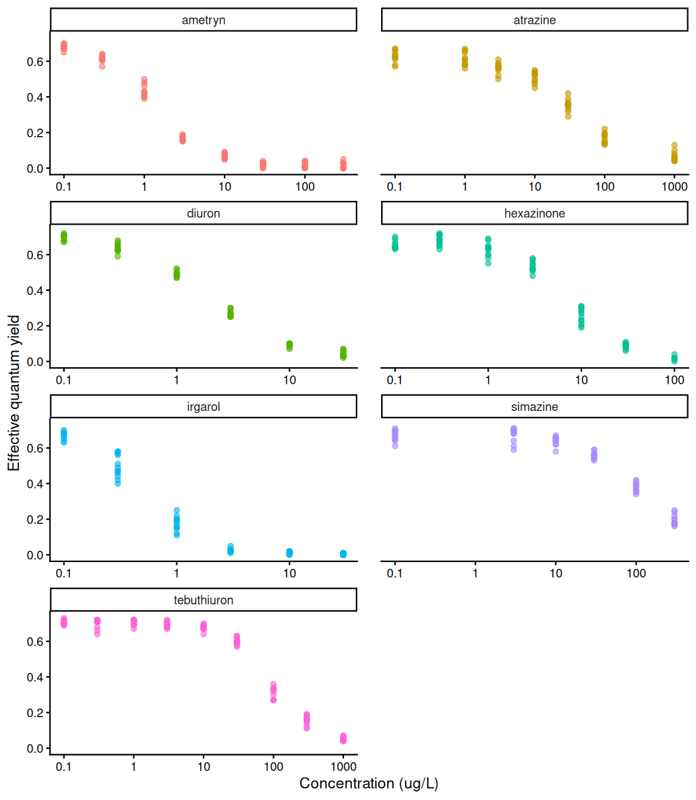
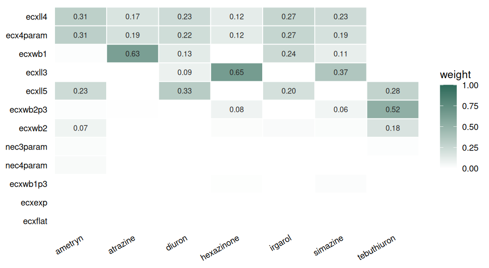
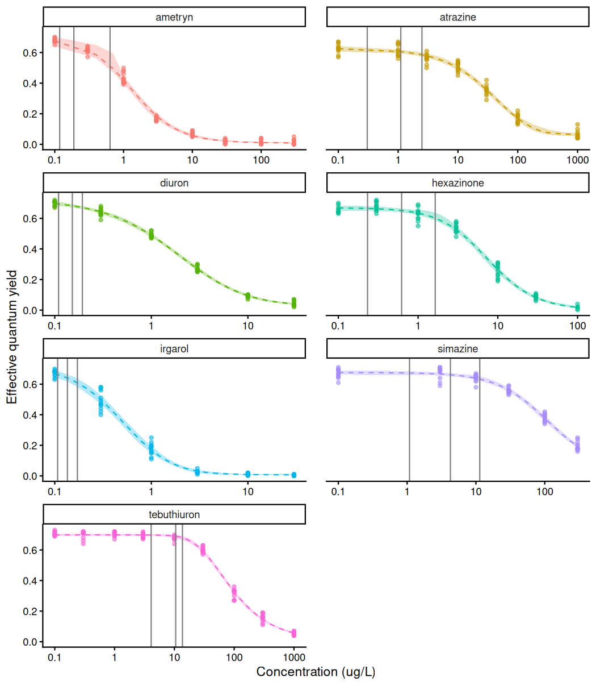
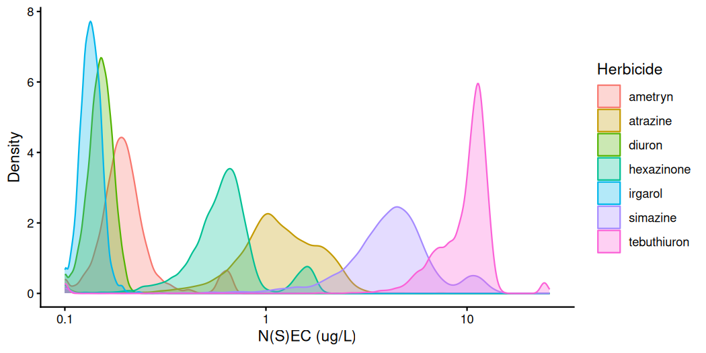
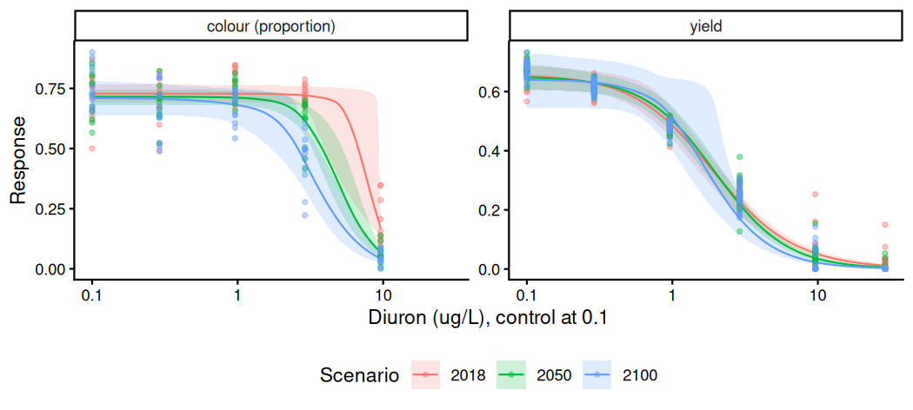
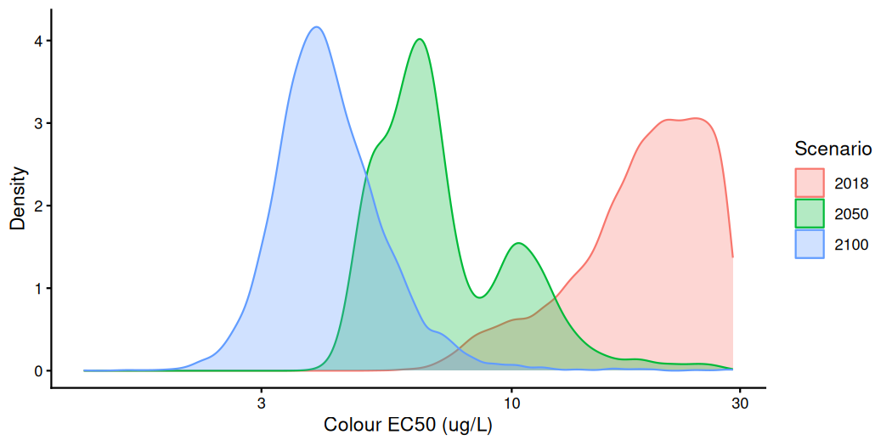
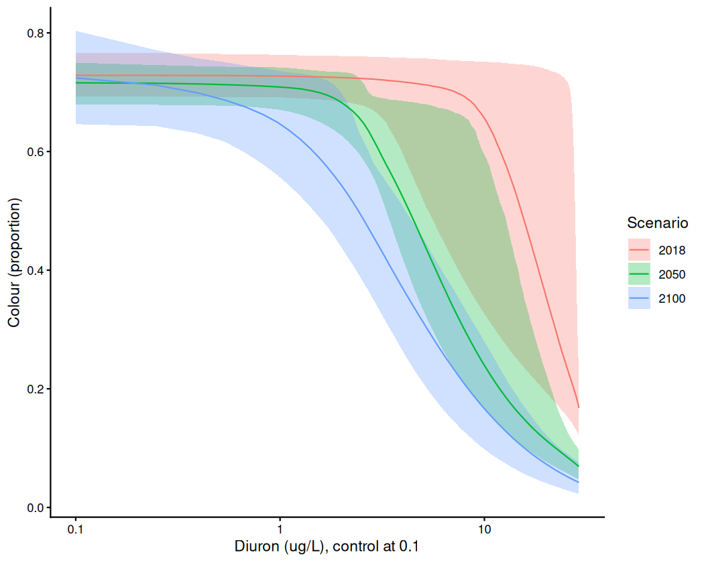
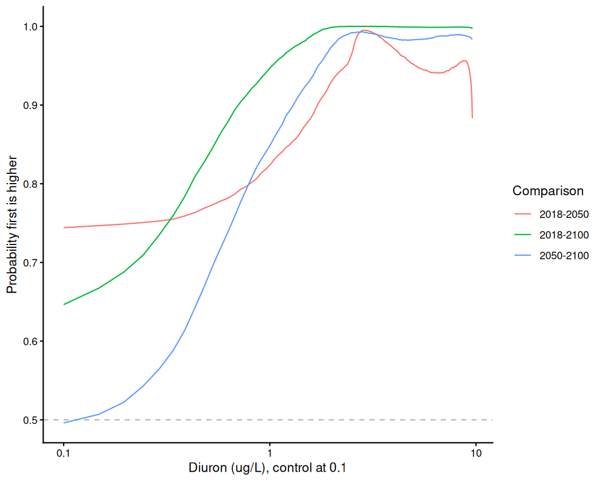

[e1]: https://open-aims.github.io/bayesnec/articles/example1.html
[e2]: https://open-aims.github.io/bayesnec/articles/example2.html
[e2b]: https://open-aims.github.io/bayesnec/articles/example2b.html
[e3]: https://open-aims.github.io/bayesnec/articles/example3.html
[e4]: https://open-aims.github.io/bayesnec/articles/example4.html
[e8]: https://open-aims.github.io/bayesnec/articles/example8.html

# Overview

With `bayesnec` we have included a function that allows bootstrapped
comparisons of posterior predictions. The main focus here is to showcase how the
user can fit several different `bnec` model fits and can compare differences in
the posterior predictions across these fits for individual toxicity estimates
(e.g. *NEC*, *N(S)EC*, *NSEC* or *ECx*) or across a range of predictor values.
The `compare_posterior` function was developed with the intention of comparing
model sets based on different data to assess statistically the difference in
either the toxicity estimates, or across the entire fitted curve, amongst
factors of interest. Examples would include assessing for changes in toxicity
across different WET tests through time, or comparing different levels of a
factor treatment variable (such as climate change scenarios), to look at how
these interact with concentration to impact toxicity.

A factor covariate can be fitted in `bayesnec` in three ways, and these answer
different questions. A group-level term written into the formula (`ogl()`,
`(par | group)` or `pgl()`) fits one model to all of the data, treating the
levels as a sample from a population and estimating how far each level departs
from a curve the levels share. Alternatively, `bnec_group()` fits each level
separately, so that each level has its own model set and its own functional
form and shares nothing with the other levels. This is the approach required
where the levels are fixed and of interest in themselves. A `bnec_group()` fit
can also be refitted as a single model using `bnec_joint()`, in which each level
is fitted with the equation its own model weights favour (by default) and has
its own parameter values, but all levels are estimated in one posterior. Which
designs admit which of these approaches is set out in the
[Grouping and factor covariates][e8] vignette.

`compare_posterior` is the function used to compare separate fits, whether these
come from `bnec_group()` or from calls made independently for each level. It
pairs the draws of two posteriors using a random permutation, which approximates
their difference when the posteriors are independent. Separate fits of the
levels by `bnec_group()` meet that condition. Levels of a fit with a shared
term may be dependent, and permuting their draws would discard that dependence.
For a joint fit, we therefore take a contrast by differencing its aligned
draws. This also applies to the herbicide refit below, in which the levels have
no shared parameters.

Below we demonstrate `compare_posterior` on two published datasets that are
included in `bayesnec`, each fitted separately by level using `bnec_group()`. In
the first, the levels are seven photosystem II herbicides tested on the coral
*Seriatopora hystrix* [@jones2003]. In the second, the levels are three climate
scenarios under which the coral *Acropora millepora* was exposed to one of those
herbicides, diuron [@flores2021], and the comparison is the one that study was
designed to make. A final section uses the herbicide fits to show how two levels
are compared within a single joint refit.

To run this vignette, we will also need some additional packages


``` r
library(bayesnec)
library(ggplot2)
library(dplyr)
```

Both concentration series span two or more orders of magnitude, so each figure
is drawn on a log axis. `ggbnec_data()` and `compare_posterior()` return the
predictor on the scale it was recorded on, having already inverted any
transformation written inside `crf()`, so the axis is set by transforming the
scale and not the values. The helper `group_curves()` collects the fitted curve
of each level of a `bnec_group()` fit into one data frame, so that a single
`ggplot()` call can draw them together.


``` r
log_x <- scale_x_continuous(transform = "log10",
                            labels = function(x) signif(x, 2))
group_curves <- function(x) {
  do.call(rbind, Map(function(f, lev) data.frame(level = lev, ggbnec_data(f)),
                     x$fits, x$levels))
}
```

# Herbicide phytotoxicity to coral

`herbicide` [@jones2003] contains the effective quantum yield of photosystem II
in the symbiotic dinoflagellates of the coral *Seriatopora hystrix*, measured
after a ten-hour exposure to each of seven photosystem II inhibiting herbicides
(<https://doi.org/10.3354/meps261149>). Three replicate containers of four
corals were held at each concentration. However, the container is not recorded
in `herbicide`, so no group-level term can be included for it and the fits below
include none.


``` r
data(herbicide)
ggplot(herbicide, aes(x = concentration, y = fvfm, colour = herbicide)) +
  geom_point(alpha = 0.6) +
  facet_wrap(~herbicide, ncol = 2, scales = "free_x") +
  log_x +
  scale_colour_hue(guide = "none") +
  theme_classic() +
  theme(panel.spacing.x = unit(1.2, "lines")) +
  labs(x = "Concentration (ug/L)", y = "Effective quantum yield")
```

<div class="figure" style="text-align: center">

<p class="caption">plot of chunk exmp4-herbicide-raw</p>
</div>

Effective quantum yield declines with concentration for all seven herbicides,
although the concentration at which it does so differs by about two orders of
magnitude among them. For example, yield is at half its lowest-dose mean by
1 µg/L of irgarol and 3 µg/L of diuron or ametryn, against 100 µg/L of
tebuthiuron and 300 µg/L of simazine (the highest concentration simazine was
tested at).

## Separate fits for each herbicide

The seven herbicides are a fixed set chosen for their interest, and not a sample
from a larger population of herbicides. Their functional forms may differ, and
there is no common curve towards which they should be shrunk, so we fit each
herbicide separately using `bnec_group()`. We use the `"decline"` model set,
which is the set used for Figure 11 of @fisher2024.


``` r
fits_herb <- bnec_group(fvfm ~ crf(log(concentration), "decline"),
                        data = herbicide, group_var = "herbicide",
                        family = Beta(link = "identity"),
                        seed = 228, refresh = 0)
```

Each herbicide is screened separately because each was fitted separately, so an
equation that fails for one herbicide is removed from that herbicide without
discarding its fits for the other six.


``` r
fits_herb <- screen_models(fits_herb, group_action = "per_level")
#> Screening level "ametryn".
#> All 12 candidate models passed the sampler screen (Rhat <= 1.01, ESS >= 400, divergences <= 10).
#> Screening level "atrazine".
#> Dropping 1 of 12 candidate models that failed the sampler screen:
#>   -  ecxll5: 30 divergent transitions
#> Fitted models are: nec3param nec4param ecxexp ecx4param ecxwb1 ecxwb2 ecxwb1p3 ecxwb2p3 ecxll4 ecxll3 ecxflat
#> The fitted ecxflat curve does not fall to the control's 0.01 quantile within the predictor range for 7920 of 8000 draws. The NSEC summary is censored at 6.91: those draws keep their rank in it and are given no value.
#> Screening level "diuron".
#> All 12 candidate models passed the sampler screen (Rhat <= 1.01, ESS >= 400, divergences <= 10).
#> Screening level "hexazinone".
#> All 11 candidate models passed the sampler screen (Rhat <= 1.01, ESS >= 400, divergences <= 10).
#> Screening level "irgarol".
#> All 12 candidate models passed the sampler screen (Rhat <= 1.01, ESS >= 400, divergences <= 10).
#> Screening level "simazine".
#> Dropping 1 of 12 candidate models that failed the sampler screen:
#>   -  ecxll5: ESS 163.4, 113 divergent transitions
#> Fitted models are: nec3param nec4param ecxexp ecx4param ecxwb1 ecxwb2 ecxwb1p3 ecxwb2p3 ecxll4 ecxll3 ecxflat
#> The fitted ecxflat curve does not fall to the control's 0.01 quantile within the predictor range for 7920 of 8000 draws. The NSEC summary is censored at 5.7: those draws keep their rank in it and are given no value.
#> Screening level "tebuthiuron".
#> All 12 candidate models passed the sampler screen (Rhat <= 1.01, ESS >= 400, divergences <= 10).
```

The screen removes `ecxll5` for atrazine (30 divergent transitions) and for
simazine (113 divergent transitions and an effective sample size, or ESS, of
163), so each herbicide keeps
eleven or twelve equations of `"decline"`.

`summary()` on a `bayesnecgroupfit` prints a full summary for each level, which
for seven herbicides is several hundred lines. Here we collate only the model
weights, to show which equations each herbicide supports.


``` r
herb_wi <- do.call(rbind, Map(function(f, lev) {
  w <- summary(f)$mod_weights[, "wi"]
  data.frame(herbicide = lev, equation = names(w), wi = as.numeric(w))
}, fits_herb$fits, fits_herb$levels))
# Order the equations by their total weight, so those in use are at the top.
herb_wi$equation <- reorder(factor(herb_wi$equation), herb_wi$wi, sum)

ggplot(herb_wi, aes(x = herbicide, y = equation, fill = wi)) +
  geom_tile(colour = "white", linewidth = 0.4) +
  geom_text(aes(label = ifelse(wi >= 0.05, sprintf("%.2f", wi), "")),
            size = 2.7, colour = "grey15") +
  scale_fill_gradient(low = "white", high = "#2c6a5a", name = "weight",
                      limits = c(0, 1)) +
  theme_classic() +
  theme(axis.text.x = element_text(angle = 30, hjust = 1),
        axis.line = element_blank(), axis.ticks = element_blank()) +
  labs(x = NULL, y = NULL)
```

<div class="figure" style="text-align: center">

<p class="caption">plot of chunk exmp4-herb-weights</p>
</div>

The herbicides differ in which equations describe them. For example, tebuthiuron
puts 0.52 of its weight on `ecxwb2p3`, which receives no more than 0.08 for any
other herbicide, and hexazinone puts 0.65 on `ecxll3`, which four of the others
weight below 0.05. Ametryn, hexazinone and irgarol spread their weight over four
equations, and diuron and simazine over five (counting the labelled cells, those
of 0.05 or more). No herbicide gives `nec3param` or `nec4param` a weight of 0.05
or more. This suggests that fitting the levels separately is appropriate
here, because the curve they would be shrunk towards is not one the data agree
on.


``` r
ggplot(group_curves(fits_herb), aes(x = x_e, colour = level, fill = level)) +
  geom_polygon(aes(y = y_ci), colour = NA, alpha = 0.3) +
  # Give the line only the rows of the curve; the band's return half has no y_e.
  geom_line(data = ~ subset(.x, !is.na(y_e)), aes(y = y_e), linetype = 2) +
  geom_point(aes(x = x_r, y = y_r), alpha = 0.6, size = 1.2) +
  geom_vline(aes(xintercept = nec_vals), colour = "grey50") +
  facet_wrap(~level, ncol = 2, scales = "free_x") +
  log_x +
  scale_colour_hue(guide = "none") +
  scale_fill_hue(guide = "none") +
  theme_classic() +
  theme(panel.spacing.x = unit(1.2, "lines")) +
  labs(x = "Concentration (ug/L)", y = "Effective quantum yield")
```

<div class="figure" style="text-align: center">

<p class="caption">plot of chunk exmp4-herbicides</p>
</div>

The fitted band follows the observations down for each herbicide, with the
N(S)EC (grey lines, the median and 95% credible interval) at or a little before
the concentration where the points leave the control level. The N(S)EC is the
model-averaged no-effect estimate, based mainly on the NEC where threshold
equations receive most of the weight and on the NSEC where smooth equations do.
The threshold equations receive almost no weight for any herbicide here, so the
N(S)EC of each is in effect an NSEC. The response axis is shared and the concentration axis
is not, so the panels are comparable in level but not in position. The seven curves have a similar shape and are located at different
concentrations,
which suggests that what separates the herbicides is where the curve falls, more
than how it falls.

## Comparing toxicity estimates across herbicides

`compare_posterior` takes a `bnec_group()` fit directly and compares its levels.
Here we compare the N(S)EC across the herbicides. The posterior draws for each herbicide are returned in `posterior_data`, which we
summarise first.


``` r
cmp_herb <- compare_posterior(fits_herb, comparison = "n(s)ec")
herb_post <- cmp_herb$posterior_data
herb_post |>
  group_by(model) |>
  summarise(median = median(value), lower = quantile(value, 0.025),
            upper = quantile(value, 0.975)) |>
  arrange(median)
#> # A tibble: 7 × 4
#>   model       median lower  upper
#>   <chr>        <dbl> <dbl>  <dbl>
#> 1 irgarol      0.134 0.106  0.170
#> 2 diuron       0.151 0.109  0.194
#> 3 ametryn      0.194 0.118  0.634
#> 4 hexazinone   0.624 0.235  1.66 
#> 5 atrazine     1.13  0.333  2.49 
#> 6 simazine     4.24  0.983 11.4  
#> 7 tebuthiuron 10.6   4.42  13.6
```

The N(S)EC estimates span about two orders of magnitude, from irgarol at
0.134 µg/L (0.106–0.170) and diuron at 0.151 (0.109–0.194), through ametryn at
0.194, hexazinone at 0.624 and atrazine at 1.13, to simazine at 4.24 and
tebuthiuron at 10.6 (4.42–13.6). These draws can also be plotted as densities.


``` r
ggplot(data = herb_post, mapping = aes(x = value)) +
  geom_density(mapping = aes(group = model, colour = model, fill = model),
               alpha = 0.3) +
  log_x +
  theme_classic() +
  labs(x = "N(S)EC (ug/L)", y = "Density", fill = "Herbicide",
       colour = "Herbicide")
```

<div class="figure" style="text-align: center">

<p class="caption">plot of chunk exmp4-cmp-herbicides</p>
</div>

This is the display shown in Figure 11 of @fisher2024. Irgarol and diuron, the most potent of the herbicides, overlap substantially: their intervals run from 0.106 to 0.170 and from 0.109
to 0.194 µg/L, so that one is almost inside the
other. The posteriors also differ in width as much as in position. For example,
the interval for irgarol spans a factor of 1.6 from end to end and that for
diuron a factor of 1.8, against 11.6 for simazine and 7.5 for atrazine. Several
of the posteriors are bimodal, such as hexazinone, with a second mode near
1.6 µg/L, and simazine, with one near 11. A model-averaged posterior is a mixture,
and an equation with little weight that places its threshold elsewhere can
appear as a second mode or a long tail, without changing the median.

The probability that the first herbicide of each pair has the higher N(S)EC is
returned in `prob_diff`, so a value near 0 or 1 separates two herbicides and one
near 0.5 does not.


``` r
cmp_herb$prob_diff
#>                comparison        prob  prob_lower  prob_upper censored_first censored_second
#> 1        ametryn-atrazine 0.019252407 0.019252407 0.019252407              0               0
#> 2          ametryn-diuron 0.837354669 0.837354669 0.837354669              0               0
#> 3      ametryn-hexazinone 0.045380673 0.045380673 0.045380673              0               0
#> 4         ametryn-irgarol 0.922740343 0.922740343 0.922740343              0               0
#> 5        ametryn-simazine 0.010126266 0.010126266 0.010126266              0               0
#> 6     ametryn-tebuthiuron 0.011126391 0.011126391 0.011126391              0               0
#> 7         atrazine-diuron 0.987373422 0.987373422 0.987373422              0               0
#> 8     atrazine-hexazinone 0.838979872 0.838979872 0.838979872              0               0
#> 9        atrazine-irgarol 0.987998500 0.987998500 0.987998500              0               0
#> 10      atrazine-simazine 0.044880610 0.044880610 0.044880610              0               0
#> 11   atrazine-tebuthiuron 0.011751469 0.011751469 0.011751469              0               0
#> 12      diuron-hexazinone 0.014751844 0.014751844 0.014751844              0               0
#> 13         diuron-irgarol 0.731966496 0.731966496 0.731966496              0               0
#> 14        diuron-simazine 0.009501188 0.009501188 0.009501188              0               0
#> 15     diuron-tebuthiuron 0.011251406 0.011251406 0.011251406              0               0
#> 16     hexazinone-irgarol 0.986248281 0.986248281 0.986248281              0               0
#> 17    hexazinone-simazine 0.018127266 0.018127266 0.018127266              0               0
#> 18 hexazinone-tebuthiuron 0.011251406 0.011251406 0.011251406              0               0
#> 19       irgarol-simazine 0.009251156 0.009251156 0.009251156              0               0
#> 20    irgarol-tebuthiuron 0.011251406 0.011251406 0.011251406              0               0
#> 21   simazine-tebuthiuron 0.076509564 0.076509564 0.076509564              0               0
```

Of the 21 pairs, 16 have a probability below 0.05 or above 0.95. For example,
the probability that irgarol has the higher N(S)EC is 0.009 against simazine and
0.011 against tebuthiuron. The least separated pair is diuron and irgarol at
0.732, the most potent of the set, followed by ametryn and diuron at 0.837,
atrazine and hexazinone at 0.839, ametryn and irgarol at 0.923, and simazine and
tebuthiuron at 0.077.
`bnec_group()` fits each herbicide separately, so the independence that the
random pairing of `compare_posterior` assumes is satisfied here.

The N(S)EC is a no-effect estimate, and it is not what @jones2003 report. They
report EC50 values (the concentration at which yield is halved), so the
comparison with the source study uses `ecx()`.


``` r
ecx(fits_herb, ecx_val = 50)
#>         level         Q50        Q2.5       Q97.5 bound_Q50 bound_Q2.5 bound_Q97.5
#> 1     ametryn   1.4591758   1.2863149   1.6324673                                 
#> 2    atrazine  39.3445996  34.7377094  44.3024469                                 
#> 3      diuron   2.0418154   1.8998202   2.1894078                                 
#> 4  hexazinone   7.4208606   6.7161146   8.0947159                                 
#> 5     irgarol   0.5399852   0.4873592   0.5958367                                 
#> 6    simazine 124.1203960 112.8038986 136.3685623                                 
#> 7 tebuthiuron  90.3584313  84.5195241  95.2532588
```

@jones2003 give EC50 values of 0.7 µg/L for irgarol, 1.7 for ametryn, 2.3 for
diuron, 8.8 for hexazinone, 45 for atrazine, 150 for simazine and 175 for
tebuthiuron. Six of the seven agree closely, with the published value between 13
and 30 per cent above the one here, and both studies rank
those six in one order.
Tebuthiuron is the exception at roughly half the published value, and it is also
the herbicide whose order differs: here it is more toxic than simazine, whereas
in the source study it is less so. The published and fitted estimates
were derived differently. @jones2003 interpolated linearly between the tested concentrations (in ToxCalc 5.0), while the values above are a model
average over eleven or twelve fitted curves. Linear interpolation across a log-spaced series follows
the chord of a curve that is concave over that interval, which places the
half-effect concentration higher than a fitted curve would, and this may
explain why the published value is higher for all seven herbicides. Nothing in these data indicates which
estimate is closer to the truth for tebuthiuron.

# Diuron under climate scenarios

`coral_colour` and `coral_pam` contain two endpoints from one experiment, in
which fragments of the coral *Acropora millepora* were exposed to diuron for 14
days under three climate scenarios [@flores2021,
<https://doi.org/10.1016/j.marpolbul.2021.112582>]. The scenarios are
combinations of temperature and dissolved carbon dioxide, labelled by the year
they represent: 28.1 °C at 397 ppm for present-day conditions (2018), and projections under the high-emissions pathway RCP8.5 of 29.1 °C at 680 ppm (2050) and 30.2 °C at 858 ppm (2100). Three
replicate chambers were run at each combination of scenario and concentration,
with four coral fragments in each. @jones2003 found the effect of diuron on
*S. hystrix* to be inversely related to temperature, which is the observation
@flores2021 tested by crossing diuron with warming.

Both endpoints were measured on each fragment. `yield` in `coral_pam` is the
effective quantum yield of photosystem II, the quantity also recorded in
`herbicide`, read by pulse-amplitude modulated fluorometry. `proportion` in
`coral_colour` is a colour index used as a measure of bleaching, derived from
photographs of the fragments and rescaled between the smallest and largest
values observed (see `?coral_colour`). @flores2021 report that all corals at 9.6
and 29 µg/L had died after 10 to 11 days of exposure, so the colour readings at
29 µg/L are of fragments that had bleached completely.

@flores2021 compared EC50 values between the scenarios using `bayesnec`, and
found that the colour index EC50 was lower under both future scenarios than
under present-day conditions, with probabilities of 0.956 (2050) and 0.970
(2100). For yield the corresponding probabilities were 0.615 and 0.539, so the
scenarios were not separated.

## The control on a log axis

Both endpoints include an untreated control recorded as a concentration of 0,
which has no position on a log axis, and `bnec()` refuses `crf(log(diuron))`
because the logarithm of 0 is not finite. We therefore substitute 0.1 µg/L for the control. The
treatments form a half-log dilution series (0.29, 0.96, 2.9, 9.6 and 29 µg/L,
each step about 3.16 times the last), and 0.1 is one further step below the
lowest treatment, rounded. The substitution is made here and not in the shipped
data, and an estimate returned near 0.1 µg/L would describe the substitution
and not diuron.


``` r
data(coral_colour)
data(coral_pam)
nudge <- function(x) ifelse(x == 0, 0.1, x)
coral_colour$diuron_adj <- nudge(coral_colour$diuron)
coral_pam$diuron_adj <- nudge(coral_pam$diuron)
```

## Separate fits for each scenario

The three scenarios are fixed levels of interest, so each is fitted separately
using `bnec_group()`. Each chamber was held at one concentration and contained
several fragments, so the fragments within a chamber are not independent
observations, and we include a group-level term on chamber (`ogl(chamber)`) to
allow for this. The [Grouping and factor covariates][e8] vignette describes what
a term of this kind estimates where each of its levels is observed at a single
concentration, and the model weights of a set fitted with it leave out each
chamber whole (see the `loo_controls` argument of `bnec()`).

The colour design has five concentrations and none between 2.9 and 29 µg/L,
which appears to be too few to estimate both asymptotes of an equation with four
curve parameters reliably. We therefore restrict the model set to four
equations with three curve parameters (`nec3param`, `ecxll3`, `ecxwb1p3` and
`ecxwb2p3`), and use this set for yield as well, so that the endpoints are compared on one
set of equations.


``` r
fits_colour <- bnec_group(
  proportion ~ crf(log(diuron_adj),
                   c("nec3param", "ecxll3", "ecxwb1p3", "ecxwb2p3")) +
    ogl(chamber),
  data = coral_colour, group_var = "climate",
  family = Beta(link = "identity"), seed = 228, refresh = 0)

fits_yield <- bnec_group(
  yield ~ crf(log(diuron_adj),
              c("nec3param", "ecxll3", "ecxwb1p3", "ecxwb2p3")) +
    ogl(chamber),
  data = coral_pam, group_var = "climate",
  family = Beta(link = "identity"), seed = 228, refresh = 0)
```


``` r
fits_colour <- screen_models(fits_colour, group_action = "per_level")
#> Screening level "2018".
#> Dropping 1 of 4 candidate models that failed the sampler screen:
#>   -  ecxwb2p3: 52 divergent transitions
#> Fitted models are: nec3param ecxll3 ecxwb1p3
#> Screening level "2050".
#> Dropping 1 of 4 candidate models that failed the sampler screen:
#>   -  ecxll3: ESS 387.5
#> Fitted models are: nec3param ecxwb1p3 ecxwb2p3
#> The leave-one-group-out score has Pareto k above 0.7 for 1 of 15 levels of chamber in ecxwb2p3 (weight 0.51). The scores of those levels are approximate; loo_controls = list(refit = TRUE) replaces them by refitting the equation without each level.
#> Screening level "2100".
#> All 4 candidate models passed the sampler screen (Rhat <= 1.01, ESS >= 400, divergences <= 10).
fits_yield <- screen_models(fits_yield, group_action = "per_level")
#> Screening level "2018".
#> All 4 candidate models passed the sampler screen (Rhat <= 1.01, ESS >= 400, divergences <= 10).
#> Screening level "2050".
#> Dropping 1 of 4 candidate models that failed the sampler screen:
#>   -  nec3param: ESS 185.1
#> Fitted models are: ecxll3 ecxwb1p3 ecxwb2p3
#> The leave-one-group-out score has Pareto k above 0.7 for 1 of 18 levels of chamber in ecxll3 (weight 0.97); 1 of 18 levels of chamber in ecxwb2p3 (weight 0.03). The scores of those levels are approximate; loo_controls = list(refit = TRUE) replaces them by refitting the equation without each level.
#> Screening level "2100".
#> All 4 candidate models passed the sampler screen (Rhat <= 1.01, ESS >= 400, divergences <= 10).
```


The screen removes one equation from three of the six level fits: `ecxwb2p3`
from the 2018 colour fit (52 divergent transitions), `ecxll3` from the 2050
colour fit (an ESS of 388) and `nec3param` from the 2050 yield fit (an ESS of
185). For the 2050 fits of both endpoints, the leave-one-group-out score also has a
Pareto *k* above 0.7 for one chamber in some equations (`ecxwb2p3` for colour,
and `ecxll3` and `ecxwb2p3` for yield), so the contribution of that chamber to
the model weights is approximate. `loo_controls = list(refit = TRUE)` would
replace it by refitting each equation without the chamber, which we have not
done here.

``` r
rbind(data.frame(endpoint = "colour (proportion)", group_curves(fits_colour)),
      data.frame(endpoint = "yield", group_curves(fits_yield))) |>
  ggplot(aes(x = x_e, colour = level, fill = level)) +
  geom_polygon(aes(y = y_ci), colour = NA, alpha = 0.2) +
  # Give the line only the rows of the curve; the band's return half has no y_e.
  geom_line(data = ~ subset(.x, !is.na(y_e)), aes(y = y_e)) +
  geom_point(aes(x = x_r, y = y_r), alpha = 0.4, size = 1) +
  facet_wrap(~endpoint, scales = "free_y") +
  log_x +
  theme_classic() +
  theme(legend.position = "bottom") +
  labs(x = "Diuron (ug/L), control at 0.1", y = "Response",
       colour = "Scenario", fill = "Scenario")
```

<div class="figure" style="text-align: center">

<p class="caption">plot of chunk exmp4-coral-fits</p>
</div>

The scenarios appear to separate in colour and barely at all in yield. For example, mean
colour at 2.9 µg/L is 0.728, 0.611 and 0.456 from 2018 to 2100, whereas mean
yield differs by less than 0.015 between scenarios at each concentration below
9.6 µg/L. The fitted band for yield under the 2100 scenario is also wider than
the others, from the control to about 2 µg/L.

## Comparing toxicity estimates across scenarios

We first compare the colour EC50 across the scenarios, because this is the
estimate @flores2021 compared.


``` r
cmp_colour <- compare_posterior(fits_colour, comparison = "ecx", ecx_val = 50)
cmp_colour$prob_diff
#>   comparison     prob prob_lower prob_upper censored_first censored_second
#> 1  2018-2050 0.961875   0.961875   0.961875              0        0.000000
#> 2  2018-2100 0.997250   0.997250   0.997250              0        0.000125
#> 3  2050-2100 0.922000   0.922000   0.922000              0        0.000125
```


``` r
ggplot(data = cmp_colour$posterior_data, mapping = aes(x = value)) +
  geom_density(mapping = aes(group = model, colour = model, fill = model),
               alpha = 0.3) +
  log_x +
  theme_classic() +
  labs(x = "Colour EC50 (ug/L)", y = "Density", fill = "Scenario",
       colour = "Scenario")
```

<div class="figure" style="text-align: center">

<p class="caption">plot of chunk exmp4-cmp-colour</p>
</div>

The probability that the 2018 EC50 is the higher is 0.962 against the 2050
scenario and 0.997 against the 2100 scenario, which is similar to the
probabilities of 0.956 and 0.970 that @flores2021 report. However, the EC50 values themselves differ from theirs. The posterior for 2100 is centred near 4 µg/L and
that for 2050 near 6 µg/L (with a second mode near 10), whereas the posterior for
2018 is spread from about 8 µg/L to 29 µg/L, the highest concentration tested.
@flores2021 report EC50 values of 6.05, 4.99 and 4.86 µg/L, measured for each
scenario against one reference response (halfway between the mean 2018 control
and the mean 2100 response at 29 µg/L), whereas `ecx()` measures each scenario
against its own control. The width of the 2018 posterior probably reflects the
colour design, which has no concentration between 2.9 and 29 µg/L at which to
locate the 2018 decline.

This comparison can be made for any estimate that `compare_posterior` accepts.
Here we tabulate the probabilities for the EC50, the EC10 and the N(S)EC, for
both endpoints.


``` r
scenario_probs <- function(fit) {
  prob <- function(...) compare_posterior(fit, ...)$prob_diff
  ec50 <- prob(comparison = "ecx", ecx_val = 50)
  data.frame(comparison = ec50$comparison,
             EC50 = ec50$prob,
             EC10 = prob(comparison = "ecx", ecx_val = 10)$prob,
             "N(S)EC" = prob(comparison = "n(s)ec")$prob,
             check.names = FALSE)
}
rbind(data.frame(endpoint = "colour", scenario_probs(fits_colour),
                 check.names = FALSE),
      data.frame(endpoint = "yield", scenario_probs(fits_yield),
                 check.names = FALSE))
#>   endpoint comparison     EC50     EC10   N(S)EC
#> 1   colour  2018-2050 0.961875 0.963875 0.953750
#> 2   colour  2018-2100 0.997250 0.994875 0.985875
#> 3   colour  2050-2100 0.922000 0.945500 0.890500
#> 4    yield  2018-2050 0.402125 0.272125 0.271625
#> 5    yield  2018-2100 0.631125 0.223625 0.082375
#> 6    yield  2050-2100 0.689875 0.305875 0.084250
```

For colour, the 2018 scenario has the higher estimate against both future
scenarios with a probability above 0.95, whichever of the three estimates is
used. For yield, no estimate gives a probability below 0.05 or above 0.95, and the
probabilities for the EC50 and the EC10 range from 0.22 to 0.69, which is
consistent with the probabilities of 0.615 and 0.539 that @flores2021 report
for the yield EC50.
The yield N(S)EC under the 2100 scenario is higher than under the other two
scenarios, with a probability of 0.92 against each, which is in the opposite
direction to an effect of warming. This may reflect the less precisely estimated
control under the 2100 scenario (the wider band in the figure above), because
the NSEC is measured from a lower quantile of the control response, and should not be read as an effect of climate from these data.

## Comparing the fitted curves

The user can also compare the posterior fitted values across the full range of
concentrations, using `comparison = "fitted"`. We increase `resolution` from its
default of 50, because the concentrations at which predictions are made are
evenly spaced on the recorded scale, and the lower half of a log axis would
otherwise contain only a few of them.


``` r
cmp_colour_fit <- compare_posterior(fits_colour, comparison = "fitted",
                                    resolution = 200)
head(cmp_colour_fit$posterior_data)
#>   model         x  Estimate      Q2.5     Q97.5
#> 1  2018 0.1000000 0.7285043 0.6922875 0.7664554
#> 2  2018 0.2452261 0.7283892 0.6922071 0.7657922
#> 3  2018 0.3904523 0.7282519 0.6922044 0.7653569
#> 4  2018 0.5356784 0.7280907 0.6921380 0.7643305
#> 5  2018 0.6809045 0.7278394 0.6919410 0.7640378
#> 6  2018 0.8261307 0.7275729 0.6917574 0.7635209
```

In the case of `comparison = "fitted"` the elements returned by
`compare_posterior` are data frames, with summary values of the posterior, of
the differences and of the probabilities for each value of the predictor, for
each scenario or pair of scenarios.


``` r
ggplot(data = cmp_colour_fit$posterior_data) +
  geom_ribbon(mapping = aes(x = x, ymin = Q2.5, ymax = Q97.5, fill = model),
              alpha = 0.3) +
  geom_line(mapping = aes(x = x, y = Estimate, colour = model),
            linewidth = 0.5) +
  log_x +
  theme_classic() +
  labs(x = "Diuron (ug/L), control at 0.1", y = "Colour (proportion)",
       colour = "Scenario", fill = "Scenario")
```

<div class="figure" style="text-align: center">

<p class="caption">plot of chunk exmp4-colour-fitted</p>
</div>


``` r
ggplot(data = cmp_colour_fit$prob_diff) +
  geom_hline(yintercept = 0.5, colour = "grey70", linetype = 2) +
  geom_line(mapping = aes(x = x, y = prob, colour = comparison),
            linewidth = 0.5) +
  log_x +
  theme_classic() +
  labs(x = "Diuron (ug/L), control at 0.1",
       y = "Probability first is higher", colour = "Comparison")
```

<div class="figure" style="text-align: center">

<p class="caption">plot of chunk exmp4-colour-prob</p>
</div>

The fitted curves for the three scenarios start at a similar colour (about 0.72
to 0.73 at the control), and the 2100 curve declines first, below 1 µg/L,
followed by the 2050 curve near 2 µg/L and the 2018 curve near 10 µg/L. The band
for 2018 is wide above 3 µg/L, again reflecting the absence of observations
between 2.9 and 29 µg/L. The probability that the 2018 curve is the higher
exceeds 0.9 against the 2100 curve from about 0.7 µg/L and against the 2050
curve from about 2 µg/L. Above about 1.5 µg/L, the comparison with 2100
remains above 0.95, while the comparison with 2050 dips to about 0.94 near
10 µg/L. The
2050 and 2100 curves are most clearly separated near 3 µg/L (a probability of
about 0.99), and less so near 10 µg/L (about 0.86). This suggests that the
scenarios differ over most of the range above about 1 µg/L, which is where the
colour response declines under at least one scenario.

# Contrasts from a joint refit

The comparisons above treat the levels as separate fits. `bnec_joint()` instead
takes the per-level fits of a `bnec_group()` call and builds one model that includes all levels, each level keeping the equation its own weights
favour and its own copy of that equation's parameters. A difference between two
levels is then a difference between coefficients of one fit, taken draw by draw,
and it needs no permutation.

No equation is named in the call. The equation for each level is read from the
weights the `bnec_group()` fit already computed, so the refit is of what each
herbicide separately favoured, and not of one form imposed on all seven. The
call comes after `screen_models()`, so it refits the equations each herbicide
retained after screening.


``` r
herb_joint <- bnec_joint(fits_herb, seed = 228, refresh = 0)
```


``` r
herb_joint
#> Object of class bayesnecjointfit
#> 
#>   equations         : ametryn = ecx4param, atrazine = ecxwb1, diuron = ecxll5, hexazinone = ecxll3, irgarol = ecx4param, simazine = ecxll3, tebuthiuron = ecxwb2p3 
#>   grouping variable : herbicide 
#>   levels            : ametryn, atrazine, diuron, hexazinone, irgarol, simazine, tebuthiuron 
#>   family            : beta (link = identity) 
#>   dispersion        : per level 
#>   weight at level   : ametryn 0.31, atrazine 0.628, diuron 0.331, hexazinone 0.653, irgarol 0.266, simazine 0.369, tebuthiuron 0.524 
#>   fitted by         : bayesnec 2.1.3.44, installed from a local source, which records no commit, under R 4.6.1 
#> 
#> Each level has its own equation and its own curve parameters in
#> one posterior; read them from the draws as
#> b_<parameter><level tag>_Intercept, the tags being ametryn = ametrynLv1, atrazine = atrazineLv2, diuron = diuronLv3, hexazinone = hexazinoneLv4, irgarol = irgarolLv5, simazine = simazineLv6, tebuthiuron = tebuthiuronLv7.
#> ecx(), nsec() and nec() return one row per level, and autoplot()
#> draws one panel per level.
```

Five different equations are used across the seven herbicides: `ecx4param` for
ametryn and irgarol, `ecxwb1` for atrazine, `ecxll5` for diuron, `ecxll3` for
hexazinone and simazine, and `ecxwb2p3` for tebuthiuron. The weight each chosen
equation received for its own herbicide ranges from 0.266 for irgarol to 0.653
for hexazinone, and is below 0.4 for four of the seven, which suggests that most of the
herbicides are not well described by a single form.

Each estimate from a joint refit is returned per level, one row each, as for a
`bnec_group()` fit.


``` r
ecx(herb_joint, ecx_val = 50)
#>         level         Q50        Q2.5      Q97.5 bound_Q50 bound_Q2.5 bound_Q97.5
#> 1     ametryn   1.4605707   1.2899305   1.629602                                 
#> 2    atrazine  40.0797815  35.9054921  44.793770                                 
#> 3      diuron   2.0623333   1.9374383   2.199501                                 
#> 4  hexazinone   7.4538850   6.8542001   8.096523                                 
#> 5     irgarol   0.5366745   0.4890598   0.591555                                 
#> 6    simazine 126.5668348 117.2100626 136.350713                                 
#> 7 tebuthiuron  90.8803725  86.7826173  95.188208
```

The contrast is then taken on the draws. `posterior = TRUE` returns the
per-level draws as a named list, and because they come from one fit they are
already aligned: draw *i* of one level and draw *i* of another were taken
together, at one step of one chain.


``` r
herb_draws <- ecx(herb_joint, ecx_val = 50, posterior = TRUE)
diuron_irgarol <- herb_draws[["diuron"]] - herb_draws[["irgarol"]]
c(prob_diuron_higher = mean(diuron_irgarol > 0),
  median_difference = median(diuron_irgarol),
  quantile(diuron_irgarol, c(0.025, 0.975)))
#> prob_diuron_higher  median_difference               2.5%              97.5% 
#>           1.000000           1.525176           1.389121           1.672942
```

The diuron EC50 exceeds that of irgarol in every draw, by 1.53 µg/L (1.39 to
1.67). A contrast can also be made on the N(S)EC, the estimate compared with
`compare_posterior` above.


``` r
herb_ne_draws <- nsec(herb_joint, posterior = TRUE)
diuron_irgarol_ne <- herb_ne_draws[["diuron"]] - herb_ne_draws[["irgarol"]]
c(prob_diuron_higher = mean(diuron_irgarol_ne > 0),
  median_difference = median(diuron_irgarol_ne),
  quantile(diuron_irgarol_ne, c(0.025, 0.975)))
#> prob_diuron_higher  median_difference               2.5%              97.5% 
#>        0.617000000        0.006362871       -0.038150811        0.049047814
```

On the N(S)EC the probability that diuron has the higher estimate is 0.617, with a
median difference of 0.006 µg/L (-0.038 to 0.049), against 0.732 from
`compare_posterior`. The joint refit and `compare_posterior` agree in direction, and do not separate
this pair on the N(S)EC. An ECx is a fixed decline from the control of each
level and is located where the curve is steep, whereas the N(S)EC is a departure
from a band around the control, and where the curve is nearly flat, a small change in where that band ends
produces a large change in the concentration at which the curve crosses it.

The joint refit estimates five functional forms and a separate dispersion for
each of seven herbicides, so we check its sampling.


``` r
np <- brms::nuts_params(herb_joint$fit)
s_joint <- summary(herb_joint$fit)
pars <- rbind(s_joint$fixed, s_joint$spec_pars)
c(divergent = sum(np$Value[np$Parameter == "divergent__"]),
  post_warmup_draws = sum(np$Parameter == "divergent__"),
  max_rhat = max(pars$Rhat), min_bulk_ess = min(pars$Bulk_ESS))
#>         divergent post_warmup_draws          max_rhat      min_bulk_ess 
#>          0.000000       8000.000000          1.001749       2148.367079
```

There were no divergent transitions in 8000 post-warmup draws, with a maximum
R-hat of 1.002 and a minimum bulk effective sample size of 2148.

A joint refit conditions on one equation per level, so the model uncertainty
that the per-level averages represent is absent from it. A narrower interval
after selecting one equation does not by itself show a gain in precision: it
omits uncertainty over the other equations. The chosen equation receives less
than 0.4 of the weight for four of the seven herbicides. For irgarol, whose
equation received 0.266 of the weight, the EC50 interval is 0.489 to 0.592 µg/L
in the joint refit, against 0.487 to 0.596 from the per-level model average.
The narrowing is small on these data.

`compare_posterior` and a joint refit therefore answer different questions. `compare_posterior` asks
how two independently estimated levels compare, each with its own model
uncertainty, which is appropriate where the levels were tested separately and
are being ranked. The joint refit asks how two levels compare conditional on
the selected equation for each. In this example each herbicide has its own curve
and dispersion parameters; the fitted model shares no parameter between them.
The aligned draws give a contrast under that model. A joint refit can also
include a shared term where the levels use one equation, for example in a
controlled comparison of treatments or sites.

# Provenance

The fits shown were made when this vignette was precompiled, so the estimates
are those of the package version it ships with. No call names `iter`, `warmup`
or `control`, so the defaults of `bnec()` apply (4 chains of 10000 iterations
with 8000 warmup), under `seed = 228`. `compare_posterior` pairs the draws under
its own `seed` argument, so its results do not depend on the session's random
number stream.


``` r
packageVersion("bayesnec")
#> [1] '2.1.3.44'
packageVersion("brms")
#> [1] '2.23.0'
R.version.string
#> [1] "R version 4.6.1 (2026-06-24)"
```

`herbicide` was built from the data of @jones2003 by `data-raw/herbicide_data.R`,
and `coral_colour` and `coral_pam` from the records behind @flores2021 by
`data-raw/coral_diuron.R`. The source records for the coral data are not
distributed with the package, although the scripts are, and the manual pages
state what was derived and how.

# References
