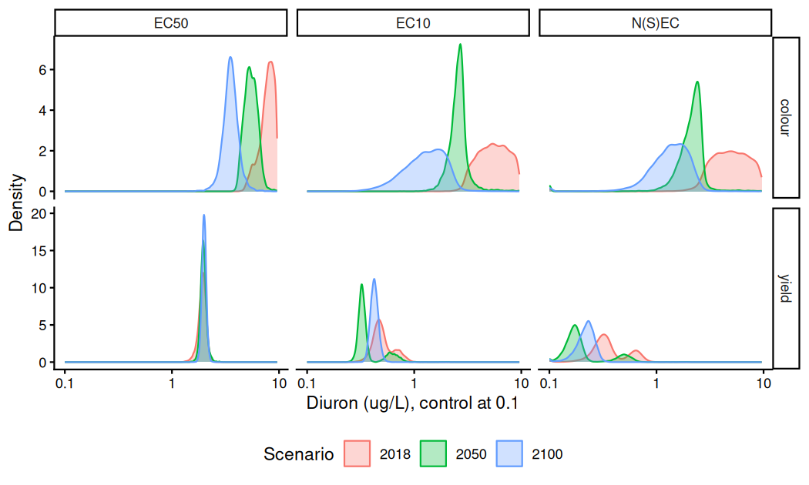

[e1]: https://open-aims.github.io/bayesnec/articles/example1.html
[e2]: https://open-aims.github.io/bayesnec/articles/example2.html
[e2b]: https://open-aims.github.io/bayesnec/articles/example2b.html
[e3]: https://open-aims.github.io/bayesnec/articles/example3.html
[e4]: https://open-aims.github.io/bayesnec/articles/example4.html
[e8]: https://open-aims.github.io/bayesnec/articles/example8.html
[e9]: https://open-aims.github.io/bayesnec/articles/example9.html

# Overview

With `bayesnec` we have included a function that allows comparisons of
posterior predictions. The main focus here is to showcase how the
user can fit several different `bnec` model fits and can compare differences in
the posterior predictions across these fits for individual toxicity estimates
(e.g. *NEC*, *N(S)EC*, *NSEC* or *ECx*) or across a range of predictor values.
The `compare_posterior` function was developed with the intention of comparing
model sets based on different data to assess statistically the difference in
either the toxicity estimates, or across the entire fitted curve, amongst
factors of interest. Examples would include assessing for changes in toxicity
across different WET tests through time, or comparing different levels of a
factor treatment variable (such as climate change scenarios), to look at how
these interact with concentration to impact toxicity.

A factor covariate can be fitted in `bayesnec` in three ways, and these answer
different questions. A group-level term written into the formula (`ogl()`,
`(par | group)` or `pgl()`) fits one model to all of the data, treating the
levels as a sample from a population and estimating how far each level departs
from a curve the levels share. Alternatively, `bnec_group()` fits each level
separately, so that each level has its own model set and its own functional
form and shares nothing with the other levels. This is the approach required
where the levels are fixed and of interest in themselves. A `bnec_group()` fit
can also be refitted as a single model using `bnec_joint()`, in which each level
is fitted with the equation its own model weights favour (by default) and has
its own parameter values, but all levels are estimated in one posterior. Which
designs admit which of these approaches is set out in the
[Grouping and factor covariates][e8] vignette.

For each pair of fits, `compare_posterior` pairs the posterior draws of an
estimate from one fit with those from the other at random, and subtracts one
from the other within each pair. It returns these differences, and in
`prob_diff` the proportion of them above zero, i.e. the probability that the
first fit has the higher estimate. This proportion estimates a posterior
probability where the two posteriors are independent, which is the case for
fits to separate data that share no parameter, such as the levels of a
`bnec_group()` fit and every comparison in this vignette.

Where two estimates come from one posterior and share a parameter, for example
two levels of a `bnec_joint()` refit with a common group-level term, they can
be correlated, and pairing their draws at random discards that correlation. The
contrast is then taken draw by draw, from the draws that `ecx()` returns for
each level of the refit under `posterior = TRUE`, as shown for copper and zinc
in the [Grouping and factor covariates][e8] vignette. Where two fits share
data, such as two equations of one model set, `prob_diff` describes how far
their posteriors overlap and cannot be read directly as a posterior probability
(see the section *What the comparison estimates* in `?compare_posterior`).

Below we demonstrate `compare_posterior` on two published datasets that are
included in `bayesnec`, each fitted separately by level using `bnec_group()`. In
the first, the levels are seven photosystem II herbicides tested on the coral
*Seriatopora hystrix* [@jones2003]. In the second, the levels are three climate
scenarios under which the coral *Acropora millepora* was exposed to one of those
herbicides, diuron [@flores2021], and the comparison is the one that study was
designed to make.

To run this vignette, we will also need some additional packages


``` r
library(bayesnec)
library(ggplot2)
library(dplyr)
```

Both concentration series span two or more orders of magnitude, so each figure
is drawn on a log axis. `ggbnec_data()` and `compare_posterior()` return the
predictor on the scale it was recorded on, having already inverted any
transformation written inside `crf()`, so the axis is set by transforming the
scale and not the values. The helper `group_curves()` collects the fitted curve
of each level of a `bnec_group()` fit into one data frame, so that a single
`ggplot()` call can draw them together.


``` r
log_x <- scale_x_continuous(transform = "log10",
                            labels = function(x) signif(x, 2))
group_curves <- function(x) {
  do.call(rbind, Map(function(f, lev) data.frame(level = lev, ggbnec_data(f)),
                     x$fits, x$levels))
}
```

# Herbicide phytotoxicity to coral

`herbicide` [@jones2003] contains the effective quantum yield of photosystem II
in the symbiotic dinoflagellates of the coral *Seriatopora hystrix*, measured
after a ten-hour exposure to each of seven photosystem II inhibiting herbicides
(<https://doi.org/10.3354/meps261149>). Three replicate containers of four
corals were held at each concentration. However, the container is not recorded
in `herbicide`, so no group-level term can be included for it and the fits below
include none.


``` r
data(herbicide)
ggplot(herbicide, aes(x = concentration, y = fvfm, colour = herbicide)) +
  geom_point(alpha = 0.6) +
  facet_wrap(~herbicide, ncol = 2, scales = "free_x") +
  log_x +
  scale_colour_hue(guide = "none") +
  theme_classic() +
  theme(panel.spacing.x = unit(1.2, "lines")) +
  labs(x = "Concentration (ug/L)", y = "Effective quantum yield")
```

<div class="figure" style="text-align: center">

<p class="caption">plot of chunk exmp4-herbicide-raw</p>
</div>

Effective quantum yield declines with concentration for all seven herbicides,
although the concentration at which it does so differs by about two orders of
magnitude among them. For example, yield is at half its lowest-dose mean by
1 µg/L of irgarol and 3 µg/L of diuron or ametryn, against 100 µg/L of
tebuthiuron and 300 µg/L of simazine (the highest concentration simazine was
tested at).

## Separate fits for each herbicide

The seven herbicides are a fixed set chosen for their interest, and not a sample
from a larger population of herbicides. Their functional forms may differ, and
there is no common curve towards which they should be shrunk, so we fit each
herbicide separately using `bnec_group()`. We use the `"decline"` model set,
which is the set used for Figure 11 of @fisher2024.


``` r
fits_herb <- bnec_group(fvfm ~ crf(log(concentration), "decline"),
                        data = herbicide, group_var = "herbicide",
                        family = Beta(link = "identity"),
                        seed = 228, refresh = 0)
```

Each herbicide is screened separately because each was fitted separately, so an
equation that fails for one herbicide is removed from that herbicide without
discarding its fits for the other six.


``` r
fits_herb <- screen_models(fits_herb, group_action = "per_level")
#> Screening level "ametryn".
#> All 12 candidate models passed the sampler screen (Rhat <= 1.01, ESS >= 400, divergences <= 10).
#> Screening level "atrazine".
#> Dropping 1 of 12 candidate models that failed the sampler screen:
#>   -  ecxll5: 30 divergent transitions
#> Fitted models are: nec3param nec4param ecxexp ecx4param ecxwb1 ecxwb2 ecxwb1p3 ecxwb2p3 ecxll4 ecxll3 ecxflat
#> The fitted ecxflat curve does not fall to the control's 0.01 quantile within the predictor range for 7920 of 8000 draws. The NSEC summary is censored at 6.91: those draws keep their rank in it and are given no value.
#> Screening level "diuron".
#> All 12 candidate models passed the sampler screen (Rhat <= 1.01, ESS >= 400, divergences <= 10).
#> Screening level "hexazinone".
#> All 11 candidate models passed the sampler screen (Rhat <= 1.01, ESS >= 400, divergences <= 10).
#> Screening level "irgarol".
#> All 12 candidate models passed the sampler screen (Rhat <= 1.01, ESS >= 400, divergences <= 10).
#> Screening level "simazine".
#> Dropping 1 of 12 candidate models that failed the sampler screen:
#>   -  ecxll5: ESS 163.4, 113 divergent transitions
#> Fitted models are: nec3param nec4param ecxexp ecx4param ecxwb1 ecxwb2 ecxwb1p3 ecxwb2p3 ecxll4 ecxll3 ecxflat
#> The fitted ecxflat curve does not fall to the control's 0.01 quantile within the predictor range for 7920 of 8000 draws. The NSEC summary is censored at 5.7: those draws keep their rank in it and are given no value.
#> Screening level "tebuthiuron".
#> All 12 candidate models passed the sampler screen (Rhat <= 1.01, ESS >= 400, divergences <= 10).
```


The screen removes `ecxll5` for atrazine (30 divergent transitions) and for
simazine (113 divergent transitions and an effective sample size, or ESS, of
163), so each herbicide keeps
eleven or twelve equations of `"decline"`. The messages also note that the leave-one-out score has a Pareto *k* at or above 0.7 for at least one observation under `ecx4param` for hexazinone, `ecxwb2` for hexazinone and `ecxll4` for hexazinone, so the weights of those equations are approximate (see the [Multi model usage][e2] vignette).

`summary()` on a `bayesnecgroupfit` prints a full summary for each level, which
for seven herbicides is several hundred lines. Here we collate only the model
weights, to show which equations each herbicide supports.


``` r
herb_wi <- do.call(rbind, Map(function(f, lev) {
  w <- summary(f)$mod_weights[, "wi"]
  data.frame(herbicide = lev, equation = names(w), wi = as.numeric(w))
}, fits_herb$fits, fits_herb$levels))
# Order the equations by their total weight, so those in use are at the top.
herb_wi$equation <- reorder(factor(herb_wi$equation), herb_wi$wi, sum)

ggplot(herb_wi, aes(x = herbicide, y = equation, fill = wi)) +
  geom_tile(colour = "white", linewidth = 0.4) +
  geom_text(aes(label = ifelse(wi >= 0.05, sprintf("%.2f", wi), "")),
            size = 2.7, colour = "grey15") +
  scale_fill_gradient(low = "white", high = "#2c6a5a", name = "weight",
                      limits = c(0, 1)) +
  theme_classic() +
  theme(axis.text.x = element_text(angle = 30, hjust = 1),
        axis.line = element_blank(), axis.ticks = element_blank()) +
  labs(x = NULL, y = NULL)
```

<div class="figure" style="text-align: center">

<p class="caption">plot of chunk exmp4-herb-weights</p>
</div>

The herbicides differ in which equations describe them. For example, tebuthiuron
puts 0.52 of its weight on `ecxwb2p3`, which receives no more than 0.08 for any
other herbicide, and hexazinone puts 0.65 on `ecxll3`, which four of the others
weight below 0.05. Ametryn, hexazinone and irgarol spread their weight over four
equations, and diuron and simazine over five (counting the labelled cells, those
of 0.05 or more). No herbicide gives `nec3param` or `nec4param` a weight of 0.05
or more. This suggests that fitting the levels separately is appropriate
here, because the curve they would be shrunk towards is not one the data agree
on.


``` r
ggplot(group_curves(fits_herb), aes(x = x_e, colour = level, fill = level)) +
  geom_polygon(aes(y = y_ci), colour = NA, alpha = 0.3) +
  # Give the line only the rows of the curve; the band's return half has no y_e.
  geom_line(data = ~ subset(.x, !is.na(y_e)), aes(y = y_e), linetype = 2) +
  geom_point(aes(x = x_r, y = y_r), alpha = 0.6, size = 1.2) +
  geom_vline(aes(xintercept = nec_vals), colour = "grey50") +
  facet_wrap(~level, ncol = 2, scales = "free_x") +
  log_x +
  scale_colour_hue(guide = "none") +
  scale_fill_hue(guide = "none") +
  theme_classic() +
  theme(panel.spacing.x = unit(1.2, "lines")) +
  labs(x = "Concentration (ug/L)", y = "Effective quantum yield")
```

<div class="figure" style="text-align: center">

<p class="caption">plot of chunk exmp4-herbicides</p>
</div>

The fitted band follows the observations down for each herbicide, with the
N(S)EC (grey lines, the median and 95% credible interval) at or a little before
the concentration where the points leave the control level. The N(S)EC is the
model-averaged no-effect estimate, based mainly on the NEC where threshold
equations receive most of the weight and on the NSEC where smooth equations do.
The threshold equations receive almost no weight for any herbicide here, so the
N(S)EC of each is in effect an NSEC. The response axis is shared and the concentration axis
is not, so the panels are comparable in level but not in position. The seven curves have a similar shape and are located at different
concentrations,
which suggests that what separates the herbicides is where the curve falls, more
than how it falls.

## Comparing toxicity estimates across herbicides

`compare_posterior` takes a `bnec_group()` fit directly and compares its levels.
Here we compare the N(S)EC across the herbicides. The posterior draws for each herbicide are returned in `posterior_data`, which we
summarise first.


``` r
cmp_herb <- compare_posterior(fits_herb, comparison = "n(s)ec")
herb_post <- cmp_herb$posterior_data
herb_post |>
  group_by(model) |>
  summarise(median = median(value), lower = quantile(value, 0.025),
            upper = quantile(value, 0.975)) |>
  arrange(median)
#> # A tibble: 7 × 4
#>   model       median lower  upper
#>   <chr>        <dbl> <dbl>  <dbl>
#> 1 irgarol      0.134 0.106  0.170
#> 2 diuron       0.151 0.109  0.194
#> 3 ametryn      0.194 0.118  0.634
#> 4 hexazinone   0.624 0.235  1.66 
#> 5 atrazine     1.13  0.320  2.54 
#> 6 simazine     4.19  1.10  11.3  
#> 7 tebuthiuron 10.6   4.42  13.6
```

The N(S)EC estimates span about two orders of magnitude, from irgarol at
0.134 µg/L (0.106–0.170) and diuron at 0.151 (0.109–0.194), through ametryn at
0.194, hexazinone at 0.624 and atrazine at 1.13, to simazine at 4.24 and
tebuthiuron at 10.6 (4.42–13.6). These draws can also be plotted as densities.


``` r
ggplot(data = herb_post, mapping = aes(x = value)) +
  geom_density(mapping = aes(group = model, colour = model, fill = model),
               alpha = 0.3) +
  log_x +
  theme_classic() +
  labs(x = "N(S)EC (ug/L)", y = "Density", fill = "Herbicide",
       colour = "Herbicide")
```

<div class="figure" style="text-align: center">

<p class="caption">plot of chunk exmp4-cmp-herbicides</p>
</div>

This is the display shown in Figure 11 of @fisher2024. Irgarol and diuron, the most potent of the herbicides, overlap substantially: their intervals run from 0.106 to 0.170 and from 0.109
to 0.194 µg/L, so that one is almost inside the
other. The posteriors also differ in width as much as in position. For example,
the interval for irgarol spans a factor of 1.6 from end to end and that for
diuron a factor of 1.8, against 11.6 for simazine and 7.5 for atrazine. Several
of the posteriors are bimodal, such as hexazinone, with a second mode near
1.6 µg/L, and simazine, with one near 11. A model-averaged posterior is a mixture,
and an equation with little weight that places its threshold elsewhere can
appear as a second mode or a long tail, without changing the median.

The probability that the first herbicide of each pair has the higher N(S)EC is
returned in `prob_diff`, so a value near 0 or 1 separates two herbicides and one
near 0.5 does not.


``` r
cmp_herb$prob_diff
#>                comparison        prob  prob_lower  prob_upper censored_first censored_second
#> 1        ametryn-atrazine 0.019877485 0.019877485 0.019877485              0               0
#> 2          ametryn-diuron 0.837354669 0.837354669 0.837354669              0               0
#> 3      ametryn-hexazinone 0.045380673 0.045380673 0.045380673              0               0
#> 4         ametryn-irgarol 0.922740343 0.922740343 0.922740343              0               0
#> 5        ametryn-simazine 0.009876235 0.009876235 0.009876235              0               0
#> 6     ametryn-tebuthiuron 0.011126391 0.011126391 0.011126391              0               0
#> 7         atrazine-diuron 0.987248406 0.987248406 0.987248406              0               0
#> 8     atrazine-hexazinone 0.842230279 0.842230279 0.842230279              0               0
#> 9        atrazine-irgarol 0.988623578 0.988623578 0.988623578              0               0
#> 10      atrazine-simazine 0.042380298 0.042380298 0.042380298              0               0
#> 11   atrazine-tebuthiuron 0.012001500 0.012001500 0.012001500              0               0
#> 12      diuron-hexazinone 0.014751844 0.014751844 0.014751844              0               0
#> 13         diuron-irgarol 0.731966496 0.731966496 0.731966496              0               0
#> 14        diuron-simazine 0.009126141 0.009126141 0.009126141              0               0
#> 15     diuron-tebuthiuron 0.011251406 0.011251406 0.011251406              0               0
#> 16     hexazinone-irgarol 0.986248281 0.986248281 0.986248281              0               0
#> 17    hexazinone-simazine 0.019377422 0.019377422 0.019377422              0               0
#> 18 hexazinone-tebuthiuron 0.011251406 0.011251406 0.011251406              0               0
#> 19       irgarol-simazine 0.009126141 0.009126141 0.009126141              0               0
#> 20    irgarol-tebuthiuron 0.011251406 0.011251406 0.011251406              0               0
#> 21   simazine-tebuthiuron 0.072509064 0.072509064 0.072509064              0               0
```

Of the 21 pairs, 16 have a probability below 0.05 or above 0.95. For example,
the probability that irgarol has the higher N(S)EC is 0.009 against simazine and
0.011 against tebuthiuron. The least separated pair is diuron and irgarol at
0.732, the most potent of the set, followed by ametryn and diuron at 0.837,
atrazine and hexazinone at 0.839, ametryn and irgarol at 0.923, and simazine and
tebuthiuron at 0.077.

The N(S)EC is a no-effect estimate, and it is not what @jones2003 report. They
report EC50 values (the concentration at which yield is halved), so the
comparison with the source study uses `ecx()`.


``` r
ecx(fits_herb, ecx_val = 50)
#>         level         Q50        Q2.5       Q97.5 bound_Q50 bound_Q2.5 bound_Q97.5
#> 1     ametryn   1.4591758   1.2863149   1.6324673                                 
#> 2    atrazine  39.3764904  34.8417070  44.2555903                                 
#> 3      diuron   2.0418154   1.8998202   2.1894078                                 
#> 4  hexazinone   7.4208606   6.7161146   8.0947159                                 
#> 5     irgarol   0.5399852   0.4873592   0.5958367                                 
#> 6    simazine 124.0980287 112.8727817 136.1964443                                 
#> 7 tebuthiuron  90.3584313  84.5195241  95.2532588
```

@jones2003 give EC50 values of 0.7 µg/L for irgarol, 1.7 for ametryn, 2.3 for
diuron, 8.8 for hexazinone, 45 for atrazine, 150 for simazine and 175 for
tebuthiuron. Six of the seven agree closely, with the published value between 13
and 30 per cent above the one here, and both studies rank
those six in one order.
Tebuthiuron is the exception at roughly half the published value, and it is also
the herbicide whose order differs: here it is more toxic than simazine, whereas
in the source study it is less so. The published and fitted estimates
were derived differently. @jones2003 interpolated linearly between the tested concentrations (in ToxCalc 5.0), while the values above are a model
average over eleven or twelve fitted curves. Linear interpolation across a log-spaced series follows
the chord of a curve that is concave over that interval, which places the
half-effect concentration higher than a fitted curve would, and this may
explain why the published value is higher for all seven herbicides. Nothing in these data indicates which
estimate is closer to the truth for tebuthiuron.

# Diuron under climate scenarios

`coral_colour` and `coral_pam` contain two endpoints from one experiment, in
which fragments of the coral *Acropora millepora* were exposed to diuron for 14
days under three climate scenarios [@flores2021,
<https://doi.org/10.1016/j.marpolbul.2021.112582>]. The scenarios are
combinations of temperature and dissolved carbon dioxide, labelled by the year
they represent: 28.1 °C at 397 ppm for present-day conditions (2018), and projections under the high-emissions pathway RCP8.5 of 29.1 °C at 680 ppm (2050) and 30.2 °C at 858 ppm (2100). Three
replicate chambers were run at each combination of scenario and concentration,
with four coral fragments in each. @jones2003 found the effect of diuron on
*S. hystrix* to be inversely related to temperature, which is the observation
@flores2021 tested by crossing diuron with warming.

Both endpoints were measured on each fragment. `yield` in `coral_pam` is the
effective quantum yield of photosystem II, the quantity also recorded in
`herbicide`, read by pulse-amplitude modulated fluorometry. `proportion` in
`coral_colour` is a colour index used as a measure of bleaching, derived from
photographs of the fragments and rescaled between the smallest and largest
values observed (see `?coral_colour`). @flores2021 report that all corals at 9.6
and 29 µg/L had died after 10 to 11 days of exposure. The corals at 9.6 µg/L had
bleached by 10 days and were photographed then, whereas those at 29 µg/L died
before they could be photographed. `coral_colour` therefore has five
concentrations (0, 0.29, 0.96, 2.9 and 9.6 µg/L), and `coral_pam` has a sixth,
29 µg/L. At 9.6 µg/L, `coral_colour` has a colour score for 10 of the 12
fragments under 2050 and 5 of the 12 under 2100.

@flores2021 compared EC50 values between the scenarios using `bayesnec`, and
found that the colour index EC50 was lower under both future scenarios than
under present-day conditions, with probabilities of 0.956 (2050) and 0.970
(2100). For yield the corresponding probabilities were 0.615 and 0.539, so the
scenarios were not separated.

## The control on a log axis

Both endpoints include an untreated control recorded as a concentration of 0,
which has no position on a log axis, and `bnec()` refuses `crf(log(diuron))`
because the logarithm of 0 is not finite. We therefore substitute 0.1 µg/L
for the control. The non-zero treatments (0.29, 0.96, 2.9, 9.6 and, for yield
only, 29 µg/L) are separated by steps of approximately half a log unit (a factor
of about three), and the value 0.1 is one further half-log step below the
lowest treatment, rounded. The substitution is made here and not in the shipped
data, and an estimate returned near 0.1 µg/L would describe the substitution and
not diuron.


``` r
data(coral_colour)
data(coral_pam)
nudge <- function(x) ifelse(x == 0, 0.1, x)
coral_colour$diuron_adj <- nudge(coral_colour$diuron)
coral_pam$diuron_adj <- nudge(coral_pam$diuron)
```

## Yield readings of zero


63 of the 414 yield readings are 0, all of
them at 9.6 and 29 µg/L. @flores2021 repeated the
yield measurement at 14 days only up to 2.9 µg/L, so the readings at the two
highest concentrations were taken at 7 days, before those corals died. Yield is
recorded to three decimal places, but no reading is between 0 and
0.007, the smallest positive value. Of the
61 fragments read twice at
9.6 and 29 µg/L, 21 gave one reading of 0
and one of up to 0.143. A 0 is therefore a reading at the floor of
the fluorometer, with a true value at or below the smallest positive reading,
and not a separate outcome such as a dead fragment, which a hurdle model would
describe. We treat these readings as left-censored at the smallest positive
reading (see *Censoring* in [Single model usage][e1]). The alternative,
shifting each 0 to a fixed small value as `bnec()` does for an uncensored Beta
response, would treat that value as a measurement.


``` r
yield_floor <- min(coral_pam$yield[coral_pam$yield > 0])
coral_pam$censoring <- ifelse(coral_pam$yield == 0, "left", "none")
# A censored row carries its bound: a Beta fit refuses one censored at 0.
coral_pam$yield_cens <- ifelse(coral_pam$yield == 0, yield_floor,
                               coral_pam$yield)
```

## Separate fits for each scenario

The three scenarios are fixed levels of interest, so each is fitted separately
using `bnec_group()`. Each chamber was held at one concentration and contained
several fragments, so the fragments within a chamber are not independent
observations, and we include a group-level term on chamber (`ogl(chamber)`) to
allow for this. The [Grouping and factor covariates][e8] vignette describes what
a term of this kind estimates where each of its levels is observed at a single
concentration, and the model weights of a set fitted with it leave out each
chamber whole (see the `loo_controls` argument of `bnec()`).

The colour design has five concentrations, which appears to be too few to
estimate both asymptotes of an equation with four curve parameters reliably. We
therefore restrict the model set to four equations with three curve parameters
(`nec3param`, `ecxll3`, `ecxwb1p3` and `ecxwb2p3`), and use this set for yield
as well, so that the endpoints are compared on one set of equations. [A complete analysis workflow][e9] fits the
full declining set to the 2050 colour series and examines how the sparse
concentrations may affect sampling, prior sensitivity and model weights.


``` r
fits_colour <- bnec_group(
  proportion ~ crf(log(diuron_adj),
                   c("nec3param", "ecxll3", "ecxwb1p3", "ecxwb2p3")) +
    ogl(chamber),
  data = coral_colour, group_var = "climate",
  family = Beta(link = "identity"), seed = 228, refresh = 0)

fits_yield <- bnec_group(
  yield_cens | cens(censoring) ~
    crf(log(diuron_adj), c("nec3param", "ecxll3", "ecxwb1p3", "ecxwb2p3")) +
    ogl(chamber),
  data = coral_pam, group_var = "climate",
  family = Beta(link = "identity"), seed = 228, refresh = 0)
```


``` r
fits_colour <- screen_models(fits_colour, group_action = "per_level")
#> Screening level "2018".
#> Dropping 1 of 4 candidate models that failed the sampler screen:
#>   -  ecxwb2p3: 70 divergent transitions
#> Fitted models are: nec3param ecxll3 ecxwb1p3
#> Screening level "2050".
#> All 4 candidate models passed the sampler screen (Rhat <= 1.01, ESS >= 400, divergences <= 10).
#> Screening level "2100".
#> Dropping 1 of 4 candidate models that failed the sampler screen:
#>   -  nec3param: ESS 393.3
#> Fitted models are: ecxll3 ecxwb1p3 ecxwb2p3
#> The leave-one-group-out score has Pareto k at or above 0.7 for 1 of 15 levels of chamber in ecxwb1p3 (weight
#> 0.39); 1 of 15 levels of chamber in ecxll3 (weight 0.33); 1 of 15 levels of chamber in ecxwb2p3 (weight 0.28). The
#> affected scores are approximate; loo_controls = list(refit = TRUE) replaces them by refitting the equation without
#> each level.
fits_yield <- screen_models(fits_yield, group_action = "per_level")
#> Screening level "2018".
#> Dropping 1 of 4 candidate models that failed the sampler screen:
#>   -  nec3param: Rhat 1.014
#> Fitted models are: ecxll3 ecxwb1p3 ecxwb2p3
#> The leave-one-group-out score has Pareto k at or above 0.7 for 2 of 18 levels of chamber in ecxll3 (weight 0.75); 1 of 18 levels of chamber in ecxwb2p3 (weight 0.25). The affected scores are approximate; loo_controls = list(refit = TRUE) replaces them by refitting the equation without each level.Screening level "2050".
#> All 4 candidate models passed the sampler screen (Rhat <= 1.01, ESS >= 400, divergences <= 10).
#> Screening level "2100".
#> All 4 candidate models passed the sampler screen (Rhat <= 1.01, ESS >= 400, divergences <= 10).
```


The screen removes `ecxwb2p3` from the 2018 colour fit, `nec3param` from the 2100 colour fit and `nec3param` from the 2018 yield fit, and the messages above give the criterion
that each failed. Where the leave-one-group-out score has a Pareto *k* at or above
0.7 for a chamber, the messages also name the equation, and the contribution of
that chamber to the model weights is approximate.
`loo_controls = list(refit = TRUE)` would replace it by refitting each equation
without the chamber, which we have not done here.


``` r
rbind(data.frame(endpoint = "colour (proportion)", group_curves(fits_colour)),
      data.frame(endpoint = "yield", group_curves(fits_yield))) |>
  ggplot(aes(x = x_e, colour = level, fill = level)) +
  geom_polygon(aes(y = y_ci), colour = NA, alpha = 0.2) +
  # Give the line only the rows of the curve; the band's return half has no y_e.
  geom_line(data = ~ subset(.x, !is.na(y_e)), aes(y = y_e)) +
  geom_point(aes(x = x_r, y = y_r), alpha = 0.4, size = 1) +
  facet_wrap(~endpoint, scales = "free_y") +
  log_x +
  theme_classic() +
  theme(legend.position = "bottom") +
  labs(x = "Diuron (ug/L), control at 0.1", y = "Response",
       colour = "Scenario", fill = "Scenario")
```

<div class="figure" style="text-align: center">

<p class="caption">plot of chunk exmp4-coral-fits</p>
</div>

The scenarios appear to separate in colour and barely at all in yield. For example, mean
colour at 2.9 µg/L is 0.724, 0.604 and 0.446 from 2018 to 2100, whereas mean
yield differs between scenarios by at most 0.014 at
each concentration below 9.6 µg/L.

## Comparing toxicity estimates across scenarios

We compare three estimates across the scenarios, for both endpoints: the EC50,
which is the estimate @flores2021 compared, and the EC10 and the N(S)EC, which
describe smaller effects or none. `compare_posterior` is called once for each estimate
and endpoint, and the table collates `prob_diff` from each call, i.e. the
probability that the first scenario of each pair has the higher estimate.


``` r
compare_scenarios <- function(fit) {
  list(EC50 = compare_posterior(fit, comparison = "ecx", ecx_val = 50),
       EC10 = compare_posterior(fit, comparison = "ecx", ecx_val = 10),
       "N(S)EC" = compare_posterior(fit, comparison = "n(s)ec"))
}
cmp_coral <- list(colour = compare_scenarios(fits_colour),
                  yield = compare_scenarios(fits_yield))
coral_probs <- bind_rows(lapply(cmp_coral, function(cmps) {
  data.frame(comparison = cmps$EC50$prob_diff$comparison,
             sapply(cmps, function(x) x$prob_diff$prob), check.names = FALSE)
}), .id = "endpoint")
coral_probs
#>   endpoint comparison     EC50     EC10   N(S)EC
#> 1   colour  2018-2050 0.938875 0.977000 0.967750
#> 2   colour  2018-2100 0.999000 0.998750 0.989500
#> 3   colour  2050-2100 0.980000 0.958875 0.843375
#> 4    yield  2018-2050 0.412750 0.835875 0.836875
#> 5    yield  2018-2100 0.354250 0.785500 0.915250
#> 6    yield  2050-2100 0.420875 0.191875 0.296250
```

The posterior draws behind each probability are returned in `posterior_data`,
and we plot them as densities, with one panel for each endpoint and estimate.


``` r
coral_post <- bind_rows(lapply(cmp_coral, function(cmps) {
  bind_rows(lapply(cmps, `[[`, "posterior_data"), .id = "estimate")
}), .id = "endpoint")
coral_post$estimate <- factor(coral_post$estimate,
                              levels = c("EC50", "EC10", "N(S)EC"))
ggplot(data = coral_post, mapping = aes(x = value)) +
  geom_density(mapping = aes(group = model, colour = model, fill = model),
               alpha = 0.3) +
  facet_grid(endpoint ~ estimate, scales = "free_y") +
  log_x +
  theme_classic() +
  theme(legend.position = "bottom") +
  labs(x = "Diuron (ug/L), control at 0.1", y = "Density", fill = "Scenario",
       colour = "Scenario")
```

<div class="figure" style="text-align: center">

<p class="caption">plot of chunk exmp4-cmp-scenarios</p>
</div>


For the colour EC50 (top left panel), the probability that the 2018 estimate is
the higher is 0.939 against the 2050
scenario and 0.999 against the 2100
scenario, where @flores2021 report 0.956 and 0.970. These could not be expected
to match exactly, because our model differs from theirs in two respects. The
fits here use four equations with three curve parameters, because the five
colour concentrations are too few to estimate both asymptotes of the equations
with four, whereas @flores2021 averaged over a larger set (their Table S2). The
fits here also include a group-level term for chamber (`ogl(chamber)`), which
@flores2021 did not fit. The EC50 values are also defined differently. The
posterior medians are 7.9,
5.4 and
3.5 µg/L for 2018, 2050 and 2100, against
the values of 6.05, 4.99 and 4.86 µg/L that @flores2021 report. They measured
each scenario against one reference response (halfway between the mean 2018
control and the mean 2100 response at the highest concentration), whereas
`ecx()` measures each scenario against its own control. The 95% credible
interval of the 2018 EC50 is 5.3 to 9.5 µg/L, which
probably reflects the colour design: under 2018 the mean colour at 2.9 µg/L is
still at the control level, and the only higher concentration is 9.6 µg/L, so
there are no observations within the range of concentrations where the 2018
response declines.

For colour, the order of the scenarios by increasing posterior median is
2100, 2050 and 2018 for all three estimates. Across the three estimates, the probability that the
2018 estimate is the higher ranges from 0.939
to 0.999 against the 2050 and 2100 scenarios.
The 2018 posteriors are also wide for the EC10 and the N(S)EC (e.g. a 95%
credible interval for the EC10 of 3 to 9.2 µg/L,
against 1.8 to 3.9 µg/L for 2050), which is again
likely to reflect the absence of observations between 2.9 and 9.6 µg/L.

For yield, the EC50 posteriors of the three scenarios overlap almost completely
(bottom left panel), with probabilities from
0.35 to 0.42,
which is consistent with the probabilities of 0.615 and 0.539 that @flores2021
report for the yield EC50. None of the yield probabilities, for any of the three estimates, is below 0.05 or above 0.95. The model weights favour
`ecxll3` under 2018 (0.75) and `ecxwb1p3` under 2050 and 2100 (0.81 and 1.00). The EC10 and the N(S)EC differ more between the scenarios than the EC50 does (e.g. a 95% credible interval for the N(S)EC of 0.18 to 0.75 µg/L under 2018, against 0.13 to 0.29 µg/L under 2100), although mean yield differs between scenarios by at most 0.014 at each concentration below 9.6 µg/L. The medians of both estimates are below 0.96 µg/L, where the only observations are at the control and 0.29 µg/L, and there the fitted curve follows the shape of the equation the weights favour. The difference is therefore likely to reflect that choice of equation, and it should not be read as an effect of climate from these data.

## Comparing the fitted curves

The user can also compare the posterior fitted values across the full range of
concentrations, using `comparison = "fitted"`. We increase `resolution` from its
default of 50, because the concentrations at which predictions are made are
evenly spaced on the recorded scale, and the lower half of a log axis would
otherwise contain only a few of them.


``` r
cmp_colour_fit <- compare_posterior(fits_colour, comparison = "fitted",
                                    resolution = 200)
head(cmp_colour_fit$posterior_data)
#>   model         x  Estimate      Q2.5     Q97.5
#> 1  2018 0.1000000 0.7256260 0.6938334 0.7573956
#> 2  2018 0.1477387 0.7256260 0.6938334 0.7573956
#> 3  2018 0.1954774 0.7256260 0.6938334 0.7573956
#> 4  2018 0.2432161 0.7256260 0.6938334 0.7573956
#> 5  2018 0.2909548 0.7256193 0.6938334 0.7573956
#> 6  2018 0.3386935 0.7256151 0.6938334 0.7573702
```

In the case of `comparison = "fitted"` the elements returned by
`compare_posterior` are data frames, with summary values of the posterior, of
the differences and of the probabilities for each value of the predictor, for
each scenario or pair of scenarios.


``` r
ggplot(data = cmp_colour_fit$posterior_data) +
  geom_ribbon(mapping = aes(x = x, ymin = Q2.5, ymax = Q97.5, fill = model),
              alpha = 0.3) +
  geom_line(mapping = aes(x = x, y = Estimate, colour = model),
            linewidth = 0.5) +
  log_x +
  theme_classic() +
  labs(x = "Diuron (ug/L), control at 0.1", y = "Colour (proportion)",
       colour = "Scenario", fill = "Scenario")
```

<div class="figure" style="text-align: center">

<p class="caption">plot of chunk exmp4-colour-fitted</p>
</div>


``` r
ggplot(data = cmp_colour_fit$prob_diff) +
  geom_hline(yintercept = 0.5, colour = "grey70", linetype = 2) +
  geom_line(mapping = aes(x = x, y = prob, colour = comparison),
            linewidth = 0.5) +
  log_x +
  theme_classic() +
  labs(x = "Diuron (ug/L), control at 0.1",
       y = "Probability first is higher", colour = "Comparison")
```

<div class="figure" style="text-align: center">

<p class="caption">plot of chunk exmp4-colour-prob</p>
</div>


The fitted curves for the three scenarios start at a similar colour
(0.71 to
0.73 at the control), and their medians
fall 10 per cent below the control value in the order 2100 (1.3 µg/L), 2050 (2.6 µg/L) and 2018 (5.4 µg/L). The
band for 2018 is widest at 8.9 µg/L, which is again likely
to reflect the absence of observations between 2.9 and 9.6 µg/L. The probability
that the 2018 curve is the higher first exceeds 0.9 at
0.77 µg/L against the 2100 curve and at
1.7 µg/L against the 2050 curve, and
at the highest concentration it is
0.997 and
0.887, respectively. The
2050 and 2100 curves are most clearly separated at
2.8 µg/L (a probability of
0.992), and the probability is
0.982 at the highest concentration. This
suggests that the scenarios differ over the range of concentrations in which the
colour response declines under at least one scenario.

# Provenance

The fits shown were made when this vignette was precompiled, so the estimates
are those of the package version it ships with. No call names `iter`, `warmup`
or `control`, so the defaults of `bnec()` apply (4 chains of 10000 iterations
with 8000 warmup), under `seed = 228`. `compare_posterior` pairs the draws under
its own `seed` argument, so its results do not depend on the session's random
number stream.


``` r
packageVersion("bayesnec")
#> [1] '2.1.3.44'
packageVersion("brms")
#> [1] '2.23.0'
R.version.string
#> [1] "R version 4.6.1 (2026-06-24)"
```

`herbicide` was built from the data of @jones2003 by `data-raw/herbicide_data.R`,
and `coral_colour` and `coral_pam` from the records behind @flores2021 by
`data-raw/coral_diuron.R`. The source records for the coral data are not
distributed with the package, although the scripts are, and the manual pages
state what was derived and how.

# References
