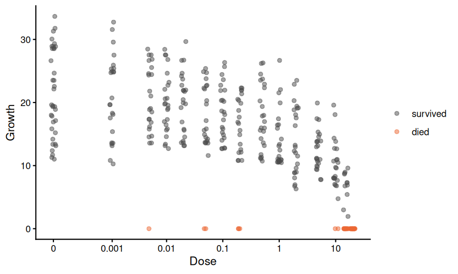
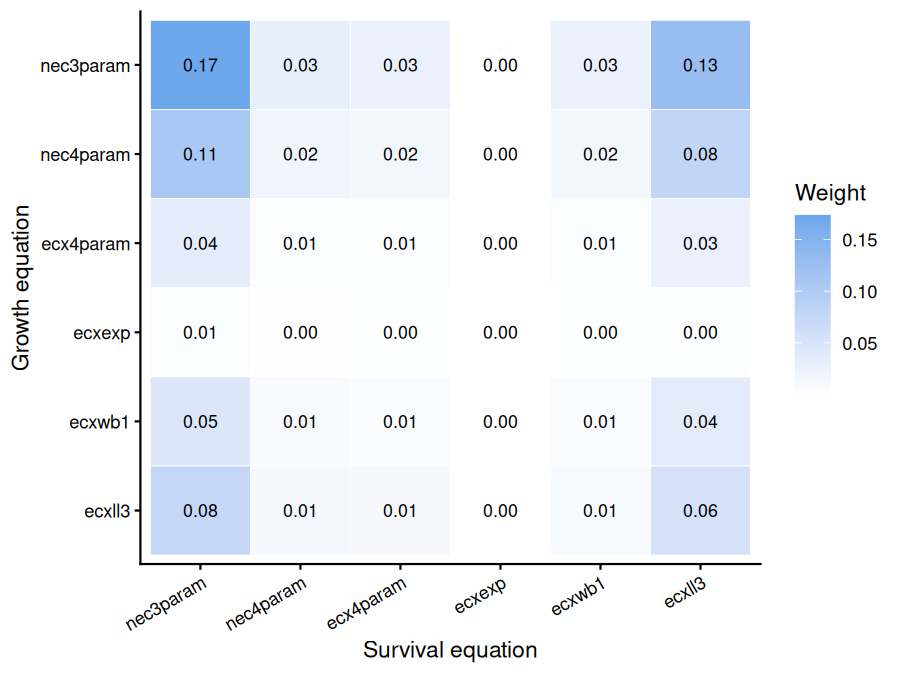
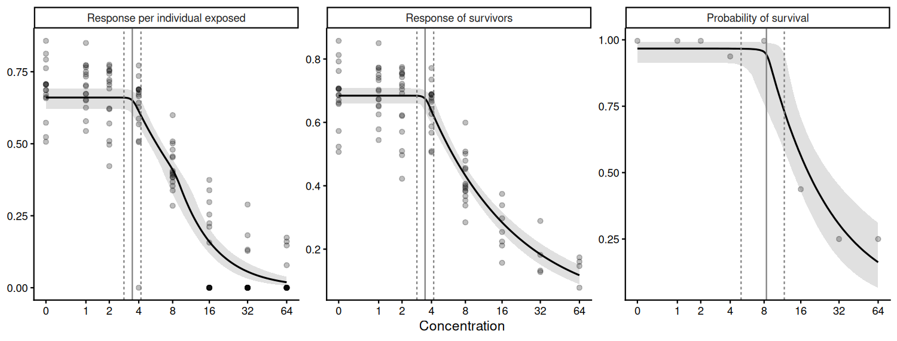

[e1]: https://open-aims.github.io/bayesnec/articles/example1.html
[e2]: https://open-aims.github.io/bayesnec/articles/example2.html

# Overview

In some toxicity tests, exposure can both reduce the response and remove the
individual that provides it. For example, a snail exposed to a contaminated
sediment may grow more slowly or it may die, and an algal culture may be
suppressed or it may fail entirely. The conventional analysis discards the individuals that did not
survive and fits a zero-bounded model (e.g. a Gamma) to the remainder.

That analysis is not incorrect, but it answers a narrower question than it
appears to. Dropping the individuals that died conditions the estimate on
survival, so that it describes growth *given that the individual lived*, and not
growth itself. Because mortality also depends on concentration, the snails that
survive a high concentration are a more strongly selected group than those that
survive a low one, and the two groups are not directly comparable in the way a
single fitted curve implies.

A hurdle model retains both processes by splitting the likelihood into a
response component, which describes the measurement made on the units that
provided one, and a zero-probability component, which describes whether a unit
provided a measurement at all. It therefore gives three toxicity estimates where
the conventional analysis gives one.

| endpoint | question | in `bayesnec` |
|---|---|---|
| response of survivors | how much does exposure suppress growth among individuals that live? | `which = "growth"` |
| survival | how much does exposure kill? | `which = "survival"` |
| combined | what is the expected response per individual *exposed*? | `which = "combined"` (default) |

The combined endpoint is the one the conventional analysis cannot produce. It is
generally the quantity of interest for risk assessment, because it is the
expected response over the whole exposed cohort, including the individuals that
contributed no measurement.

The response and zero-probability components share no parameters. The hurdle
log-likelihood is the sum of a term over all individuals and a term over the
survivors only,

```
log p(y_i) = log Bernoulli(alive_i | 1 - hu_i)
           + 1[y_i > 0] * log Gamma(y_i | mu_i, shape)
```

so with independent priors the posterior factorises. A fit to the survivors
only therefore recovers the response component exactly, and is not an
approximation to the hurdle model. What such a fit cannot provide is the
survival curve or the combined endpoint.

Throughout, the response and zero-probability components are referred to as
"growth" and "survival", after the case these models were written for. Nothing
in the implementation is specific to that reading, and any process that produces
exact zeros alongside a positive response has this structure (see *Other
response families* for proportions and counts).

To run this vignette we also need


``` r
library(bayesnec)
library(ggplot2)
library(dplyr)
```

# The `nassarius` data

The `nassarius` dataset contains four chronic toxicity tests on the tropical
marine snail *Nassarius dorsatus* [@trenfield2016], with one row per snail that
entered the experiment. A snail that died is recorded with `alive = 0` and a
growth of zero. The contaminants are anonymised as A–D and the dose units are
not stated. Here we use the test of contaminant A, in which
38 of the
204 snails died.


``` r
data(nassarius)
snails <- nassarius |>
  filter(contaminant == "A") |>
  select(dose, alive, growth)
```

Each snail that entered the test must be present in the data, with the dead
recorded as zeros. A fit to data from which the dead have been omitted describes
a smaller experiment with less mortality. In this test,
30
of the deaths were snails absent from the source records, and were reinstated
from the test design (the `record` column gives the trace of each death; see
*Deaths recorded by omission*).

2 of the
166 survivors in this test have a negative growth, which
reflects measurement error around a small true value and which a Gamma
distribution cannot take. We set them to half the smallest positive value in the
test. This is a substitution of the kind discussed under *Zeros from flooring*,
and we state it here instead of applying it silently. These snails must not be
given a growth of zero, because the hurdle model would then count them as
deaths.


``` r
pos_min <- min(snails$growth[snails$growth > 0])
snails$growth[snails$alive == 1 & snails$growth <= 0] <- pos_min / 2
```

The doses span more than three orders of magnitude, so we fit the models on a
log scale, as in the other vignettes. The control is recorded as a dose of zero,
for which the logarithm is undefined, so we add 0.001 (one decade below the
lowest dose tested, 0.01) inside the call to `crf()`, which is far enough below
it to be read as a control and close enough not to stretch the fitted range.
Because the transformation
is written in the formula, `bayesnec` returns the estimates and plots on the
dose scale (see the [Single model usage][e1] vignette). The figures below draw
dose on this log scale, with the control one decade below the lowest dose.


``` r
off <- 0.001
dose_axis <- scale_x_continuous(
  "Dose", breaks = log(c(0, 0.01, 0.1, 1, 10) + off),
  labels = c("0", "0.01", "0.1", "1", "10")
)
```


``` r
ggplot(snails, aes(x = log(dose + off), y = growth, colour = alive == 0)) +
  geom_point(alpha = 0.5,
             position = position_jitter(width = 0.1, height = 0, seed = 1)) +
  scale_colour_manual(values = c("grey30", "#eb6834"),
                      labels = c("survived", "died"), name = NULL) +
  dose_axis +
  labs(y = "Growth") +
  theme_classic()
```

<div class="figure" style="text-align: center">

<p class="caption">Growth of the snails in the test of contaminant A. A death is recorded as a growth of zero. Points are jittered horizontally.</p>
</div>

Growth is similar from the control to a dose of 0.63 and falls steeply at 1.25
and 2.5 (figure above). Mortality, in contrast, is concentrated at the two
highest doses: 5 snails died at
doses below 2.5, whereas 15 of the
18 snails at 2.5 and all 18 at
20 died. These deaths appear as zeros along the bottom of the plot.

# The factorised route

`bayesnec` provides two ways of fitting a hurdle model. In the factorised route,
`bnec_hurdle()` fits two ordinary `bnec()` models (a zero-bounded model to the
non-zero responses, and a `bernoulli` model to the survival indicator over all
individuals) and returns them together as a `bayesnechurdlefit`. The combined
endpoint is formed afterwards by multiplying the growth and survival posteriors.
The joint route, which fits both components as one model, is described in *The
joint route*.

We begin with one equation, `nec3param`, for both components.


``` r
# bayesnec does not set cores; unless mc.cores is set, brms then runs the
# chains one after another.
fit_f <- bnec_hurdle(growth ~ crf(log(dose + 0.001), model = "nec3param"),
                     data = snails, seed = 10, refresh = 0, cores = 4)
```

## Endpoints of the factorised fit

For each endpoint we report the EC10 and EC50, each measured as a percentage
decline from the fitted control value, and the NSEC, the dose at which the curve
falls below a lower quantile of the posterior of the control [@fisherfox2023].
The functions below collect these estimates, and the posterior of each curve
over a grid of doses. A factorised fit selects an
endpoint through the `which` argument, and a joint fit (see *The joint route*)
through `dpar`, which names the `brms` distributional parameter. These
arguments are not interchangeable, so where a component estimate looks like the
combined one, it is useful to check `class(fit)`. Note also that `nec()` on a
joint fit returns the combined no-effect estimate, and has no argument for
selecting a block.


``` r
endpoints <- c("growth", "survival", "combined")
endpoint_labels <- c(growth = "Growth of survivors",
                     survival = "Probability of survival",
                     combined = "Growth per snail exposed")

# For a joint fit, dpar = NULL selects the combined endpoint.
select_endpoint <- function(fit, endpoint) {
  if (inherits(fit, "bayesnechurdlefit")) {
    return(list(which = endpoint))
  }
  list(dpar = switch(endpoint, growth = "mu", survival = "hu", combined = NULL))
}

endpoint_estimates <- function(fit) {
  bind_rows(lapply(endpoints, function(w) {
    sel <- select_endpoint(fit, w)
    est <- rbind(
      NSEC = do.call(nsec, c(list(fit), sel)),
      EC10 = do.call(ecx, c(list(fit, ecx_val = 10, resolution = 500), sel)),
      EC50 = do.call(ecx, c(list(fit, ecx_val = 50, resolution = 500), sel))
    )
    data.frame(endpoint = w, estimate = rownames(est), median = est[, 1],
               lower = est[, 2], upper = est[, 3], row.names = NULL)
  }))
}

dose_grid <- data.frame(dose = exp(seq(log(off), log(20 + off),
                                       length.out = 200)) - off)

endpoint_curves <- function(fit) {
  if (inherits(fit, "bayesnechurdlefit")) {
    draws <- lapply(endpoints, function(w) {
      posterior_epred(fit, which = w, newdata = dose_grid)
    })
  } else {
    growth <- posterior_epred(fit, newdata = dose_grid, dpar = "mu")
    # brms defines hu as the probability of a zero, so survival is 1 - hu.
    survival <- 1 - posterior_epred(fit, newdata = dose_grid, dpar = "hu")
    draws <- list(growth, survival, growth * survival)
  }
  names(draws) <- endpoints
  bind_rows(lapply(draws, function(m) {
    data.frame(dose = dose_grid$dose, median = apply(m, 2, median),
               lower = apply(m, 2, quantile, probs = 0.025),
               upper = apply(m, 2, quantile, probs = 0.975))
  }), .id = "endpoint")
}

# The survival panel shows the proportion surviving at each dose.
observed <- bind_rows(
  growth = snails |> filter(alive == 1) |> transmute(dose, y = growth),
  survival = snails |> group_by(dose) |> summarise(y = mean(alive)),
  combined = snails |> transmute(dose, y = growth),
  .id = "endpoint"
)

endpoint_plot <- function(curves) {
  ggplot(curves, aes(x = log(dose + off))) +
    geom_point(aes(y = y), data = observed, colour = "grey60", alpha = 0.4,
               size = 1) +
    facet_wrap(vars(factor(endpoint, levels = endpoints)), scales = "free_y",
               labeller = as_labeller(endpoint_labels)) +
    dose_axis +
    labs(y = NULL) +
    theme_classic()
}

# Two significant figures, keeping a trailing zero (1.0, not 1).
sig2 <- function(x) {
  sub("\\.$", "", formatC(x, digits = 2, format = "fg", flag = "#"))
}
format_estimate <- function(median, lower, upper) {
  sprintf("%s (%s–%s)", sig2(median), sig2(lower), sig2(upper))
}
```

The NSEC, EC10 and EC50 are drawn on each curve as vertical lines at their
posterior medians (figure below), and the table gives each with its 95% credible
interval.


``` r
est_f <- endpoint_estimates(fit_f)
```


``` r
estimate_colours <- c(NSEC = "#2a78d6", EC10 = "#eb6834", EC50 = "#1baf7a")

endpoint_plot(endpoint_curves(fit_f)) +
  geom_ribbon(aes(ymin = lower, ymax = upper), fill = "grey70", alpha = 0.5) +
  geom_line(aes(y = median)) +
  geom_vline(aes(xintercept = log(median + off), colour = estimate,
                 linetype = estimate), data = est_f) +
  scale_colour_manual(values = estimate_colours, breaks = names(estimate_colours),
                      name = NULL) +
  scale_linetype_manual(values = c(NSEC = "solid", EC10 = "dashed",
                                   EC50 = "dotdash"),
                        breaks = names(estimate_colours), name = NULL) +
  theme(legend.position = "bottom")
```

<div class="figure" style="text-align: center">

<p class="caption">The three endpoints of the factorised `nec3param` fit, with the median and 95% credible band of each curve. Vertical lines mark the posterior median NSEC, EC10 and EC50 of each endpoint. The deaths are the zeros along the bottom of the combined panel, and they are absent from the growth panel.</p>
</div>


``` r
est_f |>
  mutate(value = format_estimate(median, lower, upper),
         endpoint = endpoint_labels[endpoint]) |>
  select(endpoint, estimate, value) |>
  tidyr::pivot_wider(names_from = estimate, values_from = value) |>
  knitr::kable()
```


|endpoint                 |NSEC             |EC10             |EC50           |
|:------------------------|:----------------|:----------------|:--------------|
|Growth of survivors      |0.63 (0.49–0.78) |0.64 (0.51–0.81) |1.0 (0.91–1.2) |
|Probability of survival  |1.7 (1.2–2.3)    |1.8 (1.3–2.4)    |2.0 (1.6–2.5)  |
|Growth per snail exposed |0.63 (0.50–0.80) |0.64 (0.51–0.81) |1.0 (0.91–1.2) |


The growth estimates lie between the doses of 0.31 and 1.25, over which growth
declines, whereas the survival estimates lie between 1.25 and 2.5, over which
survival falls from near 1 to near 0 (figure and table above). For example, the
EC50 is 1.0 for growth and
2.0 for survival. On the combined curve, however,
the EC10 and EC50 take their growth values (0.64
and 1.0), and the NSEC is close to the growth
NSEC, so the lines on the combined panel are at the doses of those on the growth
panel. The NSEC and EC10 of each endpoint are also close to each other (e.g.
0.63 and 0.64 for
growth), and their lines overlap.

This pattern follows from the definition of the combined curve as the product of
the growth and survival curves. Below the dose at which survival begins to fall,
survival is at its control value, so the combined curve is a constant multiple
of the growth curve. An ECx, which is a percentage decline from the control, is
therefore equal on the combined and growth curves up to the dose at which
mortality begins, and the growth and combined estimates
differ only above that dose. The NSEC instead measures the decline against a
lower quantile of the control posterior, so it can differ slightly between the
growth and combined curves even where survival is unaffected. The no-effect
estimate that `nec()` returns with `which = "combined"` is the per-draw minimum
of the growth and survival estimates, and so equals the growth estimate whenever
growth is the more sensitive endpoint. This is usually the case, because a
contaminant that kills has generally slowed growth at a lower dose first, and it
follows from what a threshold is (the dose at which an effect *begins*): the
combined effect begins as soon as either process does.


Above the dose at which survival falls, however, the combined curve drops well
below the growth curve, and the difference is largest on the response scale. At
a dose of 2.5, for example, the median growth of survivors is
3.3, whereas the expected growth per snail exposed
is 0.58. These numbers answer different
questions, and which is appropriate depends on whether the assessment concerns
the individuals that survive or the population that was exposed.

The practical consequence is that a combined no-effect estimate or low-effect
ECx, which will generally be close to the growth estimate, is not a reason to
fit a hurdle model. The reasons to fit one are the survival curve, which an
analysis of the survivors only cannot produce at all, and the effect sizes at
doses where mortality is operating, which such an analysis systematically
understates.

## Model averaging

As elsewhere in `bayesnec`, model averaging is the preferred way of handling
uncertainty about the form of the curve (see the [Multi model usage][e2]
vignette), and it is as important for the survival component as for growth.
The factorised route makes the full crossed comparison available, in which each
growth equation is paired with each survival equation. Here we fit a set of six
equations, spanning threshold and smooth forms, to each component.


``` r
# The pseudo-BMA weights use a Bayesian bootstrap, which draws from R's random
# number stream.
set.seed(10)

mod_set <- c("nec3param", "nec4param", "ecx4param", "ecxexp", "ecxwb1",
             "ecxll3")

# adapt_delta is raised because most deaths are at the two highest doses, so
# the survival curve is weakly identified. iter is reduced from the
# bayesnec default of 1e4 to keep twelve fits tractable.
fit_m <- bnec_hurdle(growth ~ crf(log(dose + 0.001), model = mod_set),
                     data = snails, seed = 10, refresh = 0, cores = 4,
                     iter = 4e3,
                     control = list(adapt_delta = 0.99, max_treedepth = 12))
```

`crossed_weights()` gives the weight of each combination (figure below). Because
the components are independent, the expected log predictive density of a
combination is the sum of those of its growth and survival equations, and each
crossed weight is the product of a growth weight and a survival weight. All
36 combinations therefore follow from the growth and survival
fits, without fitting each pair. This identity is specific to pseudo-BMA
weights, the `bayesnec` default, because stacking optimises a different
objective whose solution is not in general a product of this kind.


``` r
crossed <- as.data.frame(as.table(crossed_weights(fit_m)),
                         responseName = "weight")

ggplot(crossed, aes(x = survival, y = growth, fill = weight)) +
  geom_tile(colour = "white") +
  geom_text(aes(label = sprintf("%.2f", weight)), size = 3) +
  scale_fill_gradient(low = "white", high = "#6da7ec", name = "Weight") +
  scale_y_discrete(limits = rev) +
  labs(x = "Survival equation", y = "Growth equation") +
  theme_classic() +
  theme(axis.text.x = element_text(angle = 30, hjust = 1))
```

<div class="figure" style="text-align: center">

<p class="caption">Crossed model weights for the test of contaminant A. Each cell is the weight given to the combination of a growth equation (row) and a survival equation (column).</p>
</div>


Weight is spread across several combinations and is not concentrated in one
(figure above). The largest crossed weight, 0.17,
is given to `` nec3param `` growth with
`` nec3param `` survival, and the next largest,
0.13, to `` nec3param `` growth
with `` ecxll3 `` survival. This is the situation model
averaging is designed to handle, and reporting a single combination would
discard that uncertainty.

Each model set includes smooth (ECx) equations as well as threshold equations.
The NSEC, EC10 and EC50 reported below are read off the model-averaged curves,
as for a single equation. The no-effect estimate that `summary()` and `nec()`
report for such a set is a different quantity. A smooth equation has no
threshold parameter, so its contribution to that estimate is an NSEC
[@fisherfox2023], not an NEC, and the estimate is a weighted mixture of NEC and
NSEC draws, which `bayesnec` refers to as the N(S)EC [@fisher2023ieam].
`summary()` labels each endpoint accordingly, whereas `nec()` returns the
estimate as an unlabelled vector with a message to that effect, so `summary()`
is the better choice where the distinction is important. The NSEC, EC10 and
EC50 of the model average are compared with those of the single-equation fits
in the next section.

# The joint route

In the joint route, `bnec(family = "hurdle_gamma")` fits one model with two
parameter blocks. `brms` names the second block `hu` (or `zi` for the
zero-inflated families), and `bayesnec` gives that block its own
concentration-response curve, with the block name as a prefix on each of its
non-linear parameters (e.g. `top` belongs to the response block and `hutop` to
the survival block). Because the likelihood factorises, the factorised and
joint routes give equivalent inference, so the choice between them depends on
what each can fit.

| | factorised (`bnec_hurdle`) | joint (`family = "hurdle_gamma"`) |
|---|---|---|
| different equation on each block | yes, via `model_survival` | yes, via `model_survival` |
| model averaging | full crossed set via `crossed_weights()` | response block only |
| coupling the blocks (e.g. shared group-level effect) | no — breaks the factorisation | yes |
| number of fits | two | one |

We recommend the factorised route by default, because it makes the crossed model
comparison tractable. The joint route is needed where the growth and survival
blocks must share structure (e.g. a group-level effect common to both), which
the factorisation cannot express. The routes are intended to be used in
sequence: the model sets are fitted and averaged with `bnec_hurdle()`, a
combination is selected from `crossed_weights()`, and `bnec_joint()` refits that
combination jointly, with whatever shared structure is required.

## Survival in the second block

Both routes model the probability of surviving, which declines with dose, but
they arrive at it in different ways. In the factorised route the second fit has
a response of its own: `bnec_hurdle()` constructs an alive/dead indicator (`1`
for alive) and fits an ordinary `bernoulli` model to it, so nothing is inverted.
In the joint route, however, `hu` is a distributional parameter of the response
itself, and `brms` defines it as the probability of a zero (i.e. mortality).
This definition belongs to the family and cannot be exchanged for its
complement, so `bayesnec` writes

```
hu = 1 - (an ordinary bayesnec equation, parameters prefixed)
```

so that the equation describes the declining survival curve of the factorised
route, while `hu` keeps the meaning `brms` requires. The `1 -` makes the joint
route agree with the factorised route, and does not represent a modelling
decision.

Placing the declining curve on survival has three consequences. First, all 24
equations are available for the second block unchanged. `beta` is exponentiated
in each equation that includes it, so the equations can only decline (or, for
`ecxflat`, stay constant), and none of them can express an increasing mortality
curve. Second, `hutop` is the control survival, which is near 1, so it takes the
prior a `bernoulli` fit would use, whereas the equivalent mortality parameter
would lie near its lower bound of 0, where it samples poorly. Third, `ecx()` and
`nsec()` apply unchanged. Both require a declining curve, and both invert the
zero-probability block to survival before computing, so an EC10 has the meaning
here that it has for any other model in the package. Nothing is lost in
exchange, because `hunec`, the dose at which survival begins to fall, is also
the dose at which mortality begins to rise. When reading output, note
that `hutop` and `hunec` describe survival (e.g. a `hutop` near 1 indicates
near-complete survival in the controls).

## Refitting a selected combination

Model averaging is done on the factorised fit, because the joint route can
average over the response block only. Where a single fit is required,
`best_crossed()` identifies the combination with the largest crossed weight, and
`bnec_joint()` refits that combination as one two-block model.


``` r
best_crossed(fit_m)
#> $growth
#> [1] "nec3param"
#> 
#> $survival
#> [1] "nec3param"
#> 
#> $weight
#> [1] 0.1733737
```


``` r
fit_j <- bnec_joint(fit_m, seed = 10, refresh = 0, cores = 4, iter = 4e3,
                    control = list(adapt_delta = 0.99))
```

Here `best_crossed()` selects `nec3param` for both components, the combination
fitted as `fit_f` above. The joint fit can therefore be compared directly with
the factorised fit of these equations, and both can be compared with the
model average of the factorised fit (figure and table below).


``` r
fit_colours <- c(`factorised, nec3param` = "#2a78d6",
                 `joint, nec3param` = "#eb6834",
                 `factorised, model average` = "#1baf7a")

route_curves <- bind_rows(
  `factorised, nec3param` = endpoint_curves(fit_f),
  `joint, nec3param` = endpoint_curves(fit_j),
  `factorised, model average` = endpoint_curves(fit_m),
  .id = "fit"
)

endpoint_plot(route_curves) +
  geom_ribbon(aes(ymin = lower, ymax = upper, fill = fit), alpha = 0.15) +
  geom_line(aes(y = median, colour = fit, linetype = fit)) +
  scale_colour_manual(values = fit_colours, breaks = names(fit_colours),
                      name = NULL) +
  scale_fill_manual(values = fit_colours, breaks = names(fit_colours),
                    name = NULL) +
  scale_linetype_manual(values = c("solid", "dashed", "solid"),
                        breaks = names(fit_colours), name = NULL) +
  theme(legend.position = "bottom")
```

<div class="figure" style="text-align: center">

<p class="caption">The three endpoints of the factorised `nec3param` fit, the joint fit of that combination, and the model average of the factorised six-equation sets, each with its median and 95% credible band.</p>
</div>


``` r
est_j <- endpoint_estimates(fit_j)
est_m <- endpoint_estimates(fit_m)

bind_rows(
  `factorised, nec3param` = est_f,
  `joint, nec3param` = est_j,
  `factorised, model average` = est_m,
  .id = "fit"
) |>
  mutate(value = format_estimate(median, lower, upper),
         endpoint = endpoint_labels[endpoint]) |>
  select(fit, endpoint, estimate, value) |>
  tidyr::pivot_wider(names_from = fit, values_from = value) |>
  knitr::kable()
```


|endpoint                 |estimate |factorised, nec3param |joint, nec3param |factorised, model average |
|:------------------------|:--------|:---------------------|:----------------|:-------------------------|
|Growth of survivors      |NSEC     |0.63 (0.49–0.78)      |0.63 (0.50–0.78) |0.63 (0.18–1.1)           |
|Growth of survivors      |EC10     |0.64 (0.51–0.81)      |0.64 (0.52–0.81) |0.65 (0.25–1.1)           |
|Growth of survivors      |EC50     |1.0 (0.91–1.2)        |1.0 (0.91–1.2)   |1.1 (0.75–1.2)            |
|Probability of survival  |NSEC     |1.7 (1.2–2.3)         |1.7 (1.2–2.4)    |1.7 (1.1–2.4)             |
|Probability of survival  |EC10     |1.8 (1.3–2.4)         |1.8 (1.3–2.4)    |1.8 (1.3–2.4)             |
|Probability of survival  |EC50     |2.0 (1.6–2.5)         |2.0 (1.6–2.5)    |2.1 (1.4–2.5)             |
|Growth per snail exposed |NSEC     |0.63 (0.50–0.80)      |0.63 (0.50–0.79) |0.64 (0.21–1.1)           |
|Growth per snail exposed |EC10     |0.64 (0.51–0.81)      |0.64 (0.52–0.81) |0.65 (0.25–1.1)           |
|Growth per snail exposed |EC50     |1.0 (0.91–1.2)        |1.0 (0.91–1.2)   |1.1 (0.75–1.2)            |


The curves of the factorised and joint fits of `nec3param` overlap, and their
estimates differ by no more than Monte Carlo error (figure and table above). The
factorised and joint routes therefore differ in the models they can fit, and not
in the estimates they give for a model both can fit. The model average, in
contrast, has wider credible intervals than either single-equation fit for
growth and for the combined endpoint, most markedly at their lower bounds,
whereas its survival intervals are similar to theirs. For example, its growth
NSEC is
0.63
(0.18–1.1),
against 0.63
(0.49–0.78)
for the factorised `nec3param` fit. This is likely to reflect the smooth
equations in the set, which together receive 0.37 of the
growth weight, and under which growth can begin to decline at lower doses than
under a threshold.

The equation for each block is set independently, so a joint fit with any
combination can also be requested directly, with `crf()` naming the equation for
the response block and `model_survival` the equation for the survival block.
`bnec_joint()` is a convenience wrapper that fills in these names from
`best_crossed()`.


``` r
bnec(growth ~ crf(log(dose + 0.001), model = "nec3param"), data = snails,
     family = "hurdle_gamma", model_survival = "ecxll3")
```

Selecting a single combination discards the rest of the crossed table, which is
a substantial loss of information where the weights are spread across several
combinations. This step is therefore justified only where the joint form is
needed for a reason the factorisation cannot accommodate. The main such reason
is group-level structure spanning both blocks, which is supplied through the
`formula` argument of `bnec_joint()`.

# Other response families

## Count responses

A structural zero in a count response uses `hurdle_poisson` or
`hurdle_negbinomial`, not the similarly named zero-inflated family. A hurdle
states that every zero came from the survival process. Its positive-count
likelihood is therefore conditional on `Y > 0`, and the two blocks factorise.
`bnec_hurdle()` applies `trunc(lb = 1)` internally to the growth fit, while the
joint hurdle families include the same normalisation in their density.

`zero_inflated_poisson` and `zero_inflated_negbinomial` apply where the source
of a zero is unknown. An observed zero can then arise from either the count
distribution or the added zero-probability component. The likelihood contains
both possibilities in one mixture term and cannot be fitted as two independent
models. `bayesnec` fits the concentration-response curve to the count mean and
holds the zero-inflation probability constant for these families.

For count hurdles, the response of survivors is `E[Y | Y > 0]`.
`bayesnec` computes that quantity exactly from the truncated growth fit's
underlying count parameters. This avoids the finite upper grid that `brms`
uses for expected predictions from a general truncated discrete model, which
can omit a substantial negative-binomial tail.
For a joint count hurdle, `ecx(dpar = "mu")` and `nsec(dpar = "mu")` convert
the underlying Poisson or negative-binomial mean to the same conditional mean.
The fitted `top` and `bot` parameters of the joint equation remain on the
underlying count-mean scale.

The factorised count route requires brms 2.23.2 or later. Earlier brms versions
used a different lower-bound convention in `log_lik()`, so `bnec_hurdle()`
refuses the route before fitting and points to the corresponding joint hurdle
family. Count growth cannot currently be combined with `cens()`: `brms` does
not condition a censored count contribution on the truncation bound, and
`bnec_hurdle()` refuses that combination before fitting.

## The hurdle Beta

`zero_inflated_beta` is the direct analogue of `hurdle_gamma` for a proportional
response bounded on (0, 1), with a Beta response block for the units that gave a
measurement and a survival block for whether a unit gave one at all. It applies
where a proportion is measured on each unit and some units fail entirely, for
example an algal culture expressed as a proportion of a design ceiling, with
replicates that crashed.

A zero-inflated Gamma or Beta model is identical to the corresponding hurdle
model. Zero-inflation differs from a hurdle only where the base distribution can
itself produce zeros, which the Gamma and Beta distributions cannot. Consistent
with this, the Stan density that `brms` generates for `zero_inflated_beta` is the
hurdle form, with no mixture at zero. `bayesnec` treats the zero-inflated and
hurdle forms identically and keeps the `brms` name, so `hurdle_gamma` and
`zero_inflated_beta` differ in name and in the support of the response, but not
in structure.

In practice, however, the conditions under which this family is appropriate are
more restrictive than they first appear, and the most likely misuse is to choose
it simply because a proportion contains some zeros.

### Conditions for a hurdle Beta

A hurdle Beta is appropriate only where all of the following conditions are met:

* the proportion has a denominator that is fixed by design or measured per unit,
  and is not a control mean or an observed maximum (see the normalisation caveat
  below);
* the response declines, matching the convention of the `bayesnec` model set;
* the zeros are structural, produced by a process that genuinely fails; and
* there is no mass at 1.

The last condition is the one that limits use of the family in practice, and it
fails for structural reasons, not by accident:

* if the denominator is the unit's own baseline, the response can exceed it and
  produce values at or above 1, and capping these at 1 converts the excess into
  a spike at the boundary (i.e. flooring, discussed below, applied at the other
  end of the scale);
* if the "nothing happened" state is at the *top* of the scale, the inflation is
  at 1 and not at 0, which requires a different family; and
* if the response is genuinely a count out of a known total, the binomial is
  already correct and no Beta is needed.

A response inflated at both boundaries requires `zero_one_inflated_beta` or an
ordered-Beta treatment, and these are not available in `bayesnec`. A response
that is a ratio to a per-unit baseline is often better modelled with
`hurdle_gamma` on the uncapped ratio.

### A simulated example

No dataset shipped with `bayesnec` satisfies all four conditions, nor did any of
the candidates considered while this vignette was written, and the mass-at-1
condition is the one that failed, for the structural reasons given above. The
example below is therefore simulated, and constructed to meet all four conditions.
It shows what the family does where it applies, and it is not evidence that any
particular real dataset qualifies, so the conditions above should still be
checked before the family is used.

The scenario is an algal growth-rate test. Growth is expressed as a proportion
of a ceiling fixed in advance by the test protocol (i.e. not a control mean and
not the observed maximum, as the first condition requires). A culture that
crashes contributes an exact zero, and a culture that grows contributes a
proportion drawn from a Beta distribution, which cannot itself return a zero, so
each zero in the data is structural.


``` r
set.seed(101)

nec3 <- function(x, top, beta, nec) {
  top * exp(-exp(beta) * (x - nec) * (x > nec))
}

# Growth declines from a control proportion of 0.70 with a threshold at 1.5;
# cultures start crashing only from 3.0, so the two thresholds are distinct.
conc <- rep(c(0, 0.5, 1, 2, 3, 5, 8, 12), each = 16)
mu_true <- nec3(conc, top = 0.70, beta = log(0.32), nec = 1.5)
p_alive <- nec3(conc, top = 0.98, beta = log(0.20), nec = 3.0)

alive <- rbinom(length(conc), 1, p_alive)
# 30 is the Beta precision: higher values give tighter scatter about mu.
prop <- rbeta(length(conc), mu_true * 30, (1 - mu_true) * 30)

zib_dat <- data.frame(x = conc, y = ifelse(alive == 1, prop, 0))
```

Two of the conditions can be checked directly from the data: that there is no
mass at 1, and that the zeros are confined to crashed cultures, not small
measurements.


``` r
c(n = nrow(zib_dat),
  zeros = sum(zib_dat$y == 0),
  max = round(max(zib_dat$y), 3),
  at_or_above_1 = sum(zib_dat$y >= 1))
#>             n         zeros           max at_or_above_1 
#>       128.000        33.000         0.857         0.000

table(dose = zib_dat$x, measured = zib_dat$y > 0)
#>      measured
#> dose  FALSE TRUE
#>   0       0   16
#>   0.5     0   16
#>   1       0   16
#>   2       1   15
#>   3       0   16
#>   5       8    8
#>   8      12    4
#>   12     12    4
```

The largest observed proportion is 0.86 and no value
is at or above 1, so there is no spike at the boundary for the Beta to
accommodate.
Mortality is graded across the top four doses, instead of changing directly to
total loss, which leaves the response block with data at each dose and the
survival threshold identifiable.

`bnec_hurdle()` takes the data unchanged. It selects the response family from
the non-zero rows, and so chooses a Beta here, where it chose a Gamma for the
snail growth. The joint route would instead name the family, as
`family = "zero_inflated_beta"`, and its second block is named `zi`, not `hu`,
so the survival parameters appear as `zitop`, `zibeta` and `zinec`.


``` r
zib_f <- bnec_hurdle(y ~ crf(x, model = "nec3param"), data = zib_dat,
                     seed = 101, refresh = 0)
```


``` r
zib_est <- rbind(
  `growth nec` = nec(zib_f, which = "growth"),
  `survival nec` = nec(zib_f, which = "survival")
)
data.frame(generating = c(1.5, 3.0), signif(zib_est, 3))
#>              generating  Q50 Q2.5 Q97.5
#> growth nec          1.5 1.69 1.41  1.91
#> survival nec        3.0 2.96 1.44  3.95
```

Both generating thresholds lie inside their 95% credible intervals (table
above). The growth threshold has a posterior median of
1.69 against a generating value of 1.5, with
an interval of 1.41 to
1.91, and the survival threshold a median of
2.96 against 3.0.

The precision of both thresholds is limited by the design, not by the family. A
threshold model can locate a change point only as sharply as the dose spacing
around it allows, and here the generating growth threshold of 1.5 falls in the
gap between the doses at 1 and 2. With nothing observed in between, the
likelihood is nearly flat across that interval, and the posterior median is
above the generating value, towards the dose of 2 at which the decline is first
unambiguous. The survival threshold is less
precise again, because mortality is confined to the top four doses. Where a
threshold is the quantity of interest, placing doses around it is therefore
likely to narrow its interval more than extra replication elsewhere.


``` r
autoplot(zib_f, which = "all")
```

<div class="figure" style="text-align: center">

<p class="caption">The simulated hurdle Beta. Growth is the proportion achieved by cultures that grew, survival the probability of a culture growing at all, and the combined endpoint their product (the expected proportion per culture started).</p>
</div>

### Normalisation caveat

Where a proportional response has been obtained by dividing by a maximum, the
divisor must be a constant fixed in advance, and not one computed from the data
under analysis. Dividing all observations by a single random quantity (e.g. a
control mean or an observed maximum) induces correlation across observations,
discards the uncertainty in the divisor, and biases effective doses upwards by
Jensen's inequality [@Ritz2026].

The relevant distinction is between a shared divisor and a per-unit one, and not
between a random divisor and a fixed one. Dividing each unit by its own baseline
also uses a random quantity, but it induces no correlation between observations
and no Jensen bias, so the problem arises only where a single divisor is applied
to all observations. A baseline mean that is subtracted (instead of divided)
does not introduce the Jensen bias at all, because subtraction is linear. It
introduces a shared offset that slightly understates standard errors, but it
does not bias effective doses.

The recommended alternative is available in `bayesnec` and requires no
normalisation. The raw response is fitted and `ecx(type = "absolute")` is used,
which measures the decline relative to the *fitted* control value and therefore
propagates the uncertainty in the control through the posterior.

# The origin of the zeros

A hurdle model assumes that each zero is structural, i.e. that it marks a unit
that died or failed. A zero in concentration-response data can instead be a value
rounded down at the recording resolution, a negative value replaced by zero, or
a genuine measurement near zero. Conversely, a death can be recorded by leaving
the unit out of the data, so that the zero it should contribute is missing. The
subsections below describe how to recognise each case.

## Zeros from rounding

`bayesnec` ships the `herbicide` dataset [@jones2003], which contains 23 zero
values in `fvfm` (maximum quantum yield). These zeros appear to make the data
candidates for zero-inflation. However, they are not, and fitting
`zero_inflated_beta` to them would be misleading.


``` r
data(herbicide)

herbicide |>
  group_by(herbicide) |>
  summarise(n = n(), zeros = sum(fvfm == 0),
            min_nonzero = min(fvfm[fvfm > 0]), .groups = "drop")
#> # A tibble: 7 × 4
#>   herbicide       n zeros min_nonzero
#>   <chr>       <int> <int>       <dbl>
#> 1 ametryn        96    12        0.01
#> 2 atrazine       84     0        0.04
#> 3 diuron         72     0        0.02
#> 4 hexazinone     76     1        0.01
#> 5 irgarol        72    10        0.01
#> 6 simazine       72     0        0.16
#> 7 tebuthiuron   108     0        0.04
```

Two features of the data indicate the origin of these zeros. First, each value
is a multiple of the recording resolution, and the smallest non-zero value is
equal to one unit of that resolution.


``` r
nonzero <- herbicide$fvfm[herbicide$fvfm > 0]
c(resolution = min(diff(sort(unique(nonzero)))),
  smallest_nonzero = min(nonzero))
#>       resolution smallest_nonzero 
#>             0.01             0.01
```

A recorded `0.00` therefore means that the true value was below 0.005. It does
not mark a distinct event, but a measurement that was rounded down.

Second, the zeros appear only where the curve falls below the rounding floor
(0.005). Diuron has no zeros, and its means decline smoothly and level off above
the floor (0.043 at the highest concentration, 30), whereas zeros appear only
for the more potent compounds (ametryn, hexazinone and irgarol), whose curves go
lower. Diuron was tested with the organisms and the instrument used for the
other herbicides, and yet its data contain no zeros.


``` r
herbicide |>
  filter(herbicide == "diuron") |>
  group_by(concentration) |>
  summarise(mean_fvfm = round(mean(fvfm), 3), .groups = "drop")
#> # A tibble: 6 × 2
#>   concentration mean_fvfm
#>           <dbl>     <dbl>
#> 1           0.1     0.698
#> 2           0.3     0.639
#> 3           1       0.491
#> 4           3       0.27 
#> 5          10       0.092
#> 6          30       0.043
```

Fitting a hurdle model to these data would give the `zi` block its own NEC and
ECx for the probability of *rounding to zero*, which is a measurement artefact
and not an endpoint. In addition, the `mu` block would be biased upward at high
concentrations, because conditioning on `y > 0` truncates precisely the smallest
values.

These data instead show interval censoring at the recording resolution (i.e. `y`
in `[0, 0.005)`). `bayesnecformula` accepts a `cens()` aterm for this, declared
through a variable in the data that marks the censored rows (see
`?bayesnecformula`), and a left-censored row must record the bound (here 0.005)
in place of the zero, because a Beta distribution has no probability mass at or
below 0. This route is not fitted here. The default `bayesnec` behaviour of
nudging zeros to `min(y[y > 0]) / 10` is crude, but defensible in this case,
because 0.001 falls inside the true interval.

The diagnostic for this case is a comparison of the gap between zero and the
smallest non-zero value against the resolution the data were recorded at. Where
the gap is much greater than the resolution, the zeros mark a distinct process
and a hurdle model applies. Where the gap is approximately equal to the
resolution, the zeros are rounding or censoring, and a hurdle model does not
apply.


``` r
gap_ratio <- function(y) {
  y <- y[!is.na(y)]
  nonzero <- y[y > 0]
  resolution <- min(diff(sort(unique(nonzero))))
  min(nonzero) / resolution
}

c(herbicide = gap_ratio(herbicide$fvfm),
  simulated = gap_ratio(zib_dat$y))
#> herbicide simulated 
#>    1.0000  200.6589
```

A ratio near 1 (as for `herbicide`) indicates that the smallest non-zero value
is one rounding unit above zero, so zero is simply the next value down. A large
ratio (about 200 for
the simulated hurdle Beta data) indicates a real gap between "no response" and
"the smallest response that was measured".

## Zeros from flooring

The gap diagnostic tests whether the zeros are separated from the continuum of
measured values. It does not test how many causes the zeros have, and no test
computed on the processed data can do so. This is the second thing to establish,
and it is a question of provenance (i.e. how the data were recorded and
prepared), not of computation.

| state | true value | kind of zero |
|---|---|---|
| individual died / replicate failed | undefined | **structural** |
| individual shrank / population declined | negative | **floored** — a substituted value |
| no measurable change | ≈ 0 | **genuine** |

A hurdle model assumes structural zeros. Growth endpoints, however, frequently
contain floored zeros, because negative growth rates, yields or increments are
routinely replaced with 0, or nudged to a small positive value, so that a
zero-bounded family will accept them. Three things go wrong at once when a
floored response is analysed:

1. a living, measured individual is assigned to the state of a dead one;
2. the response block conditions on `y > 0`, so the "response of survivors"
   silently becomes the "response of those that happened to increase", which is
   selection on the outcome, and because decline is concentration-dependent this
   bias grows with dose; and
3. the zero-probability block then mixes failure with decline, and describes
   neither.

The biases in the response and zero-probability blocks run in one direction and
both increase with dose, so the fitted curves for these blocks are pulled apart
precisely where the toxicological signal is strongest.

Flooring is substitution at a boundary, and the case against substitution is
well established: it fabricates data, biases statistics and obscures real
relationships [@helsel2006]. Establishing which kind of zero is present before
choosing a model is standard advice [@blasco2019; @martin2005], as is the
warning that many zeros do not by themselves indicate zero inflation
[@warton2005].

The regulatory standard also advises against substitution, and for the same
reason. OECD TG 201 [@oecd2026tg201] defines growth endpoints that admit
negative values, namely the average specific growth rate,
`µ = (ln X_j − ln X_i)/(t_j − t_i)` (eq. 1, ¶49), and the yield (the biomass at
the end of the test minus the biomass at the start, ¶53). Annex 5 is explicit
about values that fall outside the expected range, stating both what to do with
them and what not to do:

> Negative inhibitions may be a problem with for instance the log-normal
> distribution function likewise demanding an alternative regression function. It
> is not recommended to assign a zero or small positive value to such negative
> values because this distorts the error distribution.

These sentences concern negative *inhibition* (growth stimulation at low
concentrations), not negative growth rates, so they are not a ruling on this
case. However, the reason and the remedy are both general, and both apply here:
change the function, not the values.

### The meaning of "distorts the error distribution"

The phrase is precise, and not rhetorical. Write `µ(x)` for the fitted mean at
concentration `x`, `σ` for the residual scale, `f` for the density and `F` for
the distribution function. For a unit whose growth was measured as some negative
value `y`, there are three possible treatments, and each contributes differently
to the likelihood:

| treatment | contribution | what it asserts |
|---|---|---|
| keep `y`, on a real-line scale | `f(y; µ(x), σ)` | the true value **is** `y` — true |
| floor to zero | `f(0; µ(x), σ)` | the true value **is** 0 — false |
| censor at zero | `F(0; µ(x), σ)` | the true value **is at most** 0 — true |

The first row is the remedy the guideline points to (i.e. keep the value, and
choose a regression function able to accommodate it). Its contribution is
largest when `µ(x)` is near `y`, so the fitted curve is free to follow the data
down. Flooring (the second row) replaces this with a contribution that is
largest when `µ(x)` is near zero, so each floored observation pulls the curve up
toward zero. Because floored values cluster at the top of the concentration
range, that pull is concentrated precisely where the response is changing
fastest, and the result is a fit biased upward in a dose-dependent way. This is
what distorting the error distribution amounts to in practice.

Censoring (the third row) asserts something true without requiring the negative
region to be modelled at all, because `F(0; µ(x), σ)` rises toward 1 as `µ(x)`
falls, so that it saturates instead of pulling the curve. This property is
useful enough to justify a recommendation of its own (see *Recommended handling*
below).

The three failures listed above for a floored response all follow from the way a
hurdle model allocates observations between its two blocks. This bias, in
contrast, originates in the likelihood contribution of the substituted value
itself, and is therefore present in an ordinary regression that has no
zero-probability block at all. Fitting a simpler model does not avoid it.

### The provenance question

> Can this endpoint take negative values in principle? Rates, increments,
> differences and yields all can. If it can, and the data as supplied contain
> zeros but no negative values, the zeros should not be accepted as structural
> until it has been established how negative values were handled, either from
> the raw measurements or from whoever prepared the data.

In the `nassarius` data, for example, growth can be negative in principle, and
4 survivors are recorded with a
negative growth, which indicates that negative values were not floored upstream
and that the zeros are deaths. Zeros of different origin cannot be distinguished
once written to file. The gap test and the provenance question are
complementary: the gap test asks whether
the zeros are distinct from the continuum, and the provenance question asks
whether they are distinct from each other.

### Recommended handling

The first recommendation is not to floor. Instead, the response should be
modelled on a scale that admits the values as measured (e.g. a specific growth
rate, or the raw increment), using a family on the real line and an equation
with a lower asymptote (e.g. `nec4param` or `ecx4param`) so that the curve can
cross zero. On a Gaussian response `bayesnec` also fits the zero-bounded
equations, whose curves cannot fall below zero, and the model weights then
assess that shape against the data. Any hurdle should be driven by the recorded
failure indicator, not by `y == 0`.

The second recommendation applies where the shape of the curve below zero is not
of interest, in which case the response should be censored at zero. This is the
better approach whenever the assessment concerns the transition from growth to
decline (and not the severity of the decline). A left-censored (Tobit)
likelihood asserts "true value ≤ 0" instead of "= 0", so the fit is not dragged
upward, and it no longer needs to describe the shape of the response below zero.

This second effect is more important than it first appears. Growth data often
provide no lower plateau (i.e. the curve is still descending at the highest
concentration tested), so `bot` is identified by the prior and by its
correlation with the other parameters. Because `bot` is shared across the whole
curve, this also deforms the fit in the positive-growth region. Censoring turns
`bot` from a poorly extrapolated estimate into a weakly identified nuisance
parameter.

The disadvantage of censoring is that censored observations retain only
near-quantal information. The proportion of observations falling below zero at a
given concentration is informative, but once nearly all replicates at a
concentration are below zero, a small negative growth rate and a large one
become close to indistinguishable. The distinction between growth arrest and
active loss of biomass is therefore largely given up, and where that distinction
is important to the assessment, the uncensored real-line fit of the first
recommendation should be kept.

Censoring also requires two points of discipline. First, it is a deliberate
coarsening of values that were in fact measured (not a description of the
recording process), and it should be reported as such. Second, a censored zero
and a structural zero cannot be distinguished once written to file, so the
censoring indicator and the failure indicator must be separate columns. A dead
individual is a structural zero and belongs to the hurdle, whereas a living one
that shrank is a censored observation and belongs to the response block.
Collapsing these indicators into one column is flooring by another route.

`bayesnecformula` passes the `cens()` aterm to the fit, so this route is
available directly; see the Censoring section of `vignette("example1")` for
the declaration and for what a censored likelihood can and cannot recover.

The third recommendation applies where the values are already floored and cannot
be recovered. The left-censored likelihood described above is then the salvage,
because it replaces a false assertion with a true one, which is the most that
can be recovered. Censoring here repairs values that have already been altered,
whereas in the second recommendation it is chosen in advance for values that
were measured.

The fourth recommendation applies where a strictly positive scale is required.
The response should then be modelled relative to each unit's own baseline, where
the only zeros are genuine failures and `hurdle_gamma` is correct. Note that the
ECx must then be defined on the derived increment, because a 50% reduction in a
*ratio* and a 50% reduction in the *increment* are different quantities, and can
differ by more than an order of magnitude.

## Deaths recorded by omission

Deaths are often recorded by omission or by a sentinel code, not as zeros, and
must be reconstructed before fitting. `bnec_hurdle()` requires each unit that
entered the experiment to be present in the data, with `0` recorded for those
that gave no response. Rows omitted, instead of recorded as zero, cannot be
distinguished from rows that were never run, and would be read as a smaller
experiment instead of as additional zeros.

Common traces to look for include:

* sentinel codes, often one constant per test run, well below the real data (a
  large gap between the sentinel and the next real value makes these
  unambiguous);
* blank replicates within a tank or plate that is present;
* absent tanks or plates within a treatment that is present, where the whole
  unit failed; and
* an omitted top concentration, where all units died and the treatment does not
  appear in the file.

The last of these is the easiest to miss and has the greatest consequence where
the omitted concentration is the lowest one at which all units died, because
the information about where survival collapses comes from the doses between the
last with full survival and the first with none. Concentrations above that one,
at which all units also died, are likely to change the survival estimates much
less.

# References
