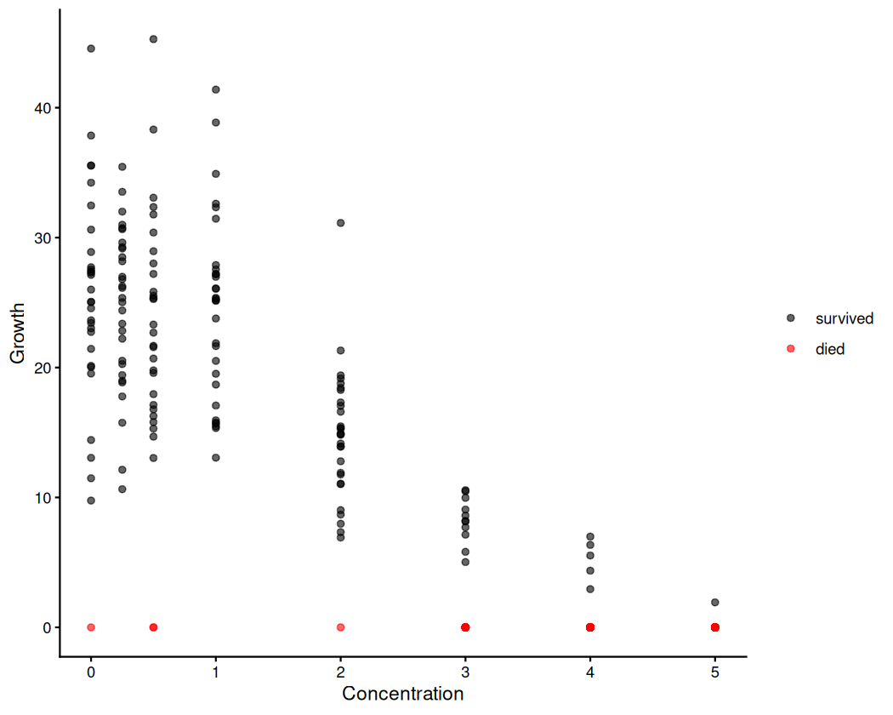

[e1]: https://open-aims.github.io/bayesnec/articles/example1.html
[e2]: https://open-aims.github.io/bayesnec/articles/example2.html
[e2b]: https://open-aims.github.io/bayesnec/articles/example2b.html
[e3]: https://open-aims.github.io/bayesnec/articles/example3.html
[e4]: https://open-aims.github.io/bayesnec/articles/example4.html
[e5]: https://open-aims.github.io/bayesnec/articles/example5.html

# Overview

Some toxicity tests damage the response and remove the responder simultaneously.
For example, a snail exposed to contaminated sediment may grow more slowly or it
may die, and an algal culture may be suppressed or it may fail entirely. The
conventional analysis discards the individuals that did not survive and fits a
zero-bounded model to the remainder.

That analysis is not incorrect, but it answers a narrower question than it
appears to. Dropping the individuals that died conditions the estimate on
survival, so that it describes growth *given that the individual lived*, and not
growth itself. Because mortality is also concentration-dependent, the cohort
surviving a high concentration is a more strongly selected group than the cohort
surviving a low one, and these cohorts are not directly comparable in the way a
single fitted curve implies.

A hurdle model retains both processes by splitting the likelihood into a
response component, which describes the measurement made on units that provided
one, and a zero-probability component, which describes whether a unit provided a
measurement at all. It therefore yields three toxicity estimates (for the
response of survivors, for survival, and for their combination) where the
conventional analysis yields one.

| endpoint | question | in `bayesnec` |
|---|---|---|
| response of survivors | how much does exposure suppress growth among individuals that live? | `which = "growth"` |
| survival | how much does exposure kill? | `which = "survival"` |
| combined | what is the expected response per individual *exposed*? | `which = "combined"` (default) |

The combined endpoint is the estimate that the conventional analysis cannot
produce. It is generally the quantity of interest for risk assessment, because
it is the expectation over the whole exposed cohort, including the individuals
that contributed no measurement.

Two properties of these models are easily misread. First, a survivors-only
analysis is not an approximation to the hurdle model. The hurdle log-likelihood
is the sum of a term over all individuals and a term over the survivors only,

```
log p(y_i) = log Bernoulli(alive_i | 1 - hu_i)
           + 1[y_i > 0] * log Gamma(y_i | mu_i, shape)
```

and the response and zero-probability blocks share no parameters. With
independent priors the posterior therefore factorises, and a fit to the
survivors only recovers the response block exactly (as demonstrated numerically
below). What such a fit cannot provide is the mortality curve or the combined
endpoint.

Second, a zero-inflated Gamma or Beta model is identical to the corresponding
hurdle model. Zero-inflation differs from a hurdle only where the base
distribution can itself produce zeros, which the Gamma and Beta distributions
cannot. Consistent with this, the Stan density that `brms` generates for
`zero_inflated_beta` is the hurdle form, with no mixture at zero. `bayesnec`
treats the zero-inflated and hurdle forms identically and keeps the `brms` name,
so `hurdle_gamma` and `zero_inflated_beta` differ in name and in the support of
the response, but not in structure.

Throughout, the two components are referred to as "growth" and "survival",
after the case these models were written for. Nothing in the implementation is
specific to that reading: any process producing exact zeros alongside a
positive response has the same structure.

To run this vignette we also need


``` r
library(bayesnec)
library(ggplot2)
library(dplyr)
```

# Factorised and joint implementations

`bayesnec` provides two ways of fitting these models. Because the likelihood
factorises, they give equivalent inference, so the choice between them depends
on what each route can fit (summarised in the table below) and not on the
estimates they produce.

In the factorised route, `bnec_hurdle()` fits two ordinary `bnec()` models (a
zero-bounded model to the non-zero subset, and a `bernoulli` model to the
survival indicator over all individuals) and returns them together as a
`bayesnechurdlefit`. Combined predictions are formed afterwards by multiplying
the growth and survival posteriors.

In the joint route, `bnec(family = "hurdle_gamma")` fits one model with two
parameter blocks. `brms` names the second block `hu` (or `zi` for the
zero-inflated families), and `bayesnec` gives that block its own
concentration-response curve, with the block name as a prefix on each of its
non-linear parameters (e.g. `top` belongs to the response block and `hutop` to
the survival block).

| | factorised (`bnec_hurdle`) | joint (`family = "hurdle_gamma"`) |
|---|---|---|
| different equation on each block | yes, via `model_survival` | yes, via `model_survival` |
| model averaging | full crossed set via `crossed_weights()` | response block only |
| coupling the blocks (e.g. shared group-level effect) | no — breaks the factorisation | yes |
| number of fits | two | one |

We recommend the factorised route by default, because it is the route that makes
the crossed model comparison (of each growth equation with each survival
equation) tractable. Since `elpd(a, b) = elpd_growth(a) + elpd_survival(b)`, all
combinations of the growth and survival model sets can be compared from two
fits, without fitting each pair. The joint route is needed where the blocks must
share structure, which is the only thing the factorisation cannot express. The
routes are intended to be used in sequence, and `bnec_joint()` connects them:
the model sets are fitted and averaged with `bnec_hurdle()`, a combination is
selected from `crossed_weights()`, and that combination is then refitted jointly
with whatever shared structure is required.

## Count responses

A structural zero in a count response uses `hurdle_poisson` or
`hurdle_negbinomial`, not the similarly named zero-inflated family. A hurdle
states that every zero came from the survival process. Its positive-count
likelihood is therefore conditional on `Y > 0`, and the two blocks factorise.
`bnec_hurdle()` applies `trunc(lb = 1)` internally to the growth fit, while the
joint hurdle families include the same normalisation in their density.

`zero_inflated_poisson` and `zero_inflated_negbinomial` apply where the source
of a zero is unknown. An observed zero can then arise from either the count
distribution or the added zero-probability component. The likelihood contains
both possibilities in one mixture term and cannot be fitted as two independent
models. `bayesnec` fits the concentration-response curve to the count mean and
holds the zero-inflation probability constant for these families.

For count hurdles, the response of survivors is `E[Y | Y > 0]`.
`bayesnec` computes that quantity exactly from the truncated growth fit's
underlying count parameters. This avoids the finite upper grid that `brms`
uses for expected predictions from a general truncated discrete model, which
can omit a substantial negative-binomial tail.
For a joint count hurdle, `ecx(dpar = "mu")` and `nsec(dpar = "mu")` convert
the underlying Poisson or negative-binomial mean to the same conditional mean.
The fitted `top` and `bot` parameters of the joint equation remain on the
underlying count-mean scale.

The factorised count route requires brms 2.23.2 or later. Earlier brms versions
used a different lower-bound convention in `log_lik()`, so `bnec_hurdle()`
refuses the route before fitting and points to the corresponding joint hurdle
family. Count growth cannot currently be combined with `cens()`: `brms` does
not condition a censored count contribution on the truncation bound, and
`bnec_hurdle()` refuses that combination before fitting.

## Survival in the second block

Both routes model the probability of surviving, which declines with
concentration and so follows the sign convention of the 23 `bayesnec` equations
that change with concentration. However, the routes arrive at this in different
ways.

In the factorised route the second fit has a response variable of its own, which
is coded as survival: `bnec_hurdle()` constructs an alive/dead indicator (`1`
for alive) and fits an ordinary `bernoulli` model to it, using the equation
unchanged. Nothing is inverted.

In the joint route there is no second response to code. `hu` is a distributional
parameter of the response itself, and `brms` defines it as the probability of a
zero (i.e. mortality). This definition belongs to the family and cannot be
exchanged for its complement. The formula is the only element under the user's
control, so `bayesnec` writes

```
hu = 1 - (an ordinary bayesnec equation, parameters prefixed)
```

which describes the declining survival curve of the factorised route while
leaving `hu` with the meaning `brms` requires. The `1 -` is an adapter that
makes the joint route agree with the factorised route, and does not represent a
modelling decision.

### Consequences of modelling survival

Placing the declining curve on survival, in both routes, has three consequences.
First, the equation set is reused unchanged. All 24 equations are available for
the second block, so there are no mirrored versions to write or maintain. `beta`
is exponentiated in each equation that includes it, so the equations can only
decline (or, for `ecxflat`, stay constant), and none of them can express an
increasing mortality curve.

Second, the priors remain well behaved. `hutop` is the control survival, which
is near 1, and so it takes the prior a `bernoulli` fit would use. Under a
mortality parameterisation the equivalent parameter would be near 0, against its
lower bound, where it samples poorly.

Third, `ecx()` and `nsec()` continue to apply. `ecx()` measures a percentage
decline from the fitted control value, and `nsec()` finds the concentration at
which the curve falls below a lower quantile of the control posterior, so both
require a declining curve. `ecx()` inverts the zero-probability block back to
survival before computing, so an EC10 has the meaning here that it has for any
other model in the package.

Nothing is lost in exchange, because `hunec`, the concentration at which
survival begins to fall, is also the concentration at which mortality begins to
rise. When reading output, note that `hutop` and `hunec` describe survival (e.g.
a `hutop` near 1 indicates near-complete survival in the controls).

# A simulated demonstration

We simulate a growth experiment in which both growth and survival are affected
and the generating values of each are known, to show that the factorised and
joint routes agree, and what a survivors-only analysis does and does not
recover.


``` r
set.seed(333)

nec3 <- function(x, top, beta, nec) {
  top * exp(-exp(beta) * (x - nec) * (x > nec))
}

# Truth: growth is suppressed from 1.0 onward, survival only from 2.0 onward,
# so the two thresholds are genuinely different and can be told apart.
conc <- rep(c(0, 0.25, 0.5, 1, 2, 3, 4, 5), each = 30)
mu_true <- nec3(conc, top = 25, beta = log(0.55), nec = 1.0)
p_alive <- nec3(conc, top = 0.97, beta = log(0.9), nec = 2.0)

alive <- rbinom(length(conc), 1, p_alive)
shape <- 12
growth <- rgamma(length(conc), shape = shape, rate = shape / mu_true)

# A death contributes a zero, not a missing row. Every individual that entered
# the experiment must be present in the data or the fit reads a smaller
# experiment rather than more zeros.
sim_dat <- data.frame(x = conc, y = ifelse(alive == 1, growth, 0))

table(sim_dat$x, sim_dat$y > 0)
#>       
#>        FALSE TRUE
#>   0        1   29
#>   0.25     0   30
#>   0.5      2   28
#>   1        0   30
#>   2        1   29
#>   3       19   11
#>   4       25    5
#>   5       29    1
```


``` r
ggplot(sim_dat, aes(x = x, y = y)) +
  geom_point(aes(colour = y == 0), alpha = 0.6) +
  scale_colour_manual(values = c("black", "red"),
                      labels = c("survived", "died"), name = NULL) +
  labs(x = "Concentration", y = "Growth") +
  theme_classic()
```

<div class="figure" style="text-align: center">

<p class="caption">Simulated growth data. Zeros are deaths, not small measurements.</p>
</div>

Few individuals die at concentrations up to 2 (at most 2 of the 30 exposed at
each), whereas 19, 25 and 29 of the 30 die at 3, 4 and 5, respectively, and
these deaths appear as zeros in the plot.

## The factorised route


``` r
fit_f <- bnec_hurdle(y ~ crf(x, model = "nec3param"), data = sim_dat,
                     seed = 333, refresh = 0)
```

The `summary` method prints all three endpoints together and labels each by
type. Because each component here is fitted with a single threshold equation
(`nec3param`), each no-effect estimate is a true NEC.


``` r
summary(fit_f, ecx = TRUE, ecx_vals = c(10, 50))
#> Object of class bayesnechurdlefit
#> 
#>    240 individuals exposed; 77 recorded as zero ( 32.1% )
#> 
#>   growth   : Gamma -- nec3param 
#>   survival : bernoulli -- nec3param 
#> 
#> No-effect toxicity estimates
#>                 Q50 Q2.5 Q97.5
#> combined (NEC) 1.08 0.78  1.37
#> growth (NEC)   1.08 0.78  1.37
#> survival (NEC) 2.18 1.89  2.59
#> 
#> ECx estimates
#>                Q50 Q2.5 Q97.5
#> combined ec10 1.26 1.00  1.53
#> combined ec50 2.21 2.03  2.42
#> growth ec10   1.26 1.00  1.53
#> growth ec50   2.32 2.13  2.51
#> survival ec10 2.28 2.01  2.66
#> survival ec50 2.84 2.58  3.11
#> 
#> The combined endpoint is the expected response per individual exposed,
#> i.e. growth * survival. Use which = to select a component.
#> 
#> Fitted by bayesnec 2.1.3.44, installed from a local source, which records no commit, under R 4.6.1.
```

The growth and survival thresholds are distinct, and each is estimated close to
its generating value (1.0 and 2.0, respectively). The combined threshold equals
the growth threshold, for reasons set out in the next section.

`which = "all"` draws the three curves together (figure below).


``` r
autoplot(fit_f, which = "all")
```

<div class="figure" style="text-align: center">

<p class="caption">The three curves. Growth is the response of survivors, survival the probability of contributing a measurement at all, and the combined endpoint their product. Note the zeros along the bottom of the combined panel: these are the deaths, and they are absent from the survivors panel entirely.</p>
</div>

## Differences between the combined and growth endpoints

The combined no-effect estimate is `pmin(ne_growth, ne_survival)` evaluated per
posterior draw, and so it equals the growth estimate whenever growth is the more
sensitive endpoint. In practice this is usually the case, because a contaminant
that kills has generally slowed growth at a lower concentration first. This
follows from what a threshold is (the concentration at which an effect
*begins*), and is not a limitation of the combination, because the combined
effect begins as soon as either process does.

This reasoning also applies beyond the no-effect estimate, and it determines
where the combined endpoint is informative. The combined curve is the product of
the growth and survival curves, and below the survival threshold survival is at
its control value, so the combined curve there is a constant multiple of the
growth curve. An ECx, which `ecx()` measures as a percentage decline from the
control, therefore takes the same value on the combined curve as on the growth
curve up to the concentration at which mortality begins, and the growth and
combined estimates differ only above that concentration. `nsec()` instead
measures the decline against a lower quantile of the control posterior, so the
NSEC can differ slightly between the growth and combined curves even below the
survival threshold.


``` r
rbind(
  `growth NSEC`   = nsec(fit_f, which = "growth"),
  `combined NSEC` = nsec(fit_f, which = "combined"),
  `growth EC10`   = ecx(fit_f, ecx_val = 10, which = "growth"),
  `combined EC10` = ecx(fit_f, ecx_val = 10, which = "combined"),
  `growth EC50`   = ecx(fit_f, ecx_val = 50, which = "growth"),
  `combined EC50` = ecx(fit_f, ecx_val = 50, which = "combined")
) |>
  round(3)
#>                 Q50  Q2.5 Q97.5
#> growth NSEC   1.194 0.952 1.458
#> combined NSEC 1.225 0.971 1.488
#> growth EC10   1.265 0.996 1.529
#> combined EC10 1.265 0.996 1.529
#> growth EC50   2.319 2.128 2.507
#> combined EC50 2.212 2.035 2.416
```

In this simulation survival is unaffected below a concentration of 2.0. The NSEC
and EC10 both fall below that concentration, so they are similar on the growth
and combined curves (the EC10 is identical, and the NSEC differs only slightly),
whereas the EC50 is reached earlier on the combined curve than on the growth
curve. The gap continues to widen with the level of effect considered, and is
largest on the response scale itself (see the comparison in *The survivors-only
analysis* below).

The practical consequence is that a combined no-effect estimate, which will
generally reproduce the growth estimate, is not a reason to fit a hurdle model.
The reasons to fit one are the survival curve, which a survivors-only analysis
cannot produce at all, and the effect sizes at concentrations where mortality is
operating, which a survivors-only analysis systematically understates.

## The joint route

Here the model of the factorised route is fitted as a single two-block `brms`
model, in which the thresholds of the response and survival blocks appear as
`nec` and `hunec`, respectively.


``` r
fit_j <- bnec(y ~ crf(x, model = "nec3param"), data = sim_dat,
              family = "hurdle_gamma", seed = 333, refresh = 0)
```


``` r
summary(fit_j)
#> Object of class bayesnecfit containing the nec3param model
#> 
#>  Family: hurdle_gamma 
#>   Links: mu = identity; hu = identity 
#> Formula: y ~ top * exp(-exp(beta) * (x - nec) * step(x - nec)) 
#>          top ~ 1
#>          beta ~ 1
#>          nec ~ 1
#>          hu ~ 1 - (hutop * exp(-exp(hubeta) * (x - hunec) * step(x - hunec)))
#>          hutop ~ 1
#>          hubeta ~ 1
#>          hunec ~ 1
#>    Data: data (Number of observations: 240) 
#>   Draws: 4 chains, each with iter = 10000; warmup = 8000; thin = 1;
#>          total post-warmup draws = 8000
#> 
#> Regression Coefficients:
#>        Estimate Est.Error l-95% CI u-95% CI Rhat Bulk_ESS Tail_ESS
#> top       24.76      0.72    23.40    26.29 1.00     6285     5306
#> beta      -0.58      0.09    -0.75    -0.40 1.00     4791     5399
#> nec        1.08      0.16     0.79     1.37 1.00     4507     4379
#> hutop      0.96      0.01     0.93     0.99 1.00     6902     4163
#> hubeta     0.09      0.20    -0.27     0.54 1.00     5793     5669
#> hunec      2.18      0.21     1.90     2.59 1.00     5723     6518
#> 
#> Further Distributional Parameters:
#>       Estimate Est.Error l-95% CI u-95% CI Rhat Bulk_ESS Tail_ESS
#> shape    11.03      1.23     8.77    13.65 1.00     8154     5124
#> 
#> Draws were sampled using sample(hmc). For each parameter, Bulk_ESS
#> and Tail_ESS are effective sample size measures, and Rhat is the potential
#> scale reduction factor on split chains (at convergence, Rhat = 1).
#> 
#> Divergent transitions after warmup: 0
#> 
#> 
#>     Estimate Q2.5 Q97.5
#> NEC     1.08 0.79  1.37
#> 
#> 
#> Bayesian R2 estimates:
#>    Estimate Est.Error Q2.5 Q97.5
#> R2     0.73      0.01 0.70  0.76
#> 
#> 
#> Fitted by bayesnec 2.1.3.44, installed from a local source, which records no commit, under R 4.6.1.
```

The factorised and joint routes select the component that a toxicity estimate
refers to in different ways, and the difference is easy to miss. A
`bayesnechurdlefit` from `bnec_hurdle()` contains two separate fits, and the
`which` argument (`"growth"`, `"survival"` or `"combined"`) selects one of them
or their combination. A joint fit contains two parameter blocks within one
model, so `ecx()` instead takes `dpar = "mu"` or `dpar = "hu"`, naming the
`brms` distributional parameter. These arguments are not interchangeable, so
where a component estimate looks like the combined one, it is useful to check
`class(fit)`.

Note also that `nec()` on a joint fit returns the *combined* threshold (the
per-draw minimum of the growth and survival blocks, as described above), and has
no argument for selecting a block. The comparison below therefore pairs each
estimate from the factorised fit with its equivalent from the joint fit.


``` r
comparison <- rbind(
  `factorised, combined`      = nec(fit_f, which = "combined"),
  `joint, combined`           = nec(fit_j),
  `factorised, growth EC10`   = ecx(fit_f, ecx_val = 10, which = "growth"),
  `joint, growth EC10`        = ecx(fit_j, ecx_val = 10, dpar = "mu"),
  `factorised, survival EC10` = ecx(fit_f, ecx_val = 10, which = "survival"),
  `joint, survival EC10`      = ecx(fit_j, ecx_val = 10, dpar = "hu")
)
round(comparison, 3)
#>                             Q50  Q2.5 Q97.5
#> factorised, combined      1.075 0.783 1.365
#> joint, combined           1.081 0.793 1.366
#> factorised, growth EC10   1.265 0.996 1.529
#> joint, growth EC10        1.269 1.006 1.530
#> factorised, survival EC10 2.278 2.010 2.660
#> joint, survival EC10      2.278 2.014 2.658
```

The differences between the factorised and joint estimates (e.g. 1.075 against
1.081 for the combined threshold) are Monte Carlo noise, and do not reflect a
modelling choice.

## The survivors-only analysis

To demonstrate numerically the point made in the overview, we fit an ordinary
Gamma model to the non-zero rows only.


``` r
fit_s <- bnec(y ~ crf(x, model = "nec3param"),
              data = subset(sim_dat, y > 0),
              family = "Gamma", seed = 333, refresh = 0)
```


``` r
rbind(`survivors only` = nec(fit_s),
      `hurdle, growth` = nec(fit_f, which = "growth"))
#>                    Q50      Q2.5    Q97.5
#> survivors only 1.07513 0.7834951 1.365483
#> hurdle, growth 1.07513 0.7834951 1.365483
```

These estimates are identical to all printed digits, because the growth
component of the factorised route is this fit, run on this subset with this
seed. The survivors-only analysis therefore gives a correct estimate of the
response of survivors, and nothing is gained by replacing it. The problem arises
only when that estimate is reported as the effect of exposure on growth, as a
comparison on the response scale shows.


``` r
nd <- data.frame(x = c(0, 1, 2, 3, 4, 5))
med <- function(m) apply(m, 2, median)

data.frame(
  x         = nd$x,
  growth    = round(med(posterior_epred(fit_f, which = "growth",   newdata = nd)), 2),
  survival  = round(med(posterior_epred(fit_f, which = "survival", newdata = nd)), 3),
  combined  = round(med(posterior_epred(fit_f, which = "combined", newdata = nd)), 2)
)
#>   x growth survival combined
#> 1 0  24.77    0.964    23.83
#> 2 1  24.44    0.964    23.53
#> 3 2  14.80    0.961    14.14
#> 4 3   8.44    0.403     3.40
#> 5 4   4.81    0.132     0.64
#> 6 5   2.75    0.044     0.12
```

At the control the growth of survivors and the combined endpoint agree, because
almost all individuals survive. At the top concentration (5), however, the
survivors-only analysis estimates a growth of about 2.7, whereas the expected
growth per individual *exposed* is about 0.12 (a factor of more than twenty).
This difference is not an error, because these numbers answer different
questions, and which is appropriate depends on whether the assessment concerns
the individuals that survive or the population that was exposed. The
survivors-only analysis also cannot produce the mortality curve, which here is
the effect with the more clearly identified threshold.

# Crossed model averaging

As elsewhere in `bayesnec`, model averaging is the preferred way of handling
uncertainty about the functional form of the response (see the [Multi model
usage][e2] vignette), and it is as important for the survival component as for
the growth component. The factorised route makes the full crossed model
comparison available, and here we fit a set of six equations, spanning threshold
and smooth models, to each component.


``` r
mod_set <- c("nec3param", "nec4param", "ecx4param", "ecxexp", "ecxwb1",
             "ecxll3")

# adapt_delta is raised because the four-parameter models are weakly identified
# on the survival component here -- only the top three concentrations carry much
# mortality information, so the lower asymptote is poorly constrained. iter is
# reduced from the bayesnec default of 1e4 to keep a twelve-fit example
# tractable; these models converge comfortably at this length. See the fitting
# section of the worked example below for why `resolution` is reduced.
fit_m <- bnec_hurdle(y ~ crf(x, model = mod_set), data = sim_dat,
                     seed = 333, refresh = 0, iter = 4e3, cores = 4,
                     resolution = 200,
                     control = list(adapt_delta = 0.99))
```


``` r
round(crossed_weights(fit_m), 3)
#>            survival
#> growth      nec3param nec4param ecx4param ecxexp ecxwb1 ecxll3
#>   nec3param     0.379     0.110     0.030      0  0.025  0.053
#>   nec4param     0.121     0.035     0.010      0  0.008  0.017
#>   ecx4param     0.030     0.009     0.002      0  0.002  0.004
#>   ecxexp        0.001     0.000     0.000      0  0.000  0.000
#>   ecxwb1        0.011     0.003     0.001      0  0.001  0.002
#>   ecxll3        0.092     0.027     0.007      0  0.006  0.013
```

Rows of this table are growth models and columns are survival models, and each
entry is the weight given to that combination. In this fit the largest crossed
weight (0.379) is given to `nec3param` for both components, which is the
equation used to simulate the data. Because the components are independent, the
crossed weights are the outer product of the growth and survival weights, so all
`n_growth * n_survival` combinations follow from the growth and survival fits
without fitting each pair. Note that this identity is specific to pseudo-BMA
weights, because stacking optimises a different objective whose solution is not
generally an outer product.

## Reading the no-effect estimate from a mixed model set


``` r
summary(fit_m, ecx = TRUE, ecx_vals = c(10, 50), resolution = 500)
#> Object of class bayesnechurdlefit
#> 
#>    240 individuals exposed; 77 recorded as zero ( 32.1% )
#> 
#>   growth   : Gamma -- nec3param, nec4param, ecx4param, ecxexp, ecxwb1, ecxll3 
#>   survival : bernoulli -- nec3param, nec4param, ecx4param, ecxexp, ecxwb1, ecxll3 
#> 
#> No-effect toxicity estimates
#>                    Q50 Q2.5 Q97.5
#> combined (N(S)EC) 1.04 0.29  1.42
#> growth (N(S)EC)   1.04 0.31  1.42
#> survival (N(S)EC) 2.20 1.43  2.81
#> 
#> NSEC values appear where a model set contains smooth (ECx) models, which
#> carry no threshold parameter; N(S)EC is a model-averaged combination
#> of the two (Fisher et al. 2023).
#> 
#> ECx estimates
#>                Q50 Q2.5 Q97.5
#> combined ec10 1.23 0.48  1.56
#> combined ec50 2.21 1.95  2.42
#> growth ec10   1.23 0.49  1.56
#> growth ec50   2.31 2.10  2.51
#> survival ec10 2.30 1.90  2.84
#> survival ec50 2.86 2.53  3.16
#> 
#> The combined endpoint is the expected response per individual exposed,
#> i.e. growth * survival. Use which = to select a component.
#> 
#> Fitted by bayesnec 2.1.3.44, installed from a local source, which records no commit, under R 4.6.1.
```

Each model set now includes smooth (ECx) models as well as threshold models. A
smooth model has no threshold parameter, so its contribution to the weighted
posterior is an NSEC [@fisherfox2023], not an NEC, and the model-averaged
estimate is a weighted mixture of NEC and NSEC draws. `bayesnec` refers to this
as the N(S)EC [@fisher2023ieam], and `summary` labels each endpoint accordingly.
`nec()` returns this quantity as well, with a message to that effect, but as an
unlabelled vector, so `summary` is the better choice where the distinction is
important.

## Refitting a selected combination jointly

Model averaging is done on the factorised fit, because the joint route can
average only over the response block (see the table in *Factorised and joint
implementations*). However, a single fit is sometimes required, most often
because the growth and survival blocks need to share structure, which the
factorisation cannot express. In that case `best_crossed()` identifies the
combination with the highest crossed weight, and `bnec_joint()` refits that
combination as one two-block model.


``` r
best_crossed(fit_m)
#> $growth
#> [1] "nec3param"
#> 
#> $survival
#> [1] "nec3param"
#> 
#> $weight
#> [1] 0.3785072
```


``` r
fit_bj <- bnec_joint(fit_m, seed = 333, refresh = 0, iter = 4e3, cores = 4,
                     control = list(adapt_delta = 0.99))
```


``` r
summary(fit_bj)
#> Object of class bayesnecfit containing the nec3param model
#> 
#>  Family: hurdle_gamma 
#>   Links: mu = identity; hu = identity 
#> Formula: y ~ top * exp(-exp(beta) * (x - nec) * step(x - nec)) 
#>          top ~ 1
#>          beta ~ 1
#>          nec ~ 1
#>          hu ~ 1 - (hutop * exp(-exp(hubeta) * (x - hunec) * step(x - hunec)))
#>          hutop ~ 1
#>          hubeta ~ 1
#>          hunec ~ 1
#>    Data: data (Number of observations: 240) 
#>   Draws: 4 chains, each with iter = 4000; warmup = 3200; thin = 1;
#>          total post-warmup draws = 3200
#> 
#> Regression Coefficients:
#>        Estimate Est.Error l-95% CI u-95% CI Rhat Bulk_ESS Tail_ESS
#> top       24.75      0.70    23.45    26.30 1.00     2426     1957
#> beta      -0.58      0.10    -0.75    -0.39 1.00     1592     2072
#> nec        1.08      0.16     0.80     1.37 1.00     1588     2116
#> hutop      0.96      0.01     0.93     0.99 1.00     2429     1563
#> hubeta     0.09      0.20    -0.28     0.51 1.00     1720     1710
#> hunec      2.18      0.20     1.89     2.59 1.00     1605     2057
#> 
#> Further Distributional Parameters:
#>       Estimate Est.Error l-95% CI u-95% CI Rhat Bulk_ESS Tail_ESS
#> shape    11.04      1.21     8.78    13.61 1.00     2692     2075
#> 
#> Draws were sampled using sample(hmc). For each parameter, Bulk_ESS
#> and Tail_ESS are effective sample size measures, and Rhat is the potential
#> scale reduction factor on split chains (at convergence, Rhat = 1).
#> 
#> Divergent transitions after warmup: 0
#> 
#> 
#>     Estimate Q2.5 Q97.5
#> NEC     1.08 0.80  1.37
#> 
#> 
#> Bayesian R2 estimates:
#>    Estimate Est.Error Q2.5 Q97.5
#> R2     0.73      0.01 0.70  0.76
#> 
#> 
#> Fitted by bayesnec 2.1.3.44, installed from a local source, which records no commit, under R 4.6.1.
```

The equation for each block is set independently, so a joint fit with any
combination can also be requested directly, with `crf` in the formula naming the
equation for the response block and `model_survival` naming the equation for the
survival block. `bnec_joint()` is a convenience wrapper that fills in these
names from `best_crossed()`.


``` r
bnec(y ~ crf(x, model = "nec3param"), data = sim_dat,
     family = "hurdle_gamma", model_survival = "ecx4param")
```

Selecting a single combination discards the rest of the crossed table, which is
a substantial loss of information where the weights are spread across several
combinations. This step is therefore justified only where the joint form is
needed for a reason the factorisation cannot accommodate. The main such reason
is group-level structure spanning both blocks, which is supplied through the
`formula` argument of `bnec_joint()`.

# Chronic snail toxicity tests

The `nassarius` dataset contains four chronic toxicity tests on the tropical
marine snail *Nassarius dorsatus*, with one row per individual snail that
entered the experiment. The test method follows @trenfield2016, although that
paper does not describe the mortality scenario these models address. The
contaminants are anonymised as A–D and the dose units are not stated, so only
the relative spacing of doses is preserved (which is all any toxicity estimate
depends on).

The endpoint is a measure of growth, which can in principle be negative, so
zeros in it cannot be assumed to be structural without checking how negative
values were handled (see the data-preparation section below). In these data
negative values were not floored, and four survivors are recorded with negative
growth, which indicates that no truncation was applied upstream.


``` r
data(nassarius)
str(nassarius)
#> 'data.frame':	1208 obs. of  6 variables:
#>  $ contaminant: Factor w/ 4 levels "A","B","C","D": 1 1 1 1 1 1 1 1 1 1 ...
#>  $ dose       : num  0 0 0 0 0 0 0 0 0 0 ...
#>  $ tank       : chr  "A-1" "A-1" "A-1" "A-1" ...
#>  $ alive      : int  1 1 1 1 1 0 1 1 1 1 ...
#>  $ growth     : num  8.72 28.17 27.28 15.86 19.02 ...
#>  $ record     : Factor w/ 5 levels "measured","sentinel_code",..: 1 1 1 1 1 2 1 1 1 1 ...
```

Mortality is substantial and concentration-dependent in each test (from 8% of
the snails exposed to C to 78% of those exposed to B), which makes these data
unsuitable for a survivors-only analysis.


``` r
nassarius |>
  group_by(contaminant) |>
  summarise(exposed = n(), survived = sum(alive),
            died = sum(alive == 0),
            pct_died = round(100 * mean(alive == 0), 1), .groups = "drop")
#> # A tibble: 4 × 5
#>   contaminant exposed survived  died pct_died
#>   <fct>         <int>    <int> <int>    <dbl>
#> 1 A               204      166    38     18.6
#> 2 B               284       63   221     77.8
#> 3 C               348      320    28      8  
#> 4 D               372      327    45     12.1
```

## The recording of deaths

The `alive` column is the product of a reconstruction, and was not read directly
off the source records. In those records a death appeared as one of four traces,
of which only the first is obvious:

1. a sentinel value far below the real data, one constant per test;
2. a blank replicate within a tank that ran;
3. a tank missing from a treatment that ran; or
4. a treatment missing from the file entirely, because nothing in it survived.

The `record` column preserves this provenance, and the result is worth examining
before any model is fitted.


``` r
nassarius |>
  filter(alive == 0) |>
  mutate(record = droplevels(record)) |>
  count(contaminant, record, .drop = FALSE) |>
  tidyr::pivot_wider(names_from = record, values_from = n)
#> # A tibble: 4 × 5
#>   contaminant sentinel_code blank_rep absent_tank absent_dose
#>   <fct>               <int>     <int>       <int>       <int>
#> 1 A                       8         0          12          18
#> 2 B                      11         0           0         210
#> 3 C                       4         0           0          24
#> 4 D                       0         9          12          24
```

Only the first two traces appear in the source file. The last two are snails
absent from it altogether, and they account for 79% to 95% of the deaths in each
test. Had these snails been omitted, each fit would have described a smaller
experiment with less mortality, instead of the full experiment with more. The
fourth trace has the greatest consequence, because no amount of care in reading
the file can recover it. Recovering it requires returning to the test design and
establishing which treatments were set up. In these data each test was taken to
a common top dose at which nothing survived, and no test records that dose.

A reinstated death is not a guess. A treatment that ran and killed all of its
individuals is a fact about the experiment that happens to have been recorded by
omission, and recovering it adds information without inventing any. The
reconstructed deaths are therefore data used in the fit, and not a caveat
attached to it, and their contribution to the estimates is quantified in the
next section.

## Contaminant B and the contribution of the reconstruction

Of the four tests, B is the most severely affected, and for that reason it
provides the clearest illustration of why a hurdle model is needed.


``` r
B <- subset(nassarius, contaminant == "B")
survivors <- subset(B, growth > 0)

c(exposed = nrow(B), survived = nrow(survivors),
  doses_total = length(unique(B$dose)),
  doses_with_a_survivor = length(unique(survivors$dose)))
#>               exposed              survived           doses_total doses_with_a_survivor 
#>                   284                    63                    14                     4
```

A survivors-only analysis of these data would contain 63 of the 284 snails
exposed. Because a dose at which nothing survived contributes no rows, it would
also contain only the four lowest doses (0 to 0.10), and the ten doses from 0.30
upward would not appear in it in any form (not even as zeros).


``` r
round(tapply(survivors$growth, survivors$dose, mean), 2)
#>     0  0.02  0.05   0.1 
#> 24.82 24.52 19.83  6.94
```

These four means are the only data such an analysis would see. It would describe
a smooth decline in growth across a dose range ending at 0.10, and each of its
fitted values would be defensible. However, it could not show that the
contaminant kills all of the snails at three times that dose, because the 221
snails that provide this information are precisely those it discards. This is
the conditioning problem in an extreme form, in which 78% of the cohort and 71%
of the tested doses are excluded from the analysis when the dead are dropped.

### Sensitivity of the estimates to the reconstruction

The reconstruction changes the estimates for the survival component only, and
that is the point of the comparison below. The three variants differ only in the
rows recording individuals that died: they contain 74, 95 and 284 snails,
respectively, and each contains the 63 survivors. The growth component is fitted
to the non-zero responses only, so it is identical in all three variants by
construction, and a survivors-only analysis of B gives an unchanged answer
however much of the mortality is reconstructed. This is a consequence of the
factorisation demonstrated in the simulation above (i.e. reinstated deaths are
invisible to the response block).

The survival component, in contrast, is a `bernoulli` model over all individuals
that entered the experiment, so it uses each of them. Below we refit that block
on progressively more of the reconstruction.


``` r
observed <- subset(B, record != "absent_dose")

variants <- list(
  `recorded deaths only` = observed,
  `+ first all-dead dose` = rbind(observed, subset(B, dose == 0.30)),
  `+ all all-dead doses` = B
)

off <- min(B$dose[B$dose > 0]) / 10
sens <- lapply(variants, function(d) {
  d$log_dose <- log(d$dose + off)
  f <- bnec(alive ~ crf(log_dose, model = "nec3param"), data = d,
            family = "bernoulli", seed = 10, refresh = 0, cores = 4,
            control = list(adapt_delta = 0.99))
  nec(f, xform = function(z) exp(z) - off)
})
```


``` r
do.call(rbind, sens)
#>                              Q50       Q2.5      Q97.5
#> recorded deaths only  0.06596914 0.03669723 0.09693471
#> + first all-dead dose 0.08320376 0.05272932 0.09830386
#> + all all-dead doses  0.08480641 0.05635826 0.09806783
```

Two conclusions follow from this comparison, and they have different
implications. First, reinstating the first all-dead dose changes the survival
threshold, increasing it by about 25% and narrowing its 95% credible interval by
about a quarter. Analysing only the doses that appear in the file biases the
threshold low, because the last dose those records contain (0.10) is one at
which half the snails were still alive, so the fit never sees the concentration
at which survival collapses. The growth estimate is unaffected, which is why
this bias is invisible to an analysis restricted to survivors.

Second, the all-dead doses above it add little, changing the threshold by about
2%, well inside the credible interval. Once the fitted curve has reached zero,
further doses at which all individuals died are largely redundant, and the
information about where survival collapses comes from the narrow window between
the last dose with full survival and the first with none.

The second conclusion is the more useful in practice, because it indicates where
effort is best directed. Reconstructing the *first* treatment that killed all of
its individuals is essential and irreplaceable, whereas reconstructing those
beyond it makes little difference to the estimate. Where records are incomplete,
effort should therefore be concentrated on that treatment.

B's high mortality is a finding, and not a limitation of the dataset. Its growth
curve is based on four doses because the contaminant kills all individuals
beyond them, and no analysis can recover growth measurements from snails that
did not survive to be measured. The contribution of the hurdle model is that it
makes this visible, instead of conditioning it away.

## Preparing the response

Two decisions have to be made before fitting, and both are usually made without
being reported. The first concerns the four negative growth values. The assay is
destructive, so growth is obtained by referencing each snail to a baseline mean
(and not to its own starting size). That referencing has error, and four
survivors of 876 have slightly negative growth, which the Gamma distribution
cannot accommodate.


``` r
subset(nassarius, alive == 1 & growth <= 0)
#>     contaminant  dose  tank alive     growth   record
#> 159           A  1.25  A-27     1 -0.7424596 measured
#> 169           A  2.50  A-29     1 -7.2883168 measured
#> 766           C 10.00 C-124     1 -1.4209774 measured
#> 797           C 15.00 C-129     1 -2.7495489 measured
```

These values are measurement noise around a true value near zero (i.e. a
*random* zero region, not a structural one), so these snails must not be passed
to the hurdle as though they had died. Instead, they are nudged to half the
smallest positive value in their own test. At 0.46% of survivors this is
immaterial to the fit, but it is a substitution, and so we state it here instead
of applying it silently. Flooring these values to zero would be considerably
worse than immaterial, for the reasons given in the data-preparation section
below.

The second decision concerns the control on a log dose scale. Dose spans several
orders of magnitude, so the models are fitted on a log scale, on which `log(0)`
is undefined. The control is therefore placed one decade below the lowest tested
dose, which is far enough below it to be read as a control and close enough not
to stretch the fitted range.


``` r
prep <- function(d) {
  pos_min <- min(d$growth[d$growth > 0])
  d$growth <- ifelse(d$alive == 1 & d$growth <= 0, pos_min / 2, d$growth)
  off <- min(d$dose[d$dose > 0]) / 10
  d$log_dose <- log(d$dose + off)
  d
}

back_transform <- function(d) {
  off <- min(d$dose[d$dose > 0]) / 10
  function(z) exp(z) - off
}
```

## Fitting

The simulation objects are released before fitting. Each `bnec` fit forks worker
processes that share the memory of the session that spawned them, and each page
those workers touch stops being shared, so a large session increases the memory
used by each subsequent fit. None of the simulation fits is used again.


``` r
rm(fit_f, fit_j, fit_s, fit_m, fit_bj)
invisible(gc())
```

Each test is fitted with `mod_set` (the six-equation set used in the simulation
above) on both components, which is 48 model fits in total. The loop below is
therefore written to keep as few of them in memory at once as possible: each
test is summarised as it is fitted and then discarded, and only contaminant A is
kept for the plots that follow. Holding all four six-equation hurdle fits at
once would be the largest memory requirement in this vignette, and it is
avoidable.


``` r
tests <- split(nassarius, nassarius$contaminant)

# adapt_delta is pushed high because the survival curve is weakly identified in
# every test -- mortality is confined to the top one or two doses.
#
# `cores` is worth setting explicitly: bayesnec does not pass one through, so
# brms falls back to mc.cores, which is 1 unless it has been changed, and the
# chains then run one after another. On a fit of this size that is the single
# largest cost.
#
# `resolution` sets the predictor grid each fit stores its predictions on. It is
# reduced from the default 1000 because the only reported quantity that grid
# feeds is the NSEC contribution to the model-averaged N(S)EC, and that is
# located by interpolation (`modelbased::zero_crossings`, which itself samples
# on a fixed 100-point grid), so its precision saturates well below 200. ECx is
# read off a fresh grid at reporting time, where a finer one is requested.
fit_test <- function(d) {
  bnec_hurdle(growth ~ crf(log_dose, model = mod_set),
              data = prep(d), seed = 10, refresh = 0, cores = 4, iter = 4e3,
              resolution = 200,
              control = list(adapt_delta = 0.99, max_treedepth = 12))
}

estimates <- function(f, ct, back) {
  do.call(rbind, lapply(c("growth", "survival", "combined"), function(w) {
    data.frame(
      contaminant = ct, endpoint = w,
      ne = nec(f, which = w, xform = back)[1],
      ec10 = ecx(f, ecx_val = 10, which = w, xform = back,
                 resolution = 500)[1],
      ec50 = ecx(f, ecx_val = 50, which = w, xform = back,
                 resolution = 500)[1],
      row.names = NULL
    )
  }))
}

endpoints <- list()
for (ct in names(tests)) {
  f <- fit_test(tests[[ct]])
  endpoints[[ct]] <- estimates(f, ct, back_transform(tests[[ct]]))
  # Contaminant A is carried forward for the summary, plot and crossed weights
  # below; the rest are released as soon as their estimates are extracted.
  if (ct == "A") fit_a <- f
  rm(f)
  gc()
}
```

The `summary` method prints all three endpoints for one test. Passing `xform`
applies the back-transformation to each estimate in the table, so the values are
on the original dose scale.


``` r
# resolution is the number of predictor values ECx is read off. Every call
# rebuilds the component predictions for both six-model sets, so a finer grid
# adds time to each call.
summary(fit_a, ecx = TRUE, ecx_vals = c(10, 50), resolution = 500,
        xform = back_transform(tests[["A"]]))
#> Object of class bayesnechurdlefit
#> 
#>    204 individuals exposed; 38 recorded as zero ( 18.6% )
#> 
#>   growth   : Gamma -- nec3param, nec4param, ecx4param, ecxexp, ecxwb1, ecxll3 
#>   survival : bernoulli -- nec3param, nec4param, ecx4param, ecxexp, ecxwb1, ecxll3 
#> 
#> No-effect toxicity estimates
#>                    Q50 Q2.5 Q97.5
#> combined (N(S)EC) 0.60 0.16  1.13
#> growth (N(S)EC)   0.60 0.19  1.13
#> survival (N(S)EC) 1.69 1.10  2.40
#> 
#> NSEC values appear where a model set contains smooth (ECx) models, which
#> carry no threshold parameter; N(S)EC is a model-averaged combination
#> of the two (Fisher et al. 2023).
#> 
#> ECx estimates
#>                Q50 Q2.5 Q97.5
#> combined ec10 0.65 0.25  1.15
#> combined ec50 1.05 0.77  1.24
#> growth ec10   0.65 0.25  1.15
#> growth ec50   1.05 0.77  1.24
#> survival ec10 1.78 1.28  2.41
#> survival ec50 2.10 1.45  2.47
#> NB: 7 of 3200 draws of the growth ec50 lie above 20, the upper bound
#>     of the prediction range. An entry marked >= is that bound and not a quantile.
#> 
#> The combined endpoint is the expected response per individual exposed,
#> i.e. growth * survival. Use which = to select a component.
#> 
#> Fitted by bayesnec 2.1.3.44, installed from a local source, which records no commit, under R 4.6.1.
```

Each no-effect estimate is labelled N(S)EC, because each model set includes both
threshold and smooth models. This is the intended behaviour of a model-averaged
no-effect estimate. However, it means that the reported values are not pure NEC
values, and they should not be described as such. The note under the ECx
estimates records that 7 of the 3,200 draws of the growth EC50 lie above 20 (the
top dose, and the upper bound of the prediction range). No entry in the table is
marked `>=`, so each reported value is a quantile of the draws.

The median estimates for the four tests are collected below, where `ne` is the
no-effect estimate (the N(S)EC, as above).


``` r
endpoints <- do.call(rbind, endpoints)
endpoints[, 3:5] <- signif(endpoints[, 3:5], 2)
endpoints
#>     contaminant endpoint     ne   ec10   ec50
#> A.1           A   growth  0.600  0.650  1.100
#> A.2           A survival  1.700  1.800  2.100
#> A.3           A combined  0.600  0.650  1.100
#> B.1           B   growth  0.048  0.048  0.072
#> B.2           B survival  0.080  0.082  0.100
#> B.3           B combined  0.048  0.048  0.070
#> C.1           C   growth  0.028  0.032  3.500
#> C.2           C survival 14.000 15.000 16.000
#> C.3           C combined  0.028  0.032  3.500
#> D.1           D   growth  0.033  0.080  7.600
#> D.2           D survival 13.000 13.000 15.000
#> D.3           D combined  0.032  0.080  7.500
```

Three features of these results are notable. First, the combined and growth rows
are almost identical. At the printed precision the combined no-effect estimate
equals the growth estimate for A, B and C, and differs only in the third decimal
for D (0.032 against 0.033). This is consistent with the per-draw minimum,
because the combined estimate can depart from the growth estimate only where
mortality begins close enough to the growth threshold to bind on at least some
draws. Survival comes closest to growth in B, whose survival estimate is 1.7
times its growth estimate (against ratios of 2.8 for A and several hundred for C
and D).

Second, in contrast, the growth and survival estimates are widely separated.
They are within a factor of two for B and a factor of three for A, but more than
two orders of magnitude apart for C and D, whose growth declines from the low
end of the tested range while survival is unaffected until close to the top dose
of 20. A single number from a survivors-only analysis cannot express this
difference, and the four tests would appear far more alike than they are. In
addition, such an analysis cannot produce the survival curve at any level of
effect.

Third, what the combined endpoint adds appears above the no-effect level. The
combined EC50 is at or below the growth EC50 in all four tests (about 3% lower
for B and 1% lower for D, and unchanged for C and for A, whose growth EC50 of
1.1 is below the concentration at which its survival curve departs from the
control). D's combined EC50 is lower despite a survival no-effect estimate two
orders of magnitude above the growth one, because a model-averaged survival
curve that includes smooth models is never perfectly flat, and so it contributes
a little decline well below its nominal threshold. The EC10 values for growth
and combined are identical in all four tests, and a difference in the last digit
of that column would be at the scale of the predictor grid and not
interpretable. The larger contribution of the combined endpoint is on the
response scale, where it gives the expected growth per individual exposed
instead of per individual that lived.


``` r
autoplot(fit_a, which = "all")
```

<div class="figure" style="text-align: center">

<p class="caption">Contaminant A: the combined endpoint, the growth of survivors, and the probability of survival. The predictor is on the log dose scale used for fitting.</p>
</div>

## Crossed model weights

Each component was fitted with a set of six equations, so there are 36 crossed
combinations, all available from the growth and survival fits.


``` r
round(crossed_weights(fit_a), 3)
#>            survival
#> growth      nec3param nec4param ecx4param ecxexp ecxwb1 ecxll3
#>   nec3param     0.187     0.029     0.028      0  0.026  0.139
#>   nec4param     0.097     0.015     0.015      0  0.013  0.072
#>   ecx4param     0.046     0.007     0.007      0  0.006  0.035
#>   ecxexp        0.006     0.001     0.001      0  0.001  0.004
#>   ecxwb1        0.045     0.007     0.007      0  0.006  0.033
#>   ecxll3        0.076     0.012     0.011      0  0.010  0.056
```

Weight is spread across several combinations and is not concentrated in one (the
largest weights are 0.187 for `nec3param` on both components and 0.139 for
`nec3param` growth with `ecxll3` survival), which is the situation model
averaging is designed to handle. Reporting a single crossed combination would
discard that uncertainty, and for this reason `bnec_joint()` should be reserved
for cases where the joint form is required for structural reasons.

# The hurdle Beta

`zero_inflated_beta` is the direct analogue of `hurdle_gamma` for a proportional
response bounded on (0, 1), with a Beta response block for the units that gave a
measurement and a survival block for whether a unit gave one at all. It applies
where a proportion is measured on each unit and some units fail entirely, for
example an algal culture expressed as a proportion of a design ceiling, with
replicates that crashed.

In practice, however, the conditions under which this family is appropriate are
more restrictive than they first appear, and the most likely misuse is to choose
it simply because a proportion contains some zeros.

## Conditions for a hurdle Beta

A hurdle Beta is appropriate only where all of the following conditions are met:

* the proportion has a denominator that is fixed by design or measured per unit,
  and is not a control mean or an observed maximum (see the normalisation caveat
  below);
* the response declines, matching the convention of the `bayesnec` model set;
* the zeros are structural, produced by a process that genuinely fails; and
* there is no mass at 1.

The last condition is the one that limits use of the family in practice, and it
fails for structural reasons, not by accident:

* if the denominator is the unit's own baseline, the response can exceed it and
  produce values at or above 1, and capping these at 1 converts the excess into
  a spike at the boundary (i.e. flooring, discussed below, applied at the other
  end of the scale);
* if the "nothing happened" state is at the *top* of the scale, the inflation is
  at 1 and not at 0, which requires a different family; and
* if the response is genuinely a count out of a known total, the binomial is
  already correct and no Beta is needed.

A response inflated at both boundaries requires `zero_one_inflated_beta` or an
ordered-Beta treatment, and these are not available in `bayesnec`. A response
that is a ratio to a per-unit baseline is often better modelled with
`hurdle_gamma` on the uncapped ratio.

## A simulated example

No dataset shipped with `bayesnec`, and none of the candidates considered while
this vignette was written, satisfies all four conditions — the mass-at-1
condition is the one that keeps failing, for the structural reasons just given.
The demonstration below is therefore **simulated**, and deliberately constructed
to meet every condition. It shows what the family does when it is the right
reach; it is not evidence that any particular real dataset qualifies, and the
checklist above remains the thing to work through before using it.

The scenario is an algal growth-rate test. Growth is expressed as a proportion
of a ceiling **fixed in advance by the test protocol** — not a control mean and
not the observed maximum, which is what condition one requires. Cultures that
crash contribute an exact zero; cultures that grow contribute a proportion drawn
from a Beta, which can never itself return a zero. So every zero in the data is
structural.


``` r
set.seed(101)

# Growth declines from a control proportion of 0.70 with a threshold at 1.5;
# cultures start crashing only from 3.0, so the two thresholds are distinct.
conc <- rep(c(0, 0.5, 1, 2, 3, 5, 8, 12), each = 16)
mu_true <- nec3(conc, top = 0.70, beta = log(0.32), nec = 1.5)
p_alive <- nec3(conc, top = 0.98, beta = log(0.20), nec = 3.0)

alive <- rbinom(length(conc), 1, p_alive)
# phi is the Beta precision: higher values give tighter scatter about mu.
prop <- rbeta(length(conc), mu_true * 30, (1 - mu_true) * 30)

zib_dat <- data.frame(x = conc, y = ifelse(alive == 1, prop, 0))
```

Checking the two conditions that can be read directly off the data — no mass at
1, and zeros confined to crashed cultures rather than merely small measurements:


``` r
c(n = nrow(zib_dat),
  zeros = sum(zib_dat$y == 0),
  max = round(max(zib_dat$y), 3),
  at_or_above_1 = sum(zib_dat$y >= 1))
#>             n         zeros           max at_or_above_1 
#>       128.000        33.000         0.857         0.000

table(dose = zib_dat$x, measured = zib_dat$y > 0)
#>      measured
#> dose  FALSE TRUE
#>   0       0   16
#>   0.5     0   16
#>   1       0   16
#>   2       1   15
#>   3       0   16
#>   5       8    8
#>   8      12    4
#>   12     12    4
```

The largest observed proportion is well short of 1 and nothing reaches it, so
there is no boundary spike for the Beta to choke on. Mortality is graded across
the top four doses rather than jumping straight to total loss, which leaves the
response block with data at every dose and the survival threshold identifiable.

Both routes take the data unchanged. The factorised route selects the response
family from the non-zero rows, and so picks a Beta here rather than the Gamma
appropriate to the snail example.


``` r
zib_f <- bnec_hurdle(y ~ crf(x, model = "nec3param"), data = zib_dat,
                     seed = 101, refresh = 0)
```


``` r
summary(zib_f, ecx = TRUE, ecx_vals = c(10, 50))
#> Object of class bayesnechurdlefit
#> 
#>    128 individuals exposed; 33 recorded as zero ( 25.8% )
#> 
#>   growth   : beta -- nec3param 
#>   survival : bernoulli -- nec3param 
#> 
#> No-effect toxicity estimates
#>                 Q50 Q2.5 Q97.5
#> combined (NEC) 1.68 1.32  1.91
#> growth (NEC)   1.69 1.41  1.91
#> survival (NEC) 2.96 1.44  3.95
#> 
#> ECx estimates
#>                Q50 Q2.5 Q97.5
#> combined ec10 1.98 1.72  2.19
#> combined ec50 3.41 2.99  3.77
#> growth ec10   1.99 1.75  2.19
#> growth ec50   3.69 3.44  3.99
#> survival ec10 3.47 2.19  4.37
#> survival ec50 6.30 5.21  8.12
#> 
#> The combined endpoint is the expected response per individual exposed,
#> i.e. growth * survival. Use which = to select a component.
#> 
#> Fitted by bayesnec 2.1.3.44, installed from a local source, which records no commit, under R 4.6.1.
```

The joint route asks for the family explicitly. Its second block is named `zi`
rather than `hu`, so the survival parameters appear as `zitop`, `zibeta` and
`zinec`; nothing else about the specification changes.


``` r
zib_j <- bnec(y ~ crf(x, model = "nec3param"), data = zib_dat,
              family = "zero_inflated_beta", seed = 101, refresh = 0)
```


``` r
summary(zib_j)
#> Object of class bayesnecfit containing the nec3param model
#> 
#>  Family: zero_inflated_beta 
#>   Links: mu = identity; zi = identity 
#> Formula: y ~ top * exp(-exp(beta) * (x - nec) * step(x - nec)) 
#>          top ~ 1
#>          beta ~ 1
#>          nec ~ 1
#>          zi ~ 1 - (zitop * exp(-exp(zibeta) * (x - zinec) * step(x - zinec)))
#>          zitop ~ 1
#>          zibeta ~ 1
#>          zinec ~ 1
#>    Data: data (Number of observations: 128) 
#>   Draws: 4 chains, each with iter = 10000; warmup = 8000; thin = 1;
#>          total post-warmup draws = 8000
#> 
#> Regression Coefficients:
#>        Estimate Est.Error l-95% CI u-95% CI Rhat Bulk_ESS Tail_ESS
#> top        0.68      0.01     0.66     0.71 1.00     5533     5155
#> beta      -1.07      0.09    -1.25    -0.90 1.00     4987     4738
#> nec        1.69      0.13     1.40     1.91 1.00     4326     3697
#> zitop      0.97      0.02     0.91     0.99 1.00     6661     4402
#> zibeta    -1.58      0.26    -2.15    -1.10 1.00     4056     3824
#> zinec      2.96      0.52     1.34     3.95 1.00     3966     2926
#> 
#> Further Distributional Parameters:
#>     Estimate Est.Error l-95% CI u-95% CI Rhat Bulk_ESS Tail_ESS
#> phi    28.41      4.11    21.09    37.47 1.00     5893     5081
#> 
#> Draws were sampled using sample(hmc). For each parameter, Bulk_ESS
#> and Tail_ESS are effective sample size measures, and Rhat is the potential
#> scale reduction factor on split chains (at convergence, Rhat = 1).
#> 
#> Divergent transitions after warmup: 0
#> 
#> 
#>     Estimate Q2.5 Q97.5
#> NEC     1.68 1.27  1.91
#> 
#> 
#> Bayesian R2 estimates:
#>    Estimate Est.Error Q2.5 Q97.5
#> R2     0.88      0.01 0.86  0.90
#> 
#> 
#> Fitted by bayesnec 2.1.3.44, installed from a local source, which records no commit, under R 4.6.1.
```

Set against the generating values:

| parameter | generating value | joint estimate |
|---|---|---|
| growth `top` | 0.70 | 0.68 |
| growth `nec` | 1.5 | 1.69 |
| survival `zitop` | 0.98 | 0.97 |
| survival `zinec` | 3.0 | 3.16 |
| Beta precision `phi` | 30 | 28.5 |

The two routes agree, as they must:


``` r
rbind(factorised = nec(zib_f),
      joint      = nec(zib_j))
#>                 Q50     Q2.5    Q97.5
#> factorised 1.681525 1.318349 1.906091
#> joint      1.675964 1.271652 1.906585
```

Every generating value falls inside its credible interval. The two thresholds
are the least precisely recovered, and both point estimates sit above the truth
— the growth threshold at 1.69 against a generating value of 1.5, with an
interval of 1.42 to 1.92.

That imprecision is a design property rather than a defect in the family. A
threshold model can only locate a changepoint as sharply as the dose spacing
around it allows, and here the generating threshold of 1.5 falls in the gap
between the doses at 1 and 2. With nothing observed in between, the likelihood
is nearly flat across that interval and the estimate drifts toward the first
dose showing unambiguous decline. The survival threshold is looser still,
because mortality is confined to the top four doses. The same lesson appears in
the snail example below, where reinstating a single missing dose moves the
survival threshold by 25%: where a threshold is the quantity of interest, dose
placement around it does more good than extra replication elsewhere.


``` r
autoplot(zib_f, which = "all")
```

<div class="figure" style="text-align: center">

<p class="caption">The simulated hurdle Beta. Growth is the proportion achieved by cultures that grew, survival the probability of a culture growing at all, and the combined endpoint their product -- the expected proportion per culture started.</p>
</div>

## Normalisation caveat

Where a proportional response has been obtained by dividing by a maximum, the
divisor must be a constant fixed in advance, and not one computed from the data
under analysis. Dividing all observations by a single random quantity (e.g. a
control mean or an observed maximum) induces correlation across observations,
discards the uncertainty in the divisor, and biases effective doses upwards by
Jensen's inequality [@Ritz2026].

The relevant distinction is between a shared divisor and a per-unit one, and not
between a random divisor and a fixed one. Dividing each unit by its own baseline
also uses a random quantity, but it induces no correlation between observations
and no Jensen bias, so the problem arises only where a single divisor is applied
to all observations. A baseline mean that is subtracted (instead of divided)
does not introduce the Jensen bias at all, because subtraction is linear. It
introduces a shared offset that slightly understates standard errors, but it
does not bias effective doses.

The recommended alternative is available in `bayesnec` and requires no
normalisation. The raw response is fitted and `ecx(type = "absolute")` is used,
which measures the decline relative to the *fitted* control value and therefore
propagates the uncertainty in the control through the posterior.

# Zeros that are not structural

`bayesnec` ships the `herbicide` dataset [@jones2003], which contains 23 zero
values in `fvfm` (maximum quantum yield). These zeros appear to make the data
candidates for zero-inflation. However, they are not, and fitting
`zero_inflated_beta` to them would be misleading.


``` r
data(herbicide)

herbicide |>
  group_by(herbicide) |>
  summarise(n = n(), zeros = sum(fvfm == 0),
            min_nonzero = min(fvfm[fvfm > 0]), .groups = "drop")
#> # A tibble: 7 × 4
#>   herbicide       n zeros min_nonzero
#>   <chr>       <int> <int>       <dbl>
#> 1 ametryn        96    12        0.01
#> 2 atrazine       84     0        0.04
#> 3 diuron         72     0        0.02
#> 4 hexazinone     76     1        0.01
#> 5 irgarol        72    10        0.01
#> 6 simazine       72     0        0.16
#> 7 tebuthiuron   108     0        0.04
```

Two features of the data indicate the origin of these zeros. First, each value
is a multiple of the recording resolution, and the smallest non-zero value is
equal to one unit of that resolution.


``` r
nonzero <- herbicide$fvfm[herbicide$fvfm > 0]
c(resolution = min(diff(sort(unique(nonzero)))),
  smallest_nonzero = min(nonzero))
#>       resolution smallest_nonzero 
#>             0.01             0.01
```

A recorded `0.00` therefore means that the true value was below 0.005. It does
not mark a distinct event, but a measurement that was rounded down.

Second, the zeros appear only where the curve falls below the rounding floor
(0.005). Diuron has no zeros, and its means decline smoothly and level off above
the floor (0.043 at the highest concentration, 30), whereas zeros appear only
for the more potent compounds (ametryn, hexazinone and irgarol), whose curves go
lower. Diuron was tested with the organisms and the instrument used for the
other herbicides, and yet its data contain no zeros.


``` r
herbicide |>
  filter(herbicide == "diuron") |>
  group_by(concentration) |>
  summarise(mean_fvfm = round(mean(fvfm), 3), .groups = "drop")
#> # A tibble: 6 × 2
#>   concentration mean_fvfm
#>           <dbl>     <dbl>
#> 1           0.1     0.698
#> 2           0.3     0.639
#> 3           1       0.491
#> 4           3       0.27 
#> 5          10       0.092
#> 6          30       0.043
```

Fitting a hurdle model to these data would give the `zi` block its own NEC and
ECx for the probability of *rounding to zero*, which is a measurement artefact
and not an endpoint. In addition, the `mu` block would be biased upward at high
concentrations, because conditioning on `y > 0` truncates precisely the smallest
values.

These data instead show interval censoring at the recording resolution (i.e. `y`
in `[0, 0.005)`). `bayesnecformula` accepts a `cens()` aterm for this, declared
through a variable in the data that marks the censored rows (see
`?bayesnecformula`), and a left-censored row must record the bound (here 0.005)
in place of the zero, because a Beta distribution has no probability mass at or
below 0. This route is not fitted here. The default `bayesnec` behaviour of
nudging zeros to `min(y[y > 0]) / 10` is crude, but defensible in this case,
because 0.001 falls inside the true interval.

## The diagnostic

> Compare the gap between zero and the smallest non-zero value against the
> resolution the data were recorded at. Where the gap is much greater than the
> resolution, the zeros mark a distinct process and a hurdle model applies.
> Where the gap is approximately equal to the resolution, the zeros are rounding
> or censoring, and a hurdle model does not apply.


``` r
gap_ratio <- function(y) {
  y <- y[!is.na(y)]
  nonzero <- y[y > 0]
  resolution <- min(diff(sort(unique(nonzero))))
  min(nonzero) / resolution
}

c(herbicide = gap_ratio(herbicide$fvfm),
  simulated = gap_ratio(sim_dat$y))
#> herbicide simulated 
#>     1.000  1574.487
```

A ratio near 1 (as for `herbicide`) indicates that the smallest non-zero value
is one rounding unit above zero, so zero is simply the next value down. A large
ratio (about 1,570 for the simulated growth data) indicates a real gap between
"no response" and "the smallest response that was measured".

# Data preparation and the meaning of zero

The gap diagnostic tests whether the zeros are separated from the continuum of
measured values. It does not test how many causes the zeros have, and no test
computed on the processed data can do so. This is the second thing to establish,
and it is a question of provenance (i.e. how the data were recorded and
prepared), not of computation.

## Kinds of zero

| state | true value | kind of zero |
|---|---|---|
| individual died / replicate failed | undefined | **structural** |
| individual shrank / population declined | negative | **floored** — a substituted value |
| no measurable change | ≈ 0 | **genuine** |

A hurdle model assumes structural zeros. Growth endpoints, however, frequently
contain floored zeros, because negative growth rates, yields or increments are
routinely replaced with 0, or nudged to a small positive value, so that a
zero-bounded family will accept them. Three things go wrong at once when a
floored response is analysed:

1. a living, measured individual is assigned to the state of a dead one;
2. the response block conditions on `y > 0`, so the "response of survivors"
   silently becomes the "response of those that happened to increase", which is
   selection on the outcome, and because decline is concentration-dependent this
   bias grows with dose; and
3. the zero-probability block then mixes failure with decline, and describes
   neither.

The biases in the response and zero-probability blocks run in one direction and
both increase with dose, so the fitted curves for these blocks are pulled apart
precisely where the toxicological signal is strongest.

Flooring is substitution at a boundary, and the case against substitution is
well established: it fabricates data, biases statistics and obscures real
relationships [@helsel2006]. Establishing which kind of zero is present before
choosing a model is standard advice [@blasco2019; @martin2005], as is the
warning that many zeros do not by themselves indicate zero inflation
[@warton2005].

The regulatory standard also advises against substitution, and for the same
reason. OECD TG 201 [@oecd2026tg201] defines growth endpoints that admit
negative values, namely the average specific growth rate,
`µ = (ln X_j − ln X_i)/(t_j − t_i)` (eq. 1, ¶49), and the yield (the biomass at
the end of the test minus the biomass at the start, ¶53). Annex 5 is explicit
about values that fall outside the expected range, stating both what to do with
them and what not to do:

> Negative inhibitions may be a problem with for instance the log-normal
> distribution function likewise demanding an alternative regression function. It
> is not recommended to assign a zero or small positive value to such negative
> values because this distorts the error distribution.

These sentences concern negative *inhibition* (growth stimulation at low
concentrations), not negative growth rates, so they are not a ruling on this
case. However, the reason and the remedy are both general, and both apply here:
change the function, not the values.

## The meaning of "distorts the error distribution"

The phrase is precise, and not rhetorical. Write `µ(x)` for the fitted mean at
concentration `x`, `σ` for the residual scale, `f` for the density and `F` for
the distribution function. For a unit whose growth was measured as some negative
value `y`, there are three possible treatments, and each contributes differently
to the likelihood:

| treatment | contribution | what it asserts |
|---|---|---|
| keep `y`, on a real-line scale | `f(y; µ(x), σ)` | the true value **is** `y` — true |
| floor to zero | `f(0; µ(x), σ)` | the true value **is** 0 — false |
| censor at zero | `F(0; µ(x), σ)` | the true value **is at most** 0 — true |

The first row is the remedy the guideline points to (i.e. keep the value, and
choose a regression function able to accommodate it). Its contribution is
largest when `µ(x)` is near `y`, so the fitted curve is free to follow the data
down. Flooring (the second row) replaces this with a contribution that is
largest when `µ(x)` is near zero, so each floored observation pulls the curve up
toward zero. Because floored values cluster at the top of the concentration
range, that pull is concentrated precisely where the response is changing
fastest, and the result is a fit biased upward in a dose-dependent way. This is
what distorting the error distribution amounts to in practice.

Censoring (the third row) asserts something true without requiring the negative
region to be modelled at all, because `F(0; µ(x), σ)` rises toward 1 as `µ(x)`
falls, so that it saturates instead of pulling the curve. This property is
useful enough to justify a recommendation of its own (see Recommended handling
below).

The three failures listed above for a floored response all follow from the way a
hurdle model allocates observations between its two blocks. This bias, in
contrast, originates in the likelihood contribution of the substituted value
itself, and is therefore present in an ordinary regression that has no
zero-probability block at all. Fitting a simpler model does not avoid it.

## The provenance question

> Can this endpoint take negative values in principle? Rates, increments,
> differences and yields all can. If it can, and the data as supplied contain
> zeros but no negative values, the zeros should not be accepted as structural
> until it has been established how negative values were handled, either from
> the raw measurements or from whoever prepared the data.

Zeros of different origin cannot be distinguished once written to file. The gap
test and the provenance question are complementary: the gap test asks whether
the zeros are distinct from the continuum, and the provenance question asks
whether they are distinct from each other.

## Recommended handling

The first recommendation is not to floor. Instead, the response should be
modelled on a scale that admits the values as measured (e.g. a specific growth
rate, or the raw increment), using a family on the real line and an equation
with a lower asymptote (e.g. `nec4param` or `ecx4param`) so that the curve can
cross zero. On a Gaussian response `bayesnec` also fits the zero-bounded
equations, whose curves cannot fall below zero, and the model weights then
assess that shape against the data. Any hurdle should be driven by the recorded
failure indicator, not by `y == 0`.

The second recommendation applies where the shape of the curve below zero is not
of interest, in which case the response should be censored at zero. This is the
better approach whenever the assessment concerns the transition from growth to
decline (and not the severity of the decline). A left-censored (Tobit)
likelihood asserts "true value ≤ 0" instead of "= 0", so the fit is not dragged
upward, and it no longer needs to describe the shape of the response below zero.

This second effect is more important than it first appears. Growth data often
provide no lower plateau (i.e. the curve is still descending at the highest
concentration tested), so `bot` is identified by the prior and by its
correlation with the other parameters. Because `bot` is shared across the whole
curve, this also deforms the fit in the positive-growth region. Censoring turns
`bot` from a poorly extrapolated estimate into a weakly identified nuisance
parameter.

The disadvantage of censoring is that censored observations retain only
near-quantal information. The proportion of observations falling below zero at a
given concentration is informative, but once nearly all replicates at a
concentration are below zero, a small negative growth rate and a large one
become close to indistinguishable. The distinction between growth arrest and
active loss of biomass is therefore largely given up, and where that distinction
is important to the assessment, the uncensored real-line fit of the first
recommendation should be kept.

Censoring also requires two points of discipline. First, it is a deliberate
coarsening of values that were in fact measured (not a description of the
recording process), and it should be reported as such. Second, a censored zero
and a structural zero cannot be distinguished once written to file, so the
censoring indicator and the failure indicator must be separate columns. A dead
individual is a structural zero and belongs to the hurdle, whereas a living one
that shrank is a censored observation and belongs to the response block.
Collapsing these indicators into one column is flooring by another route.

`bayesnecformula` carries the `cens()` aterm through to the fit, so this route
is available directly; see the Censoring section of `vignette("example1")` for
the declaration and for what a censored likelihood can and cannot recover.

The third recommendation applies where the values are already floored and cannot
be recovered. The left-censored likelihood described above is then the salvage,
because it replaces a false assertion with a true one, which is the most that
can be recovered. Censoring here repairs values that have already been altered,
whereas in the second recommendation it is chosen in advance for values that
were measured.

The fourth recommendation applies where a strictly positive scale is required.
The response should then be modelled relative to each unit's own baseline, where
the only zeros are genuine failures and `hurdle_gamma` is correct. Note that the
ECx must then be defined on the derived increment, because a 50% reduction in a
*ratio* and a 50% reduction in the *increment* are different quantities, and can
differ by more than an order of magnitude.

## Reconstructing deaths

Deaths are often recorded by omission or by a sentinel code, not as zeros, and
must be reconstructed before fitting. `bnec_hurdle()` requires each unit that
entered the experiment to be present in the data, with `0` recorded for those
that gave no response. Rows omitted, instead of recorded as zero, cannot be
distinguished from rows that were never run, and would be read as a smaller
experiment instead of as additional zeros.

Common traces to look for include:

* sentinel codes, often one constant per test run, well below the real data (a
  large gap between the sentinel and the next real value makes these
  unambiguous);
* blank replicates within a tank or plate that is present;
* absent tanks or plates within a treatment that is present, where the whole
  unit failed; and
* an omitted top concentration, where all units died and the treatment does not
  appear in the file.

The last of these is the easiest to miss and has the greatest consequence,
because the concentration omitted is the one with the most information about the
survival curve.

# References
