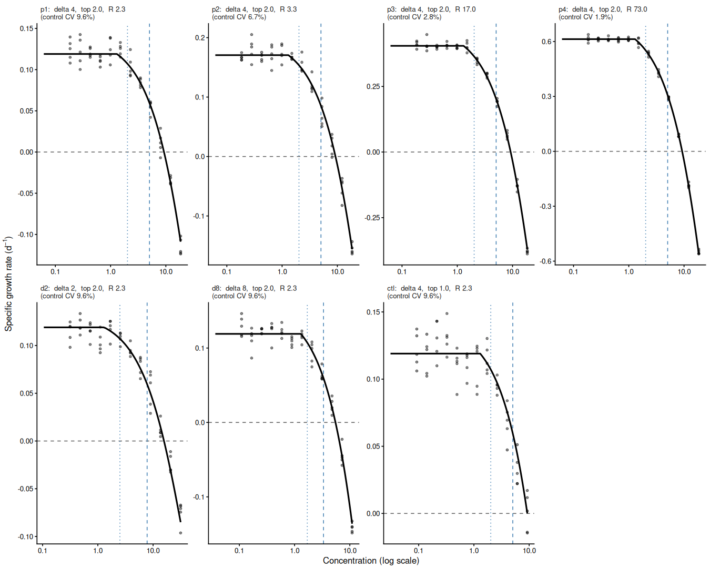
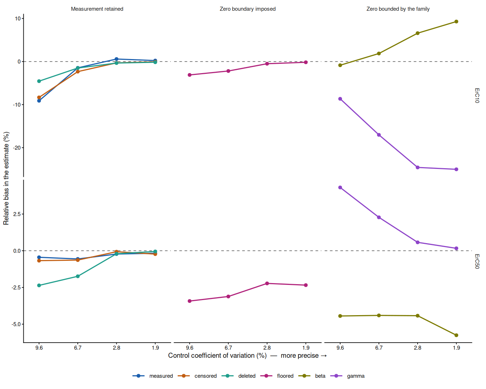
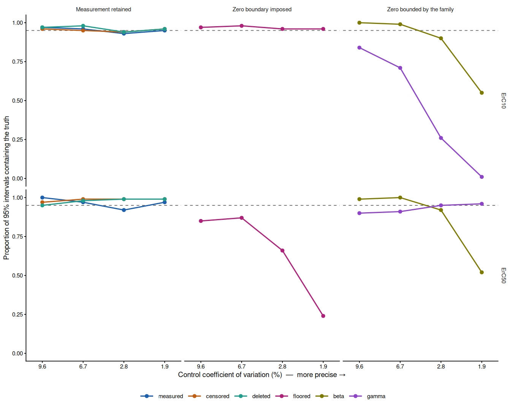

[e1]: https://open-aims.github.io/bayesnec/articles/example1.html
[e2]: https://open-aims.github.io/bayesnec/articles/example2.html
[e6]: https://open-aims.github.io/bayesnec/articles/example6.html

# Summary

This vignette examines how different conventions for handling negative
growth-rate measurements affect concentration-response modelling and the
resulting toxicity estimates. Negative growth rates are common in algal toxicity
tests and other ecological endpoints that measure change over time, yet many
analytical workflows modify or remove these observations before model fitting.

Using simulated datasets where the true toxicity values are known, six commonly
used approaches were compared: retaining measured values, censoring values below
zero, deleting negative observations, replacing negatives with zero
("flooring"), and fitting Beta or Gamma response distributions that do not
permit negative values. Performance was assessed for ErC10, ErC50 and NSEC
estimates across a range of experimental designs and levels of measurement
precision.

The results show that approaches which retain the measured information, either
directly or through censoring, consistently recover the true toxicity values,
maintain nominal interval coverage, and improve as experimental precision
increases. Deleting negative observations performs less well but remains largely
unbiased. In contrast, conventions that replace negative values or impose a
non-negative response distribution introduce systematic bias that does not
disappear with increasing precision. Flooring negative values produces
increasingly over-conservative toxicity estimates, particularly for the NSEC,
while Beta and Gamma models can introduce substantial bias despite successfully
converging.

Application to four real algal growth datasets demonstrated that the choice of
convention can materially affect reported toxicity values, although the
magnitude of the effect depends on the prevalence of observations at or below
zero growth. The simulation results indicate that the direction of the bias is
predictable even when its magnitude is dataset specific.

Overall, the study supports analysing growth-rate data as measured whenever
possible and using censoring when values below a detection or counting limit are
unavailable. The results provide strong evidence against replacing negative
values with zero or selecting bounded response distributions solely because
negative responses are present. These practices distort the data-generating
process and can produce toxicity estimates that become more confidently wrong as
data quality improves.

# 1 Negative growth rates

Some ecotoxicological responses can legitimately take negative values. Specific
growth rate is the most common example: as a rate of change, it is negative for
a population that declines over the course of a test. Other examples include
increments, differences between paired measurements, and any response expressed
as a change from a baseline.

However, these negative values are typically removed before fitting, both in
this package and in others. The reasons are long-standing, and none of
them is specific to any one piece of software. A negative value cannot be
expressed as a percentage of the control without the percentage exceeding 100,
and several commonly used concentration-response equations cannot generate a
negative mean at all. In addition, a negative growth rate looks anomalous on a
plot, which may cause the reader to treat it as an error and not as a
measurement.

The negative values are removed in one of several ways: by deleting the rows
that hold them, by replacing them with zero before fitting, by declaring them
censored at zero, or by fitting a response distribution that has no support
below zero (e.g. a Beta or a Gamma). In a minority of cases the negative
values are kept and the model is fitted to the data as recorded, which is the
`measured` convention of Section 5.

Here we examine how each of these conventions affects the toxicity estimate that
is subsequently reported. We first define the estimates and explain why their
definition is important when the response can cross zero (Section 2), and then
set out what replacing a negative value commits the analyst to, which is more
than an edit to the data (Section 3). We also list the equations `bayesnec` fits
under a Gaussian family, and the ECx that `ecx()` returns for them (Section 4).
The conventions are then evaluated in a simulation study in which the true
values are known, so that each convention can be scored against the truth and
not merely compared with the others (Section 5), and the comparison is repeated
on four real algal growth tests (Section 6). The recommendations and the
limitations are given in Sections 7 and 8, and the provenance of each figure
quoted is recorded in Section 9.

To run this vignette we will need the following packages.


``` r
library(bayesnec)
library(brms)
library(ggplot2)
library(dplyr)
library(tidyr)
```

# 2 Toxicity estimates and their reference

## 2.1 Growth rate and the ErCx notation

In OECD terminology the *endpoint* is the measured biological response, and OECD
Test Guideline 201 [@oecd2026tg201] defines two endpoints from one set of cell
counts and requires both to be reported: the average specific *growth rate*
(i.e. the rate constant of population increase) and the *yield* (i.e. the
biomass increase over the test). The `r` in ErC50 comes from TG 201 and names
the endpoint from which the estimate was derived, so that ErC50 is the EC50 for
the growth rate and EyC50 is the EC50 for the yield (TG 201 writes this letter
as a subscript, whereas we write it inline). For a given dataset EyC50 is
systematically lower than ErC50, and the guideline requires the growth rate to
be reported because it does not depend on test duration.

An ECx or an NSEC (both defined below) is therefore a *toxicity estimate*, not
an endpoint. This distinction is important here because it is the growth-rate
endpoint, and not the toxicity estimate, that can take negative values.
Everything below concerns ErCx.

## 2.2 The ECx reference

`bayesnec` measures each ECx from the control, which is the predicted mean at
the lowest concentration in the supplied predictor, taken per posterior draw.
The `type` argument names what the percentage is measured *towards*:
`"absolute"` (the default) measures from the control to zero, `"relative"` from
the control to the equation's lower asymptote, and `"range"` from the control
to the lowest response the curve predicts, whereas `"direct"` reads the
concentration off a nominated response value (see `?ecx` for the full
definitions).

TG 201 uses the definition given by `type = "absolute"`, under which a 50%
effect means the growth rate has been halved relative to the control, and a
100% effect means growth has stopped altogether. This definition has two
consequences for a response that can go negative. First, zero growth is 100%
effect for any dataset, whatever the control growth rate, so a curve whose
lower asymptote is negative descends past 100% effect and continues to decline.
Second, effects above 100% are meaningful and are not truncated (`ecx_val` is
not capped), because 120% inhibition of a growth rate is a rate of -0.2 times
the control, which is a real measurement on an unbounded response and is the
value reported under TG 201.

ErC10 and ErC50 are always located where the curve is above zero, because they
require the response to be 90% and 50% of the control respectively, and both of
these values are strictly positive. The negative part of the curve can
therefore affect these estimates only indirectly, by changing the shape of the
fitted curve through the observations at high concentrations, and it is this
indirect effect that we quantify in the rest of this vignette.

We do not normalise the response to the control anywhere in this vignette. The
absolute ECx already expresses the effect relative to the fitted control
response, so dividing the data by the control mean beforehand would apply the
same correction twice, and would also distort the error structure [@Ritz2026].

## 2.3 The NSEC

The NSEC is the no-significant-effect-concentration of @fisherfox2023, i.e. the
highest concentration at which the modelled mean response is still
statistically indistinguishable from the modelled control response (read up the
concentration series, this is the point at which the response first becomes
distinguishable from the control). To estimate it, `bayesnec` takes a lower
quantile of the control posterior (by default the 1st percentile, controlled by
`sig_val`) and finds where each posterior draw of the curve crosses it. The
NSEC is one of the estimates recommended for guideline derivation under the
current Australian and New Zealand technical guidance [@warne2025], and its
relationship to the NEC is described by @fisher2023ieam.

The NSEC depends on the width of the control posterior, which determines how
the results below need to be read. This dependence follows from how the metric
is defined, and not from how any approach fits the data. A noisier experiment
tends to produce a wider control posterior, and hence a lower reference value
and a crossing further to the right, at a higher concentration. Conversely, as
the residual error among the control replicates tends to zero, the reference
converges on the control mean and the crossing is found at a lower
concentration.

Several equations in `bayesnec` include a `nec` parameter (a threshold
concentration below which the modelled mean response is flat at the control
level and above which it declines), so that the curve consists of two straight
or curved segments meeting at a corner instead of a single smooth decline. For
such an equation the NSEC converges on `nec` itself as the residual error
falls. The true `nec` is therefore the limiting value of the NSEC, and not its
expected value at any finite level of noise.

# 3 Flooring and the response distribution

Replacing a negative growth rate with zero is more than an edit to the data,
because it asserts that the response cannot be negative. This is a statement
about the response distribution, and the rest of the analysis then has to be
made consistent with it.

However, no available distribution family represents that assertion exactly. A
floored response has a point mass at zero, whereas the distributions available
for a non-negative continuous response exclude zero itself (a Beta is defined on
the open interval (0, 1) and a Gamma on the open interval (0, infinity)). The
floored values are therefore outside the support of the family that the
flooring implies. A distribution that does represent a continuous non-negative
response with a point mass at zero (e.g. a Tweedie) is not available natively
in `brms`.

`bayesnec` accommodates this by shifting the values inside the support of the
Beta or Gamma family. `check_data()` shifts an exact zero to one tenth of the
smallest positive value and, under a Beta, an exact one to `1 - 0.001`.
`bnec()` gives one message for each substitution, naming the number of rows,
the value substituted and the reason, and, for a substituted zero, the family
that would represent a genuine zero instead of shifting it. This accommodation is
a device for making an inconsistent specification runnable, and not a model of
the response.

Substituting zeros and choosing a bounded family are therefore one practice
applied at different stages of the analysis, which is why we do not
treat them as alternatives. The `floored` convention below replaces the
negative values and keeps the family unbounded, whereas the `beta` and `gamma`
conventions make this assertion through the family as well as through the
data.

Two cases are outside this argument. A row whose value was never recorded,
because the population fell below a counting limit, is a censored observation
and not a floored one, and is exempt from the substitution. A response that is
genuinely zero because the population died is a different process again, for
which the hurdle and zero-inflated families are designed (see the [Hurdle and
zero-inflated concentration-response models][e6] vignette). However, these
families are not a remedy for a substituted negative.

# 4 Zero-asymptote equations under a Gaussian family

The interval within which a response distribution allows the mean to fall is a
property of the distribution, and not of the link function. The mean of a
Gaussian distribution is unconstrained, because the data enter the likelihood
only through the residual, and a negative fitted mean is therefore an ordinary
prediction and not an invalid one.

For this reason the six declining equations whose lower asymptote is fixed at
zero (`nec3param`, `ecxexp`, `ecxsigm`, `ecxwb1p3`, `ecxwb2p3` and `ecxll3`) are
retained under a Gaussian family, although none of them can predict a negative
mean while `top` is positive. An absolute ECx is reported for each of them,
even though none has a `bot` parameter. Under a Gaussian family the declining
candidate set that `bnec()` fits by default includes these six and the eight
other declining equations and, together with the constant equation
`ecxflat` (which is also in the `"decline"` group), consists of fifteen
equations.


``` r
models()$decline
#>  [1] "nec3param" "nec4param" "neclin"    "ecxlin"    "ecxexp"    "ecxsigm"   "ecx4param" "ecxwb1"    "ecxwb2"   
#> [10] "ecxwb1p3"  "ecxwb2p3"  "ecxll5"    "ecxll4"    "ecxll3"    "ecxflat"
```

In practice, this means that the curve shape described for algal growth-rate
data by both TG 201 and @Ritz2026 (a lower asymptote fixed at zero, representing
complete inhibition) can be fitted directly to the measurements as recorded, and
can be weighed against the shapes with a free lower asymptote by the same model
averaging that `bayesnec` applies to everything else. Whether that shape is used
then depends on the weight the data give it, and not on a choice made in the
model specification. The decision to replace the measurements is a separate one,
made before any equation is fitted, and it is this decision that we examine in
the remaining sections.

# 5 Simulation study

Real datasets can show that the conventions disagree, but not which of them is
correct, because the true toxicity of a real substance is unknown. We therefore
make the comparison on simulated data, for which the true ErC10, ErC50 and `nec`
are known by construction, so that each convention can be scored against them.

## 5.1 The conventions compared

We compare six conventions, which differ only in what is done to the data before
fitting and in the response distribution that is then used.

| name | what the analyst does |
|---|---|
| `measured` | use the growth rates as recorded |
| `censored` | declare each negative value left-censored at zero |
| `deleted` | delete the rows holding a negative value |
| `floored` | replace each negative value with zero |
| `beta` | floor, scale the response to (0, 1], fit a Beta |
| `gamma` | floor, fit a Gamma |

Each convention then calls `bnec()` with the package defaults, i.e. the default
priors derived from its own prepared data, the default declining candidate set
for its family, and the default model averaging over that set (pseudo-BMA with a
Bayesian bootstrap, which `bnec()` uses when `loo_controls` is not supplied). No
convention is given a prior or an equation chosen by another convention. The
difference between two conventions is therefore the difference a practitioner
would obtain by following each convention through, and not a contrast in the
likelihood only, with everything else held artificially fixed.

If the equation were held fixed (e.g. at `nec4param`), any difference could be
attributed only to the treatment of the data. However, this answers a
question about the likelihood, and not the question a reader has, which is what
happens to the number they will report. A fixed equation would also introduce an
artefact, because on altered data a fixed `nec4param` is no longer the equation
that generated them, and part of what it measured would then be
misspecification that the convention did not cause.

The `measured` convention uses the growth rates as recorded, with the lower
asymptote left free wherever the equation has one, and provides the reference
for all of the results below.


``` r
bnec(y ~ crf(x, "decline"), data = dat, family = gaussian(link = "identity"))
```

The `censored` convention declares each negative value censored at zero, so
that the model is told the observation is at or below zero without being told
its value. This is the option available when the negative values were never
recorded. Censoring also changes which observations constrain the mean most
strongly, because a censored row contributes the probability that the response
is at or below the bound, and not a density (see the *Censoring* section of the
[Single model usage][e1] vignette).


``` r
dat_censored <- dat |>
  mutate(cens = ifelse(y < 0, "left", "none"),
         y = ifelse(y < 0, 0, y))
bnec(y | cens(cens) ~ crf(x, "decline"), data = dat_censored,
     family = gaussian(link = "identity"))
```

The `deleted` convention drops the rows holding a negative value and analyses
the remaining data unchanged. Nothing false is asserted about any observation
that is kept. However, the replication per concentration can change, and a
whole treatment group may disappear at the top of the series (i.e. at the
highest concentrations).


``` r
bnec(y ~ crf(x, "decline"), data = filter(dat, y >= 0),
     family = gaussian(link = "identity"))
```

The `floored` convention replaces each negative growth rate with zero and does
not change the model.


``` r
dat_floored <- mutate(dat, y = pmax(y, 0))
bnec(y ~ crf(x, "decline"), data = dat_floored,
     family = gaussian(link = "identity"))
```

The `beta` convention divides the floored response by its maximum, so that it
is in the interval (0, 1], and fits a Beta. Dividing by the maximum is how these
data have been prepared in the work this vignette draws on, whereas dividing by
the control mean is at least as common elsewhere, and @Ritz2026 set out why the
response should not be divided by either before fitting.


``` r
dat_beta <- dat |>
  mutate(y = pmax(y, 0)) |>
  mutate(y = y / max(y))
bnec(y ~ crf(x, "decline"), data = dat_beta, family = Beta(link = "identity"))
```

The `gamma` convention applies no scaling, and fits a Gamma to the floored
response.


``` r
bnec(y ~ crf(x, "decline"), data = dat_floored,
     family = Gamma(link = "identity"))
```

Under the `beta` and `gamma` conventions the zeros created by flooring are
shifted off the boundary by `check_data()` (Section 3), and this shift is part
of the convention under test, not something the study pre-empts. Dividing by
the maximum does not affect the reported toxicity estimates, because
`ecx(type = "absolute")` solves `f(x) = control * (1 - x/100)`. A positive
scaling of the response therefore applies to both sides of this equation, and
the concentration at which the curve meets the target is unchanged. The choice
of family changes the fitted curve, but not the definition of the estimate.

The candidate set differs between families, because the declining set is
filtered according to what the support of each family allows. Under a Gaussian
family the study used the fourteen equations listed in Section 4 other than
`ecxflat` (which was added to the set after the study was run), whereas under a
Beta and under a Gamma it used twelve.


## 5.2 Design

The data are generated from `nec4param`, which is in the candidate set of each
Gaussian convention, so that the generating shape is available to be recovered
and the weight it receives is itself informative.


``` r
nec4param_curve <- function(x, top, bot, beta, nec) {
  bot + (top - bot) * exp(-exp(beta) * (x - nec) * (x >= nec))
}
```

The truth is parameterised so that the two experimental factors are explicit.
The control growth rate is set by the control fold-change `R` (the factor by
which the control population multiplies over a test of length `t`), and the
depth of the lower asymptote is set as a multiple `delta` of that control rate.
For example, at `delta = 2` the population declines twice as fast at the
highest concentrations as it grows in the control. The three levels used
(`delta` = 2, 4 and 8) span the range measured on the real datasets.


``` r
sim_truth <- function(R = 2.3, delta = 4, t = 7, nec = 1.3, beta = -3.573) {
  mu_0 <- log(R) / t                    # true control growth rate
  bot <- -delta * mu_0                  # lower asymptote, delta x deeper than top
  list(R = R, delta = delta, t = t, top = mu_0, bot = bot,
       beta = beta, nec = nec,
       # where the true curve crosses zero growth
       zero_crossing = nec + log((1 + delta) / delta) / exp(beta))
}
```

The design is a geometric concentration series spanning a factor of one
hundred, with ten controls and five replicates at each of twelve concentrations
(n = 70), matching the real designs. The position of the highest concentration
is the second factor, and is expressed as a multiple `top_factor` of the
concentration at which the true curve crosses zero. At `top_factor = 1.0` the
series stops exactly at the crossing and about one design point in fourteen has
a non-positive true mean, whereas at `2.0` the series extends well past the
crossing and one design point in seven has a non-positive true mean. This
factor therefore determines how much negative data there is for a convention to
act on.


``` r
sim_design <- function(truth, top_factor = 1, n_conc = 12, n_rep = 5,
                       n_control = 10, span = 100) {
  x_max <- top_factor * truth$zero_crossing
  concs <- exp(seq(log(x_max / span), log(x_max), length.out = n_conc))
  data.frame(x = c(rep(0, n_control), rep(concs, each = n_rep)))
}
```

The residual scale is constant along the curve, and the fits are homoscedastic
to match, so that no convention is misspecified in its variance and only the
mean structure is under test. When the within-dose standard deviation of the
`alga` data is measured against position on the curve (with substituted rows
excluded), only one of the four datasets shows a gradient at all
(`c_proliferum`, fitted ratio 14.1, slope p < 0.001), whereas the ratios for
the other three are 1.2 to 1.5 (p > 0.35). Generating all cells as
heteroscedastic would therefore assert as general a pattern seen in one
dataset. It would also misspecify each convention identically, which
is a confound shared by the whole comparison and not a feature of it.


``` r
sim_sigma <- function(x, truth, sigma_0_abs) rep(sigma_0_abs, length(x))

simulate_dataset <- function(truth, design, sigma_0_abs, seed = NULL) {
  if (!is.null(seed)) set.seed(seed)
  mu <- nec4param_curve(design$x, truth$top, truth$bot, truth$beta, truth$nec)
  data.frame(x = design$x,
             y = rnorm(length(mu), mu, sim_sigma(design$x, truth, sigma_0_abs)))
}
```

The control residual standard deviation is held at a fixed absolute value,
anchored so that it corresponds to a coefficient of variation of 9.6% at `R` =
2.3, rather than at a fixed coefficient of variation. Under a fixed coefficient
of variation the generating model is exactly scale-equivariant in the growth
rate, so changing `R` would change nothing that is reported. Holding the
absolute error fixed instead means that increasing `R` increases the signal but
does not change the noise, which makes `R` an axis of measurement precision.


``` r
sigma_0_abs <- 0.096 * log(2.3) / 7   # absolute control SD, anchored at R = 2.3
```

The design consists of seven cells. Four of them (`p1` to `p4`) have `delta` =
4 and `top_factor` = 2.0 and increasing values of `R`, giving four levels of
measurement precision with an otherwise identical design and truth. Two more
(`d2` and `d8`) change how far the true curve descends below zero, and the
seventh (`ctl`) stops the concentration series at the zero crossing, so that
the conventions have almost nothing to act on. Each cell was simulated 100
times and each simulated dataset was analysed under all six conventions, giving
7 x 100 x 6 = 4,200 model-averaged fits and 52,533 individual equation fits.
Sampling used four chains of 4,000 iterations with 2,000 warmup,
`adapt_delta = 0.99` and `max_treedepth = 12`. All fits are retained in the
summaries, as no unit failed and no estimate was unidentified.


``` r
cells <- data.frame(
  cell = c("p1", "p2", "p3", "p4", "d2", "d8", "ctl"),
  delta = c(4, 4, 4, 4, 2, 8, 4),
  top_factor = c(2, 2, 2, 2, 2, 2, 1),
  R = c(2.3, 3.3, 17, 73, 2.3, 2.3, 2.3)
)

cell_detail <- function(s) {
  tr <- sim_truth(R = s$R, delta = s$delta)
  dz <- sim_design(tr, top_factor = s$top_factor)
  mu <- nec4param_curve(dz$x, tr$top, tr$bot, tr$beta, tr$nec)
  true_ecx <- function(p) {
    target <- tr$top * (1 - p / 100)
    tr$nec + log((tr$top - tr$bot) / (target - tr$bot)) / exp(tr$beta)
  }
  data.frame(top = tr$top, bot = tr$bot, x_max = max(dz$x),
             ErC10 = true_ecx(10), ErC50 = true_ecx(50),
             cv_control = sigma_0_abs / tr$top,
             # tolerance, not `<= 0`: at top_factor = 1 the highest design point
             # sits exactly on the crossing, so a strict test flips on floating
             # point and reports 0 for some cells and 1/14 for others
             prop_negative = mean(mu <= 1e-10))
}
cells <- cbind(cells, do.call(rbind, lapply(seq_len(nrow(cells)),
                                            function(i) cell_detail(cells[i, ]))))
```


Table: **Table 1.** The seven simulated cells. `top` and `bot` are the true upper and lower asymptotes of the growth rate; `prop. negative` is the proportion of the 70 design points whose true mean growth rate is at or below zero. The true `nec` is 1.3 in every cell.

|Cell | delta| top factor|    R|   top|    bot| max conc.| true ErC10| true ErC50| control CV| prop. negative|
|:----|-----:|----------:|----:|-----:|------:|---------:|----------:|----------:|----------:|--------------:|
|p1   |     4|          2|  2.3| 0.119| -0.476|      18.5|       2.02|       5.05|      0.096|          0.143|
|p2   |     4|          2|  3.3| 0.171| -0.682|      18.5|       2.02|       5.05|      0.067|          0.143|
|p3   |     4|          2| 17.0| 0.405| -1.619|      18.5|       2.02|       5.05|      0.028|          0.143|
|p4   |     4|          2| 73.0| 0.613| -2.452|      18.5|       2.02|       5.05|      0.019|          0.143|
|d2   |     2|          2|  2.3| 0.119| -0.238|      31.5|       2.51|       7.79|      0.096|          0.143|
|d8   |     8|          2|  2.3| 0.119| -0.952|      11.0|       1.70|       3.34|      0.096|          0.143|
|ctl  |     4|          1|  2.3| 0.119| -0.476|       9.2|       2.02|       5.05|      0.096|          0.071|


Three features of Table 1 are important for interpreting the results below.
First, the true ErC10 and ErC50 depend only on `delta`, so `p1` to `p4` share
one estimand and differ only in how precisely it can be measured. Second, the
proportion of negative true means is one in seven in all cells except `ctl`,
where it is one in fourteen, which in the realised datasets corresponds to
about 10 negative observations out of 70 (against about 2 in `ctl`). Third, the
control coefficient of variation falls from 9.6% to 1.9% across `p1` to `p4`,
and this is the precision sweep on which the rest of this section is built.

Figure 1 shows one simulated dataset from each cell. The scatter of the
observations relative to the range of the true curve narrows from `p1` to `p4`,
and in each cell except `ctl` the true curve is below zero growth at the
highest two concentrations, whereas in `ctl` the series ends where the true
curve crosses zero.


``` r
curve_data <- do.call(rbind, lapply(seq_len(nrow(cells)), function(i) {
  s <- cells[i, ]
  tr <- sim_truth(R = s$R, delta = s$delta)
  xx <- seq(0, s$x_max, length.out = 300)
  data.frame(cell = s$cell, x = xx,
             mu = nec4param_curve(xx, tr$top, tr$bot, tr$beta, tr$nec))
}))

point_data <- do.call(rbind, lapply(seq_len(nrow(cells)), function(i) {
  s <- cells[i, ]
  tr <- sim_truth(R = s$R, delta = s$delta)
  d <- simulate_dataset(tr, sim_design(tr, s$top_factor), sigma_0_abs,
                        seed = 42 + i)
  data.frame(cell = s$cell, d)
}))

# Panels in design order -- the precision sweep first, then the cells that change
# the truth or the design -- rather than alphabetically.
cell_levels <- c("p1", "p2", "p3", "p4", "d2", "d8", "ctl")
cells$cell <- factor(cells$cell, levels = cell_levels)
curve_data$cell <- factor(curve_data$cell, levels = cell_levels)
point_data$cell <- factor(point_data$cell, levels = cell_levels)

lab <- setNames(
  sprintf("%s:  delta %g,  top %.1f,  R %.1f\n(control CV %.1f%%)",
          cells$cell, cells$delta, cells$top_factor, cells$R,
          100 * cells$cv_control),
  levels(cells$cell))

# controls sit at x = 0 and have no position on a log axis, so they are dropped
# from this figure; every fit uses them
ggplot(subset(point_data, x > 0), aes(x = x, y = y)) +
  geom_hline(yintercept = 0, linetype = "dashed", colour = "grey40") +
  geom_vline(data = cells, aes(xintercept = ErC10),
             linetype = "dotted", colour = "steelblue") +
  geom_vline(data = cells, aes(xintercept = ErC50),
             linetype = "dashed", colour = "steelblue") +
  geom_point(alpha = 0.45, size = 0.8) +
  geom_line(data = subset(curve_data, x > 0), aes(y = mu), linewidth = 0.7) +
  facet_wrap(~ cell, scales = "free", ncol = 4,
             labeller = labeller(cell = lab)) +
  scale_x_log10() +
  labs(x = "Concentration (log scale)",
       y = expression("Specific growth rate ("*d^-1*")")) +
  theme_classic(base_size = 8) +
  theme(panel.spacing = unit(0.35, "lines"),
        plot.margin = margin(2, 4, 2, 2),
        strip.background = element_blank(), strip.text = element_text(hjust = 0))
```

<div class="figure" style="text-align: center">

<p class="caption">**Figure 1.** The seven simulated cells. Points are one simulated dataset per cell; the solid line is the true curve; the dashed horizontal line is zero growth. Vertical lines mark the true ErC10 (dotted) and ErC50 (dashed). Panels are labelled with the cell name, its design factors and the control coefficient of variation it realises.</p>
</div>


## 5.3 One dataset under each convention


The tables and figures below summarise each cell over its 100 realisations, and
such a summary does not show what a convention does to an individual dataset.
We therefore also fitted all six conventions to a single simulated dataset from
`p1`, the noisiest cell tested, in which
10 of the seventy
design points have a true mean growth rate at or below zero and
11 of the seventy simulated observations were negative
(Figure 2). This realisation is the one drawn for the `p1` exemplar by a seed
fixed on the cell and convention names, so it was chosen before any result was
seen and not selected afterwards for the picture it makes.


``` r
ggplot(panel_fit, aes(x = x)) +
  geom_hline(yintercept = 0, linetype = "dashed", colour = "grey60") +
  geom_vline(xintercept = panel_cell$ErC50, linetype = "dashed",
             colour = "grey60") +
  geom_ribbon(aes(ymin = lo, ymax = hi, fill = arm), alpha = 0.25) +
  geom_point(data = subset(panel_points, x > 0),
             aes(y = y, shape = altered), size = 1.1, alpha = 0.7) +
  geom_line(data = panel_true, aes(y = y), linewidth = 1, colour = "grey10") +
  geom_line(aes(y = y, colour = arm), linewidth = 0.8) +
  scale_shape_manual(values = c(`FALSE` = 16, `TRUE` = 1), guide = "none") +
  scale_colour_manual(values = arm_cols, guide = "none") +
  scale_fill_manual(values = arm_cols, guide = "none") +
  scale_x_log10() +
  facet_wrap(~ arm, ncol = 3) +
  labs(x = "Concentration (log scale)",
       y = expression("Specific growth rate ("*d^-1*")")) +
  theme_classic(base_size = 9) +
  theme(strip.background = element_blank(),
        strip.text = element_text(hjust = 0))
```

<div class="figure" style="text-align: center">

<p class="caption">**Figure 2.** One simulated dataset from cell `p1`, fitted under each of the six conventions. Points are the data each convention was given; open symbols mark the 11 observations it altered or dropped, drawn at zero by the four conventions that substitute and at their measured values under `deleted`, which discards those rows. `measured` alters none, so nothing in its panel is marked. The coloured line is the model-averaged posterior median and the band its 95% credible interval; the black line is the true curve. The dashed horizontal line is zero growth and the dashed vertical line the true ErC50. The controls sit at a concentration of zero and have no position on a log axis, so they are not drawn; every fit uses them.</p>
</div>


Under `measured` the model-averaged curve follows the true curve along its
whole length, including the part below zero, and its credible band is narrow
throughout (Figure 2). Under `censored` the median also follows the true curve,
although the band widens once the curve passes zero, because a row declared to
be below a bound provides less information about where the curve goes than a
measurement does.

In contrast, the three conventions that put a zero in place of the measurement
(`floored`, `beta` and `gamma`) produce a curve that flattens onto zero instead
of continuing to decline. This flattening appears from a little below the true
ErC50 (the dashed vertical line), and therefore begins at lower concentrations
than the substituted rows themselves. This is likely to be the mechanism behind
the biases reported below: the substitution is made at the top of the
concentration series, but the resulting curve is displaced over a range that
includes the concentrations from which the estimates are read. The displacement
is small at the ErC50 and large at the low-concentration end of the curve, where
the NSEC is read, and this ordering is measured in Sections 5.4 and 5.6.

The `deleted` panel shows a different consequence. In this dataset, removing
all rows with a negative value removed the highest concentrations entirely, so
the fitted curve stops where the surviving data stop, and the design is no
longer the one that was run.

The `gamma` panel shows a failure of the variance and not of the mean. Its
credible band is widest at the control (on the left of the panel), where the
generated residual spread is no wider than at any other concentration, because
an identity-link Gamma ties the spread to the fitted mean. We quantify this
with a posterior predictive check in Section 5.4.

## 5.4 ErC10 and ErC50

Relative bias is the mean of the estimated value minus the true value over the
100 realisations of a cell, expressed as a percentage of the true value. The
precision sweep is the most informative comparison in the study, because it
distinguishes the two sources of error in an estimate: estimation error shrinks
as an experiment becomes more precise, whereas the error due to model
misspecification does not.


``` r
bias_plot <- function(d, ests) {
  ggplot(subset(d, estimate %in% ests),
         aes(x = cv_f, y = rel_bias, colour = arm, group = arm)) +
    geom_hline(yintercept = 0, linetype = "dashed", colour = "grey40") +
    geom_line(linewidth = 0.7) +
    geom_point(size = 1.8) +
    # One label per series at the right-hand edge rather than a key: the label
    # sits on the line it names, which is the secondary encoding the palette
    # note above depends on.
    scale_x_discrete(expand = expansion(add = c(0.4, 0.4))) +
    facet_grid(estimate ~ handling, scales = "free_y") +
    labs(x = "Control coefficient of variation (%)  —  more precise →",
         y = "Relative bias in the estimate (%)") +
    scale_colour_manual(values = arm_cols, breaks = arm_levels) +
    guides(colour = guide_legend(nrow = 1)) +
    theme_classic(base_size = 9) +
    theme(strip.background = element_blank(), legend.position = "bottom",
          legend.title = element_blank(), legend.key.width = unit(1.4, "lines"))
}
bias_plot(precision, c("ErC10", "ErC50"))
```

<div class="figure" style="text-align: center">

<p class="caption">**Figure 3.** Relative bias in the estimated ErC10 and ErC50 against the control coefficient of variation, which decreases to the right as the experiment becomes more precise. Each point summarises 100 simulated datasets. The dashed line is zero bias.</p>
</div>

The three conventions that retain the measurement converge on the true ErC50
(Figure 3). Across `p1` to `p4` the bias of `measured` ranges from
-0.4% to
-0.2%, that of `censored` from
-0.7% to
-0.2%, and that of `deleted` from
-2.4% to
0.0%, so that all three are within half a per
cent of the truth at the highest precision tested.

In contrast, flooring does not converge. The magnitude of the ErC50 bias of
`floored` falls from -3.4% to
-2.3% and then stops falling, and that of
`beta` remains between -4.4% and
-5.8% throughout, so both conventions make the
substance appear more toxic than it is. This residual bias is smaller than the 8
to 15% reported for these conventions under a fixed `nec4param`, because the
candidate set contains the zero-asymptote shapes that floored data resemble
(Section 4), and averaging over these shapes absorbs part of the distortion.
However, it does not absorb all of it.

The Gamma converges on the true ErC50, but is the least accurate of the six
conventions on ErC10. Its ErC50 bias falls from
4.3% to
0.2% across the sweep, whereas its ErC10 is
displaced by -8.7% at the noisiest and
-25.0% at the most precise. This bias increases
as the experiment becomes more precise, which indicates misspecification and
not estimation error.

The cause is in the variance and not in the mean, as a posterior predictive
check shows. These data are generated with a residual standard deviation that is
constant along the curve, so what a correctly specified family should predict is
known exactly (i.e. the generated value at each concentration). Each fit of the
four precision cells was refitted, and its model-averaged predicted spread was
compared with the generated one, for 100 realisations per cell and convention.
We summarise the comparison by the control ratio (the predicted spread at the
lowest concentration divided by the generated value) and the gradient (the ratio
of the predicted spread at the control to that at the highest concentration),
both of which should therefore be one for a correctly specified family.


Because `measured` is correctly specified by construction, its values are the
closest this statistic comes to one on these data, and provide the reference
against which the other conventions are read: a control ratio of
1.00 to 0.98, with 95% of
realisations between 0.81
and 1.18, and a
gradient of 1.03.

An identity-link Gamma cannot reproduce a constant spread, because it ties the
residual standard deviation to the mean. It overstates the spread at the
control by a factor of 2.51 to 2.69,
and its gradient ranges from 181
at the noisiest cell to 90
at the most precise, against a true value of one. The floored block of
observations is therefore given almost all of the weight in the likelihood and
the control scatter almost none, so that it is the fit at the shoulder of the
curve (where a 10% decline is read, i.e. the ErC10) that is distorted.

This check also shows what flooring does and does not damage. Under a
Gaussian family the floored data are described by a correctly specified
variance model, with a control ratio for `floored` of
0.91 to 1.12 and a gradient of
1.04, both within the reference. What the
substitution changes is the mean structure (examined in Section 5.7), whereas
under a Gamma the failures of the mean and of the variance compound.

The Beta is a third case. Its control ratio of 1.09 to
1.10 is within the reference, and its gradient of
1.71 to 2.66
is a mild departure compared with that of the Gamma. Whatever displaces the
ErC10 of the Beta is therefore not the variance model.

At the highest precision tested, the intervals of `gamma` are
2.14
times as wide as those of `measured` on ErC50, which keeps its ErC50 coverage
nominal while its point estimate for ErC10 is a quarter low.

The Beta is displaced in the other direction on ErC10, from
-0.9% at the noisiest to
9.3% at the most precise. This bias also
increases as the experiment becomes more precise, which again indicates
misspecification and not estimation error.


``` r
ggplot(design_cells, aes(x = rel_bias, y = arm, colour = arm)) +
  geom_vline(xintercept = 0, linetype = "dashed", colour = "grey40") +
  geom_point(size = 2.2) +
  # estimate on the columns, not the rows: facet_grid frees a scale per column,
  # and the three estimates are on scales that differ by an order of magnitude,
  # so sharing one x axis across them would hide everything but the NSEC.
  facet_grid(cell ~ estimate, scales = "free_x") +
  scale_y_discrete(limits = rev(arm_levels)) +
  labs(x = "Relative bias in the estimate (%)", y = NULL) +
  scale_colour_manual(values = arm_cols, guide = "none") +
  theme_classic(base_size = 9) +
  theme(strip.background = element_blank(), legend.position = "none")
```

<div class="figure" style="text-align: center">

<p class="caption">**Figure 4.** Relative bias in the three cells that change the truth or the design rather than the measurement precision, all at a control coefficient of variation of 9.6%. `d2` and `d8` change how far the true curve descends below zero; `ctl` stops the concentration series at the zero crossing, leaving about two negative observations in seventy for a convention to act on.</p>
</div>

The depth to which the curve descends below zero changes the size of the
effect, but not its direction (Figure 4). Between `d2` and `d8` the ErC50 bias
of `floored` is -4.0% and
-2.0%, and that of `beta`
-5.0% and
-3.1%, against
0.0% and
1.1% for `measured`.

The `ctl` cell is the one that indicates whether any of this applies to a
reader's own data.
Its concentration series stops at the zero crossing, so a realised dataset
contains about two negative observations instead of ten, and the four Gaussian
conventions then span 0.4 percentage points of ErC50
bias between them. This compares with 3.0 in `p1`,
which has equal control variability and four times as many negative
observations. Where essentially none of the observations are at or below zero
growth, the choice of convention is therefore unlikely to change the reported
value.

## 5.5 Credible interval coverage

Coverage is the proportion of the 100 realisations whose 95% credible interval
contains the true value. We report it together with the mean interval width,
because a wide interval and an accurate one both achieve nominal coverage,
although they are different results.


``` r
cov_plot <- function(d, ests) {
  ggplot(subset(d, estimate %in% ests),
         aes(x = cv_f, y = coverage, colour = arm, group = arm)) +
    geom_hline(yintercept = 0.95, linetype = "dashed", colour = "grey40") +
    geom_line(linewidth = 0.7) +
    geom_point(size = 1.8) +
    scale_x_discrete(expand = expansion(add = c(0.4, 0.4))) +
    scale_y_continuous(limits = c(0, 1)) +
    facet_grid(estimate ~ handling) +
    labs(x = "Control coefficient of variation (%)  —  more precise →",
         y = "Proportion of 95% intervals containing the truth") +
    scale_colour_manual(values = arm_cols, breaks = arm_levels) +
    guides(colour = guide_legend(nrow = 1)) +
    theme_classic(base_size = 9) +
    theme(strip.background = element_blank(), legend.position = "bottom",
          legend.title = element_blank(), legend.key.width = unit(1.4, "lines"))
}
cov_plot(precision, c("ErC10", "ErC50"))
```

<div class="figure" style="text-align: center">

<p class="caption">**Figure 5.** Proportion of 95% credible intervals containing the true ErC10 or ErC50, against the control coefficient of variation. The dashed line is nominal coverage.</p>
</div>

The three conventions that retain the measurement maintain nominal coverage
across the sweep (Figure 5). At the highest precision the interval of
`measured` contains the true ErC50 in
0.97 of the 100 realisations,
compared with 0.99 for `censored`
and 0.99 for `deleted`.

In contrast, the coverage of `floored` falls as the experiment becomes more
precise, from 0.85 to
0.24 on ErC50, and that of `beta`
from 0.99 to
0.52. This is the practical
consequence of a bias that does not converge, because the interval narrows
around a centre that remains displaced. A laboratory that improves its
technique, adds replicates and reduces its control variability is therefore
likely, if it floors its negative values, to produce an analysis that is more
confident and no less wrong. The ErC10 of `gamma` shows this failure more
severely,
with coverage falling from 0.84 to
0.01.

Without the interval width, these coverage results could be read the wrong way
round. At the highest precision `floored` has an ErC50 interval
1.47
times as wide as that of `measured` and contains the truth in a quarter of the
realisations, whereas `gamma` has an interval
2.14
times as wide and contains the truth at the nominal rate. Neither coverage nor
width should therefore be reported without the other.

## 5.6 The NSEC

ErC10 and the NSEC are both commonly used as a no-effect value, but the
conventions affect them differently. Because the true `nec`
is the limiting value of the NSEC as the residual error goes to zero, and not
its expected value at any finite level of noise (Section 2.3), an approach is
identified by the precision sweep and not by any single cell. A correctly
specified approach remains on the truth as the experiment becomes more precise,
whereas a misspecified one departs further from it the more precise the
experiment becomes.


``` r
# Bias and coverage in one figure, as two rows of a facet rather than two plots
# stacked by a layout package: the reference line differs between the rows, so
# it is supplied as data rather than as a constant.
nsec_long <- subset(precision, estimate == "NSEC") |>
  select(arm, handling, cv_f, `Relative bias (%)` = rel_bias,
         `Interval coverage` = coverage) |>
  pivot_longer(c(`Relative bias (%)`, `Interval coverage`),
               names_to = "metric", values_to = "value") |>
  mutate(metric = factor(metric, levels = c("Relative bias (%)",
                                            "Interval coverage")))
nsec_ref <- data.frame(metric = factor(c("Relative bias (%)",
                                         "Interval coverage"),
                                       levels = levels(nsec_long$metric)),
                       yint = c(0, 0.95))

ggplot(nsec_long, aes(x = cv_f, y = value, colour = arm, group = arm)) +
  geom_hline(data = nsec_ref, aes(yintercept = yint),
             linetype = "dashed", colour = "grey40") +
  geom_line(linewidth = 0.7) +
  geom_point(size = 1.8) +
  scale_x_discrete(expand = expansion(add = c(0.4, 0.4))) +
  facet_grid(metric ~ handling, scales = "free_y", switch = "y") +
  labs(x = "Control coefficient of variation (%)  —  more precise \u2192",
       y = NULL) +
  scale_colour_manual(values = arm_cols, breaks = arm_levels) +
  guides(colour = guide_legend(nrow = 1)) +
  theme_classic(base_size = 9) +
  theme(strip.background = element_blank(), strip.placement = "outside",
        legend.position = "bottom", legend.title = element_blank(),
        legend.key.width = unit(1.4, "lines"))
```

<div class="figure" style="text-align: center">

<p class="caption">**Figure 6.** Relative bias in the estimated NSEC against the true `nec` of 1.3 (upper row) and the proportion of 95% credible intervals containing it (lower row), against the control coefficient of variation. The dashed lines are zero bias and nominal coverage. A correctly specified approach stays on zero bias as the residual error falls; a misspecified one departs further the more precise the experiment becomes.</p>
</div>

The retaining conventions remain near the true `nec` across the sweep, with no
trend in either direction (Figure 6). At the highest precision the NSEC bias of
`measured` is 3.2%, that of `censored`
2.4% and that of `deleted`
0.7%. These biases are not constant across
the sweep (the largest single departure of the three is
10.8%,
for `measured` at a control coefficient of variation of 6.7%), but the
departures do not grow as the experiment becomes more precise, and this is what
distinguishes estimation error from misspecification.

Section 2.3 gives the reason to expect an overestimate at finite noise. Under
the priors used here, however, this overshoot is small enough to be lost in the
Monte Carlo error of 100 realisations, and does not appear as a trend. It was
visible under the superseded prior, where these three conventions ranged from
about +14% down to +4%. A correctly specified approach is therefore identified
here by remaining on the truth as the residual error falls, and not by the
direction from which it approaches.

In contrast, the conventions that replace the measurement diverge downward. The
NSEC bias of `floored` ranges from -11.9% to
-52.9%, that of `beta` from
-1.4% to -42.7%, and
that of `gamma` from 25.0% to
-71.6%. Coverage follows this pattern: at the
highest precision the interval of `floored` contains the true `nec` in
0.00 of the 100 realisations and
that of `gamma` in 0.04, against
0.97 for `censored` and
0.98 for `deleted`.

For a convention that floors, the errors in ErC50 and in the NSEC are in the
same direction. Such a convention returns an ErC50 and an NSEC that are both too
low, so the substance appears more toxic than it is on both estimates, which for
a guideline value is the cautious direction in which to be wrong. However, being
cautious is different from being correct. At the highest precision tested the
NSEC of `floored` is displaced by more than half the true value, which is an
error comparable in size to the estimate, and its interval contains the truth in
none of the 100 realisations. An estimate that provides no information about
the quantity it names cannot be relied on to be cautious on the next dataset
either.

`measured` is the only convention whose NSEC coverage falls without its bias
diverging, from 0.99 to
0.88. This is the property of the
metric described in Section 2.3, and not a failure of the convention. The NSEC
overshoots the true `nec` slightly at finite noise, and by `p4` the interval has
narrowed faster than the remaining bias of
3.2% has closed, so that an interval
correctly placed to within a few per cent no longer contains the truth. Over
this range `censored` and `deleted` maintain nominal coverage, with intervals
1.81
and
2.10
times as wide.

## 5.7 The equations the data are made to resemble

Each convention is model-averaged over the declining set for its family, and
the data were generated from `nec4param`, so the weight each convention gives
to `nec4param` measures how closely the data, once the convention has been
applied, still resemble the process that produced them. This weight describes
the data supplied to the fit and not the substance, and we report it because it
explains the biases above.


Table: **Table 2.** Mean model weight on the generating equation `nec4param` across the precision sweep, averaged over 100 realisations per cell. The remaining weight is spread over the other eleven to thirteen equations in the candidate set.

|Convention | p1 (CV 9.6%)| p2 (CV 6.7%)| p3 (CV 2.8%)| p4 (CV 1.9%)|
|:----------|------------:|------------:|------------:|------------:|
|measured   |        0.506|        0.714|        0.849|        0.852|
|censored   |        0.300|        0.355|        0.344|        0.469|
|deleted    |        0.111|        0.191|        0.254|        0.363|
|floored    |        0.066|        0.061|        0.003|        0.000|
|beta       |        0.066|        0.050|        0.017|        0.010|
|gamma      |        0.036|        0.021|        0.000|        0.000|


Given the measurements as recorded, model averaging identifies the generating
equation, and does so more clearly as the experiment becomes more precise
(Table 2): `nec4param` receives
0.51
of the weight at a control coefficient of variation of 9.6% and
0.85
at 1.9%. Under `censored` and `deleted` it still receives
0.47
and 0.36
of the weight at the highest precision, with most of the remainder given to
`neclin`, which shares its breakpoint and differs only in the shape below it.

In contrast, under the conventions that replace the measurement the generating
equation receives essentially none of the weight, which goes instead to a
zero-asymptote shape. At the highest precision `floored` gives `nec4param`
0.00
of the weight and `ecxsigm`
0.96,
whereas `gamma` gives `ecxwb1`
0.92.
Both of these equations decay smoothly to zero, which is what floored data look
like, and the weights favour them more strongly the more precise the
experiment. A model weight is evidence about which shape fits the data
supplied, and not about which process produced the measurements, and on floored
data these are different questions.

The six equations whose lower asymptote is fixed at zero provide the clearest
signature of the substitution, although they identify it only where the
substitution itself imposes the boundary. At the highest precision these
equations receive
0.98
of the weight under `floored`, against
0.00
under `measured` and
0.00
under `censored`. Under `beta` and `gamma` they receive only
0.04
and
0.00,
because these families already exclude a negative mean, and an equation with a
free lower asymptote is bounded below in any case. The weight on these six
equations is therefore a diagnostic for flooring under an unbounded family, and
not for the zero boundary in general.

# 6 Worked case studies

The simulation establishes which conventions recover the truth, but it cannot
show how large the difference is on a real dataset, where the truth is unknown
and the design, the noise and the shape of the response are not under the
analyst's control. We therefore analysed four marine microalgal growth tests
under all six conventions, and compared each estimate with the `measured`
estimate on that dataset.

The four tests are included in `bayesnec` as the `alga` data. Two are tests on
*Cladocopium proliferum* (a coral endosymbiont) over seven days, and two are on
*Rhodomonas salina* over three days, with each species exposed to two
contaminants on undisclosed and mutually incomparable concentration scales. The
summary of the datasets in Table 3 is computed from the data that ship with the
package, so it describes whichever version you have installed.


``` r
data(alga)

# The four case studies are the four species-by-contaminant cells of `alga`.
# The names used throughout this section are the vignette's; the mapping is by
# cell rather than by row order, so it survives any reordering of the data.
alga$dataset <- factor(
  paste0(as.character(alga$species), ifelse(alga$contaminant == "B", "2", "")),
  levels = c("c_proliferum", "c_proliferum2", "r_salina", "r_salina2"))

# The growth rate implied by the counting limit of 10 cells per mL, against the
# starting density recorded for the test. Where the source substituted a zero
# for a below-limit count -- flagged `sgr_source == "substituted"` -- this is the
# rate the substitution implies, and it is what the retaining conventions use in
# place of the substituted zero.
alga$below_limit <- alga$sgr_source == "substituted"
alga$limit_rate <- (log(10) - log(alga$density_initial)) / alga$days
alga$y <- ifelse(alga$below_limit, alga$limit_rate, alga$sgr)

datasets <- alga |>
  group_by(dataset, species, duration_d = days) |>
  summarise(n = n(), n_conc = n_distinct(dose),
            control_rate = mean(y[dose == 0]),
            below_limit = sum(below_limit),
            n_negative = sum(y < 0),
            prop_at_or_below_zero = mean(y <= 0), .groups = "drop") |>
  mutate(fold_change_R = exp(control_rate * duration_d), .before = below_limit)
```


Table: **Table 3.** The four case-study datasets, computed from the `alga` data that ship with the package. `Below limit` counts the rows whose population fell below the counting limit, for which the source substituted a zero. All four have a substantial proportion of observations at or below zero growth, so all four are in the regime where Section 5 applies.

|                       |c_proliferum |c_proliferum2 |r_salina |r_salina2 |
|:----------------------|:------------|:-------------|:--------|:---------|
|Species                |c_proliferum |c_proliferum  |r_salina |r_salina  |
|Days                   |7            |7             |3        |3         |
|n                      |85           |70            |85       |70        |
|Concentrations         |14           |13            |14       |13        |
|Control rate (per d)   |0.119        |0.169         |1.431    |0.951     |
|Fold change R          |2.3          |3.3           |73.1     |17.3      |
|Below limit            |0            |0             |16       |4         |
|Negative               |12           |10            |20       |21        |
|Prop. at or below zero |0.14         |0.14          |0.24     |0.30      |


## 6.1 Undefined growth rates in the *Rhodomonas* tests

At the highest concentrations in both *Rhodomonas* tests the population fell
below the counting limit of 10 cells per mL, so the density is recorded as zero
and the specific growth rate is *undefined*, not negative. These rows are
flagged `sgr_source == "substituted"` in `alga` (16 on `r_salina` and 4 on
`r_salina2`, Table 3). The *Cladocopium* tests have no such rows, and their
negative values are measurements.

Because there is no measured value to retain in these rows, each convention
must substitute something. The `measured` convention uses the growth rate
implied by the counting limit, which is itself a substitution, so on these two
datasets it is not a true analysis of the measurements, and the comparison is
correspondingly weaker. This situation is likely to be common with real algal
data, and is one of the reasons left-censoring is useful, as it can express "at or below the
limit" without inventing a value.

The undefined rows also determine what `censored` means on these two datasets.
Left-censoring declares that the true value is at or below a bound, so the bound
should be the tightest one the measurement supports. This is zero for a growth
rate that was measured and was negative, but the counting limit itself for a row
that fell below it. The latter is a stronger statement than "below zero", and is
the one thing the test does establish about that row.

## 6.2 Estimates from each convention

Each dataset is prepared by each convention exactly as in Section 5.1, and
passed to `bnec()` with package defaults, so the conventions and candidate sets
in the case studies match those in the simulation.


``` r
# Every convention takes bnec()'s own default priors here, unlike the
# simulation, where one prior is fixed per cell and convention so that repeated
# realisations compile one Stan program rather than a hundred. Each dataset is
# fitted once, so there is nothing for a fixed prior to save, and taking the
# defaults is the practice under examination.
fit_case <- function(d, convention) {
  d$y <- ifelse(d$below_limit, d$limit_rate, d$sgr)
  gauss <- gaussian(link = "identity")
  switch(convention,
    measured = bnec(y ~ crf(dose, "decline"), data = d, family = gauss),
    floored  = bnec(y ~ crf(dose, "decline"), data = transform(d, y = pmax(y, 0)),
                    family = gauss),
    deleted  = bnec(y ~ crf(dose, "decline"), data = d[d$y >= 0, ],
                    family = gauss),
    # Zero for a measured negative; the counting limit for a row that fell below
    # it, which is what the test actually establishes about that row.
    censored = bnec(y | cens(cens) ~ crf(dose, "decline"),
                    data = transform(d,
                      cens = ifelse(below_limit | y < 0, "left", "none"),
                      y = ifelse(below_limit, limit_rate, pmax(y, 0))),
                    family = gauss),
    beta     = bnec(y ~ crf(dose, "decline"),
                    data = transform(d, y = pmax(y, 0) / max(pmax(y, 0))),
                    family = Beta(link = "identity")),
    gamma    = bnec(y ~ crf(dose, "decline"), data = transform(d, y = pmax(y, 0)),
                    family = Gamma(link = "identity")))
}
```

These 24 fits are not run when this vignette is built. Instead, they are run
in the compendium used for the simulation, against the pinned version of
`bayesnec` used there, and their results are transcribed here (Section 9 gives
the time they take and what this means for reading them).


Because the toxicity values of the four datasets are on completely different
concentration scales, each estimate is shown as a ratio, i.e. the estimate from
a convention divided by the `measured` estimate on that dataset, so that a
ratio of 1 is exact agreement (Figure 7).


``` r
# Clipping by pmax/pmin on the data rather than a scale limit, to avoid
# depending on `scales` for an out-of-bounds handler. An interval that runs past
# the panel is already flagged unusable and is drawn with an open symbol.
ratio_lim <- c(0.1, 4)
case_ratios$rlo_p <- pmax(case_ratios$rlo, ratio_lim[1])
case_ratios$rhi_p <- pmin(case_ratios$rhi, ratio_lim[2])

ggplot(case_ratios, aes(x = r, y = arm, colour = arm, shape = usable)) +
  geom_vline(xintercept = 1, linetype = "dashed", colour = "grey40") +
  geom_errorbar(aes(xmin = rlo_p, xmax = rhi_p), orientation = "y",
                width = 0, linewidth = 0.6) +
  geom_point(size = 2.2, fill = "white") +
  scale_shape_manual(values = c("TRUE" = 16, "FALSE" = 21), guide = "none") +
  scale_y_discrete(limits = rev(arm_levels)) +
  scale_x_log10(breaks = c(0.25, 0.5, 1, 2, 4), limits = ratio_lim) +
  facet_grid(estimate ~ dataset) +
  labs(x = "Estimate as a ratio to the `measured` analysis (log scale)",
       y = NULL) +
  scale_colour_manual(values = arm_cols, guide = "none") +
  theme_classic(base_size = 9) +
  theme(strip.background = element_blank(), legend.position = "none")
```

<div class="figure" style="text-align: center">

<p class="caption">**Figure 7.** Estimated ErC10, ErC50 and NSEC from each convention on the four real datasets, expressed as a ratio to the `measured` analysis of the same dataset, with 95% credible intervals. The vertical line at 1 is exact agreement. Open symbols mark estimates flagged as unusable, meaning the interval reached an edge of the tested concentration range, where the bound is the design rather than the data, or collapsed to a point. Intervals extending past the plotted range are clipped at the panel edge.</p>
</div>

No estimate in Figure 7 is flagged unusable: every interval lies inside the tested concentration range.

Three features of Figure 7 require care in what they do and do not establish.

First, the choice of convention changes the reported value substantially on one
of the four datasets, and hardly at all on the other three. On `c_proliferum`
the five conventions other than `measured` return an ErC50 between
0.72 and 0.77
times the `measured` estimate, which is the difference between one regulatory
value and another. On `c_proliferum2`, `r_salina` and `r_salina2` the estimate
from the convention furthest from `measured` is
0.96, 1.02 and
0.87 times the `measured` estimate, respectively.

The size of the effect therefore does not appear to be predictable from the
data alone, and
on three of these four datasets a reader choosing between conventions would have
seen almost no difference. However, this is not evidence that the choice is
safe. The simulation is unambiguous about the direction of the error, and about
the fact that the error does not shrink as an experiment becomes more precise.
A single real dataset, by contrast, cannot separate the effect of a convention
from the error of the analysis it is compared against, because the `measured`
analysis has its own error and there is no truth against which to score either
of them.


Table: **Table 5.** Total model weight on the six equations whose lower asymptote is fixed at zero, for each convention on each dataset.

|Convention | c_proliferum| c_proliferum2| r_salina| r_salina2|
|:----------|------------:|-------------:|--------:|---------:|
|measured   |         0.00|          0.00|     0.00|      0.00|
|censored   |         0.00|          0.00|     0.00|      0.00|
|deleted    |         0.50|          0.41|     0.43|      0.60|
|floored    |         0.61|          0.74|     0.64|      0.44|
|beta       |         0.05|          0.01|     0.00|      0.00|
|gamma      |         0.19|          0.00|     0.00|      0.00|


Second, the mixing of some of these fits needs to be read alongside the ratios.
Each fit is an average over thirteen or fourteen equations, and on two datasets
a substantial share of the weight is on equations that mixed poorly. For each
fit, the transcribed table records the weight held by equations whose tail
effective sample size fell below 400, which is the level at which the bounds of
a 95% interval are no longer reliably estimated (Table 4).


Table: **Table 4.** Model weight held by equations whose tail effective sample size fell below 400, for the fits where it exceeds 0.01. Fits not listed hold essentially none. In the simulation the largest such figure in any cell and convention is under 0.005.

|Dataset      |Convention | weight on tail ESS < 400|
|:------------|:----------|------------------------:|
|r_salina     |deleted    |                    0.576|
|r_salina     |measured   |                    0.524|
|c_proliferum |measured   |                    0.151|
|r_salina     |gamma      |                    0.065|
|r_salina2    |deleted    |                    0.028|


This is a limitation of these four fits, and not of the conventions. It affects
`measured` and `deleted` on `r_salina`, which are reference analyses and not the
conventions under test, so the ratios on that dataset should be read as the
weaker evidence. The simulation does not have this problem. Averaged over its
4,200 fits, equations failing either diagnostic account for 0.4% of the model
weight, and the largest figure for any one cell and convention is 5.2% (under
`gamma` in the `ctl` cell), so no figure reported from the simulation depends on
an equation that did not converge.

Third, the weight on the zero-asymptote equations, which Section 5.7 identifies
as a diagnostic for flooring under an unbounded family, can be computed here
because it needs no truth (Table 5). Averaged over the four datasets `floored`
places 61% of its weight
on these equations, against
0% under `measured` and
0% under `censored`,
whereas in the simulation the corresponding weights range from near zero to near
one. Two things differ between the simulation and the case studies. In the
simulation the generating equation is in the candidate set and is known to be
correct, so a retaining convention recovers it and a floored one visibly cannot,
whereas on real data no candidate is known to be correct. In addition, these
growth-rate curves appear to decline toward zero whatever is done to the data,
so a
zero-asymptote shape is a defensible description of all four datasets, and not
an artefact of one convention. The case studies therefore establish that the
choice of convention changes the reported value, but they do not confirm the
mechanism, and without a known truth they cannot.

# 7 Recommendations

We recommend analysing the growth rates as measured, and letting the model set
determine the shape of the curve, because nothing in a Gaussian
concentration-response fit requires the response to be positive. In the
simulation this approach recovers the true ErC50 to within
0.6%
at each level of measurement precision tested, maintains nominal interval
coverage, and gives the generating equation
0.85
of the model weight at the highest precision tested.

Where the negative values were never recorded, we recommend declaring them
censored instead of substituting a value. At the highest precision tested,
`censored` matches the measurements themselves on ErC50
(-0.2% against
-0.2%), and it is the only option when the
underlying values are gone. Together with `deleted`, it is also one of only two
conventions that maintain nominal coverage for all three toxicity estimates
across the whole precision sweep.

Deleting the negative rows is better than replacing them, but worse than keeping
them. The ErC50 bias of `deleted` converges on zero as the experiment becomes
more precise, and its coverage remains nominal. However, deletion changes the
replication per concentration, and at the top of a series it may remove a
treatment group altogether, which is a change to the design and not to the
data.

We do not recommend replacing negative values with zero. Flooring results in an
ErC50 bias of -2.3% that does not shrink as
the experiment becomes more precise, so its interval coverage falls to
0.24 at the highest precision
tested, and it displaces the NSEC by -52.9%.
Averaging over the candidate set absorbs part of this distortion (the ErC10 of
`floored` is close to unbiased), but it does not remove it, and it cannot do
so, because the floored data are no longer draws from the process that produced
the measurements.

We also do not recommend choosing a zero-bounded response distribution (e.g. a
Beta or a Gamma) as a way of dealing with negative values. Although this appears
to be the most common response to negative growth rates, it does not work. The
Beta maintains an ErC50 bias near
-5.8% at each precision, and an ErC10 bias that
increases to 9.3% as the experiment becomes more
precise, while the Gamma converges on ErC50 but displaces ErC10 by
-25.0%, with coverage of
0.01. Both conventions give no
outward sign of a problem, as all 1,400 fits under these two conventions
converged and returned all three toxicity estimates.

Converting the response to percent inhibition before fitting is also not
recommended. Expressing the response as a percentage of the control caps it at
100%, which makes negative growth look like an error and may encourage the
analyst to choose a bounded family. In addition, `ecx(type = "absolute")` already
expresses the effect relative to the fitted control, so the transformation is
unnecessary as well as harmful, and @Ritz2026 reach this conclusion by a
different route. `bayesnec` will warn if it detects data that appear to have
been normalised.

We recommend reporting the proportion of observations at or below zero, because
it is the single number that indicates whether the question arises for a
dataset at all.
In the `ctl` cell, where about two observations in seventy are negative, the
four Gaussian conventions span 0.4 percentage points
of ErC50 bias between them, whereas at one in seven, with equal control
variability, they span 3.0.

Interval coverage and interval width should not be reported on their own. At the
highest precision tested, `gamma` achieves nominal coverage on ErC50 with
intervals
2.14
times as wide as those of `measured`, while `floored` has narrower intervals
than `gamma` and contains the truth in a quarter of the realisations. Either
figure on its own would therefore reverse the ranking of these two conventions.

Finally, the model weights should be read as a description of the data
supplied. On floored data the generating equation receives essentially none of
the weight, and a zero-asymptote shape receives almost all of it, with a
confidence that increases as the experiment becomes more precise. A weight is
evidence about which shape fits the data supplied to the model, and not about
which process produced the measurements.

# 8 Limitations

The data are generated from a single equation (`nec4param`), which is in the
candidate set of each Gaussian convention, so the study measures how well each
convention allows a correctly specified candidate to be recovered. It does not
establish what happens when no candidate is correct, which is typically
the situation with real data.

The residual scale is constant along the curve, and each fit is homoscedastic
to match. This is a deliberate simplification, made so that no convention is
misspecified in its variance, but it means that none of the conventions
reported here estimates a dispersion that varies along the curve. One of the
four `alga` datasets does show a residual gradient (Section 5.2), so the
homoscedastic case is not the only one that arises.

We also ran the precision sweep with a dispersion sub-model, on the cells and
realisations used above, but do not report those results. A sub-model does not
repair the conventions that impose the zero boundary through the response
distribution, and adding one to a Gaussian family, whose variance model is
already correct, gives its variance a gradient the data do not have. The code
and the tables are in the compendium, and its `CLAUDE.md` records why they are
not cited.

The priors are the defaults of `bnec()`, derived once per cell and convention
from a reference realisation and then held fixed across the 100 realisations of
that cell, so that the Stan programs are identical between realisations and
compile only once. Holding the priors fixed eliminates the variation in the prior
from one realisation to the next, which is nuisance variation. Each convention
still has its own prior derived from its own prepared data, so the contrast
between conventions is unaffected. Under the pinned version of `bayesnec` the
default `nec` prior is a lognormal on the log of the predictor, with a central
95% interval that spans the concentrations tested. This prior
places the true `nec` of 1.3 between the 23rd and the 63rd percentile, depending
on the cell, and the true ErC50 between the 80th and the 95th, so both are
comfortably inside it.

This was not the case in the version of this study published before, in which
the default `nec` and `ec50` prior was a gamma whose spread is tied to its
shape. Its central 95% interval therefore covered a fraction of a
logarithmically spaced series, however the series was designed, and it placed
the true ErC50 above the 99th percentile in each cell. Anyone comparing both
versions should therefore be aware that the equations parameterised by `ec50`
are likely to behave differently between them for that reason alone.

Each cell was simulated 100 times, and the Monte Carlo standard error of the
reported bias has a median of
0.4% of the true value for
ErC50, 1.2% for ErC10 and
2.2% for the NSEC, with a
maximum of 10.5% for the
gamma NSEC in the
d2 cell. Differences smaller than these are
not resolved by this study. The Monte Carlo standard error on a coverage of 0.95
is 0.02.

The design is fixed at seventy observations across twelve concentrations
spanning a factor of one hundred, with ten controls. The study therefore does
not establish how the conventions behave on a smaller design, on an arithmetic
series, or, beyond the single `ctl` cell, on a series that does not reach the
zero crossing at all.

The case studies compare the conventions on four datasets whose truth is
unknown. They show that the choice of convention changes the reported value,
and the results that they do not reproduce from the simulation are described in
Section 6.2. However, they are not recommendations for how those particular
tests should be analysed, and the *Rhodomonas* comparison is weaker than the
*Cladocopium* comparison, because no convention there is a true analysis of the
measurements (Section 6.1).

# 9 Provenance of the reported results

Neither the simulation nor the case studies are run when this vignette is built.
Together they comprise 4,224 model-averaged fits, which is far more machine time
than a package build can use, and they are run instead in a separate research
compendium,
[open-AIMS/negative-response-conventions](https://github.com/open-AIMS/negative-response-conventions)
[@negresponse2026]. The compendium contains the generating code, the runners,
the fixed priors (as tracked files), the container in which the fits ran, and
the result tables from which all figures here are transcribed.

All figures quoted are transcribed from the output of the compendium at the
commit named in its bibliography entry, i.e. `results/metrics.csv` for the
simulation, `results/weights.csv` for the model weights of Table 2, and
`results/case_estimates.csv` for Section 6. The fits were run against `bayesnec`
at commit `9269bf6d`, as recorded in the compendium's `hpc/bayesnec.lock`,
inside the container identified by the compendium's `hpc/image.lock`, which
provides the toolchain and installs the package from that pinned source.

This commit is a development version of `bayesnec`, and not a release. The
version is more important here than usual, because this vignette measures the
behaviour of the package defaults. The results reported above depend on three
defaults at that commit: the `nec` and `ec50` priors are built on the log of the
predictor, the initial-value search accepts chains individually, and the NSEC
crossing is sought from the control upward, with the control as the first point
of the searched grid. The NSEC search was revised after that commit in ways that
may change NSEC estimates and their intervals (see `NEWS.md`), so an analysis
run under a later version of `bayesnec` may not reproduce these numbers exactly.

The posterior predictive figures quoted in Section 5.4 are transcribed from
`results/ppc_spread.csv`, which summarises 100 realisations of each cell and
convention, and cover only the four precision cells. The study also keeps one
fitted object per cell and convention, and all 24 case fits, chosen by a seed
fixed on the cell and convention names before any result was seen. These fits
are not in the compendium's repository (66 model-averaged fits is too much to
track), and are instead fetched from the cluster with `hpc/fetch-fits.sh`.

The case studies are also fitted in the compendium. Four datasets by six
conventions, each an average over thirteen or fourteen equations, take about
fifteen hours, which is too long to run on a workstation whenever the vignette
is built. The case-study estimates therefore describe the pinned commit, as the
simulation does, and not the version of `bayesnec` installed with this vignette.
However, Table 3, which describes the four datasets themselves, is computed at
build time from the `alga` data that ship with the package, and therefore does
reflect your installation.

# 10 References
