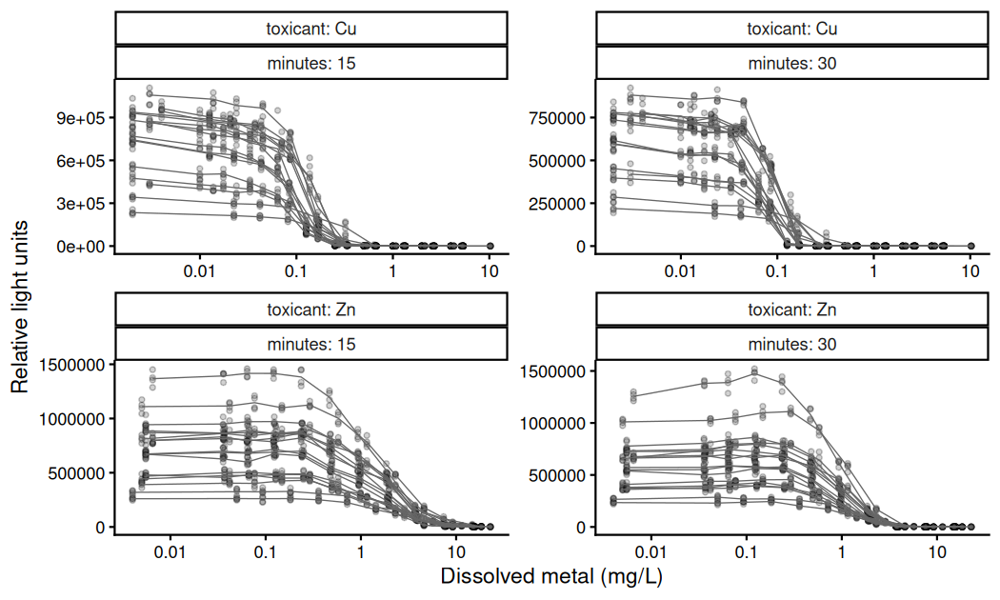
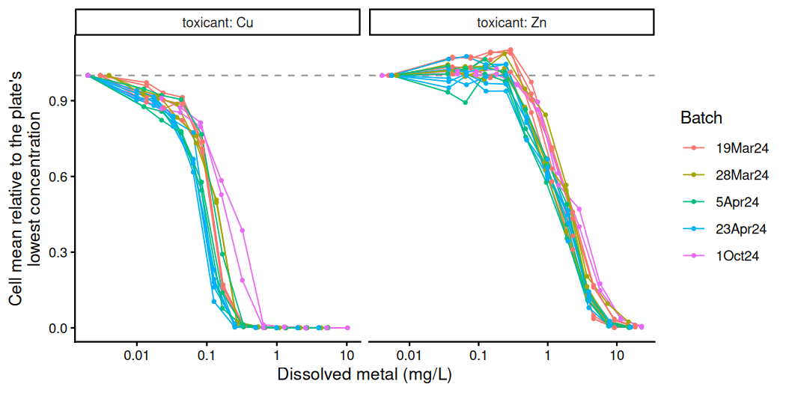
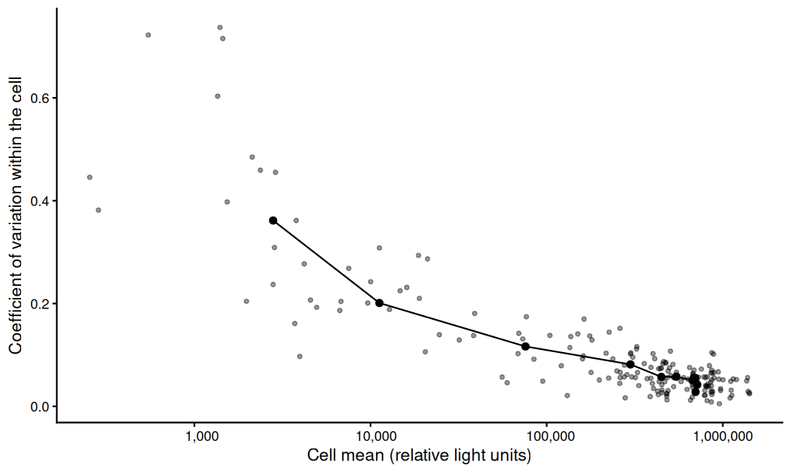
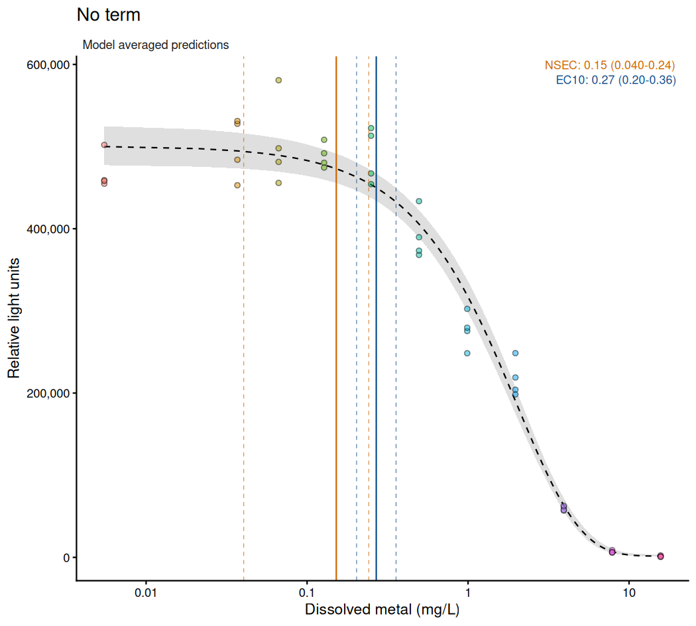
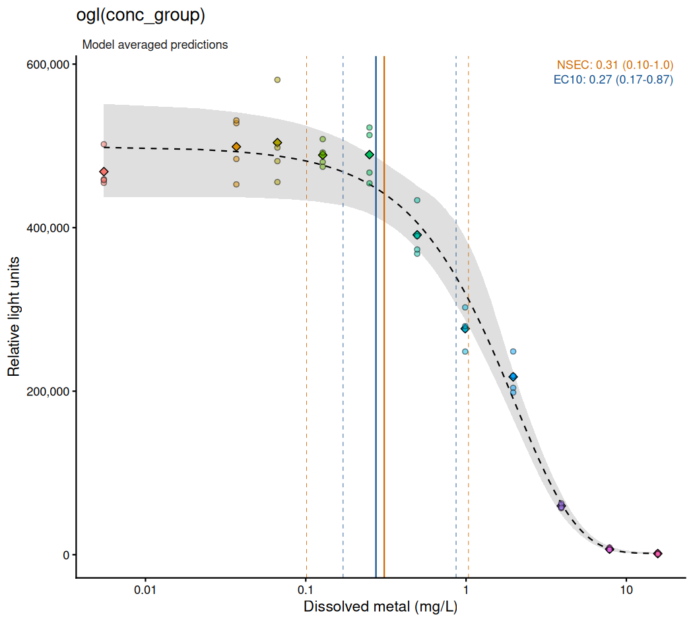
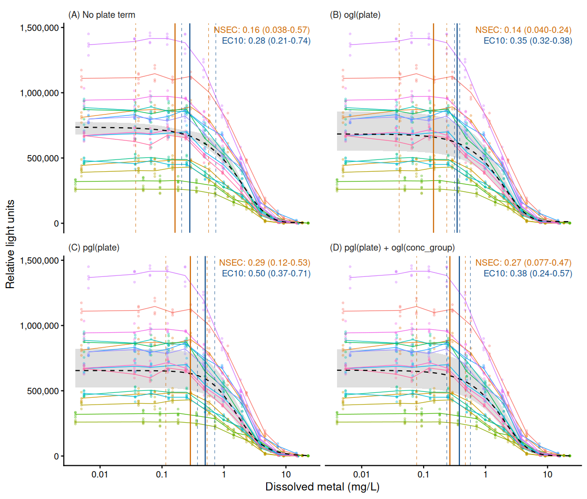
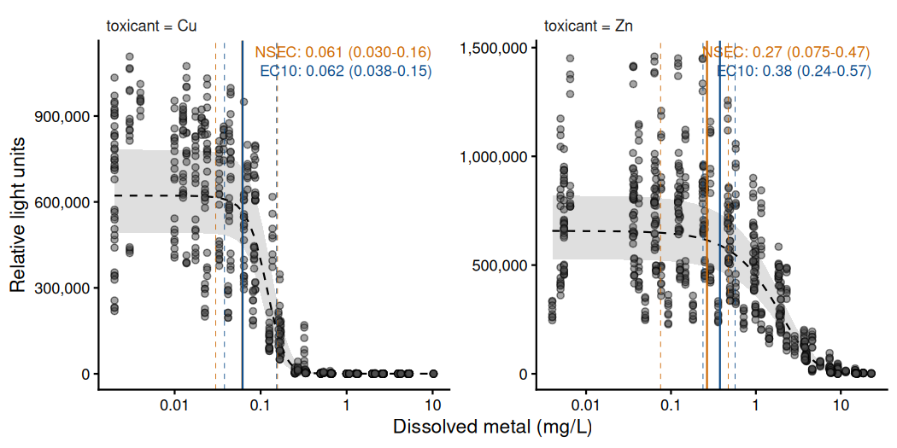
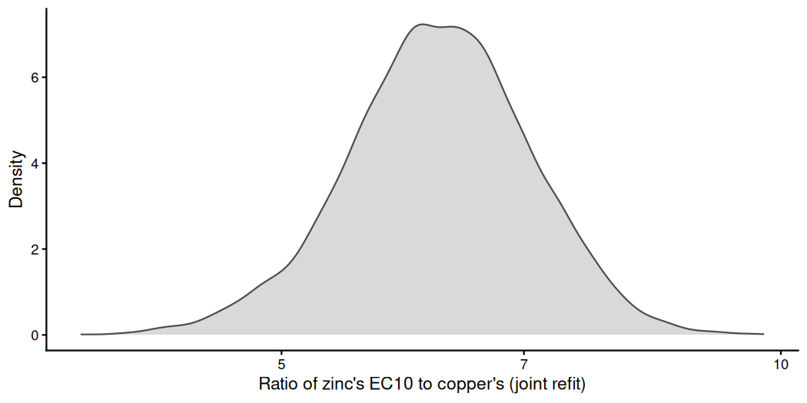

[e1]: https://open-aims.github.io/bayesnec/articles/example1.html
[e2]: https://open-aims.github.io/bayesnec/articles/example2.html
[e3]: https://open-aims.github.io/bayesnec/articles/example3.html
[e9]: https://open-aims.github.io/bayesnec/articles/example9.html

# Overview

Concentration-response experiments are rarely a single series. Replicates are
often held in shared vessels (e.g. tanks, vials or chambers), and a test may be
repeated on several plates, in several batches, or for several chemicals.
Ignoring that structure treats observations as independent when they are not,
and may change both an estimate and its uncertainty.

`bayesnec` provides three routes for such data: a group-level term in the model
formula, a separate model set for each level fitted by `bnec_group()`, and a
joint refit of those separate fits by `bnec_joint()`. Which route applies
depends on the kind of grouping (see the table under *Types of grouping*), and
here we apply all three to the `lum31` bioluminescence data of @luter2025.


``` r
library(bayesnec)
library(ggplot2)
library(dplyr)
```

Each plate of `lum31` spans more than three orders of magnitude of
concentration, so each figure is drawn on a log axis. `autoplot()` returns the
predictor on the scale it was recorded on, having inverted the `log()` written
inside `crf()`, so the axis is set by transforming the scale and not the values
or the breaks (see *The scale of the predictor* in [Single model usage][e1]).
`rlu_axes` names and formats the axes of the `autoplot()` figures.


``` r
log_x <- scale_x_continuous(transform = "log10",
                            labels = function(x) signif(x, 2))
rlu_axes <- list(
  labs(x = "Dissolved metal (mg/L)", y = "Relative light units"),
  scale_y_continuous(labels = function(y) format(y, big.mark = ",",
                                                 scientific = FALSE))
)
```

# Types of grouping

The route for a grouping follows from two of its properties: whether each level
spans the concentration series, and whether the levels are a sample from a
larger set (e.g. plates, which could have been any plates) or treatments chosen
by the investigator (e.g. copper and zinc).

| Grouping | Spans the series | Levels | Route | In this vignette |
|---|---|---|---|---|
| Replicate vessels at one concentration (e.g. tanks, chambers, or the wells at one concentration on a plate) | No | A sample of possible vessels | `ogl()` on the vessel | `ogl(conc_group)` |
| Repeated runs of the whole test (e.g. plates, batches, genotypes drawn from a population) | Yes | A sample of possible runs | `ogl()`, `(par \| group)` or `pgl()` on the run | `pgl(plate)` |
| Treatments of interest (e.g. chemicals, species, exposure times) | Yes | Fixed, chosen by the investigator | `bnec_group()`, a model set per level | `toxicant` |
| Treatments to be contrasted in one posterior, or sharing a group-level term | Yes | Fixed | `bnec_joint()` on a `bnec_group()` fit | copper and zinc with a shared `(ec50 \| batch)` |

A vessel at one concentration has no curve of its own, because it is observed at
a single concentration, so it admits only a displacement, and `ogl()` is the
term for it. A grouping whose levels each span the series can also differ in
shape. `(par | group)` places a deviation on one named parameter where there is
a hypothesis about which feature of the curve varies (for example,
`(nec | group)` for a threshold that differs between levels), and `pgl()` places
one on each parameter where there is no such hypothesis. Treatments of interest
are not a sample from a larger population, so shrinking them towards a common
curve would answer a different question, and their functional forms may also
differ. The routes can be combined (e.g. the copper and zinc fits below include
group-level terms within each level of a `bnec_group()` call). The figure below
shows what each term does to a curve.

<div class="figure" style="text-align: center">

<p class="caption">The effect of each group-level term on a nec4param curve, drawn from chosen parameter values without fitting. The dashed black line is the population curve and each colour one level of the grouping. (a) ogl() scales each level's curve by one factor, with the shape shared. (b) (nec | group) shifts the threshold along the axis and shares the rest of the curve. (c) pgl() gives every parameter a deviation, so each curve differs a little in each respect. (d) For a grouping within a concentration, each level (grey point) is one mean at its own concentration, displaced from the curve, with no curve of its own. On an ECx equation, (ec50 | group) acts as (nec | group) does in (b).</p>
</div>

# Group-level term syntax

`ogl()`, `(par | group)` and `pgl()` are written into a `bayesnecformula`, and
`make_brmsformula()` (the function `bnec()` uses to build the non-linear `brms`
formula it fits) shows what each term becomes. We use `nec4param`, which
includes each parameter a term can be placed on (`top`, `bot`, `beta` and
`nec`). `make_brmsformula()` needs only the column names of the data, so we use
a small synthetic data frame with a proportion as the response and a `Beta`
family. The identity link is stated because a family object held in a variable
keeps its own link, and `Beta()` defaults to `logit`.


``` r
set.seed(228)
gdat <- data.frame(
  conc     = rep(c(0.1, 0.3, 1, 3, 10, 30), each = 4),
  response = rep(c(0.90, 0.88, 0.70, 0.40, 0.15, 0.05), each = 4) +
             rnorm(24, 0, 0.02),
  group    = factor(rep(letters[1:4], times = 6))
)
beta_fam <- Beta(link = "identity")

brms_form <- function(formula, family = beta_fam) {
  make_brmsformula(bayesnecformula(formula), data = gdat,
                   family = family)[["nec4param"]]
}
```

`ogl()` gives each level one deviation applied to the whole fitted mean, so the
curve is displaced and its shape is shared (the analogue of a random intercept
in a linear model).


``` r
brms_form(response ~ crf(conc, "nec4param") + ogl(group))
#> response ~ bnecmu * exp(ogl)/(1 - bnecmu + bnecmu * exp(ogl)) 
#> bnecmu ~ bot + (top - bot) * exp(-exp(beta) * (conc - nec) * step(conc - nec))
#> bot ~ 1
#> top ~ 1
#> beta ~ 1
#> nec ~ 1
#> ogl ~ 1 + (1 | group)
```

The equation appears intact as `bnecmu`, and the deviation `ogl` is applied
through `bnecmu * exp(ogl) / (1 - bnecmu + bnecmu * exp(ogl))`, which adds it to
the log-odds of the mean. How the deviation is applied depends on the family: it
is added to the mean under `gaussian()`, multiplies the mean by `exp(ogl)` under
`Gamma(link = "identity")`, and is added on the log-odds under `Beta`. Its
standard deviation (SD) is therefore read on that scale and not on the response
scale (e.g. under the `Gamma` family used for `lum31`, an SD of 0.1 corresponds
to a departure of about 10 per cent). The *Priors for group-level parameters*
section of the [Priors][e3] vignette lists which deviations are applied in this
way.

`(par | group)` places a deviation on one named parameter, and the other
parameters stay population-level (e.g. `(nec | group)` adds `+ (1 | group)` to
`nec` only). However, the parameters differ between equations (e.g. `bot` is a
parameter of `nec4param` but not of `nec3param`). Where the named parameter is
absent, the term is dropped from that equation, and an equation left with no
term on the grouping variable is excluded from the set, because it would
otherwise be fitted as one curve pooled over the levels that the other equations
separate. `bnec()` prints a message naming an excluded equation before fitting,
and `check_formula()` with `run_par_checks = TRUE` shows the dropped terms
without fitting anything:


``` r
invisible(check_formula(
  bayesnecformula(response ~ crf(conc, c("nec3param", "nec4param")) +
                    (bot | group)),
  data = gdat, run_par_checks = TRUE
))
#> Performing single parameter checks on all models...
#> The parameter(s) "bot" not valid parameters in nec3param. If this was a mistake, check ?models and ?show_params, otherwise ignore.
```

The message names `nec3param` as the equation without a `bot` parameter, and
`(bot | group)` is the only term on `group` in this formula, so `bnec()` would
exclude `nec3param` and fit `nec4param` only.

`pgl()` places a deviation on each parameter of the equation, so each level has
its own curve, shrunk towards a common one, and the parameter names do not have
to be known in advance.


``` r
brms_form(response ~ crf(conc, "nec4param") + pgl(group))
#> response ~ bnecbot + (bnectop - bnecbot) * exp(-exp(beta) * (conc - nec) * step(conc - nec)) 
#> bot ~ 1
#> top ~ 1
#> beta ~ 1 + (1 | group)
#> nec ~ 1 + (1 | group)
#> botgl ~ 0 + (1 | group)
#> bnecbot ~ bot * exp(botgl)/(1 - bot + bot * exp(botgl))
#> topgl ~ 0 + (1 | group)
#> bnectop ~ top * exp(topgl)/(1 - top + top * exp(topgl))
```

`beta` and `nec` take their deviations additively, and `top` and `bot`, which
the `Beta` family bounds, take theirs through `topgl` and `botgl` in the
transformed form shown above for `ogl`. `pgl()` therefore estimates one SD per
parameter (four for `nec4param`) from however many levels the grouping has. Five
levels is the conventional minimum for estimating one SD, so `pgl()` is likely
to need more levels than the other terms to be well determined.

# The bioluminescence data

`lum31` contains acute copper and zinc toxicity tests on the tropical marine
bacterium *Vibrio azureus* (strain Lum-31), reported by @luter2025 at
<https://doi.org/10.1002/tox.70003>. Light output falls as the cells are
inhibited, so the response is the luminescence reading itself (in relative light
units). Copper and zinc were tested repeatedly as reference toxicants to show
that the assay is repeatable, which gives the data replication at four nested
scales (table below; see also `?lum31`).


``` r
data(lum31)
```


|Scale |Column       |Unit                                             | One plate| Zinc at 15 minutes|
|:-----|:------------|:------------------------------------------------|---------:|------------------:|
|Well  |`well`       |One reading of one well                          |        44|                748|
|Cell  |`conc_group` |The four wells at one concentration on one plate |        11|                187|
|Plate |`plate`      |One complete test of 11 concentrations           |         1|                 17|
|Batch |`batch`      |The plates dosed and read on one date            |         1|                  5|


Copper has 16 plates (176 cells and 704 wells) in the five batches, and each
well was read again at 30 minutes. We call each combination of toxicant and
exposure time an arm. Concentrations are measured dissolved metal, and each
batch was dosed separately, so a given dilution step is at a slightly different
concentration in each batch.


``` r
ggplot(lum31, aes(x = conc, y = rlu_cens, group = plate,
                  colour = toxicant)) +
  geom_point(alpha = 0.3, size = 1) +
  stat_summary(fun = mean, geom = "line", linewidth = 0.3) +
  facet_wrap(~toxicant + minutes, scales = "free", labeller = label_both) +
  log_x +
  # The facet strip names the toxicant, so a legend would repeat it.
  scale_colour_hue(guide = "none") +
  theme_classic() +
  labs(x = "Dissolved metal (mg/L)", y = "Relative light units")
```

<div class="figure" style="text-align: center">

<p class="caption">plot of chunk fig-lum31-raw</p>
</div>

In each arm, luminescence stays near its control level over the lower part of
the series and then falls across about a tenfold range of concentration. Zinc is
less potent than copper by about an order of magnitude, and both metals are more
potent at 30 minutes. At the highest concentrations the readings reach the
instrument's floor. The plates of one arm differ by a factor of four to five at
the control, which is likely to reflect mainly the gain of the plate reader, set
separately for each read.

Dividing each plate's cell means by its mean at the lowest concentration divides
out that gain, so that the positions of the plates' curves can be compared.
`conc_rank` numbers the concentrations of a plate from lowest to highest (read
from the suffix of `conc_group`):


``` r
zn_cu_15 <- droplevels(subset(lum31, minutes == 15)) |>
  mutate(conc_rank = factor(as.integer(sub(".*-c", "",
                                           as.character(conc_group)))))
```


``` r
zn_cu_15 |>
  group_by(toxicant, batch, plate, conc_rank) |>
  summarise(conc = mean(conc), cell_mean = mean(rlu_cens),
            .groups = "drop_last") |>
  mutate(relative = cell_mean / cell_mean[conc_rank == "1"]) |>
  ggplot(aes(x = conc, y = relative, group = plate, colour = batch)) +
  geom_hline(yintercept = 1, linetype = 2, colour = "grey60") +
  geom_line(linewidth = 0.4) +
  geom_point(size = 0.8) +
  facet_wrap(~toxicant, scales = "free_x", labeller = label_both) +
  log_x +
  theme_classic() +
  labs(x = "Dissolved metal (mg/L)",
       y = "Cell mean relative to the plate's\nlowest concentration",
       colour = "Batch")
```

<div class="figure" style="text-align: center">

<p class="caption">plot of chunk fig-plate-relative</p>
</div>

For zinc, 12 or 13 of the 17 plates have a relative mean above 1 at each of the
second to fifth concentrations (medians of 1.01 to 1.03), so luminescence
appears to rise above the control before it falls (hormesis), whereas no copper
plate does. Once the gain is divided out, the plates of one metal still appear
to differ in where their curves fall. For example, the two 1Oct24 copper plates fall at
higher concentrations than every plate of the other batches, and the two 1Oct24
zinc plates fall above most of them.

We fit the raw luminescence and do not divide it by a control. Dividing by an
estimated control mean induces correlation between the observations that share
the divisor [@Ritz2026], whereas `ecx()` already measures an effect from the
fitted control (see *Preparing the response* in [Single model usage][e1]), and
the gain of each plate can be estimated by a plate term instead (see *Grouping
across the concentration series*). Readings at the floor are left-censored
through `rlu_cens | cens(censoring)`, and are not treated as zeros from a
separate process (see `?lum31`, and *Censoring* in [Single model usage][e1]). In
addition, a `Gamma` family with a constant shape has a constant coefficient of
variation, whereas the coefficient of variation within a cell rises as the
response falls (figure below), so each fit includes `disp("power")` (see
*Non-constant dispersion* in [Single model usage][e1], and *The dispersion
sub-model* in [A complete analysis workflow][e9]). The
single-plate and plate fits use the zinc readings at 15 minutes, and all fits
use a `Gamma` family with the identity link:


``` r
zn15 <- droplevels(subset(lum31, toxicant == "Zn" & minutes == 15))
gfam <- Gamma(link = "identity")
```


``` r
cells <- zn15 |>
  group_by(conc_group) |>
  summarise(cell_mean = mean(rlu_cens),
            cv = sd(rlu_cens) / mean(rlu_cens), .groups = "drop") |>
  mutate(step = as.integer(sub(".*-c", "", as.character(conc_group))))
step_medians <- cells |>
  group_by(step) |>
  summarise(cell_mean = median(cell_mean), cv = median(cv))

ggplot(cells, aes(x = cell_mean, y = cv)) +
  geom_point(alpha = 0.4, size = 1) +
  geom_line(data = step_medians, linewidth = 0.5) +
  geom_point(data = step_medians, size = 1.8) +
  scale_x_continuous(transform = "log10",
                     labels = function(x) format(x, big.mark = ",",
                                                 scientific = FALSE)) +
  theme_classic() +
  labs(x = "Cell mean (relative light units)",
       y = "Coefficient of variation within the cell")
```

<div class="figure" style="text-align: center">

<p class="caption">plot of chunk fig-cell-cv</p>
</div>

Each grey point is one of the 187 cells of the zinc arm (four wells each), and
the black line joins the medians at each dilution step. The coefficient of
variation is about 0.05 at the lowest concentration
and rises to about 0.36 where the response is
lowest.

# Grouping within a concentration

The commonest structure in ecotoxicology is several replicate vessels at each
concentration (e.g. tanks or chambers). In `lum31` the vessel is the cell (one
level of `conc_group`). We place the term on `conc_group` and not on `well`:
within one exposure time each well has a single reading, so a term on `well`
would give each observation its own deviation, which cannot be separated from
the residual. To keep the plate structure out of this example we fit one plate
at 15 minutes, which has one cell at each of its 11 concentrations.


``` r
one_plate <- droplevels(subset(lum31, plate == "Zn 23Apr24 Rep6B" &
                                 minutes == 15))
```

Both fits use `model = "all"`, which `bnec()` filters to the equations valid for
the family and predictor. We do not use `decline`, because it includes no
equation whose curve can rise above the control, and most zinc plates do (figure
of plate-relative means). No fit in this vignette names `iter`, `warmup` or
`control`, so each samples at `bnec()`'s defaults, and a diagnostic shown here
is what a reader would obtain from the same call.


``` r
fit_plain <- bnec(rlu_cens | cens(censoring) ~ crf(log(conc), "all") +
                    disp("power"),
                  data = one_plate, family = gfam,
                  seed = 228, refresh = 0)

fit_ogl <- bnec(rlu_cens | cens(censoring) ~ crf(log(conc), "all") +
                  ogl(conc_group) + disp("power"),
                data = one_plate, family = gfam,
                seed = 228, refresh = 0)
```


`screen_models()` tests each equation of a set against R-hat, the effective
sample size and the number of divergent transitions, drops those that fail, and
recomputes the model weights over the rest (section 3 of [A complete analysis
workflow][e9] gives the cut-offs). We read all estimates from the screened sets.


``` r
fit_plain <- screen_models(fit_plain)
#> Dropping 6 of 15 candidate models that failed the sampler screen:
#>   -  nec3param: Rhat 1.014, ESS 282.6
#>   -  nec4param: Rhat 1.013, ESS 271.2
#>   -  nechorme: Rhat 1.014, 109 divergent transitions
#>   -  nechorme4: ESS 254, 51 divergent transitions
#>   -  ecxll5: ESS 218.4, 234 divergent transitions
#>   -  ecxhormebc4: 46 divergent transitions
#> Fitted models are: ecxexp ecx4param ecxwb1 ecxwb2 ecxwb1p3 ecxwb2p3 ecxll4 ecxll3 ecxflat
#> The fitted ecxflat curve does not fall to the control's 0.01 quantile within the predictor range for 7920 of 8000 draws. The NSEC summary is censored at 2.75: those draws keep their rank in it and are given no value.
fit_ogl <- screen_models(fit_ogl)
#> Dropping 3 of 15 candidate models that failed the sampler screen:
#>   -  nechorme4: Rhat 1.07, ESS 45.4
#>   -  ecxexp: 133 divergent transitions
#>   -  ecxll5: 77 divergent transitions
#> Fitted models are: nec3param nec4param nechorme ecx4param ecxwb1 ecxwb2 ecxwb1p3 ecxwb2p3 ecxll4 ecxll3 ecxhormebc4 ecxflat
#> The fitted ecxflat curve does not fall to the control's 0.01 quantile within the predictor range for 7920 of 8000 draws. The NSEC summary is censored at 2.75: those draws keep their rank in it and are given no value.
#> The leave-one-group-out score has Pareto k at or above 0.7 for 2 of 11 levels of conc_group in ecxwb1 (weight
#> 0.94); 3 of 11 levels of conc_group in ecxll3 (weight 0.032); 3 of 11 levels of conc_group in ecxhormebc4 (weight
#> 0.02). The affected scores are approximate; loo_controls = list(refit = TRUE) replaces them by refitting the
#> equation without each level.
```


The screen dropped 6 of the 15
equations from the ungrouped fit and 3 from the
grouped one. Because the four wells of a cell share one deviation, the weights
of `fit_ogl` are computed by leaving out each cell whole (its summary prints
"each level of conc_group left out"), whereas those of `fit_plain` leave out one
observation at a time, so weights are compared within a fit and not between
these fits. The last message of the screen notes that the left-out score is
approximate (Pareto *k* at or above 0.7) for 2 of the 11 cells
under `ecxwb1`, and `loo_controls = list(refit = TRUE)` would replace
those scores by refitting the equation without each such cell.

`group_level_sd()` returns the SD of each group-level term for each equation,
beside that equation's weight. Each equation estimates its own SD, so an SD is
read against the weight of the equation that estimated it: an equation given
almost no weight describes its own curve and says little about the model
average.


``` r
sd_ogl <- group_level_sd(fit_ogl)
sd_ogl[sd_ogl$wi >= 0.01, ]
#>          model         wi      group by parameter   Estimate       Q2.5     Q97.5
#> 5       ecxwb1 0.94090300 conc_group          ogl 0.08219069 0.03470957 0.1743023
#> 10      ecxll3 0.03237592 conc_group          ogl 0.16244728 0.09661981 0.2907289
#> 11 ecxhormebc4 0.02016902 conc_group          ogl 0.16420342 0.09867076 0.2960686
ec10_plain <- ecx(fit_plain, ecx_val = 10)
ec10_ogl <- ecx(fit_ogl, ecx_val = 10)
nsec_plain <- nsec(fit_plain)
nsec_ogl <- nsec(fit_ogl)
```

`lum31` comes from an acute assay, in which luminescence is read 15 and 30
minutes after exposure. Low-effect and no-effect estimates such as the EC10 and
NSEC are not usually appropriate endpoints for such an assay, and we report them
here only to illustrate the methods. The table below gives each fit's EC10 and
NSEC, and the weight, EC10, NSEC and cell SD of each equation given at least
0.01 of the weight.


|Fit               |Equation      |Weight |EC10, mg/L        |NSEC, mg/L         |Cell SD             |
|:-----------------|:-------------|:------|:-----------------|:------------------|:-------------------|
|No term           |model average |       |0.27 (0.20--0.36) |0.15 (0.040--0.24) |                    |
|                  |`ecxwb1`      |0.99   |0.27 (0.21--0.35) |0.15 (0.040--0.24) |                    |
|`ogl(conc_group)` |model average |       |0.27 (0.17--0.87) |0.31 (0.10--1.0)   |                    |
|                  |`ecxwb1`      |0.94   |0.27 (0.17--0.40) |0.30 (0.10--0.47)  |0.082 (0.035--0.17) |
|                  |`ecxll3`      |0.03   |0.82 (0.57--1.1)  |1.0 (0.56--1.3)    |0.16 (0.097--0.29)  |
|                  |`ecxhormebc4` |0.02   |0.82 (0.56--1.1)  |0.99 (0.58--1.3)   |0.16 (0.099--0.30)  |


`autoplot()` with `group = "conc_group"` colours each well by its cell and, for
the fit with the term, marks the mean of each cell (diamonds), the quantity
`ogl(conc_group)` gives a deviation to. The legend is removed, because the
position of each cell on the axis already identifies it. `nec = TRUE`, the
default, would mark the model average of each equation's own no-effect
estimate, which is an NEC for an equation of the `nec` group, so we set it to
`FALSE`. We then add the EC10 and NSEC of the table above with
`mark_estimate()`, which draws an estimate as `autoplot()` draws an ECx under
`ecx = TRUE`, so that the figures show the estimates given in the tables.


``` r
# autoplot() draws an ECx in this blue.
ec10_colour <- "dodgerblue4"
nsec_colour <- "darkorange3"
# `est` holds Q50, Q2.5 and Q97.5, and a column for each facet variable.
mark_estimate <- function(est, name, colour, vjust) {
  est$label <- paste0(name, ": ", fmt(est$Q50), " (", fmt(est$Q2.5), "-",
                      fmt(est$Q97.5), ")")
  list(
    geom_vline(data = est, aes(xintercept = Q50), colour = colour,
               linewidth = 0.5),
    geom_vline(data = est, aes(xintercept = Q2.5), colour = colour,
               linetype = 2, linewidth = 0.2),
    geom_vline(data = est, aes(xintercept = Q97.5), colour = colour,
               linetype = 2, linewidth = 0.2),
    geom_text(data = est, aes(label = label), x = Inf, y = Inf, hjust = 1.1,
              vjust = vjust, size = 3, colour = colour)
  )
}
# One row of `est` from the vector ecx() or nsec() returns for a model set.
est_row <- function(v, ...) {
  v <- unname(unlist(v))[1:3]
  data.frame(..., Q50 = v[1], Q2.5 = v[2], Q97.5 = v[3])
}
```


``` r
autoplot(fit_plain, group = "conc_group", group_aes = "colour", nec = FALSE,
         point_alpha = 0.5) +
  mark_estimate(est_row(nsec_plain), "NSEC", nsec_colour, vjust = 1.5) +
  mark_estimate(est_row(ec10_plain), "EC10", ec10_colour, vjust = 3.2) +
  log_x + rlu_axes + theme(legend.position = "none") +
  ggtitle("No term")
autoplot(fit_ogl, group = "conc_group", group_aes = "colour", nec = FALSE,
         point_alpha = 0.5) +
  mark_estimate(est_row(nsec_ogl), "NSEC", nsec_colour, vjust = 1.5) +
  mark_estimate(est_row(ec10_ogl), "EC10", ec10_colour, vjust = 3.2) +
  log_x + rlu_axes + theme(legend.position = "none") +
  ggtitle("ogl(conc_group)")
```

<div class="figure" style="text-align: center">

<p class="caption">The zinc plate Zn 23Apr24 Rep6B at 15 minutes, fitted without a group-level term and with ogl(conc_group). Each point is one well, coloured by its cell, and in the second panel each diamond marks a cell mean. The dashed black line is the model-averaged curve and the grey band its 95% credible interval. The blue lines mark the EC10 and the orange lines the NSEC, solid at the median and dashed at the 95% bounds.</p>
</div>

The median EC10 is 0.27 mg/L without the term and
0.27 with it, whereas the upper bound of its interval is
2.4 times as large with the term. Two
changes contribute (table above). First, the interval of `ecxwb1`, given
most of the weight in both fits, widens from 0.27 (0.21--0.35) to
0.27 (0.17--0.40) mg/L. With the term, the four wells of a cell
share a deviation, so the curve is informed by eleven cell means, each with its
own departure, and not by 44 wells treated as independent. On one plate there is
one cell per concentration, so each cell's deviation is also its concentration's
departure from the curve. Second, `ecxll3` and `ecxhormebc4`, given
0.05 of the weight together, place the EC10
near 0.82 mg/L and set the upper tail of the averaged interval. A
model-averaged interval is therefore read against the weights and the estimates
of the equations behind it.

The EC10 is read where the curve has fallen 10 per cent below the fitted
control, whereas the NSEC is read where the curve falls below the 0.01 quantile
of the posterior of the control (the fitted mean at the lowest concentration),
so the NSEC also depends on how precisely the control is estimated. The term
changes the NSEC more than the EC10. The median NSEC is
0.15 mg/L without the term, below the EC10, and
0.31 mg/L with it, above the EC10 (orange and blue lines in
the figure). Under `ecxwb1`, given most of the weight in both fits, it
changes from 0.15 (0.040--0.24) to
0.30 (0.10--0.47) mg/L, so the change does not arise from the
model weights. With the term, the lowest concentration is
represented by one cell with its own departure from the curve, so the control is
less precisely estimated (the band at the lowest concentration is wider in the
second panel), and the curve has to fall further before it crosses that
quantile.

# Grouping across the concentration series

A plate spans the whole concentration series, so, unlike a cell, each plate can
have a curve of its own. The figure of plate-relative means suggests that the
zinc plates differ in two ways: the plate reader's gain scales each plate's
whole curve by one factor, and once that factor is divided out, the plates still
appear to differ in where and how steeply their curves fall. We fitted the zinc
readings at 15 minutes with four plate structures, labelled A to D in the table
and figure below:

- (A) no plate term;
- (B) `ogl(plate)`, which multiplies each plate's curve by one factor, the form
  the plate reader's gain takes;
- (C) `pgl(plate)`, which also lets each plate's curve differ in position and
  slope;
- (D) `pgl(plate) + ogl(conc_group)`, which adds the cell term of the
  single-plate fit, for the reason given there.

In D each cell deviates from its own plate's curve and not from the population
curve. Without a deviation on the position of each plate's curve (e.g. with
`ogl(plate) + ogl(conc_group)`), the cell deviations would also have to describe
each plate's shift along the concentration axis. We call D the arm structure,
because it is the structure fitted to each metal below.


``` r
fit_pooled <- bnec(rlu_cens | cens(censoring) ~ crf(log(conc), "all") +
                     disp("power"),
                   data = zn15, family = gfam,
                   seed = 228, refresh = 0)

fit_plate <- bnec(rlu_cens | cens(censoring) ~ crf(log(conc), "all") +
                    ogl(plate) + disp("power"),
                  data = zn15, family = gfam,
                  seed = 228, refresh = 0)
```


``` r
fit_pgl <- bnec(rlu_cens | cens(censoring) ~ crf(log(conc), "all") +
                  pgl(plate) + disp("power"),
                data = zn15, family = gfam,
                seed = 228, refresh = 0)
```


``` r
fit_pgl_cell <- bnec(rlu_cens | cens(censoring) ~ crf(log(conc), "all") +
                       pgl(plate) + ogl(conc_group) + disp("power"),
                     data = zn15, family = gfam,
                     seed = 228, refresh = 0)
```


``` r
fit_pooled <- screen_models(fit_pooled)
fit_plate <- screen_models(fit_plate)
fit_pgl <- screen_models(fit_pgl)
fit_pgl_cell <- screen_models(fit_pgl_cell)
```

The screen dropped 5 equations from
`fit_pgl` (C). In each of `nec3param`, `nec4param`, `nechorme` and `ecxwb1`,
one
of the four chains sampled a mode of its own, at a
lower log density than the others, which
gives R-hat values of up to 1.53 and effective sample
sizes as low as 7. The screen also dropped
`ecxll5` on
16 divergent transitions. The
table below gives the number of equations each structure retained, the weights,
and the EC10 and NSEC of each model average, and the figure that follows shows
each fit.


|Panel |Plate structure                |Equations retained |Weight of 0.05 or more                                             |EC10, mg/L        |NSEC, mg/L         |
|:-----|:------------------------------|:------------------|:------------------------------------------------------------------|:-----------------|:------------------|
|A     |None                           |13 of 15           |`ecxwb1` 0.78, `ecxll3` 0.16                                       |0.28 (0.21--0.74) |0.16 (0.038--0.57) |
|B     |`ogl(plate)`                   |13 of 15           |`ecxll5` 0.64, `ecxwb1` 0.36                                       |0.35 (0.31--0.38) |0.70 (0.17--1.2)   |
|C     |`pgl(plate)`                   |10 of 15           |`ecxll3` 0.43, `ecxhormebc4` 0.42, `ecxll4` 0.08, `ecx4param` 0.07 |0.51 (0.45--0.57) |0.85 (0.31--1.3)   |
|D     |`pgl(plate) + ogl(conc_group)` |12 of 15           |`ecxll5` 0.96                                                      |0.38 (0.28--0.47) |0.77 (0.19--1.3)   |


``` r
plate_panels <- c("(A) No plate term", "(B) ogl(plate)", "(C) pgl(plate)",
                  "(D) pgl(plate) + ogl(conc_group)")
plate_plot <- do.call(rbind, Map(function(x, panel) {
  d <- ggbnec_data(x, add_nec = FALSE, group = "plate")
  d$panel <- panel
  d
}, plate_fits, plate_panels))
plate_plot$panel <- factor(plate_plot$panel, levels = plate_panels)
plate_band <- filter(plate_plot, !is.na(y_ci))
plate_obs <- filter(plate_plot, !is.na(y_r))
by_panel <- function(est) {
  do.call(rbind, Map(est_row, est,
                     panel = factor(plate_panels, levels = plate_panels)))
}

ggplot() +
  geom_polygon(data = plate_band, aes(x = x_e, y = y_ci), fill = "grey75",
               alpha = 0.5) +
  geom_point(data = plate_obs, aes(x = x_r, y = y_r, colour = group),
             alpha = 0.3, size = 0.6) +
  stat_summary(data = plate_obs, aes(x = x_r, y = y_r, colour = group,
                                     group = group),
               fun = mean, geom = "line", linewidth = 0.3) +
  geom_line(data = filter(plate_band, !is.na(y_e)), aes(x = x_e, y = y_e),
            linetype = 2) +
  mark_estimate(by_panel(plate_nsec), "NSEC", nsec_colour, vjust = 1.5) +
  mark_estimate(by_panel(plate_ec10), "EC10", ec10_colour, vjust = 3.2) +
  facet_wrap(~panel, ncol = 2) +
  log_x + rlu_axes + theme_classic() +
  theme(legend.position = "none", strip.background = element_blank(),
        strip.text = element_text(hjust = 0))
```

<div class="figure" style="text-align: center">

<p class="caption">The zinc readings at 15 minutes fitted with each plate structure (panels A to D). Each point is one well, and each thin line joins one plate's observed means, coloured by plate; these do not change between panels. The dashed black line is the model-averaged population curve and the grey band its 95% credible interval. The blue lines mark the EC10 and the orange lines the NSEC, solid at the median and dashed at the 95% bounds.</p>
</div>


The observations, and the thin lines that join each plate's observed means, do
not change between panels. The panels differ only in the population curve
fitted to those data, its band, and the EC10 and NSEC read from that curve.

Without a plate term (panel A), the differences in gain between plates are
counted as residual variation, and the population curve is fitted to the wells
of all 17 plates as though they came from one plate.
Its band is therefore narrow, with an upper bound 1.14
times its lower bound at the lowest concentration. With a plate term (panels B
to D), the band at the lowest concentration widens to a ratio of
1.54 to 1.57 between its
bounds, because the population curve then describes a typical plate, and its
height is estimated from plates that differ in gain. The EC10 interval changes
the other way. It is widest in panel A, with an upper bound
3.6 times its lower bound, and under each plate term the
ratio is 1.2 to 1.7.
On the single plate, however, the cell term widened the EC10 interval, so the
direction of the change may differ from one grouping to another. The likely
reason is that a cell has no curve of its own, so a cell term adds variation
that the curve cannot account for, whereas a plate spans the series, and a plate
term removes the differences between plates from the residual variation.

The four structures also give the curve different positions. Across the panels
the median EC10 ranges from 0.28 to 0.51
mg/L (a factor of 1.8) and the median NSEC
from 0.16 to 0.85 (a factor of
5.2), so the NSEC changed more with the
structure than the EC10. The NSEC is lowest in panel A, where the band at the
lowest concentration is narrowest (compare the orange lines of panel A with
those of panels B to D). As on the single plate, the NSEC is read against the 0.01
quantile of the posterior of the control, and a wider posterior places that
quantile further below the fitted control, so the curve is likely to cross it
at a higher concentration. A report should therefore state the structure as
well as the estimate. The weights changed as well, and no equation was given
most of the weight under every structure. Under `pgl(plate)` (panel C) the
weight was spread over 4 equations and the EC10 was
0.51 (0.45--0.57) mg/L, whereas adding the cell term (panel D) gave
`ecxll5` 0.96 of the weight and an EC10
of 0.38 (0.28--0.47) mg/L.

The table below gives the group-level SDs of `fit_pgl_cell` (structure D) from
`group_level_sd()`, for each equation given at least 0.01 of the weight. Each SD
measures how much the plates, or the cells within a plate, differ in one
parameter.


|Equation |Weight |Grouping     |Parameter |SD                   |
|:--------|:------|:------------|:---------|:--------------------|
|`ecxwb1` |0.04   |`plate`      |`ec50`    |0.18 (0.12--0.28)    |
|`ecxwb1` |0.04   |`plate`      |`beta`    |0.14 (0.085--0.22)   |
|`ecxwb1` |0.04   |`plate`      |`botgl`   |0.66 (0.32--1.0)     |
|`ecxwb1` |0.04   |`plate`      |`topgl`   |0.45 (0.33--0.66)    |
|`ecxwb1` |0.04   |`conc_group` |`ogl`     |0.062 (0.051--0.076) |
|`ecxll5` |0.96   |`plate`      |`beta`    |0.093 (0.053--0.16)  |
|`ecxll5` |0.96   |`plate`      |`ec50`    |0.072 (0.0035--0.26) |
|`ecxll5` |0.96   |`plate`      |`f`       |0.28 (0.19--0.45)    |
|`ecxll5` |0.96   |`plate`      |`botgl`   |0.30 (0.015--0.89)   |
|`ecxll5` |0.96   |`plate`      |`topgl`   |0.45 (0.33--0.66)    |
|`ecxll5` |0.96   |`conc_group` |`ogl`     |0.058 (0.048--0.070) |


`ecxll5` is given 0.96 of the weight
under structure D, so its SDs describe the model average. Its SD on `topgl`,
0.45 (0.33--0.66), measures the differences in gain between
plates on the log scale of a multiplicative factor, so the control of a plate
one SD above the population is about 1.6 times as high. The
plates also appear to differ in position along the concentration axis, which
`ogl(plate)` (B) cannot describe, because it only scales each plate's curve.
Under `pgl(plate)` without the cell term (C), each equation given at least 0.05
of the weight estimates an SD on `ec50` of 0.20
on the scale of log concentration. Under D, however, `ecxll5` appears to express
that difference through its exponent `f`, which also changes the position of
the curve, with an SD of 0.28 (0.19--0.45), whereas its SD on
`ec50` is poorly determined (0.072 (0.0035--0.26)). The cell SD,
0.058 (0.048--0.070), corresponds to departures of about
6 per cent between the cells of a plate beyond what the plate's curve
accounts for, which is small beside the SD on `topgl`.

Two cautions apply to plate terms. First, the SD of a plate term combines the
plate reader's gain with any biological difference between plates, and nothing
in these data separates gain from biology, so it is not a biological quantity
and should not be reported as one. Second, a plate term belongs within one arm:
copper against zinc, or 15 against 30 minutes, are fixed levels, for
`bnec_group()` or `bnec_joint()` (see below).

# Copper against zinc

Copper and zinc are fixed levels (see *Types of grouping*), so we fit them with
`bnec_group()`. Although both metals are passed to one call, `bnec_group()`
fits them independently: it calls `bnec()` once for each level, on that level's
data alone, and returns both model sets as one object. Each metal therefore
has its own curve parameters, group-level SDs, dispersion and model weights, and
no parameter is shared between them. Each level is fitted with the arm
structure, `pgl(plate) + ogl(conc_group)`, and with `model = "all"`, because
zinc rises above its control at low concentrations.


``` r
fits_tox <- bnec_group(
  rlu_cens | cens(censoring) ~ crf(log(conc), "all") +
    pgl(plate) + ogl(conc_group) + disp("power"),
  data = zn_cu_15, group_var = "toxicant", family = gfam,
  seed = 228, refresh = 0)
```

Because each metal's model set was fitted independently, its sampling is also
screened independently. With `group_action = "per_level"`, an equation that
fails the screen for one metal is dropped for that metal only, so copper and
zinc may retain different equations.


``` r
fits_tox <- screen_models(fits_tox, group_action = "per_level")
```


|Toxicant |Equations retained |Weight of 0.01 or more                                        |EC10, mg/L           |NSEC, mg/L          |
|:--------|:------------------|:-------------------------------------------------------------|:--------------------|:-------------------|
|Cu       |10 of 15           |`ecxll5` 0.72, `ecxll4` 0.16, `ecx4param` 0.10, `ecxwb1` 0.02 |0.065 (0.048--0.082) |0.086 (0.048--0.11) |
|Zn       |12 of 15           |`ecxll5` 0.96, `ecxwb1` 0.04                                  |0.38 (0.28--0.46)    |0.77 (0.19--1.3)    |


`autoplot()` draws one panel for each level of a `bnec_group()` fit and
identifies the panels by a column named `model`, so a layer added to the plot
needs that column to be drawn in the right panel. We add the EC10 and NSEC of
each metal from the table above in this way.


``` r
by_level <- function(tab) {
  data.frame(model = paste0(fits_tox$group_var, " = ", tab$level),
             tab[, c("Q50", "Q2.5", "Q97.5")])
}
autoplot(fits_tox, nec = FALSE, point_alpha = 0.5) +
  mark_estimate(by_level(level_nsec), "NSEC", nsec_colour, vjust = 1.5) +
  mark_estimate(by_level(level_ec10), "EC10", ec10_colour, vjust = 3.2) +
  log_x + rlu_axes
```

<div class="figure" style="text-align: center">

<p class="caption">The copper and zinc readings at 15 minutes, with the model-averaged curve of each metal's separate fit (dashed line) and its 95% credible interval (grey band). The blue lines mark the EC10 and the orange lines the NSEC, solid at the median and dashed at the 95% bounds.</p>
</div>

The screen retained 10 equations for copper and
12 for zinc, and the equation given the most
weight was `ecxll5` at both levels
(table above). The EC10 is 0.065 (0.048--0.082) mg/L for copper
and 0.38 (0.28--0.46) mg/L for zinc, so copper is the more potent
metal, as @luter2025 report. The NSEC is 0.086 (0.048--0.11) mg/L
for copper and 0.77 (0.19--1.3) mg/L for zinc. For both metals
it is above the EC10 (orange and blue lines in the figure), as it is under the
arm structure in panel D of the plate figure, for the reason given there. Each
panel has its own response axis, because the plates
of each metal were read at different gains, and their relative light units are
not comparable between metals. Under the equation given the most weight, the
left-out score is approximate (Pareto *k* at or above 0.7) for 22 of
the 176 copper cells and 22 of the 187 zinc cells, so these
weights are approximate as well, and `loo_controls = list(refit = TRUE)` would
replace the flagged scores by refitting the equation once for each flagged cell.

Each metal's model average is formed over its own equations, so a different
equation may describe each metal. Because the metals share no parameter, the
model weight of a combination of one copper equation and one zinc equation is
the product of their weights at their own levels, under the pseudo-BMA weights
`bnec()` uses by default. `crossed_group_weights()` returns the weights of each
level (`per_level`), the combination given the most weight
(`best_combination`), and the weight of each equation retained at both levels
when that one equation is fitted to both metals (`diagonal`, the combinations
that pair an equation with itself, rescaled to sum to one).


``` r
crossed <- crossed_group_weights(fits_tox)
crossed$best_combination
#>       Cu       Zn 
#> "ecxll5" "ecxll5"
round(crossed$diagonal[crossed$diagonal >= 0.001], 3)
#> ecxll5 
#>  0.999
```

The table below gives the crossed weight of each combination of the equations
given at least 0.01 of the weight at each level, with each equation's own weight
in parentheses.


|Copper equation (weight) |Zinc `ecxll5` (0.96) |Zinc `ecxwb1` (0.04) |
|:------------------------|:--------------------|:--------------------|
|`ecxll5` (0.72)          |0.686                |0.031                |
|`ecxll4` (0.16)          |0.155                |0.007                |
|`ecx4param` (0.10)       |0.099                |0.004                |
|`ecxwb1` (0.02)          |0.015                |0.001                |


The combination given the most crossed weight,
0.69, fits `ecxll5` to both metals. Most of the
remaining weight is given to combinations of zinc's `ecxll5`
with another copper equation, because copper's weight is divided among more
equations than zinc's. On the diagonal, `ecxll5` is given
0.999 of the weight over the
9 equations retained for both metals. The crossed
weights do not change either metal's model average, which is formed over that
metal's own equations. They show instead which single equation best describes
both metals, the choice that a joint refit of copper and zinc requires (see
below).

# Joint refit of copper and zinc

Each of the five batches includes plates of both metals (two to five of each),
which were dosed and read on one date, and the figure of plate-relative means
shows the 1Oct24 plates of each metal displaced to higher concentrations, the
copper plates clearly and the zinc plates less so. A
deviation on `ec50` for each batch, shared by the metals, is the term for such a
displacement. The separate fits of `fits_tox` cannot include it, because each
level sees only its own metal's plates, so a batch deviation would be estimated
twice and independently. `bnec_joint()` refits the levels of a `bnec_group()`
fit as one model, in which each level keeps its own curve parameters and a
group-level term can span the levels (see `?bnec_joint`).

Without `model`, `bnec_joint()` fits each level the equation its own weights
favour, which may differ between levels. A group-level term that spans the
levels, however, can be written only on a parameter that each level's equation
includes, so `model` names one equation to be fitted to both metals. We use
`ecxll5`, the equation given the most weight at both levels
(0.72 for copper and
0.96 for zinc) and on the
diagonal of the crossed weights
(0.999). The formula adds
`(ec50 | batch)` to the structure of `fits_tox` and writes its plate and cell
terms as `pgl(gr(plate, by = toxicant))` and `ogl(gr(conc_group, by = toxicant))`.
`gr()` is the `brms` function that declares a grouping, and with
`by = toxicant` a separate SD is fitted for each metal (see `?brms::gr`).
`disp_by_level = FALSE` fits one dispersion sub-model for both metals, where the
default would fit one for each level:


``` r
fits_tox_joint <- bnec_joint(
  fits_tox, model = "ecxll5",
  formula = rlu_cens | cens(censoring) ~ crf(log(conc), "ecxll5") +
    pgl(gr(plate, by = toxicant)) + ogl(gr(conc_group, by = toxicant)) +
    (ec50 | batch) + disp("power"),
  disp_by_level = FALSE, seed = 228, refresh = 0)
```


``` r
fits_tox_joint
#> Object of class bayesnecjointfit
#> 
#>   equation          : ecxll5 
#>   grouping variable : toxicant 
#>   levels            : Cu, Zn 
#>   family            : Gamma (link = identity) 
#>   dispersion        : shared 
#>   summed weight     : 0.833 of the available weight across levels
#>   weight at level   : Cu 0.703, Zn 0.964 
#>   fitted by         : bayesnec 2.1.3.44, installed from a local source, which records no commit, under R 4.6.1 
#> 
#> Every curve parameter takes a value per level in one posterior;
#> read them from the draws as b_<parameter>_toxicant<level>.
#> ecx(), nsec() and nec() return one row per level, and autoplot()
#> draws one panel per level.
```


The print gives the equation fitted at each level and the weight it was given
there. Those weights were computed when the refit was made, and differ slightly from the ones given above for the same fits, because pseudo-BMA weights are computed by a Bayesian bootstrap over the leave-out scores.
The `brms` formula of the refit shows which terms the metals share:


``` r
fits_tox_joint$fit$formula
#> rlu_cens | cens(censoring) ~ bnecmu * exp(ogl) 
#> bnecmu ~ bnecbot + (bnectop - bnecbot)/(1 + exp(exp(beta) * (log(conc) - ec50)))^exp(f)
#> bot ~ 0 + toxicant
#> top ~ 0 + toxicant
#> beta ~ 0 + toxicant + (1 | gr(plate, by = toxicant))
#> ec50 ~ 0 + toxicant + (1 | gr(plate, by = toxicant)) + (1 | batch)
#> f ~ 0 + toxicant + (1 | gr(plate, by = toxicant))
#> botgl ~ 0 + (1 | gr(plate, by = toxicant))
#> bnecbot ~ bot * exp(botgl)
#> topgl ~ 0 + (1 | gr(plate, by = toxicant))
#> bnectop ~ top * exp(topgl)
#> ogl ~ 1 + (1 | gr(conc_group, by = toxicant))
#> shape ~ c0 + c1 * (log((bnecmu)) - 12.7074)
#> c0 ~ 1
#> c1 ~ 1
```

Each curve parameter of `ecxll5` takes a separate value for each metal
(`0 + toxicant`). The metals share the five batch deviations of `(1 | batch)` on
`ec50` and the coefficients `c0` and `c1` of `disp("power")`. Each plate and
cell belongs to one metal, and its deviation is drawn from an SD estimated from
that metal's plates or cells alone, as in the separate fits: one SD per
parameter for `plate` and one for `conc_group`. The table below gives the SDs
of the joint refit beside those of `ecxll5` in each level of `fits_tox`.


|Grouping     |Parameter |Toxicant |Separate fit         |Joint refit          |
|:------------|:---------|:--------|:--------------------|:--------------------|
|`plate`      |`beta`    |Copper   |0.076 (0.0054--0.16) |0.060 (0.0032--0.16) |
|`plate`      |`beta`    |Zinc     |0.093 (0.053--0.16)  |0.10 (0.063--0.17)   |
|`plate`      |`ec50`    |Copper   |0.34 (0.23--0.53)    |0.082 (0.0067--0.19) |
|`plate`      |`ec50`    |Zinc     |0.072 (0.0035--0.26) |0.073 (0.0037--0.25) |
|`plate`      |`f`       |Copper   |0.098 (0.0044--0.28) |0.11 (0.0084--0.24)  |
|`plate`      |`f`       |Zinc     |0.28 (0.19--0.45)    |0.23 (0.14--0.38)    |
|`plate`      |`botgl`   |Copper   |0.55 (0.32--0.91)    |0.58 (0.33--0.96)    |
|`plate`      |`botgl`   |Zinc     |0.30 (0.015--0.89)   |0.22 (0.010--0.78)   |
|`plate`      |`topgl`   |Copper   |0.45 (0.33--0.67)    |0.45 (0.33--0.67)    |
|`plate`      |`topgl`   |Zinc     |0.45 (0.33--0.66)    |0.46 (0.34--0.67)    |
|`batch`      |`ec50`    |Both     |not fitted           |0.41 (0.20--1.1)     |
|`conc_group` |`ogl`     |Copper   |0.082 (0.059--0.12)  |0.11 (0.076--0.16)   |
|`conc_group` |`ogl`     |Zinc     |0.058 (0.048--0.070) |0.055 (0.045--0.068) |


The separate fits estimate different plate SDs for the two metals on some
parameters. For example, on `ec50` the SD is 0.34 (0.23--0.53)
for copper and 0.072 (0.0035--0.26) for zinc, and on `f` it is
0.098 (0.0044--0.28) and 0.28 (0.19--0.45). One SD
per parameter for both metals would assume that the plates of one metal vary as
much as those of the other, which these pairs of estimates suggest may not hold
for these data. In the joint refit the plate SD on `ec50` is
0.082 (0.0067--0.19) for copper and
0.073 (0.0037--0.25) for zinc, and on `f` it is
0.11 (0.0084--0.24) and 0.23 (0.14--0.38).

A batch term shared by the metals is consistent with the caution above that a
plate term belongs within one arm. The metals keep separate curve parameters,
and the batch deviation describes a condition of the date on which both were
tested: the plates of both metals in a batch were dosed and read on one date,
with cells reactivated that day from the single batch of lyophilised cells used
for every test [@luter2025]. A
condition of that date (e.g. the state of the reactivated cells, or that day's
dilution series) would be expected to displace both metals' curves together. The
batch SD on `ec50` is 0.41 (0.20--1.1), and five batches leave it poorly
determined (its interval spans a factor of
5 from end to end). Copper's plate SD on `ec50` in the joint refit is below the interval of its separate fit, so part of the difference in position that the copper fit attributed to plates appears to be attributed to batches here.

The table below sets the EC50 of each metal from the joint refit beside the
model-averaged EC50 of the separate fits and the per-plate EC50s that @luter2025
report for 15 minutes.


|Toxicant |Joint refit        |Separate fits, model average |Luter et al. (2025), mean of per-plate EC50s (range) |
|:--------|:------------------|:----------------------------|:----------------------------------------------------|
|Copper   |0.12 (0.078--0.20) |0.12 (0.096--0.14)           |0.109 (0.069--0.201; 16 plates)                      |
|Zinc     |1.8 (1.1--2.8)     |1.6 (1.4--1.9)               |1.546 (1.207--2.076; 17 plates)                      |


The EC50 is 0.12 (0.078--0.20) mg/L for copper and
1.8 (1.1--2.8) mg/L for zinc in the joint refit, against
0.12 (0.096--0.14) and 1.6 (1.4--1.9) from the
separate fits, and
all four medians lie
within the range of the per-plate EC50s that @luter2025 report. The intervals of
the joint refit are wider than those of the separate fits, although the joint
refit conditions on one equation. The likely reason is the batch term: each
metal's population `ec50` is now estimated across five batches, and the
uncertainty in their poorly determined SD widens its interval. The estimates
also differ in what they describe: the published values average a separate fit
to each plate of the normalised response, whereas `ecx()` reads the population
curve of a model that estimates the variation between plates and between
batches.

Because the levels are estimated in one posterior, a contrast between them can
be taken draw by draw, which keeps any dependence between the metals' estimates
that the shared terms introduce. Here we take the ratio of zinc's EC10 to
copper's:


``` r
ec10_joint <- ecx(fits_tox_joint, ecx_val = 10, posterior = TRUE)
zn_cu_ratio <- ec10_joint[["Zn"]] / ec10_joint[["Cu"]]
quantile(zn_cu_ratio, c(0.5, 0.025, 0.975), na.rm = TRUE)
#>      50%     2.5%    97.5% 
#> 6.024101 4.548482 7.800390
```


``` r
ggplot(data.frame(ratio = zn_cu_ratio), aes(x = ratio)) +
  geom_density(fill = "grey85", colour = "grey30") +
  scale_x_continuous(transform = "log10") +
  theme_classic() +
  labs(x = "Ratio of zinc's EC10 to copper's (joint refit)", y = "Density")
```

<div class="figure" style="text-align: center">

<p class="caption">plot of chunk fig-ratio-joint</p>
</div>

Zinc's EC10 is 6.0 (4.5--7.8) times copper's, and the ratio
exceeds 1 in more than 99.9 per cent of
the draws. The interval of the ratio spans a factor of
1.7 between its bounds, whereas the EC10
interval of each metal spans a factor of 2.7 for copper and 2.8 for zinc. The metals' EC10s are correlated
across draws (0.85 on the log scale), most likely because the shared
batch deviations shift both curves together, so much of their uncertainty
cancels in the ratio. Each draw of the ratio is taken from one draw of the joint
posterior, which keeps that correlation, whereas the separate fits of
`fits_tox` share no parameter, so a ratio formed from their draws could not
include it.


A joint refit conditions on one equation per level, so the model uncertainty
that the per-level averages represent is absent from it. `ecxll5` was given only
part of the weight at each level, so the intervals of the joint refit omit the
uncertainty that the other equations represent (more for copper than for zinc), even
where, as here, the batch term makes them wider overall. The refit recorded
1 divergent transition in 8000 post-warmup draws,
with a largest R-hat of 1.002 and a smallest
bulk effective sample size of 1098 over the
population-level, family and group-level SD parameters. Of its transitions,
99.6 per cent reached the maximum tree depth of
10, which Stan treats as a limit on the efficiency of the
sampler, not on the validity of the draws.

# Fitting the levels in parallel

`bnec_group()` has two loops that a `future` plan could drive: the levels, and
the equations within each level. The section *Fitting the model set in parallel*
of the [Multi model usage][e2] vignette describes how `bnec()` uses a plan for
the equations of one set, and it applies within a level.

A single plan drives only one of these loops, because `future` evaluates a
nested future sequentially unless the plan is itself a list. `bnec_group()`
therefore counts the rounds of one fit that each arrangement would take, uses
the arrangement with fewer rounds, and prints a message stating which it used.
With *L* levels, *M* equations and *W* workers, the levels take
`ceiling(L / W) * M` rounds and the equations `L * ceiling(M / W)`, and a tie is
resolved in favour of the equations. For example, seven levels of eleven
equations take 22 rounds with the levels in parallel against 21 with the
equations at four workers, but 11 against 14 at eight workers.

To drive both loops, give the plan as a list:


``` r
library(future)
plan(list(tweak(multisession, workers = 2),
          tweak(multisession, workers = I(4))))
fit <- bnec_group(y ~ crf(x, model = "decline"), data = my_data,
                  group_var = "site", seed = 17)
plan(sequential)
```

The outer element drives the level loop and the inner element the equation loop,
so this example fits two levels at a time with four equations within each, on
eight workers. A nested plan is used as given, without counting. The `I()`
around the inner worker count is required: `future` sets `mc.cores` to 1 inside
a worker, `parallelly` reads that as the core budget and refuses a bare
`workers = 4`, and `I()` tells `parallelly` that the number is intended.
`plan(list(sequential, tweak(multisession, workers = I(8))))` fits the levels
one at a time instead, each over eight workers.

A nested plan of `multisession` strategies produces a warning from `future` once
per level (*added, removed, or modified connections*), because the inner cluster
keeps its connections open for reuse. No fit is affected, and
`options(future.connections.onMisuse = "ignore")` turns the warning off.

Fitting the levels in parallel also uses more memory, because each level worker
keeps its level's whole model-averaged set, and the message `bnec_group()`
prints gives the number of sets held at once. Levels fitted in parallel compile
identical Stan programs at the same time, so each worker process is given its
own `cmdstanr` compile directory (`bayesnec-stan-<host>-<pid>`, under
`cmdstanr_write_stan_file_dir` where that option is set), which can be deleted
once the workers finish. Under `rstan` with `rstan_options(auto_write = TRUE)`
the cache is one location shared by a forked worker and its parent, so we
recommend `multisession` for a parallel grouped call when that option is set
(see *The Stan backend* in [Multi model usage][e2]).

Each level is given its own seed, which is realised in the calling session
before the levels are dispatched, and derived from `seed` where one was passed.
That seed is passed to each equation fitted for the level, and is applied again
when the model weights and the model-averaging draw are computed. Both uses are
needed because sequential and parallel equation loops advance different random
number streams. A grouped call therefore gives identical estimates whichever
arrangement it used, so the number of workers on the machine does not change the
results. The realised seeds are stored on the returned object as `level_seeds`.

# Provenance

The fits shown were made when this vignette was precompiled, so the estimates
are those of the package version it ships with. The session that produced them
is recorded below.


``` r
packageVersion("bayesnec")
#> [1] '2.1.3.44'
packageVersion("brms")
#> [1] '2.23.0'
R.version.string
#> [1] "R version 4.6.1 (2026-06-24)"
```


No call names `iter`, `warmup` or `control`, so `bnec()`'s defaults apply: four
chains of 10000 iterations with 8000 of warmup, under `seed = 228`. `bnec()`
also raises `adapt_delta` from Stan's 0.8 to 0.99 for an equation whose mean a
group-level term could place outside the family's support. Of the equations
retained in the fits with a group-level term, that applied to `nechorme`, `ecxhormebc4` and `nechorme4`,
and the others sampled at 0.8. @luter2025 sampled their analysis of these data
for longer, at 20000 iterations with 19000 of warmup and `adapt_delta = 0.99`.
The behaviour of nested `future` plans described under *Fitting the levels in
parallel* was measured on R 4.6.1 with `future` 1.70.0.

`lum31` was built by `data-raw/lum31.R` from the AIMS data repository deposit
that accompanies @luter2025. The source records are not distributed with the
package, and what was derived from them, and how, is described in `?lum31`.

# References
