[e1]: https://open-aims.github.io/bayesnec/articles/example1.html
[e4]: https://open-aims.github.io/bayesnec/articles/example4.html
[e6]: https://open-aims.github.io/bayesnec/articles/example6.html

# Overview

Concentration-response experiments are rarely a single clean series. Replicates
sit together in tanks, vials or chambers; the same experiment may be run on
several genotypes, in different seasons, or under a second stressor. Those
structures are not usually of interest in themselves, but ignoring them means
treating observations as independent when they are not.

`bayesnec` offers two distinct routes, and choosing between them is the first
decision to make:

- **group-level (hierarchical) terms** --- `ogl()`, `pgl()` and
  `(par | group)` --- which keep every observation in **one** fit and let the
  grouping shift parts of the curve;
- **fitting each level separately** --- `bnec_group()` --- which gives every
  level its own complete model set, and lets the *functional form* differ
  between levels.

They answer different questions and suit different data. The bioluminescent
assay below uses both, on the same dataset.


``` r
library(bayesnec)
library(ggplot2)
library(dplyr)
```

Every concentration series used here spans between two and four orders of
magnitude, so each figure is drawn on a log axis. `autoplot()` and
`ggbnec_data()` return the predictor on the scale it was recorded on, having
already inverted any transformation written inside `crf()`. The axis is
therefore set by transforming the scale, and not by transforming the values or
the breaks. The same scale object serves every figure.


``` r
log_x <- scale_x_continuous(transform = "log10",
                            labels = function(x) signif(x, 2))
```

# Types of grouping

The distinction that matters is whether the grouping sits **within** a
concentration or **across** it, because it decides which route applies.

A grouping within a concentration occurs at one concentration only ---
replicate tanks, vials, chambers. The group cannot have its own
concentration-response curve, because it spans no concentrations. What it can do
is shift the response level up or down, and that is a **group-level term**.

A grouping across concentration spans the whole concentration range ---
different genotypes, chemicals, seasons. Every level *could* have its own curve,
and the question is usually whether it does. That is **`bnec_group()`**.

# Group-level term syntax

`ogl()`, `(par | group)` and `pgl()` are written into a `bayesnecformula` the
same way and produce three different `brms` formulae from the same
concentration-response equation. They are generated below by
`make_brmsformula()`, the function `bnec()` uses to translate a
`bayesnecformula` into the non-linear `brms` formula passed to Stan, so what is
shown is the model that is fitted rather than a description of it. `nec4param` is used throughout, because every parameter a
group-level term can be placed on --- `top`, `bot`, `beta` and `nec` --- is
present in it.

`make_brmsformula()` resolves the names in a formula against a data frame, and
needs nothing else from it, so the frame below is a small synthetic one. No
dataset is introduced here: the section is about the syntax, and a real
experiment would bring with it an argument the syntax does not depend on. The
response is a proportion and is modelled with a `Beta` family, with the link
stated explicitly because `Beta()` defaults to `logit` and `bnec()` fits every
family on the identity link.


``` r
set.seed(228)
gdat <- data.frame(
  conc     = rep(c(0.1, 0.3, 1, 3, 10, 30), each = 4),
  response = rep(c(0.90, 0.88, 0.70, 0.40, 0.15, 0.05), each = 4) +
             rnorm(24, 0, 0.02),
  group    = factor(rep(letters[1:4], times = 6))
)
gfam <- Beta(link = "identity")

brms_form <- function(formula, family = gfam) {
  make_brmsformula(bayesnecformula(formula), data = gdat,
                   family = family)[["nec4param"]]
}
```

## Displacement of the whole curve

`ogl()` gives each level of the grouping one deviation applied to the fitted
mean. The whole curve is displaced up or down and its shape is identical in
every level, which makes it the analogue of a random intercept in a linear
model.


``` r
brms_form(response ~ crf(conc, "nec4param") + ogl(group))
#> response ~ bnecmu * exp(ogl)/(1 - bnecmu + bnecmu * exp(ogl)) 
#> bnecmu ~ bot + (top - bot) * exp(-exp(beta) * (conc - nec) * step(conc - nec))
#> bot ~ 1
#> top ~ 1
#> beta ~ 1
#> nec ~ 1
#> ogl ~ 1 + (1 | group)
```

The concentration-response equation appears intact as `bnecmu`, and the
deviation `ogl` is applied to it through
`bnecmu * exp(ogl) / (1 - bnecmu + bnecmu * exp(ogl))`, which adds `ogl` to the
log-odds of the mean. `top`, `bot`, `beta` and `nec` each retain a
population-level intercept and nothing more, so one displacement per level is
the whole of what `ogl()` estimates. The multiplicative form is used because a
`Beta` response restricts the mean to $(0, 1)$; `vignette("example3")`, section
"Priors for group-level parameters", states which deviations are applied that
way and why.

## Deviation on a named parameter

`(par | group)` places a deviation on one named parameter of the equation and
leaves the others population-level, so the curve changes shape in one specified
way rather than being displaced as a whole.


``` r
brms_form(response ~ crf(conc, "nec4param") + (nec | group))
#> response ~ bot + (top - bot) * exp(-exp(beta) * (conc - nec) * step(conc - nec)) 
#> bot ~ 1
#> top ~ 1
#> beta ~ 1
#> nec ~ 1 + (1 | group)
```

`nec` gains `+ (1 | group)` and nothing else in the equation changes. The
threshold is on the scale of the predictor and is not restricted by the response
distribution, so the deviation is added to it directly.

A parameter that is restricted is written differently.


``` r
brms_form(response ~ crf(conc, "nec4param") + (bot | group))
#> response ~ bnecbot + (top - bnecbot) * exp(-exp(beta) * (conc - nec) * step(conc - nec)) 
#> bot ~ 1
#> top ~ 1
#> beta ~ 1
#> nec ~ 1
#> botgl ~ 0 + (1 | group)
#> bnecbot ~ bot * exp(botgl)/(1 - bot + bot * exp(botgl))
```

`bot` keeps its population-level intercept, its prior and its meaning. The
deviation is the separate non-linear parameter `botgl`, which has no intercept
of its own --- `0 + (1 | group)` --- and is therefore centred on zero, and
`bnecbot` recombines the two on the log-odds scale. `brms` reports the standard
deviation of that deviation as `sd(botgl_Intercept)`, which is read as a
log-odds and not as a proportion.

The term names a parameter, and not every equation of a model set has every
parameter: `bot` is a parameter of `nec4param` and not of `nec3param`. Where the
named parameter is absent the `(par | group)` term is dropped for that equation
and the fit proceeds without it. The drop is reported by a message, which is easily lost
among Stan's compilation output. `check_formula()` reports it for every equation
of the set before any model is fitted.


``` r
invisible(check_formula(
  bayesnecformula(response ~ crf(conc, c("nec3param", "nec4param")) +
                    (bot | group)),
  data = gdat, run_par_checks = TRUE
))
#> Performing single parameter checks on all models...
#> The parameter(s) "bot" not valid parameters in nec3param. If this was a mistake, check ?models and ?show_params, otherwise ignore.
```

## Deviation on every parameter

`pgl()` places a deviation on every parameter of the equation at once, so each
level is given its own curve shrunk towards a common one, and the parameter
names of the equation do not have to be known in advance.


``` r
brms_form(response ~ crf(conc, "nec4param") + pgl(group))
#> response ~ bnecbot + (bnectop - bnecbot) * exp(-exp(beta) * (conc - nec) * step(conc - nec)) 
#> bot ~ 1
#> top ~ 1
#> beta ~ 1 + (1 | group)
#> nec ~ 1 + (1 | group)
#> botgl ~ 0 + (1 | group)
#> bnecbot ~ bot * exp(botgl)/(1 - bot + bot * exp(botgl))
#> topgl ~ 0 + (1 | group)
#> bnectop ~ top * exp(topgl)/(1 - top + top * exp(topgl))
```

All four parameters gain a group-level term. `beta` and `nec` are on unbounded
scales and take theirs additively; `top` and `bot` are restricted by the
response distribution and take theirs through `topgl` and `botgl` in the same
transformed form as above. Four group-level standard deviations are estimated
from however many levels the grouping has, which is the widest of the three
claims and the one the data are least likely to support.

## An unconstrained mean

Under `gaussian()` the mean is on the real line and no transformation is needed,
so all three terms appear as plain additive `brms` terms.


``` r
brms_form(response ~ crf(conc, "nec4param") + ogl(group), family = gaussian())
#> response ~ ogl + bot + (top - bot) * exp(-exp(beta) * (conc - nec) * step(conc - nec)) 
#> bot ~ 1
#> top ~ 1
#> beta ~ 1
#> nec ~ 1
#> ogl ~ 1 + (1 | group)
brms_form(response ~ crf(conc, "nec4param") + (nec | group), family = gaussian())
#> response ~ bot + (top - bot) * exp(-exp(beta) * (conc - nec) * step(conc - nec)) 
#> bot ~ 1
#> top ~ 1
#> beta ~ 1
#> nec ~ 1 + (1 | group)
brms_form(response ~ crf(conc, "nec4param") + pgl(group), family = gaussian())
#> response ~ bot + (top - bot) * exp(-exp(beta) * (conc - nec) * step(conc - nec)) 
#> bot ~ 1 + (1 | group)
#> top ~ 1 + (1 | group)
#> beta ~ 1 + (1 | group)
#> nec ~ 1 + (1 | group)
```

`ogl` is added to the equation rather than applied to its odds, and `pgl()`
reduces to `+ (1 | group)` on each of the four parameters. Compared with the
`Beta` formulae above, this isolates the transformation as a consequence of the
support of the response distribution rather than of the grouping term.

## Term choice and design structure

The within and across distinction decides which of the three terms applies, and
the decision follows from the design rather than from preference.

A grouping whose levels each sit at one concentration --- replicate tanks,
vessels or chambers --- admits only a displacement. Such a level spans no part
of the curve, so there is nothing in the data from which to estimate a
difference in shape, and `ogl()` is the term.

A grouping whose levels each span the whole concentration series --- genotypes,
plates, separate runs of the same test --- admits a difference in shape. Where
there is a hypothesis about which feature of the curve varies, `(par | group)`
states it, and `(nec | group)` is the common case: the threshold differs between
levels and the rest of the curve is shared. Where there is no such hypothesis,
`pgl()` fits a separate random curve per level. Five levels is the conventional
minimum for estimating one group-level standard deviation, and `pgl()` estimates
one per parameter.

Levels that are fixed and of interest in themselves --- a set of herbicides, or
a set of species --- are not a random grouping. They are not a sample
from a larger population, so shrinking them towards a common curve answers a
different question from the one being asked, and their functional forms may
differ from one another. `bnec_group()` fits each level separately and is the
route for these.

# Case study 1

<small>*A bioluminescent bacterial toxicity assay for tropical marine
environments*</small>

## The assay

The `lum31` dataset records acute copper and zinc toxicity tests using the
bioluminescent bacterial assay of @luter2025, reported at
<https://doi.org/10.1002/tox.70003>. The test organism is *Vibrio
azureus* strain Lum-31, a tropical bacterium chosen because the established
bacterial assays use the temperate *Aliivibrio fischeri* and are run at
temperatures a tropical marine assessment cannot use; these tests are at 27 °C.

Light is the response because light is a by-product of metabolism. Luciferase
oxidises reduced flavin mononucleotide and an aldehyde in the presence of
oxygen, and the cell regenerates the substrate through further oxidation, so
anything that interferes with electron transport reduces the light emitted.
Nothing separate is scored: the endpoint is the reading itself, in relative
light units.

Two features of the assay design decide how the response behaves, and both
matter below. Twenty microlitres of cell suspension goes into 180 µL of sample
in a white 96-well plate. @luter2025 chose that cell density to keep control
luminescence above 250 000 relative light units while still resolving an effect
threshold, so the lower end of the control readings is a design target rather
than an accident. The second is that the plate reader sets its gain per read,
which is where the between-plate differences come from.

Copper and zinc are reference toxicants here rather than contaminants under
investigation, run repeatedly to establish that the assay is reproducible:
sixteen copper plates and seventeen zinc plates.


``` r
data(lum31)
str(lum31)
#> 'data.frame':	2904 obs. of  10 variables:
#>  $ toxicant  : Factor w/ 2 levels "Cu","Zn": 1 1 1 1 1 1 1 1 1 1 ...
#>  $ batch     : Factor w/ 5 levels "19Mar24","28Mar24",..: 1 1 1 1 1 1 1 1 1 1 ...
#>  $ plate     : Factor w/ 33 levels "Cu 19Mar24 Rep1B",..: 1 1 1 1 1 1 1 1 1 1 ...
#>  $ conc_group: Factor w/ 363 levels "Cu 19Mar24 Rep1B-c01",..: 1 1 1 1 2 2 2 2 3 3 ...
#>  $ well      : Factor w/ 1452 levels "Cu 19Mar24 Rep1B-w01",..: 1 2 3 4 5 6 7 8 9 10 ...
#>  $ minutes   : int  15 15 15 15 15 15 15 15 15 15 ...
#>  $ conc      : num  0.003 0.003 0.003 0.003 0.0137 ...
#>  $ rlu       : num  1064085 1107620 990758 1067172 1032736 ...
#>  $ censoring : chr  "none" "none" "none" "none" ...
#>  $ rlu_cens  : num  1064085 1107620 990758 1067172 1032736 ...
```

The design supplies replication at three scales, and each is used in turn:

- **`conc_group`** --- the four replicate wells at one concentration on one
  plate. Every well of a concentration group sits at the same concentration, so
  the group spans no part of the curve and admits only a displacement.
- **`plate`** --- one complete test: eleven measured concentrations by four
  wells, read twice. A plate spans the whole series, so it could in principle
  differ in the shape of its curve and not only in its level.
- **`toxicant` by `minutes`** --- copper against zinc, at 15 and 30 minutes of
  exposure. These are four fixed arms chosen for their interest rather than a
  sample from a population of arms, so they are levels rather than a grouping.


``` r
lum31 |>
  group_by(toxicant, minutes) |>
  summarise(plates = n_distinct(plate), conc_groups = n_distinct(conc_group),
            wells = n_distinct(well), rows = n(), .groups = "drop")
#> # A tibble: 4 × 6
#>   toxicant minutes plates conc_groups wells  rows
#>   <fct>      <int>  <int>       <int> <int> <int>
#> 1 Cu            15     16         176   704   704
#> 2 Cu            30     16         176   704   704
#> 3 Zn            15     17         187   748   748
#> 4 Zn            30     17         187   748   748
```

Every well of every plate is drawn below, one panel per toxicant and exposure
time, with the wells of one plate joined at their concentration means. The
response is `rlu_cens`, which is the recorded luminescence with the readings
that reached the instrument's floor marked as censored; *Preparing the response*
sets out why they are treated that way.


``` r
ggplot(lum31, aes(x = conc, y = rlu_cens, group = plate,
                  colour = toxicant)) +
  geom_point(alpha = 0.3, size = 1) +
  stat_summary(fun = mean, geom = "line", linewidth = 0.3) +
  facet_wrap(~toxicant + minutes, scales = "free", labeller = label_both) +
  log_x +
  # One hue per toxicant, kept the same in every figure of this case study, so
  # that a panel here and a density below can be read as the same arm. The
  # facet strip names it, so the legend would repeat the strip.
  scale_colour_hue(guide = "none") +
  theme_classic() +
  labs(x = "Dissolved metal (mg/L)", y = "Relative light units")
```

<div class="figure" style="text-align: center">
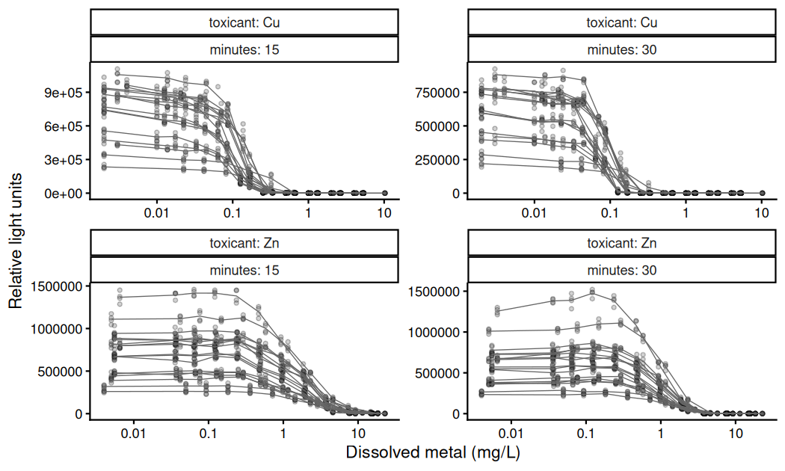
<p class="caption">plot of chunk fig-lum31-raw</p>
</div>

Luminescence stays near its control level over the lower part of each series and
then declines across about a tenfold range of concentration. It is below half the
control by 0.084 mg/L of copper at 15 minutes and 0.064 at 30 minutes, and by 1.9
and 0.93 mg/L of zinc. Zinc is therefore the weaker of the two by roughly an
order of magnitude, and both are more potent at the longer exposure. At the top
concentrations of every arm the readings reach a floor.

Two further features are taken up below. The plates of one arm are separated
vertically by a factor of four to five at the control. And at low zinc
concentrations luminescence rises above the control level before declining.

`well` identifies an individual well, which is read at both exposure times.
Concentrations are measured dissolved metal rather than nominal, and each batch
was dosed separately, so the concentration values differ between batches and the
plates are not on a common grid.

## Normalising to a control

The analysis published with these data divides each plate twice before fitting.
@luter2025 state it in the methods --- the median of the four control wells is
used to model the inverse proportion of light lost relative to the control, and
that quantity is then divided by the maximum luminescence --- and
`bayesNEC_30m_final.R` in the accompanying repository does it:

```r
Rep1B_y30_qtox  = (1 - (median(CuDat1[1:4, 4]) - Rep1B_y30) / median(CuDat1[1:4, 4]))
Rep1B_y30_qtoxB = Rep1B_y30_qtox / max(Rep1B_y30_qtox)
```

The first line simplifies to the reading divided by the median of the plate's
four control wells. The second divides by the plate maximum, which forces
exactly one observation to 1.000.

Dividing by a control mean is standard practice in ecotoxicology, and on this
assay the first division has a clear physical motivation. The plate reader
applies auto-scale gain adjustment, set per read, so absolute luminescence is a
property of the read rather than of the assay. Median control-well luminescence
differs by up to a factor of 2.8 between plates of the same batch:


``` r
lum31 |>
  filter(toxicant == "Zn", minutes == 15) |>
  group_by(batch, plate) |>
  filter(conc == min(conc)) |>
  summarise(control_rlu = median(rlu_cens), .groups = "drop_last") |>
  summarise(plates = n(), lowest = min(control_rlu), highest = max(control_rlu),
            ratio = round(max(control_rlu) / min(control_rlu), 1), .groups = "drop")
#> # A tibble: 5 × 5
#>   batch   plates  lowest  highest ratio
#>   <fct>    <int>   <dbl>    <dbl> <dbl>
#> 1 19Mar24      4 396861  1110610.   2.8
#> 2 28Mar24      3 780502  1366046.   1.8
#> 3 5Apr24       3 667941   924912    1.4
#> 4 23Apr24      5 458610.  918672.   2  
#> 5 1Oct24       2 260432.  322856    1.2
```

Gain is a per-plate multiplicative constant, so dividing by a per-plate quantity
does remove it. The difficulty is what the divisor is.

@Ritz2026 show that dividing a response by an *estimated* control mean induces
correlation between every observation sharing the denominator, and that ignoring
it biases effect doses downwards and gives intervals that are too narrow. In
their simulation, fitting the normalised response as though the observations
were independent gave ED10 bias of 2.6 to 6.8 per cent and coverage of 0.88 to
0.91 against a nominal 0.95, while modelling the raw rates gave 0.7 to 2.1 per
cent and 0.94 to 0.96. They state that weights do not remedy it, and that
per-curve normalisation on few control measurements is the worst configuration.
This assay normalises each plate by four control wells.

Their recommended approach is to model the raw response and derive inhibition
from the fitted control, treating the control level as a parameter. In
`bayesnec` that parameter is `top`, and `ecx()` is measured from the modelled
control, so a `bnec()` fit on raw luminescence is that approach.

The published estimates are what the fits in this case study are read against.
@luter2025 fitted
each plate separately on the normalised response. For copper they report EC50s
averaging 0.109 mg/L at 15 minutes, with a standard deviation of 0.036 and a
range of 0.069 to 0.201 over sixteen plates, and 0.085 at 30 minutes. For zinc,
1.546 at 15 minutes (0.284, 1.207 to 2.076 over seventeen plates) and 1.013 at
30 minutes. The spread across plates is what a per-plate analysis leaves as
variation between tests, and what a plate term estimates instead.

### A group-level term as the division

A group-level term on the control parameter targets the same per-plate constant
the division removes, and propagates its uncertainty instead of conditioning on
a point estimate. Generating the `brms` formula shows the form directly:


``` r
gfam <- Gamma(link = "identity")
make_brmsformula(
  bayesnecformula(rlu_cens | cens(censoring) ~ crf(log(conc), "nec3param") + (top | plate)),
  data = subset(lum31, toxicant == "Zn" & minutes == 15), family = gfam
)
#> $nec3param
#> rlu_cens | cens(censoring) ~ bnectop * exp(-exp(beta) * (log(conc) - nec) * step(log(conc) - nec)) 
#> top ~ 1
#> beta ~ 1
#> nec ~ 1
#> topgl ~ 0 + (1 | plate)
#> bnectop ~ top * exp(topgl)
```

`bnectop ~ top * exp(topgl)` with `topgl ~ 0 + (1 | plate)` is a per-plate
multiplicative factor on the curve, which is the form gain takes. `ogl()` gives
the same multiplicative structure applied to the whole fitted value rather than
to `top` alone:


``` r
make_brmsformula(
  bayesnecformula(rlu_cens | cens(censoring) ~ crf(log(conc), "nec3param") + ogl(plate)),
  data = subset(lum31, toxicant == "Zn" & minutes == 15), family = gfam
)
#> $nec3param
#> rlu_cens | cens(censoring) ~ bnecmu * exp(ogl) 
#> bnecmu ~ top * exp(-exp(beta) * (log(conc) - nec) * step(log(conc) - nec))
#> top ~ 1
#> beta ~ 1
#> nec ~ 1
#> ogl ~ 1 + (1 | plate)
```

The distinction matters once the equation has a lower asymptote. Gain multiplies
the whole curve, `bot` included, so `ogl()` is the match; `(top | plate)` scales
`top` and leaves `bot` common between plates. For a three-parameter equation
whose curve is `top` times a function of the predictor the two coincide.

### A global divisor

A divisor that is one constant for the whole dataset is only a change of units.
It uses no estimate and induces no correlation, so it is not what @Ritz2026
object to. This assay nonetheless does not use one, and the reason is a
property of the instrument rather than a preference.

The benefit of normalisation is not the divisor itself. It is that every curve's
control lands near the top of a bounded scale, where a `Beta` variance
`mu * (1 - mu) / (1 + phi)` is small, so the upper asymptote is well determined
and any effect concentration measured from it is stable. That requires the
curves to share a scale, and under per-read gain they do not:


``` r
lum31 |>
  filter(toxicant == "Zn", minutes == 15) |>
  group_by(plate) |>
  filter(conc == min(conc)) |>
  summarise(control_share = median(rlu_cens) / max(lum31$rlu), .groups = "drop") |>
  summarise(plates = n(), lowest = round(min(control_share), 3),
            highest = round(max(control_share), 3),
            middle_of_scale = sum(control_share < 0.61))
#> # A tibble: 1 × 4
#>   plates lowest highest middle_of_scale
#>    <int>  <dbl>   <dbl>           <int>
#> 1     17  0.171   0.898              15
```

Dividing by the largest reading in the dataset leaves most plates in the middle
of the interval, where a `Beta` variance is at its largest, so the stability a
normalised analysis relies on is not obtained. No universal ceiling in luminance
exists for the same reason: the supplementary material of @luter2025 measures 44
technical replicates of undosed cells, but at one gain, so it bounds that read
only.

### Limits of the plate term

Gain and genuine plate-to-plate biological variation are confounded in the
estimated per-plate factor, and nothing in these data separates them. This does
not affect the N(S)EC or an ECx, for which both are nuisance plate effects, but
the plate-level standard deviation is not a biological quantity and should not
be reported as one.

A related caution from @Ritz2026 applies to the scope of an `ogl(plate)` term. Normalising,
or sharing a plate term, is legitimate only within curves of the same treatment.
Plates within one toxicant-by-exposure-time arm qualify. A plate term is not
placed across the copper-versus-zinc or 15-versus-30-minute contrasts; those are
handled by `bnec_group()` below.

The argument for modelling the predictor on a transformed scale is made in
`vignette("example3")` and is not repeated here.

## Preparing the response

Two properties of the recorded response have to be settled before any fit, and
both follow from how the instrument works.

### Floored readings

Readings were blank-corrected against wells of artificial seawater, so a well
emitting less light than the blank gives a negative value. The source records
replaced such a value by zero. `rlu` reports every reading as it stands,
including one that escaped the replacement:


``` r
lum31 |>
  group_by(toxicant, minutes) |>
  summarise(rows = n(), zero = sum(rlu == 0), negative = sum(rlu < 0),
            per_cent = round(100 * mean(rlu <= 0), 1), .groups = "drop")
#> # A tibble: 4 × 6
#>   toxicant minutes  rows  zero negative per_cent
#>   <fct>      <int> <int> <int>    <int>    <dbl>
#> 1 Cu            15   704   106        0     15.1
#> 2 Cu            30   704   197        0     28  
#> 3 Zn            15   748     6        1      0.9
#> 4 Zn            30   748    77        0     10.3
```

That surviving negative is the evidence for how the zeros arise. Luminescence
cannot be negative, so a zero here is a blank-corrected negative rather than an
absence of light, and the process generating it is measurement noise about a
small positive value. These readings are therefore left-censored. A hurdle would
assert a distinct zero-generating process, which is not what happened.

A `Gamma` likelihood requires a strictly positive response and `brms` refuses
the fit at data validation otherwise, so the censoring bound cannot be zero.
`rlu_cens` and `censoring` supply the censored form, with the bound set to the
smallest positive reading on the plate --- a plate property, because gain is set
per plate, and pooled over the two exposure times because the two reads of one
plate share a gain setting.


``` r
lum31 |>
  filter(toxicant == "Zn", minutes == 15) |>
  count(censoring)
#>   censoring   n
#> 1      left   7
#> 2      none 741
```

The estimates are more sensitive to this bound where more readings reach the
floor, which is 0.9 per cent for zinc at 15 minutes and 28 per cent for copper
at 30. No detection limit is recorded for the instrument, so the bound is an
inference from the readings rather than a stated resolution.

### Non-constant dispersion

A `Gamma` with an identity link has a constant coefficient of variation, and
these data do not. Within-cell variation, pooled over the seventeen plates at
each concentration, rises steadily as the response falls:


``` r
zn15 <- droplevels(subset(lum31, toxicant == "Zn" & minutes == 15))
zn15 |>
  mutate(rank = as.integer(sub(".*-c", "", as.character(conc_group)))) |>
  group_by(rank, plate) |>
  summarise(mean_rlu = mean(rlu_cens), cv = sd(rlu_cens) / mean(rlu_cens),
            .groups = "drop_last") |>
  group_by(rank) |>
  summarise(mean_rlu = signif(mean(mean_rlu), 3), cv = round(median(cv), 3),
            .groups = "drop")
#> # A tibble: 11 × 3
#>     rank mean_rlu    cv
#>    <int>    <dbl> <dbl>
#>  1     1   704000 0.051
#>  2     2   713000 0.055
#>  3     3   714000 0.056
#>  4     4   717000 0.042
#>  5     5   718000 0.028
#>  6     6   601000 0.058
#>  7     7   459000 0.057
#>  8     8   305000 0.082
#>  9     9    92700 0.117
#> 10    10    17600 0.201
#> 11    11     3560 0.361
```

One shape parameter cannot serve a series whose own coefficient of variation
runs from about 0.05 at the control to about 0.36 at the bottom, and the
compromise it reaches is dominated by the noisy low end. The consequence falls
on the control, where the fitted variance is then far larger than the data show.
That matters for two reasons: `nsec()` is defined against the control's lower
quantile, and the relative fit of the candidate equations --- and so the model
weights --- depends on how the variance is apportioned along the series.

`disp()` models the dispersion parameter rather than holding it constant.
`disp("power")` writes `log(shape)` as a linear function of `log(mu)`, a
variance function of the fitted mean, which is a statement about the measurement
process rather than about the dose axis:


``` r
make_brmsformula(
  bayesnecformula(rlu_cens | cens(censoring) ~ crf(log(conc), "nec3param") +
                    ogl(plate) + disp("power")),
  data = zn15, family = gfam
)
#> $nec3param
#> rlu_cens | cens(censoring) ~ bnecmu * exp(ogl) 
#> bnecmu ~ top * exp(-exp(beta) * (log(conc) - nec) * step(log(conc) - nec))
#> top ~ 1
#> beta ~ 1
#> nec ~ 1
#> ogl ~ 1 + (1 | plate)
#> shape ~ c0 + c1 * (log((bnecmu * exp(ogl))) - 12.9867)
#> c0 ~ 1
#> c1 ~ 1
```

The alternative form, `disp(~log(conc))`, is an ordinary distributional formula
and describes noise as a function of the dose axis instead. Both are used below,
and `vignette("example1")` covers the dispersion machinery in general.

The coefficient-of-variation table is a summary of the recorded response rather
than of a fit, so it diagnoses the problem without confirming the remedy. The
posterior check that does confirm it is worked in `vignette("example9")`, on one
plate of the copper series: it fits the `decline` set with and without the
sub-model and compares the spread each simulates against the spread the wells
show. What transfers from there to another dataset is the check rather than the
arm, and a single plate is used so that the gain differences between plates need
no `ogl(plate)`.

## Within-concentration grouping

The commonest structure in ecotoxicology is replication within a concentration:
several vessels, chambers or wells at each exposure level, each sitting at one
point on the dose axis. Such a level spans no part of the curve, so only a
displacement is estimable and `ogl()` is the term.

In `lum31` that unit is `conc_group`, the four wells at one concentration on one
plate. A single plate is fitted here, because a plate is the only portion of
these data free of the gain differences between plates, and fitting a whole arm
would let a concentration-group term absorb plate structure as well. That plate
holds 44 readings over 11 concentration groups.


``` r
one_plate <- droplevels(subset(lum31, plate == "Zn 23Apr24 Rep6B" & minutes == 15))
nrow(one_plate)
#> [1] 44
n_distinct(one_plate$conc_group)
#> [1] 11
```

The fits below use `model = "all"`, which `bnec()` filters to the equations
valid for the family and predictor. The whole set is kept rather than `decline`
because the zinc response rises above its control at low concentrations, and
`decline` holds only the equations whose curves fall from the control. Taking
the mean of each plate's four wells at each concentration, relative to that
plate's own control:


``` r
zn15 |>
  mutate(rank = as.integer(sub(".*-c", "", as.character(conc_group)))) |>
  group_by(plate, rank) |>
  summarise(m = mean(rlu_cens), .groups = "drop_last") |>
  mutate(rel = m / m[rank == 1]) |>
  group_by(rank) |>
  summarise(plates_above_control = sum(rel > 1), median_rel = round(median(rel), 3),
            .groups = "drop") |>
  head(6)
#> # A tibble: 6 × 3
#>    rank plates_above_control median_rel
#>   <int>                <int>      <dbl>
#> 1     1                    0      1    
#> 2     2                   13      1.02 
#> 3     3                   13      1.01 
#> 4     4                   12      1.03 
#> 5     5                   12      1.01 
#> 6     6                    0      0.864
```

Excluding the hormesis equations would be a decision about the curve made
against that, so they are kept and the weights are left to settle it.

No fit in this vignette names `iter`, `warmup` or `control`, so every one of
them samples at `bnec()`'s defaults. A diagnostic reported here is therefore a
diagnostic of what a reader gets by writing the same call.


``` r
fit_plain <- bnec(rlu_cens | cens(censoring) ~ crf(log(conc), "all") + disp("power"),
                  data = one_plate, family = gfam,
                  seed = 228, refresh = 0)

fit_ogl <- bnec(rlu_cens | cens(censoring) ~ crf(log(conc), "all") + ogl(conc_group) + disp("power"),
                data = one_plate, family = gfam,
                seed = 228, refresh = 0)
```

Whether either fit may be reported is a separate question from whether it ran.
`check_sampling()` asks it for every equation of a set at once, against the
largest R-hat, the smallest effective sample size and the number of divergent
transitions:


``` r
check_sampling(fit_ogl)
#>          model max_rhat     min_ess min_ess_ratio n_divergent failed
#> 1    nec3param 1.001792 1767.528366  0.2209410457           0  FALSE
#> 2    nec4param 2.180240    5.144346  0.0006430433        1732   TRUE
#> 3     nechorme 1.001906 1256.316825  0.1570396031           2  FALSE
#> 4    nechorme4 1.003275  860.454916  0.1075568645          13   TRUE
#> 5       ecxexp 1.008704 1140.998288  0.1426247861         159   TRUE
#> 6    ecx4param 1.003026 1774.068670  0.2217585838           1  FALSE
#> 7       ecxwb1 1.005031 1739.221937  0.2174027421           0  FALSE
#> 8       ecxwb2 2.230889    5.070604  0.0006338255        1907   TRUE
#> 9     ecxwb1p3 1.003309  906.903106  0.1133628882           0  FALSE
#> 10    ecxwb2p3 1.002203 1716.456973  0.2145571217           0  FALSE
#> 11      ecxll5 1.002495 1550.777348  0.1938471685           0  FALSE
#> 12      ecxll4 1.002634 1336.326362  0.1670407953           0  FALSE
#> 13      ecxll3 1.002231 1687.532713  0.2109415891           0  FALSE
#> 14 ecxhormebc4 1.529230    7.131983  0.0008914978         380   TRUE
```

Five of the fourteen equations fail. Three of those five fail on every count at
once, with R-hats from 1.53 to 2.23 and effective sample sizes between 5 and 8
of the 8000 draws retained, which is a chain that never converged rather than
one that converged imprecisely. The other two are the ones to look at. `ecxexp`
has an R-hat of 1.0087 and an effective sample size of 1141, both unremarkable,
and records 159 divergent transitions; `nechorme4` has an R-hat of 1.0033 and an
effective sample size of 860, and records 13. A check on R-hat alone would have
kept both.

`vignette("example9")` gives the cutoffs and the reasoning behind them,
including that Stan's own guidance is that any divergent transition means the
sampler failed to explore the posterior, and that the default of ten is a
package convention rather than a published recommendation.

`screen_models()` applies the same test and drops what fails, leaving a model
average over the equations that sampled. Both fits are screened before anything
is read from them, and everything below refers to the screened objects:


``` r
fit_plain <- screen_models(fit_plain)
#> Dropping 3 of 14 candidate models that failed the sampler screen:
#>   -  nechorme: 43 divergent transitions
#>   -  nechorme4: 61 divergent transitions
#>   -  ecxhormebc4: 48 divergent transitions
#> Fitted models are: nec3param nec4param ecxexp ecx4param ecxwb1 ecxwb2 ecxwb1p3 ecxwb2p3 ecxll5 ecxll4 ecxll3
fit_ogl <- screen_models(fit_ogl)
#> Dropping 5 of 14 candidate models that failed the sampler screen:
#>   -  nec4param: Rhat 2.18, ESS 5.1, 1732 divergent transitions
#>   -  nechorme4: 13 divergent transitions
#>   -  ecxexp: 159 divergent transitions
#>   -  ecxwb2: Rhat 2.231, ESS 5.1, 1907 divergent transitions
#>   -  ecxhormebc4: Rhat 1.529, ESS 7.1, 380 divergent transitions
#> Fitted models are: nec3param nechorme ecx4param ecxwb1 ecxwb1p3 ecxwb2p3 ecxll5 ecxll4 ecxll3
```

Three of fourteen go from the ungrouped fit and five from the grouped one, each
named with the count that failed it. What remains in both is a set whose chains
converged, and the estimates below are averages over those.

`ogl(conc_group)` estimates one deviation per concentration group, so its
standard deviation summarises how much the four wells at a concentration depart
from the fitted curve beyond what the family allows.


``` r
s_ogl <- summary(fit_ogl)
s_ogl
#> Object of class bayesmanecfit
#> 
#>  Family: gamma  
#>   Links: mu = identity; shape = log  
#> 
#> Number of posterior draws per model:  8000
#> 
#> Model weights (Method: pseudobma_bb_weights):
#>             waic   wi
#> nec3param 980.45 0.18
#> nechorme  980.98 0.11
#> ecx4param 982.60 0.07
#> ecxwb1    982.00 0.11
#> ecxwb1p3  988.09 0.02
#> ecxwb2p3  980.29 0.17
#> ecxll5    981.88 0.12
#> ecxll4    982.27 0.08
#> ecxll3    980.92 0.15
#> 
#> 
#> Summary of weighted N(S)EC posterior estimates:
#> NB: Model set contains a combination of ECx and NEC
#>     models, and is therefore a model averaged
#>     combination of NEC and NSEC estimates.
#>        Estimate  Q2.5 Q97.5
#> N(S)EC     0.22 -1.68  0.62
#> 
#> 
#> Bayesian R2 estimates:
#>           Estimate Est.Error Q2.5 Q97.5
#> nec3param     0.98      0.00 0.97  0.99
#> nechorme      0.98      0.00 0.97  0.99
#> ecx4param     0.98      0.00 0.97  0.99
#> ecxwb1        0.98      0.00 0.97  0.99
#> ecxwb1p3      0.98      0.00 0.97  0.99
#> ecxwb2p3      0.98      0.00 0.97  0.99
#> ecxll5        0.98      0.00 0.97  0.99
#> ecxll4        0.98      0.00 0.97  0.99
#> ecxll3        0.98      0.00 0.97  0.99
```

That summary reports the model weights, the model-averaged N(S)EC and a Bayesian
R-squared for each equation. It does not report the group-level standard
deviation, which is estimated separately by every equation of the set, so it is
read from one of them. Taking the equation with the most weight:


``` r
best <- rownames(s_ogl$mod_weights)[which.max(s_ogl$mod_weights[, "wi"])]
best
#> [1] "nec3param"
brms::VarCorr(pull_out(fit_ogl, model = best)$fit)$conc_group$sd
#>                Estimate  Est.Error      Q2.5     Q97.5
#> ogl_Intercept 0.2404364 0.06694431 0.1444743 0.4055156
```

That standard deviation is 0.24 (0.14--0.41), on the scale the deviation is
applied on rather than on the response scale. It is a property of that equation
as well as of the data: an equation
whose curve fits the concentration means poorly attributes more of the
difference to the group term, so a standard deviation read from a poorly
weighted equation is not comparable with this one. Here the weights are spread
thinly, with `nec3param` at 0.18 against 0.17 for `ecxwb2p3` and 0.15 for
`ecxll3`, so the equation read is the most weighted by a narrow margin.

The N(S)EC in the summary above is on the scale `fit_ogl` was fitted on,
`log(conc)`, which is why its lower bound can be negative. `ecx()` takes
`xform = exp` and reports concentrations in mg/L, so the two are not in
disagreement:


``` r
rbind(
  data.frame(fit = "ungrouped", t(ecx(fit_plain, ecx_val = 10, xform = exp))),
  data.frame(fit = "ogl(conc_group)", t(ecx(fit_ogl, ecx_val = 10, xform = exp)))
)
#>               fit      Q50      Q2.5    Q97.5
#> 1       ungrouped 0.272219 0.2058078 0.376454
#> 2 ogl(conc_group) 1.037567 0.1942312 1.896349
```

The two fitted curves are drawn below, ungrouped first. The second marks the
mean of each concentration group with a diamond, which is the quantity
`ogl(conc_group)` gives a deviation to. `group_aes = "colour"` would map the
eleven groups to a colour scale as well; it is not used here because each group
sits at one concentration, so the colour would repeat what the position on the
axis already says.


``` r
autoplot(fit_plain) + log_x
```

<div class="figure" style="text-align: center">
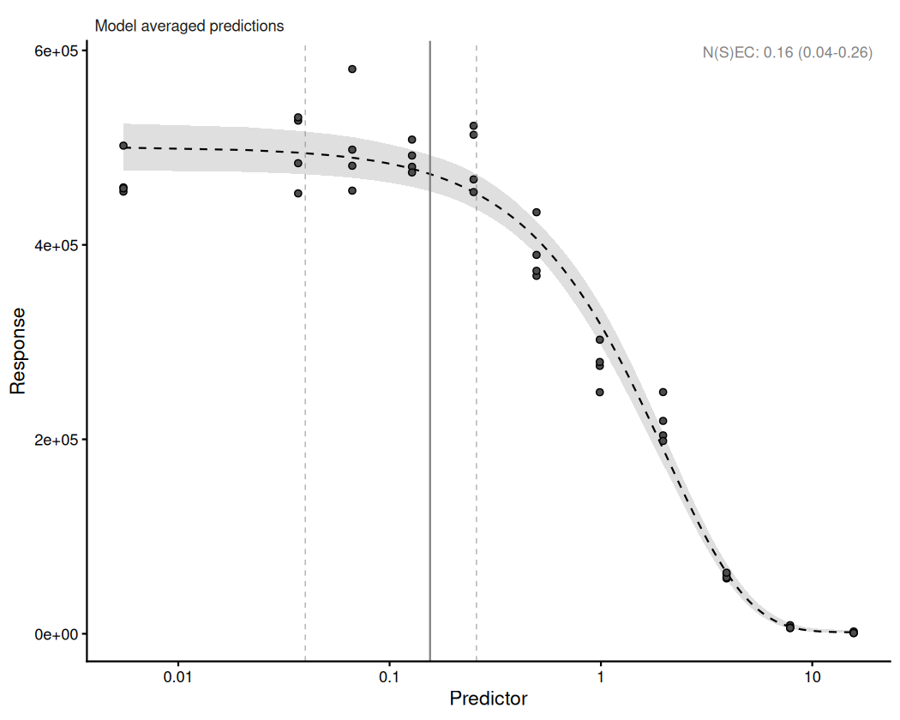
<p class="caption">plot of chunk fig-plain</p>
</div>


``` r
autoplot(fit_ogl, group = "conc_group") + log_x
```

<div class="figure" style="text-align: center">
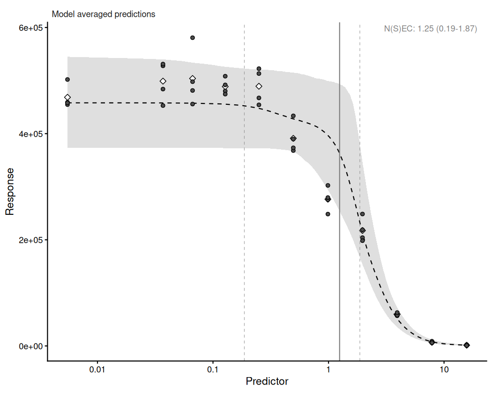
<p class="caption">plot of chunk fig-ogl</p>
</div>

`ogl(conc_group)` changes the fitted curve, not only its uncertainty. Ungrouped,
the model-averaged curve falls from the control immediately; with the term it
holds near the control before falling. EC10 changes with it, from 0.272 mg/L
(0.206--0.376) to 1.038 (0.194--1.896) --- nearly four times the estimate, on an
interval that runs a factor of 9.8 from end to end against 1.8.

That follows from the weights rather than from any one equation. Adding
`ogl(conc_group)`, which absorbs within-concentration variation, changes which
curve shapes fit the concentration means best, so the average is taken over a
different mixture. Here it is also taken over a different set: the sampler
screen dropped `nec4param`, `ecxexp` and `ecxwb2` from the grouped fit alone.
The four wells at a concentration are the only replication the design has, so an
analysis that treats them as independent has nothing left to estimate that
variation with, and reports the narrow band as though it were the evidence.

## Across-concentration grouping

A grouping whose levels each span the whole series admits a difference in shape,
and the plates of one arm are that case. Each plate is a complete test, and the
gain differences shown above mean the plates are not on a common vertical scale.

Admitting a difference in shape is not a reason to fit one, and whether these
plates have one is a question for the data rather than for the design. The two
terms make different claims. `ogl()` places one deviation on the fitted value,
so every curve parameter is shared and the plates differ by a multiplicative
constant. `pgl()` places a deviation on each parameter instead, so the threshold
and the slope may differ from plate to plate as well as the level. Seventeen
plates can support either --- five levels is the conventional minimum for one
group-level standard deviation --- so the choice is settled by fitting both and
reading the standard deviations, which *The structure a plate term states*
below does.

A model-free reading of the same question is available first, and it does not
depend on any of this. The concentration at which a plate falls to half its own
control level can be read off the observed series by interpolation. That
crossing is measured against each plate's own control, so a purely
multiplicative difference between plates cannot change it.


``` r
half_control_crossing <- function(d) {
  m <- d |>
    group_by(conc) |>
    summarise(y = mean(rlu), .groups = "drop") |>
    arrange(conc)
  half <- m$y[which.min(m$conc)] / 2
  i <- which(m$y < half)[1]
  if (is.na(i) || i == 1) return(NA_real_)
  # Linear interpolation on log(conc), which is the scale the curve is fitted
  # on, so the crossing and the fitted estimates are the same kind of quantity.
  x1 <- log(m$conc[i - 1]); x2 <- log(m$conc[i])
  y1 <- m$y[i - 1];         y2 <- m$y[i]
  x1 + (half - y1) * (x2 - x1) / (y2 - y1)
}

zn_crossings <- zn15 |>
  group_by(batch, plate) |>
  group_modify(~ tibble(cross = half_control_crossing(.x),
                        control = mean(.x$rlu[.x$conc == min(.x$conc)]))) |>
  ungroup()

c(sd_crossing = sd(zn_crossings$cross),
  sd_log_control = sd(log(zn_crossings$control)),
  cor_with_gain = cor(zn_crossings$cross, log(zn_crossings$control)))
#>    sd_crossing sd_log_control  cor_with_gain 
#>      0.1934343      0.4502265     -0.2327956
```

The crossing has a standard deviation of 0.193 on the log concentration scale
across the seventeen plates, so the plates do not share a curve position. The
control level itself varies more, at 0.45, and the two are almost unrelated: a
correlation of -0.23 between a plate's crossing and its gain. Two things differ
between plates rather than one, and `ogl()` states only the first of them.

The difference in position is a property of the plate and not of the reading.
Each plate is read twice, at 15 and at 30 minutes, and the crossings from the
two reads correlate at 0.87 across the seventeen plates.


``` r
fit_pooled <- bnec(rlu_cens | cens(censoring) ~ crf(log(conc), "all") + disp("power"),
                   data = zn15, family = gfam,
                   seed = 228, refresh = 0)

fit_plate <- bnec(rlu_cens | cens(censoring) ~ crf(log(conc), "all") + ogl(plate) + disp("power"),
                  data = zn15, family = gfam,
                  seed = 228, refresh = 0)
```

Both are screened as above, so that the comparison is between two model averages
that sampled rather than between two that merely returned:


``` r
fit_pooled <- screen_models(fit_pooled)
#> Dropping 1 of 14 candidate models that failed the sampler screen:
#>   -  ecxhormebc4: 37 divergent transitions
#> Fitted models are: nec3param nec4param nechorme nechorme4 ecxexp ecx4param ecxwb1 ecxwb2 ecxwb1p3 ecxwb2p3 ecxll5 ecxll4 ecxll3
fit_plate <- screen_models(fit_plate)
#> Dropping 8 of 14 candidate models that failed the sampler screen:
#>   -  nechorme: Rhat 1.531, ESS 7.2
#>   -  nechorme4: Rhat 1.53, ESS 7.1
#>   -  ecxwb1: Rhat 1.532, ESS 7.2
#>   -  ecxwb1p3: Rhat 1.532, ESS 7.2
#>   -  ecxwb2p3: Rhat 1.738, ESS 6.1
#>   -  ecxll4: Rhat 1.53, ESS 7.1
#>   -  ecxll3: Rhat 1.739, ESS 6.1
#>   -  ecxhormebc4: Rhat 1.54, ESS 7.1
#> Fitted models are: nec3param nec4param ecxexp ecx4param ecxwb2 ecxll5
```

The comparison of interest is between the estimates each gives, and between the
model weights each assigns, since pooling curves that differ in scale changes
which functional form fits best:


``` r
summary(fit_pooled)
#> Object of class bayesmanecfit
#> 
#>  Family: gamma  
#>   Links: mu = identity; shape = log  
#> 
#> Number of posterior draws per model:  8000
#> 
#> Model weights (Method: pseudobma_bb_weights):
#>               waic   wi
#> nec3param 19377.02 0.00
#> nec4param 19381.37 0.00
#> nechorme  19377.46 0.00
#> nechorme4 19381.38 0.00
#> ecxexp    20091.17 0.00
#> ecx4param 19314.84 0.02
#> ecxwb1    19301.96 0.38
#> ecxwb2    19345.78 0.00
#> ecxwb1p3  19378.05 0.00
#> ecxwb2p3  19342.12 0.00
#> ecxll5    19301.10 0.46
#> ecxll4    19314.62 0.03
#> ecxll3    19311.73 0.11
#> 
#> 
#> Summary of weighted N(S)EC posterior estimates:
#> NB: Model set contains a combination of ECx and NEC
#>     models, and is therefore a model averaged
#>     combination of NEC and NSEC estimates.
#>        Estimate  Q2.5 Q97.5
#> N(S)EC    -1.71 -3.10 -0.60
#> 
#> 
#> Bayesian R2 estimates:
#>           Estimate Est.Error Q2.5 Q97.5
#> nec3param     0.60      0.01 0.57  0.62
#> nec4param     0.59      0.01 0.57  0.62
#> nechorme      0.60      0.01 0.57  0.62
#> nechorme4     0.59      0.01 0.57  0.62
#> ecxexp        0.20      0.03 0.13  0.26
#> ecx4param     0.62      0.01 0.60  0.65
#> ecxwb1        0.63      0.01 0.61  0.65
#> ecxwb2        0.61      0.01 0.59  0.64
#> ecxwb1p3      0.64      0.01 0.62  0.66
#> ecxwb2p3      0.61      0.01 0.59  0.64
#> ecxll5        0.63      0.01 0.61  0.65
#> ecxll4        0.62      0.01 0.60  0.64
#> ecxll3        0.63      0.01 0.60  0.65
summary(fit_plate)
#> Object of class bayesmanecfit
#> 
#>  Family: gamma  
#>   Links: mu = identity; shape = log  
#> 
#> Number of posterior draws per model:  8000
#> 
#> Model weights (Method: pseudobma_bb_weights):
#>               waic   wi
#> nec3param 18190.78 0.00
#> nec4param 18194.38 0.00
#> ecxexp    19884.99 0.00
#> ecx4param 17676.74 0.00
#> ecxwb2    17849.35 0.00
#> ecxll5    17568.40 1.00
#> 
#> 
#> Summary of weighted N(S)EC posterior estimates:
#> NB: Model set contains a combination of ECx and NEC
#>     models, and is therefore a model averaged
#>     combination of NEC and NSEC estimates.
#>        Estimate  Q2.5 Q97.5
#> N(S)EC    -0.36 -1.67  0.14
#> 
#> 
#> Bayesian R2 estimates:
#>           Estimate Est.Error Q2.5 Q97.5
#> nec3param     0.97      0.00 0.97  0.97
#> nec4param     0.97      0.00 0.97  0.97
#> ecxexp        0.53      0.03 0.46  0.59
#> ecx4param     0.98      0.00 0.98  0.98
#> ecxwb2        0.98      0.00 0.98  0.98
#> ecxll5        0.99      0.00 0.98  0.99
```


``` r
rbind(
  data.frame(fit = "pooled", t(ecx(fit_pooled, ecx_val = 10, xform = exp))),
  data.frame(fit = "ogl(plate)", t(ecx(fit_plate, ecx_val = 10, xform = exp)))
)
#>          fit       Q50      Q2.5     Q97.5
#> 1     pooled 0.3007596 0.2129943 0.7252684
#> 2 ogl(plate) 0.3458729 0.3128655 0.3818733
```

Both fits draw one population curve through the same observations. What differs
is where the spread between plates goes: into the residual for `fit_pooled`, and
into the group-level term for `fit_plate`.


``` r
autoplot(fit_pooled) + log_x
```

<div class="figure" style="text-align: center">
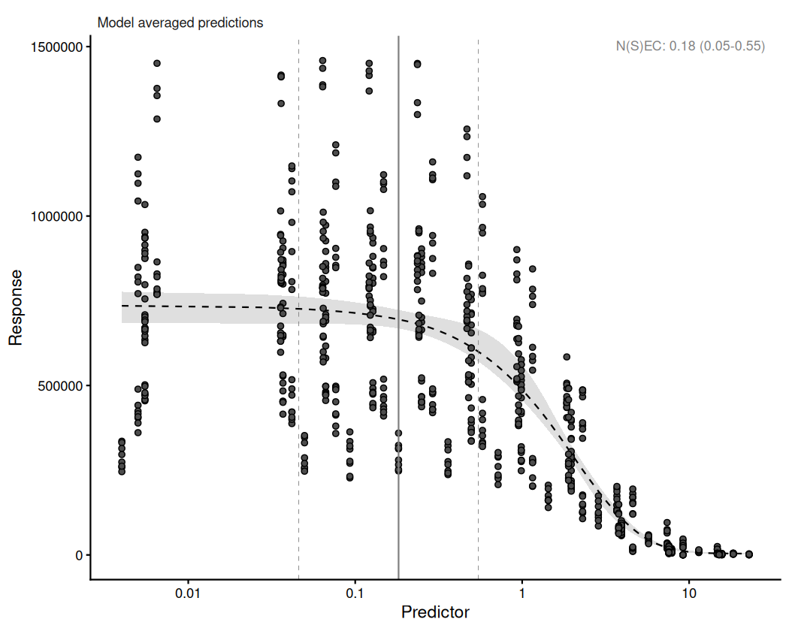
<p class="caption">plot of chunk fig-pooled</p>
</div>


``` r
autoplot(fit_plate, group = "plate") + log_x
```

<div class="figure" style="text-align: center">
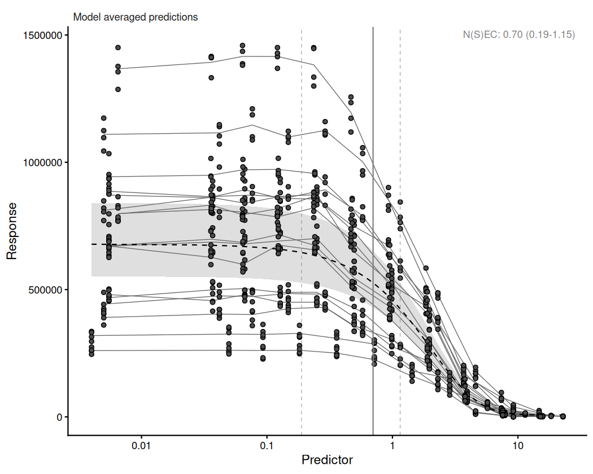
<p class="caption">plot of chunk fig-plate</p>
</div>

`group = "plate"` joins each plate's observations in the second figure, which is
what makes the structure legible: seventeen roughly parallel traces, flat over
the lower half of the series and falling together. The spread between them at
any one concentration is larger than the fall between one concentration and the
next over that flat part, and the traces stay in much the same order throughout.
That ordering is the gain difference, which dominates the figure; the difference
in position the crossings report is the smaller of the two and is not legible
here. Control wells run
from about 250,000 to 1,450,000 relative light units across the seventeen
plates, against the 250,000 floor the assay was designed to clear.

The pooled fit has nowhere to put that except the residual, so its curve falls
from the control on a narrow band; with `ogl(plate)` the spread is attributed to
the plates and the population curve holds nearer the control before falling.

EC10 is 0.301 mg/L pooled against 0.346 with the plate term, a difference of
about 15 per cent, and its interval closes from 0.213--0.725 to 0.313--0.382 ---
from a factor of 3.4 between the bounds to a factor of 1.2. The N(S)EC changes
by more: 0.18 mg/L (0.045--0.55) pooled against 0.70 (0.19--1.15). A reader
who took the pooled fit at face value would report a no-effect concentration a
quarter of the one the plate term gives, with an EC10 interval seven times as
wide, 0.51 mg/L from end to end against 0.07.

The weights account for it. With the plate term `ecxll5` takes all of the
weight; pooled it takes 0.46, with 0.38 on `ecxwb1`, 0.11 on `ecxll3`, and 0.03
and 0.02 on `ecxll4` and `ecx4param`. The two averages are not over the same
set: the sampler screen dropped eight equations from `fit_plate`, `ecxwb1` among
them, against one from `fit_pooled`. Pooling curves that differ in scale leaves
the candidate set less certain of which shape it is looking at, and the
threshold estimate is what that uncertainty lands on. The equations that
estimate a threshold --- `nec3param`, `nec4param`, `nechorme` and `nechorme4`
--- take no weight in the pooled fit; in `fit_plate` the first two take none
and the screen dropped the other two. A term on the fitted value rescales
each plate's curve by a constant and leaves the shape of the transition alone,
so it does not make a threshold easier to place, and pooling curves of different
scale smears the transition rather than sharpening it.

The direction here is the opposite of the within-concentration result, and both
follow from what the grouping has to explain. A concentration group sits at one
concentration, so `ogl(conc_group)` adds a variance component that the mean
function cannot absorb, and the intervals widen. A plate spans the whole series,
so `ogl(plate)` removes a between-plate difference that was otherwise left in
the residual, and the EC10 is better determined. The band on the response
widens instead, because the height of the population curve is now an average
over plates that differ in gain.

A `bnec_group()` fit holds one model-averaged fit per level, and `plot()` on it
draws each in turn through base graphics. `ggbnec_data()` returns the same
model-averaged curve as a data frame, so stacking those frames gives one object
that a single `ggplot()` call can facet. Both figures below use it.


``` r
group_curves <- function(x) {
  do.call(rbind, Map(function(f, lev) data.frame(level = lev, ggbnec_data(f)),
                     x$fits, x$levels))
}
```


## The structure a plate term states

The crossings above show that the plates differ in two ways, and `ogl(plate)`
states only one of them. This section fits the alternatives and reads their
group-level standard deviations, which is what decides whether the second
difference is large enough to model. Three fits vary the term while holding the
candidate set, the data and the dispersion sub-model fixed. The sampler screen
then drops different equations from each, so the model averages compared below
are taken over different sets of equations.

The named-parameter fits below place `(nec | plate)` on `nec3param` and
`nec4param`. Both equations estimate `nec`, so `check_formula()` with
`run_par_checks = TRUE` reports no dropped term for either:


``` r
invisible(check_formula(
  bayesnecformula(rlu_cens | cens(censoring) ~
                    crf(log(conc), c("nec3param", "nec4param")) +
                    (nec | plate) + disp("power")),
  data = zn15, run_par_checks = TRUE
))
#> Performing single parameter checks on all models...
```

`fit_pgl` places a deviation on every parameter of the equation. `fit_batch`
places the single deviation on the batch the plate was run in rather than on
the plate.
`fit_plate_batch` estimates both at once, which is the only one of the three
that can separate them, because plates are nested in batches and either term
alone absorbs part of the other.


``` r
fit_pgl <- bnec(rlu_cens | cens(censoring) ~ crf(log(conc), "all") + pgl(plate) + disp("power"),
                data = zn15, family = gfam,
                seed = 228, refresh = 0)

fit_batch <- bnec(rlu_cens | cens(censoring) ~ crf(log(conc), "all") + ogl(batch) + disp("power"),
                  data = zn15, family = gfam,
                  seed = 228, refresh = 0)

fit_plate_batch <- bnec(rlu_cens | cens(censoring) ~ crf(log(conc), "all") + ogl(plate) + ogl(batch) + disp("power"),
                        data = zn15, family = gfam,
                        seed = 228, refresh = 0)
```

A named-parameter term is not applied across the whole set. The parameter
placing the curve is `nec` in ten equations and `ec50` in ten, and three have
neither, so `(nec | plate)` over `model = "all"` would describe a structure most
of the set does not have. The comparison is made on two of the equations that
estimate `nec`, against the same two with `ogl(plate)`, so that the two fits
differ only in where the deviation sits.


``` r
fit_nec_gl <- bnec(rlu_cens | cens(censoring) ~ crf(log(conc), c("nec3param", "nec4param")) + (nec | plate) + disp("power"),
                   data = zn15, family = gfam,
                   seed = 228, refresh = 0)

fit_nec_ogl <- bnec(rlu_cens | cens(censoring) ~ crf(log(conc), c("nec3param", "nec4param")) + ogl(plate) + disp("power"),
                    data = zn15, family = gfam,
                    seed = 228, refresh = 0)
```

Every fit is screened before it is read, on the same terms as the pooled and
plate fits above.


``` r
fit_pgl <- screen_models(fit_pgl)
#> Dropping 12 of 14 candidate models that failed the sampler screen:
#>   -  nec3param: Rhat 2.558, ESS 4.8
#>   -  nec4param: Rhat 2.099, ESS 5.2
#>   -  nechorme: Rhat 2.412, ESS 4.9
#>   -  nechorme4: Rhat 1.745, ESS 6
#>   -  ecx4param: Rhat 1.533, ESS 7.1
#>   -  ecxwb1: Rhat 1.739, ESS 6.1
#>   -  ecxwb2: Rhat 1.532, ESS 7.1
#>   -  ecxwb1p3: Rhat 1.736, ESS 6.1
#>   -  ecxwb2p3: Rhat 1.53, ESS 7.1
#>   -  ecxll5: Rhat 1.536, ESS 7.1
#>   -  ecxll4: Rhat 2.103, ESS 5.2
#>   -  ecxhormebc4: Rhat 1.535, ESS 7.1, 55 divergent transitions
#> Fitted models are: ecxexp ecxll3
fit_batch <- screen_models(fit_batch)
#> Dropping 1 of 14 candidate models that failed the sampler screen:
#>   -  nechorme: Rhat 1.532, ESS 7.1, 55 divergent transitions
#> Fitted models are: nec3param nec4param nechorme4 ecxexp ecx4param ecxwb1 ecxwb2 ecxwb1p3 ecxwb2p3 ecxll5 ecxll4 ecxll3 ecxhormebc4
fit_plate_batch <- screen_models(fit_plate_batch)
#> Dropping 11 of 14 candidate models that failed the sampler screen:
#>   -  nec3param: 32 divergent transitions
#>   -  nec4param: Rhat 1.53, ESS 7.1, 16 divergent transitions
#>   -  nechorme: Rhat 1.529, ESS 7.1
#>   -  ecx4param: 33 divergent transitions
#>   -  ecxwb1: Rhat 1.528, ESS 7.1, 26 divergent transitions
#>   -  ecxwb2: 22 divergent transitions
#>   -  ecxwb1p3: Rhat 1.734, ESS 6.1, 51 divergent transitions
#>   -  ecxwb2p3: Rhat 1.734, ESS 6.1, 47 divergent transitions
#>   -  ecxll4: 20 divergent transitions
#>   -  ecxll3: Rhat 1.735, ESS 6.1, 50 divergent transitions
#>   -  ecxhormebc4: Rhat 1.53, ESS 7.2
#> Fitted models are: nechorme4 ecxexp ecxll5
fit_nec_gl <- screen_models(fit_nec_gl)
#> All 2 candidate models passed the sampler screen (Rhat <= 1.01, ESS >= 400, divergences <= 10).
fit_nec_ogl <- screen_models(fit_nec_ogl)
#> All 2 candidate models passed the sampler screen (Rhat <= 1.01, ESS >= 400, divergences <= 10).
```

The screen removes most of the set from the two fits that state more than a
single difference between plates: twelve of fourteen equations from `fit_pgl`
and eleven from `fit_plate_batch`, against one from `fit_batch`, and both
equations of each named-parameter fit pass. Most of the removals are chains that
did not converge, with R-hats above 1.5, so what those two fits report rests on
the two or three equations that sampled.

### The group-level standard deviations

`VarCorr()` reports the deviations on the scale of the parameter each applies
to. They are read against the model weight of the equation they were computed
on, because an equation holding no weight says nothing about the model average.


``` r
sd_table <- function(x, label) {
  w <- summary(x)$mod_weights
  do.call(rbind, lapply(rownames(w), function(m) {
    vc <- brms::VarCorr(pull_out(x, model = m)$fit)
    do.call(rbind, lapply(names(vc), function(g) {
      sd <- vc[[g]]$sd
      data.frame(fit = label, model = m, wi = w[m, "wi"], grouping = g,
                 parameter = rownames(sd), sd = sd[, "Estimate"],
                 lower = sd[, "Q2.5"], upper = sd[, "Q97.5"], row.names = NULL)
    }))
  }))
}

sds <- rbind(sd_table(fit_plate, "ogl(plate)"), sd_table(fit_pgl, "pgl(plate)"),
             sd_table(fit_batch, "ogl(batch)"),
             sd_table(fit_plate_batch, "ogl(plate) + ogl(batch)"))
subset(sds, wi >= 0.01)
#>                        fit  model        wi grouping       parameter         sd      lower     upper
#> 6               ogl(plate) ecxll5 1.0000000    plate   ogl_Intercept 0.44852644 0.31991365 0.6293291
#> 9               pgl(plate) ecxll3 1.0000000    plate  beta_Intercept 0.06719219 0.01385975 0.1247781
#> 10              pgl(plate) ecxll3 1.0000000    plate  ec50_Intercept 0.20286923 0.13621177 0.3029371
#> 11              pgl(plate) ecxll3 1.0000000    plate topgl_Intercept 0.45890499 0.33439903 0.6493035
#> 17              ogl(batch) ecxwb1 0.4986503    batch   ogl_Intercept 0.44083928 0.23500712 0.8512804
#> 21              ogl(batch) ecxll5 0.4762725    batch   ogl_Intercept 0.44054639 0.23530461 0.8384859
#> 29 ogl(plate) + ogl(batch) ecxll5 1.0000000    batch   ogl_Intercept 0.29255119 0.01852797 0.7224199
#> 30 ogl(plate) + ogl(batch) ecxll5 1.0000000    plate   ogl_Intercept 0.38997754 0.25926638 0.5839365
```

`pgl(plate)` gives all of its weight to `ecxll3`, one of the two of its fourteen
equations that pass the sampler screen, and estimates one deviation on each of
its three parameters. The deviation on `top` is 0.46 (0.33--0.65), which
reproduces the 0.45 (0.32--0.63) that `ogl(plate)` estimates on its single term:
the gain difference is the same quantity read two ways. The deviation on `ec50`
is 0.20 (0.14--0.30), an interval spanning a factor of 2.2. The deviation on
`beta` is 0.07 (0.01--0.12), smaller, with a lower bound near zero and an
interval spanning a factor of 9. The plates therefore differ in where the
transition sits as well as in its height, and the evidence for a difference in
its steepness is weak. The deviation on `ec50` reproduces the 0.19 standard
deviation of the half-control crossings, which reported the difference in
position without fitting anything.

The plate and the batch cannot be separated by fitting either alone.
`ogl(batch)` on its own estimates 0.44 (0.24--0.85) under `ecxwb1` and 0.44
(0.24--0.84) under `ecxll5`, the two equations that share its weight, which is
indistinguishable from the plate term, because the five batches absorb the
differences between the plates within them. Fitted together, the plate deviation
is 0.39 (0.26--0.58) and the batch deviation is 0.29 (0.02--0.72). The plate
interval spans a factor of 2.2 and lies well above zero. The batch interval
reaches down to 0.02 and spans a factor of 39. The difference between plates is
therefore established, and how much of it lies between batches is not
determined by seventeen plates in five batches.

### The model weights under each term


``` r
do.call(rbind, Map(function(x, label) {
  w <- summary(x)$mod_weights
  data.frame(fit = label, model = rownames(w), wi = round(w[, "wi"], 3))[w[, "wi"] >= 0.01, ]
}, list(fit_pooled, fit_plate, fit_pgl, fit_plate_batch),
   list("pooled", "ogl(plate)", "pgl(plate)", "ogl(plate) + ogl(batch)")))
#>                               fit     model    wi
#> ecx4param                  pooled ecx4param 0.024
#> ecxwb1                     pooled    ecxwb1 0.379
#> ecxll5                     pooled    ecxll5 0.455
#> ecxll4                     pooled    ecxll4 0.027
#> ecxll3                     pooled    ecxll3 0.115
#> ecxll51                ogl(plate)    ecxll5 1.000
#> ecxll31                pgl(plate)    ecxll3 1.000
#> ecxll52   ogl(plate) + ogl(batch)    ecxll5 1.000
```

Pooled, the weight is spread over five equations, with `ecxll5` at 0.46 and
`ecxwb1` at 0.38. With `ogl(plate)` it falls entirely on `ecxll5`, and with
`pgl(plate)` entirely on `ecxll3`. Part of that is the term: what counts as
residual variation changes with it, and so does which functional form the data
support. Part of it is the sampler screen, which removes different equations
from each fit. `ecxwb1`, the second equation of the pooled fit, did not converge
under `ogl(plate)` (R-hat 1.53), and `ecxll5` did not converge under
`pgl(plate)` (R-hat 1.54). The weights of a screened set therefore reflect the
screen as well as the term.

### The estimates the choice affects


``` r
rbind(
  data.frame(fit = "pooled", t(ecx(fit_pooled, ecx_val = 10, xform = exp))),
  data.frame(fit = "ogl(plate)", t(ecx(fit_plate, ecx_val = 10, xform = exp))),
  data.frame(fit = "pgl(plate)", t(ecx(fit_pgl, ecx_val = 10, xform = exp))),
  data.frame(fit = "ogl(batch)", t(ecx(fit_batch, ecx_val = 10, xform = exp))),
  data.frame(fit = "ogl(plate) + ogl(batch)", t(ecx(fit_plate_batch, ecx_val = 10, xform = exp)))
)
#>                       fit       Q50      Q2.5     Q97.5
#> 1                  pooled 0.3007596 0.2129943 0.7252684
#> 2              ogl(plate) 0.3458729 0.3128655 0.3818733
#> 3              pgl(plate) 0.5043940 0.4465593 0.5728338
#> 4              ogl(batch) 0.3065941 0.2435604 0.5360477
#> 5 ogl(plate) + ogl(batch) 0.3467241 0.3135853 0.3820538
```


``` r
rbind(
  data.frame(fit = "pooled", t(nsec(fit_pooled, xform = exp))),
  data.frame(fit = "ogl(plate)", t(nsec(fit_plate, xform = exp))),
  data.frame(fit = "pgl(plate)", t(nsec(fit_pgl, xform = exp))),
  data.frame(fit = "ogl(batch)", t(nsec(fit_batch, xform = exp))),
  data.frame(fit = "ogl(plate) + ogl(batch)", t(nsec(fit_plate_batch, xform = exp)))
)
#>                       fit       Q50       Q2.5     Q97.5
#> 1                  pooled 0.1808199 0.04006383 0.5442608
#> 2              ogl(plate) 0.7007039 0.18731625 1.1524560
#> 3              pgl(plate) 0.8699565 0.33549880 1.2913989
#> 4              ogl(batch) 1.1189981 0.25022534 2.0176075
#> 5 ogl(plate) + ogl(batch) 1.0768040 0.31430827 1.8208179
```

The two estimates answer differently. EC10 sits between 0.30 and 0.35 mg/L
under four of the five structures, and at 0.50 (0.45--0.57) under `pgl(plate)`,
whose interval does not overlap that of `ogl(plate)`. The N(S)EC is more
sensitive still: 0.18 pooled, 0.70 with `ogl(plate)`, 0.87 with `pgl(plate)`,
and 1.08 to 1.12 once a batch term is present. That is a factor of six driven
by the grouping structure alone, on one dataset with one response.

The reason is in what each estimate is read off. An ECx is a fixed percentage
drop from the control, and the control is re-estimated per plate by any of these
terms, so the drop is measured from a reference that is re-estimated with it,
and under a term on the fitted value the answer changes little. Under
`pgl(plate)` it is read off a different equation, `ecxll3` in place of `ecxll5`,
and from a population curve whose position is itself allowed to vary between
plates, and the EC10 changes from 0.35 to 0.50 mg/L. The N(S)EC is the point at
which the curve departs from the control band, and the width of that band is
exactly what a group-level term reallocates. Where the two estimates disagree
about how much a structural choice matters, an assessment should state which of
them it reports.

### The named-parameter term


``` r
rbind(
  data.frame(fit = "ogl(plate)", t(ecx(fit_nec_ogl, ecx_val = 10, xform = exp))),
  data.frame(fit = "(nec | plate)", t(ecx(fit_nec_gl, ecx_val = 10, xform = exp)))
)
#>             fit       Q50      Q2.5     Q97.5
#> 1    ogl(plate) 0.4914209 0.4749334 0.5080086
#> 2 (nec | plate) 1.4509133 1.1978768 1.7504418
sd_table(fit_nec_gl, "(nec | plate)")
#>             fit     model        wi grouping     parameter        sd     lower     upper
#> 1 (nec | plate) nec3param 0.3240097    plate nec_Intercept 0.3081710 0.2104187 0.4539733
#> 2 (nec | plate) nec4param 0.6759903    plate nec_Intercept 0.3144929 0.2151374 0.4664482
```

On the same two equations and the same data, `ogl(plate)` gives an EC10 of 0.49
(0.47--0.51) and `(nec | plate)` gives 1.45 (1.20--1.75). The deviation on `nec`
is 0.31 (0.21--0.45) under `nec3param` and 0.31 (0.22--0.47) under `nec4param`,
so the plates do differ in threshold, which is consistent with the crossings.
The two fits nonetheless answer a question about the population curve
differently by a factor of three, and the intervals do not overlap.

Neither is a correction of the other. `ogl(plate)` asks what the average plate's
curve is once each plate's gain is removed; `(nec | plate)` asks what the average
plate's threshold is, with the gain left in the residual. A term is a statement
about which differences are nuisance, and the estimate follows from it.


``` r
loo_k <- function(x, label) {
  w <- summary(x)$mod_weights
  do.call(rbind, lapply(rownames(w), function(m) {
    k <- pull_out(x, model = m)$fit$criteria$loo$diagnostics$pareto_k
    data.frame(fit = label, model = m, wi = round(w[m, "wi"], 3),
               n = length(k), k_above_0.7 = sum(k > 0.7), k_max = round(max(k), 2),
               row.names = NULL)
  }))
}
rbind(loo_k(fit_pgl, "pgl(plate)"), loo_k(fit_nec_gl, "(nec | plate)"))
#>             fit     model    wi   n k_above_0.7 k_max
#> 1    pgl(plate)    ecxexp 0.000 748           0  0.58
#> 2    pgl(plate)    ecxll3 1.000 748           0  0.44
#> 3 (nec | plate) nec3param 0.324 748           0  0.44
#> 4 (nec | plate) nec4param 0.676 748           0  0.68
```

Neither fit has a Pareto-k above 0.7, the value above which a leave-one-out
estimate is treated as approximate. The largest is 0.68, one observation of 748
under `nec4param` in `(nec | plate)`, an equation that holds 0.68 of that fit's
weight. `pgl(plate)` reaches 0.44 on `ecxll3`, which holds all of its weight,
and 0.58 on `ecxexp`, which holds none, so estimating three deviations across
seventeen levels has not made the fit fragile.

### The term this case study uses

`ogl(plate)` is kept for the sections that follow, and the reason is now stated
from the fits rather than assumed. The gain difference is the large one, at 0.45
on the log scale against 0.19 for the difference in position, and `ogl()` is the
term that states it. `pgl(plate)` finds differences in position and slope beyond
it, and it changes the EC10 from 0.35 to 0.50 mg/L, so the choice matters to the
answer. Its model average, however, rests on the two of its fourteen equations
that sampled, where `ogl(plate)` keeps six. A structure the sampler cannot fit
across most of the candidate set is a weaker basis for an estimate than one it
can.

That is a judgement about this dataset and not a rule. Where the position
difference is the larger of the two, or where more of the candidate set samples
under `pgl()`, the same evidence would favour the other term. Either way the
EC10 from these data depends on the choice, so an assessment should state which
term its estimate was read under.


``` r
autoplot(fit_pgl, group = "plate") + log_x
```

<div class="figure" style="text-align: center">
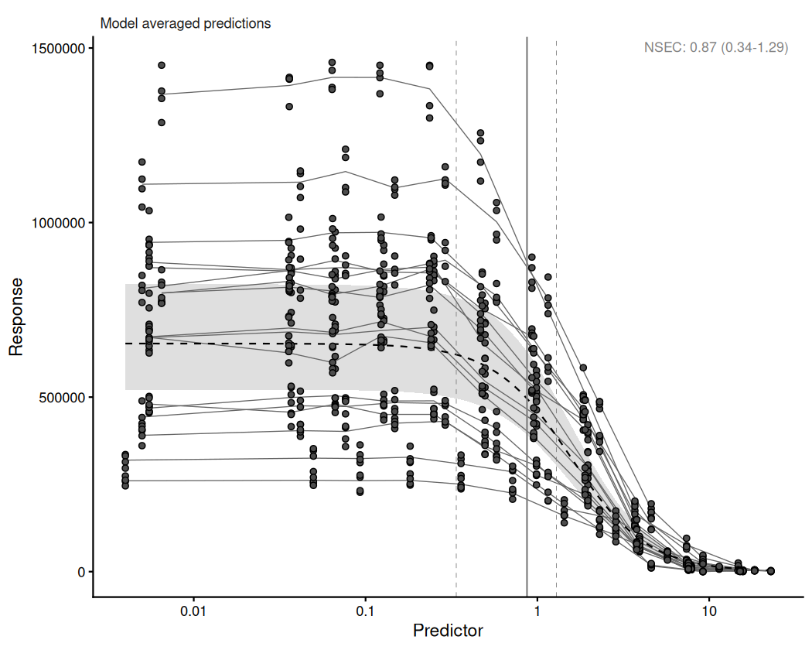
<p class="caption">plot of chunk fig-pgl</p>
</div>

The figure shows the same seventeen observed traces as the `ogl(plate)` figure
above, with the population curve of `pgl(plate)`. That curve holds at the
control level further up the series, to about 0.25 mg/L, and then falls more
steeply, which is the higher EC10 in the table above. Its band is slightly wider
than the `ogl(plate)` band over the flat part of the series and wider through
the transition, where the deviations on `ec50` and `beta` act.


## Copper against zinc

Copper and zinc are two contaminants of interest, not a sample from a
population of metals, so they are levels rather than a grouping. Each is fitted
with the structure the sections above arrived at: the censored response, a plate
term for the gain, and a dispersion sub-model. `bnec_group()` fits each level
separately and returns one object. The call keeps `model = "all"` for the reason
given under *Within-concentration grouping*, that luminescence rises above the
control level at low zinc concentrations.


``` r
zn_cu_15 <- droplevels(subset(lum31, minutes == 15))

fits_tox <- bnec_group(
  rlu_cens | cens(censoring) ~ crf(log(conc), "all") + ogl(plate) + disp("power"),
  data = zn_cu_15, group_var = "toxicant", family = gfam,
  seed = 228, refresh = 0)
```

The two levels were fitted independently, so an equation that fails the sampler
screen for one metal is removed only from that metal. Writing the action in the
call makes the resulting difference between candidate sets explicit.


``` r
fits_tox <- screen_models(fits_tox, group_action = "per_level")
#> Screening level "Cu".
#> Dropping 3 of 14 candidate models that failed the sampler screen:
#>   -  nechorme: Rhat 2.414, ESS 4.9, 317 divergent transitions
#>   -  nechorme4: Rhat 2.411, ESS 4.9, 97 divergent transitions
#>   -  ecxhormebc4: Rhat 1.531, ESS 7.2, 154 divergent transitions
#> Fitted models are: nec3param nec4param ecxexp ecx4param ecxwb1 ecxwb2 ecxwb1p3 ecxwb2p3 ecxll5 ecxll4 ecxll3
#> Screening level "Zn".
#> Dropping 8 of 14 candidate models that failed the sampler screen:
#>   -  nechorme: Rhat 1.531, ESS 7.2
#>   -  nechorme4: Rhat 1.53, ESS 7.1
#>   -  ecxwb1: Rhat 1.532, ESS 7.2
#>   -  ecxwb1p3: Rhat 1.532, ESS 7.2
#>   -  ecxwb2p3: Rhat 1.738, ESS 6.1
#>   -  ecxll4: Rhat 1.53, ESS 7.1
#>   -  ecxll3: Rhat 1.739, ESS 6.1
#>   -  ecxhormebc4: Rhat 1.54, ESS 7.1
#> Fitted models are: nec3param nec4param ecxexp ecx4param ecxwb2 ecxll5
```

The screen drops three equations from copper, each with an R-hat above 1.5, and
eight from zinc. The zinc eight are those it dropped from `fit_plate` above,
which is the same model fitted to the same zinc data.


``` r
summary(fits_tox)
#> $Cu
#> Object of class bayesmanecfit
#> 
#>  Family: gamma  
#>   Links: mu = identity; shape = log  
#> 
#> Number of posterior draws per model:  8000
#> 
#> Model weights (Method: pseudobma_bb_weights):
#>               waic   wi
#> nec3param 14269.92 0.00
#> nec4param 14003.50 0.00
#> ecxexp    15049.23 0.00
#> ecx4param 13925.08 0.36
#> ecxwb1    13952.71 0.07
#> ecxwb2    13960.66 0.00
#> ecxwb1p3  14917.23 0.00
#> ecxwb2p3  14287.78 0.00
#> ecxll5    13927.13 0.26
#> ecxll4    13925.42 0.31
#> ecxll3    14322.91 0.00
#> 
#> 
#> Summary of weighted N(S)EC posterior estimates:
#> NB: Model set contains a combination of ECx and NEC
#>     models, and is therefore a model averaged
#>     combination of NEC and NSEC estimates.
#>        Estimate  Q2.5 Q97.5
#> N(S)EC    -2.61 -3.22 -2.41
#> 
#> 
#> Bayesian R2 estimates:
#>           Estimate Est.Error Q2.5 Q97.5
#> nec3param     0.96      0.00 0.95  0.96
#> nec4param     0.96      0.00 0.96  0.97
#> ecxexp        0.55      0.03 0.49  0.60
#> ecx4param     0.97      0.00 0.97  0.97
#> ecxwb1        0.97      0.00 0.97  0.98
#> ecxwb2        0.97      0.00 0.97  0.97
#> ecxwb1p3      0.82      0.01 0.80  0.84
#> ecxwb2p3      0.96      0.00 0.95  0.97
#> ecxll5        0.97      0.00 0.97  0.98
#> ecxll4        0.97      0.00 0.97  0.97
#> ecxll3        0.96      0.00 0.95  0.97
#> 
#> $Zn
#> Object of class bayesmanecfit
#> 
#>  Family: gamma  
#>   Links: mu = identity; shape = log  
#> 
#> Number of posterior draws per model:  8000
#> 
#> Model weights (Method: pseudobma_bb_weights):
#>               waic   wi
#> nec3param 18190.78 0.00
#> nec4param 18194.38 0.00
#> ecxexp    19884.99 0.00
#> ecx4param 17676.74 0.00
#> ecxwb2    17849.35 0.00
#> ecxll5    17568.40 1.00
#> 
#> 
#> Summary of weighted N(S)EC posterior estimates:
#> NB: Model set contains a combination of ECx and NEC
#>     models, and is therefore a model averaged
#>     combination of NEC and NSEC estimates.
#>        Estimate  Q2.5 Q97.5
#> N(S)EC    -0.36 -1.67  0.14
#> 
#> 
#> Bayesian R2 estimates:
#>           Estimate Est.Error Q2.5 Q97.5
#> nec3param     0.97      0.00 0.97  0.97
#> nec4param     0.97      0.00 0.97  0.97
#> ecxexp        0.53      0.03 0.46  0.59
#> ecx4param     0.98      0.00 0.98  0.98
#> ecxwb2        0.98      0.00 0.98  0.98
#> ecxll5        0.99      0.00 0.98  0.99
```

Back-transformed, the threshold is 0.074 mg/L (0.040--0.090) for copper and 0.70
(0.19--1.15) for zinc: copper is the more potent by roughly an order of
magnitude, which is the ordering @luter2025 report from the per-plate analysis
and at much the same separation.


``` r
ggplot(group_curves(fits_tox), aes(x = x_e, colour = level, fill = level)) +
  geom_polygon(aes(y = y_ci), colour = NA, alpha = 0.3) +
  geom_line(aes(y = y_e), linetype = 2) +
  geom_point(aes(x = x_r, y = y_r), alpha = 0.4, size = 1.2) +
  geom_vline(aes(xintercept = nec_vals), colour = "grey50") +
  facet_wrap(~level, ncol = 1, scales = "free") +
  log_x +
  scale_colour_hue(guide = "none") +
  scale_fill_hue(guide = "none") +
  theme_classic() +
  labs(x = "Dissolved metal (mg/L)", y = "Relative light units")
```

<div class="figure" style="text-align: center">
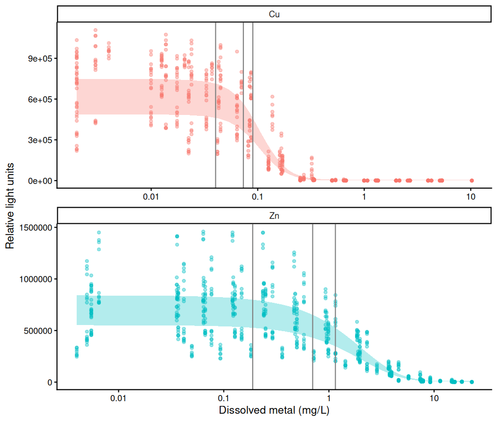
<p class="caption">plot of chunk fig-metals</p>
</div>

Each panel holds its own response axis, because the two arms were read at
different gains and their relative light units are not comparable between them.
What is comparable is where each falls, and the two panels put that an order of
magnitude apart: copper's threshold rules sit between 0.04 and 0.09 mg/L and
zinc's between 0.19 and 1.2. In both the observations scatter widely at every
concentration while the fitted band stays narrow, which is the plate term
holding the between-plate spread out of the population curve.


``` r
cmp_tox <- compare_posterior(fits_tox, comparison = "n(s)ec")
cmp_tox$prob_diff
#>   comparison     prob prob_lower prob_upper censored_first censored_second
#> 1      Cu-Zn 0.014625   0.014625   0.014625              0               0
```

`prob_diff` reduces each pair to one number. The posteriors it was computed
from are returned as well, in `posterior_data`, and drawing them separates a
difference in location from a difference in width:


``` r
tox_post <- cmp_tox$posterior_data
tox_post$value <- exp(tox_post$value)

ggplot(data = tox_post, mapping = aes(x = value)) +
  geom_density(mapping = aes(group = model, colour = model, fill = model),
               alpha = 0.3) +
  log_x +
  theme_classic() +
  labs(x = "Dissolved metal (mg/L)", y = "Density",
       fill = "Toxicant", colour = "Toxicant")
```

<div class="figure" style="text-align: center">
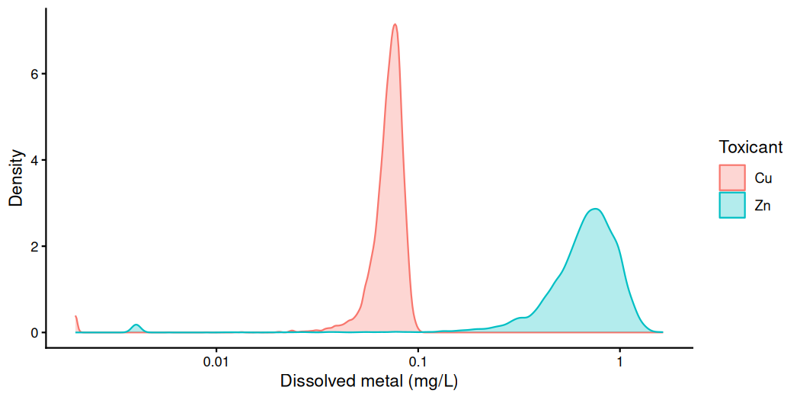
<p class="caption">plot of chunk fig-cmp-metals</p>
</div>


The two posteriors barely overlap, and they differ in more than their centres.
Copper's median is 0.074 mg/L over an interval of 0.040 to 0.090, a factor of
2.2 from end to end. Zinc's is 0.70 over 0.19 to 1.15, a factor of 6.1.
Copper is both the more potent metal and the better determined one on these
data, and the single pairwise comparison of 0.0146 is what that separation
reduces to.

# Case study 2

<small>*Combined effects of climate change and the herbicide diuron on the coral
Acropora millepora*</small>

## Design and model complexity

A concentration-response design has to be wide enough for the curve being asked
of it. Five concentrations is the conventional minimum, and at that minimum the
number of parameters in an equation matters: the design has enough information
to place a threshold or a midpoint but not enough to place both asymptotes as
well. Nothing refuses: every equation is offered, each returns an object, and the
divergent transitions are the only sign that the design was too narrow for it.

`coral_colour` and `coral_pam` are two endpoints of one exposure of *Acropora
millepora* to the herbicide diuron under three climate scenarios [@flores2021],
reported at <https://doi.org/10.1016/j.marpolbul.2021.112582>.

The scenarios are not years but combinations of temperature and dissolved carbon
dioxide, labelled by the year they represent: 28.1 °C at 397 ppm for present-day
conditions, and RCP8.5 projections of 29.1 °C at 680 ppm and 30.2 °C at 858 ppm.
Three replicate chambers were run at each combination of scenario and
concentration, with four coral fragments in each. The concentrations are
relevant to where the corals live: diuron has been measured in the Great Barrier
Reef lagoon at up to 0.778 µg/L.

The two endpoints are different measurements on the same fragments. `yield` is
the effective quantum yield of photosystem II in the symbiotic dinoflagellates,
read by pulse-amplitude modulated fluorometry. `proportion` is a colour index
standing in for bleaching: a photograph of about half a square centimetre of
live tissue, reduced to its mean grey pixel value and then rescaled between the
smallest and largest values observed. That rescaling has a consequence for the
family: one observation is bound to sit on 1, and one does.

Both are within-concentration designs, a chamber sitting at one concentration,
and they differ in the width of the design and in nothing else that matters
here.


``` r
data(coral_colour)
data(coral_pam)
rbind(
  colour = c(rows = nrow(coral_colour), concentrations = n_distinct(coral_colour$diuron),
             chambers = n_distinct(coral_colour$chamber)),
  pam    = c(rows = nrow(coral_pam), concentrations = n_distinct(coral_pam$diuron),
             chambers = n_distinct(coral_pam$chamber))
)
#>        rows concentrations chambers
#> colour  180              5       45
#> pam     414              6       54
```

The two differ in width rather than in kind: 180 colour readings over five
concentrations in 45 chambers, against 414 yield readings over six in 54. The
colour endpoint is the narrower design and the one this section turns on.

## The control on a log axis

Both endpoints include an untreated control recorded as an exact zero. A log
axis has no position for it, and `crf(log(diuron))` has no value for it either:
the column reaches the data check as `-Inf` and `bnec()` refuses the fit,
naming it. Some value has to be put in its place. That substitution is made
here, in the vignette, and not in the shipped data, so that `data-raw/coral_diuron.R`
continues to record what the experiment measured.

`coral_pam` was dosed at 0.29, 0.96, 2.9, 9.6 and 29 µg/L, each step about 3.16
times the last, which is half an order of magnitude. One further step below the lowest
treatment is 0.29/3.16 = 0.092 µg/L, and 0.1 is that value rounded. It puts the
control the same distance from 0.29 that 0.29 is from 0.96. Half the lowest
treatment, 0.145, would put it a third of that distance away, closer to the
lowest dose than any two doses are to each other. `coral_colour` was dosed at
the same concentrations but for 9.6, so its series has one step missing in the
middle and the substituted control sits a regular step below it.


``` r
nudge <- function(x) ifelse(x == 0, 0.1, x)
coral_colour$diuron_adj <- nudge(coral_colour$diuron)
coral_pam$diuron_adj <- nudge(coral_pam$diuron)
sort(unique(coral_pam$diuron_adj))
#> [1]  0.10  0.29  0.96  2.90  9.60 29.00
```

No other concentration is altered. Every estimate reported in this section is
therefore an estimate against a control placed at 0.1 µg/L, and a threshold
returned near that value would be describing the substitution rather than
diuron.

The substitution has a second consequence, and it is general rather than
particular to these data. Any concentration below 1 has a negative logarithm,
so `log(diuron_adj)` runs from -2.30 to 3.37. Three of the 18 equations that
`model = "all"` offers for this family cannot be fitted on a predictor that
reaches a negative value. `necsigm` and `ecxsigm` raise the predictor to a
fractional power, which is undefined there. `ecxhormebc5` cannot be reliably
initialised where an identity-linked `Beta` mean must stay positive, because
its hormesis term is negative wherever the predictor is. `bnec()` reports each
exclusion and fits the remaining 15. Every `lum31` fit in this vignette meets
the same condition, its concentrations being in mg/L and mostly below 1.


``` r
rbind(
  transform(coral_colour[c("climate", "diuron_adj")],
            endpoint = "colour (proportion)", y = coral_colour$proportion),
  transform(coral_pam[c("climate", "diuron_adj")],
            endpoint = "yield", y = coral_pam$yield)
) |>
  ggplot(aes(x = diuron_adj, y = y, colour = climate, shape = climate)) +
  geom_point(alpha = 0.7) +
  facet_wrap(~endpoint, scales = "free_y") +
  log_x +
  theme_classic() +
  theme(legend.position = "bottom") +
  labs(x = "Diuron (ug/L), control at 0.1", y = "Response")
```

<div class="figure" style="text-align: center">
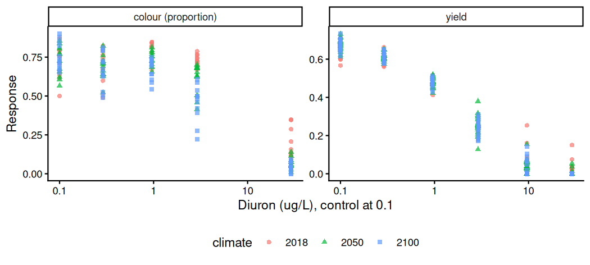
<p class="caption">plot of chunk fig-coral-raw</p>
</div>

Both responses decline with concentration. The yield panel has observations at every
one of its six concentrations. The colour panel has none between 2.9 and 29
µg/L, a full order of magnitude and the widest unsampled interval in either
endpoint.

The colour panel's top concentration is worth reading carefully, because it is
the only observation below the gap and so is the only thing that can place a
lower asymptote. At 29 µg/L the underlying photographs average 211 of 255 on
the grey scale at day 14, against 90 to 128 at every lower concentration. The
day-0 values run from 91 to 103 throughout, so those fragments started like the
others and ended white. @flores2021 record that all corals at 29 µg/L had died by day 10. The
point is real and the published fit uses it, but what it measures is a fragment
that has bleached completely rather than one on a declining curve.

The scenarios separate in the colour endpoint and barely at all in yield. Mean
colour at 2.9 µg/L runs 0.728, 0.611 and 0.456 from 2018 to 2100, and at 29
µg/L 0.173, 0.066 and 0.045. Mean yield differs by less than 0.015 between
scenarios at every concentration below 9.6.

@flores2021 reach the same conclusion from their own fits. Their colour index
EC50 falls from 6.05 µg/L under present-day conditions to 4.99 and 4.86, and
they put the probability that each later scenario lies below the first at 0.956
and 0.970. Their yield EC50 is 2.06, 2.02 and 2.03, and the matching
probabilities are 0.615 and 0.539, neither far from the 0.5 that would mean no
separation at all.

Climate is a fixed set of three levels of interest in themselves, so the route
for it is `bnec_group()`, the route the factor covariates take. The fits below
pool over it, which the yield result above licenses and the colour result does
not. That is a deliberate simplification: what these fits are used to show is
how the number of curve parameters behaves against a design of a given width,
and one curve per endpoint shows it most directly.

The yield endpoint has six concentrations and 54 chambers of five to eight
readings. `ogl(chamber)` is fitted to it over the whole set:


``` r
fit_pam <- bnec(yield ~ crf(log(diuron_adj), "all") + ogl(chamber),
                data = coral_pam, family = Beta(link = "identity"),
                seed = 228, refresh = 0)
```


``` r
fit_pam <- screen_models(fit_pam)
#> Dropping 3 of 15 candidate models that failed the sampler screen:
#>   -  nec3param: Rhat 1.213, ESS 13.7
#>   -  nechorme4: 34 divergent transitions
#>   -  ecxexp: 25 divergent transitions
#> Fitted models are: nec4param nechorme nechormepwr01 ecx4param ecxwb1 ecxwb2 ecxwb1p3 ecxwb2p3 ecxll5 ecxll4 ecxll3 ecxhormebc4
```

The screen drops three of the fifteen equations: `nec3param`, whose chains did
not converge (R-hat 1.21, effective sample size 14), and `nechorme4` and
`ecxexp`, on 34 and 25 divergent transitions.


``` r
summary(fit_pam)
#> Object of class bayesmanecfit
#> 
#>  Family: beta  
#>   Links: mu = identity  
#> 
#> Number of posterior draws per model:  8000
#> 
#> Model weights (Method: pseudobma_bb_weights):
#>                   waic   wi
#> nec4param     -1667.63 0.04
#> nechorme      -1665.85 0.01
#> nechormepwr01 -1665.32 0.01
#> ecx4param     -1663.47 0.01
#> ecxwb1        -1658.34 0.15
#> ecxwb2        -1667.78 0.03
#> ecxwb1p3      -1659.75 0.00
#> ecxwb2p3      -1660.24 0.00
#> ecxll5        -1657.64 0.10
#> ecxll4        -1662.58 0.01
#> ecxll3        -1651.78 0.00
#> ecxhormebc4   -1676.32 0.63
#> 
#> 
#> Summary of weighted N(S)EC posterior estimates:
#> NB: Model set contains a combination of ECx and NEC
#>     models, and is therefore a model averaged
#>     combination of NEC and NSEC estimates.
#>        Estimate  Q2.5 Q97.5
#> N(S)EC    -1.52 -2.09  0.72
#> 
#> 
#> Bayesian R2 estimates:
#>               Estimate Est.Error Q2.5 Q97.5
#> nec4param         0.98      0.00 0.98  0.98
#> nechorme          0.98      0.00 0.98  0.99
#> nechormepwr01     0.98      0.00 0.98  0.99
#> ecx4param         0.98      0.00 0.98  0.98
#> ecxwb1            0.98      0.00 0.98  0.98
#> ecxwb2            0.98      0.00 0.98  0.98
#> ecxwb1p3          0.98      0.00 0.98  0.98
#> ecxwb2p3          0.98      0.00 0.98  0.98
#> ecxll5            0.98      0.00 0.98  0.98
#> ecxll4            0.98      0.00 0.98  0.98
#> ecxll3            0.98      0.00 0.98  0.98
#> ecxhormebc4       0.98      0.00 0.98  0.99
```

As in the sections above, the N(S)EC in that summary is on the scale the model
was fitted on, `log(diuron_adj)`. `nsec()` and `ecx()` with `xform = exp` return
the NSEC and the effect concentrations in µg/L. The summary reads the NEC
equations by their `nec` parameter, and `nsec()` reads every equation by its
NSEC, so the two averages differ slightly.


``` r
# Bound once: the figure below draws its reference lines from the same NSEC.
pam_ne <- nsec(fit_pam, xform = exp)
rbind(
  data.frame(estimate = "NSEC", t(pam_ne)),
  data.frame(estimate = "EC10", t(ecx(fit_pam, ecx_val = 10, xform = exp))),
  data.frame(estimate = "EC50", t(ecx(fit_pam, ecx_val = 50, xform = exp)))
)
#>   estimate       Q50      Q2.5    Q97.5
#> 1     NSEC 0.2166200 0.1197926 2.085665
#> 2     EC10 0.4768297 0.4020541 2.140971
#> 3     EC50 1.9990215 1.8025923 2.733051
```

The three estimates are ordered as they should be --- 0.217, 0.477 and 1.999
µg/L --- and their upper bounds are not. The NSEC reaches 2.086 and the EC10
2.141, both above the EC50 median, while the EC50 interval is the narrowest of
the three at 1.803 to 2.733.

A model-averaged estimate is a mixture, and the median and the tail of a mixture
can be set by different components. Three equations hold 0.89 of the weight here
and all place the threshold low: `ecxhormebc4` (0.632) at 0.225 (0.120--0.292),
`ecxwb1` (0.152) at 0.178 (0.114--0.231) and `ecxll5` (0.104) at 0.182
(0.116--0.235). None has an upper bound above 0.3, and the averaged median of
0.217 is theirs. The averaged upper bound is not. `nec4param` places a threshold
at 2.106 (1.812--2.357) on a weight of 0.04. That is more than the 0.025 of the
mixture above its 97.5th percentile, and the percentile, 2.086, falls inside the
interval of `nec4param`. `ecxwb2` places its threshold at 1.606 (1.127--1.923)
on 0.03, wholly below that percentile. The tail is set by `nec4param` alone.

Each equation's own threshold, against the weight it holds, is below. The
estimator follows the equation: `nec()` where the equation has a `nec`
parameter, `nsec()` where it does not.


``` r
pam_wi <- summary(fit_pam)$mod_weights[, "wi"]
pam_thr <- do.call(rbind, lapply(names(pam_wi), function(m) {
  one <- pull_out(fit_pam, model = m)
  v <- if (m %in% models()$nec) nec(one, xform = exp) else nsec(one, xform = exp)
  data.frame(equation = m, wi = pam_wi[[m]], est = v[[1]], lo = v[[2]], hi = v[[3]])
}))
pam_thr$equation <- reorder(factor(pam_thr$equation), pam_thr$est)
pam_thr[order(-pam_thr$wi), ]
#>         equation          wi       est        lo        hi
#> 12   ecxhormebc4 0.632296110 0.2253004 0.1198070 0.2919767
#> 5         ecxwb1 0.152248197 0.1783674 0.1138664 0.2312553
#> 9         ecxll5 0.104445750 0.1818665 0.1163803 0.2354512
#> 1      nec4param 0.040203961 2.1061274 1.8122728 2.3572905
#> 6         ecxwb2 0.031898516 1.6064799 1.1271047 1.9231924
#> 4      ecx4param 0.010788705 0.7233387 0.4295838 0.9726407
#> 2       nechorme 0.007327807 0.6405761 0.5637219 0.7082179
#> 10        ecxll4 0.006234811 0.7123232 0.3848781 0.9396482
#> 3  nechormepwr01 0.005823848 0.6407759 0.5636155 0.7085278
#> 8       ecxwb2p3 0.004323472 0.7724442 0.5643879 0.9579842
#> 7       ecxwb1p3 0.002258370 0.1997385 0.1152668 0.2814606
#> 11        ecxll3 0.002150454 0.4185043 0.1879688 0.5619532

ggplot(pam_thr, aes(x = est, y = equation)) +
  annotate("rect", xmin = pam_ne[[2]], xmax = pam_ne[[3]],
           ymin = -Inf, ymax = Inf, fill = "#2c6a5a", alpha = 0.07) +
  geom_vline(xintercept = pam_ne[[1]], colour = "#2c6a5a") +
  geom_vline(xintercept = pam_ne[[3]], colour = "#2c6a5a", linetype = 2) +
  geom_linerange(aes(xmin = lo, xmax = hi, colour = wi)) +
  geom_point(aes(colour = wi, size = wi)) +
  scale_colour_gradient(low = "grey80", high = "#2c6a5a",
                        name = "model\nweight") +
  scale_size_area(max_size = 5, guide = "none") +
  log_x +
  theme_classic() +
  labs(x = "Threshold (µg/L)", y = NULL)
```

<div class="figure" style="text-align: center">
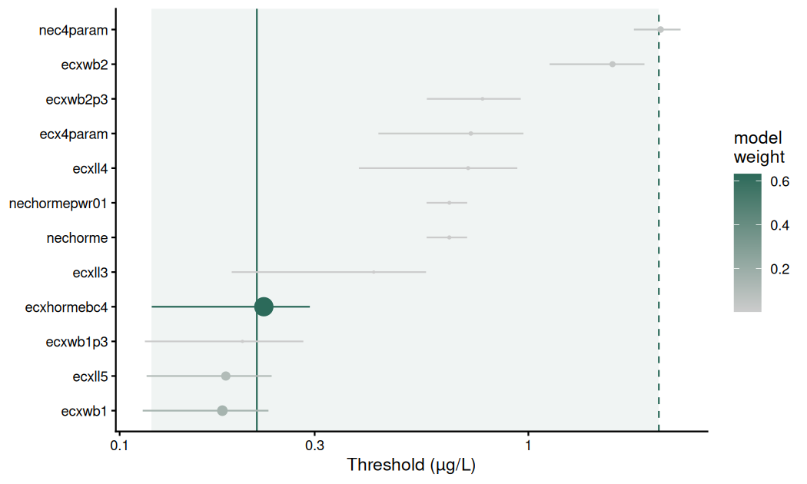
<p class="caption">plot of chunk fig-pam-thresholds</p>
</div>

The solid line is the model-averaged median and the dashed line its upper
bound, with the averaged interval shaded. The ordering is what the paragraph
above states in numbers: the three darkest points sit at the left of the range,
the two furthest to the right sit an order of magnitude away from them and are
pale, with `nec4param` on the dashed line itself, and between them the weight
is unrelated to the position. An
equation's threshold and the weight it holds are separate quantities, and that
is what lets 0.04 of the weight decide where the averaged interval ends.

The same draws are visible in the figure below. The credible band steps down at
about 2 µg/L, its upper edge falling from about 0.58 to about 0.30, because the
equations that place a threshold there hold the curve near the control until it
and drop afterwards. Less than a tenth of the weight has no effect on the median
and still decides where the interval ends, which is a reason to read a
model-averaged interval against the weights rather than on its own.


``` r
autoplot(fit_pam, group = "climate", group_aes = "colour") + log_x
```

<div class="figure" style="text-align: center">
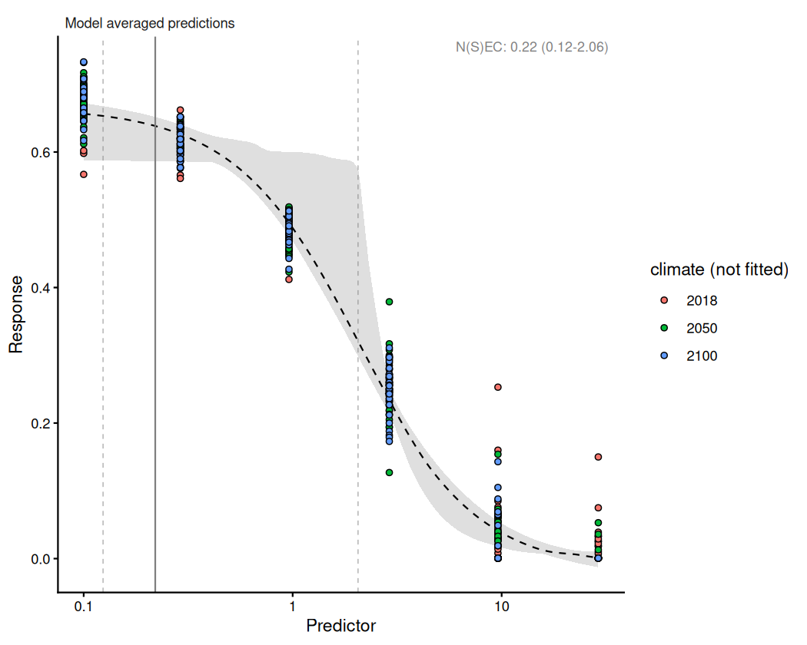
<p class="caption">plot of chunk fig-pam</p>
</div>

`climate` is not in the fitted formula --- the model estimates a deviation per
chamber, not per scenario --- so `autoplot()` takes it from the columns `bnec()`
retained from the supplied data and labels the legend "climate (not fitted)".
The curve and the band are pooled over the three scenarios, and the colour marks
the observations only.

The scenarios overlap over most of the series. The scenario means of `yield`
differ by at most 0.014 at 0.1, 0.29, 0.96 and 2.9 µg/L, and separate only at
9.6 and 29 µg/L, where they are 0.052, 0.040, 0.022 and 0.027, 0.006, 0.000 ---
a separation between quantities that have already fallen to a twelfth of the
control. @flores2021 report the same result from these data, giving a
probability of 0.615 and 0.539 that yield differs between the warming scenarios.

The colour endpoint has five concentrations and 45 chambers of four fragments.
Fitting equations of three and of four curve parameters to it separately shows
where the design runs out:


``` r
three_par <- bnec(proportion ~ crf(log(diuron_adj), c("ecxll3", "ecxwb1p3")) + ogl(chamber),
                  data = coral_colour, family = Beta(link = "identity"),
                  seed = 228, refresh = 0)

four_par <- bnec(proportion ~ crf(log(diuron_adj), c("nec4param", "ecx4param")) + ogl(chamber),
                 data = coral_colour, family = Beta(link = "identity"),
                 seed = 228, refresh = 0)
```


``` r
sampled_badly <- function(fit, label) {
  worst <- vapply(rhat(fit), function(x) max(x$rhat_vals), numeric(1))
  divergent <- vapply(names(worst), function(m) {
    np <- brms::nuts_params(pull_out(fit, model = m)$fit)
    sum(np$Value[np$Parameter == "divergent__"])
  }, numeric(1))
  data.frame(curve = label, equation = names(worst),
             divergent = divergent, max_rhat = round(worst, 4),
             row.names = NULL)
}
rbind(sampled_badly(three_par, "three parameters"),
      sampled_badly(four_par, "four parameters"))
#>              curve  equation divergent max_rhat
#> 1 three parameters    ecxll3         6   1.0042
#> 2 three parameters  ecxwb1p3         0   1.0024
#> 3  four parameters nec4param      4334   1.0995
#> 4  four parameters ecx4param      1024   1.0092
```

Neither three-parameter equation fails the screen: `ecxll3` records 6 divergent
transitions and `ecxwb1p3` none, and both have an R-hat of 1.004 or below.
`nec4param` records 4334 divergent transitions in its 8000 retained draws and
`ecx4param` 1024, at R-hats of 1.099 and 1.009. More than half of the
transitions of `nec4param` diverged, and an eighth of those of `ecx4param`.

A divergent transition is recorded where the sampler's step size is too large
for the curvature of the posterior at that point, so the simulated path departs
from the one the equations describe. A parameter the data do not constrain
produces exactly that curvature, in a posterior nearly flat along one direction
and sharp across it. R-hat asks a different question --- whether the chains of
one fit arrived at the same distribution --- and here it fails for `nec4param`
and passes for `ecx4param`.

R-hat alone would therefore pass `ecx4param`. At `bnec()`'s default run length
its R-hat is 1.009, inside the cutoff of 1.01 and within 0.007 of the two
three-parameter equations, while an eighth of its transitions diverged. Of the
two diagnostics in the table, only the divergent transitions report the problem.
On the single zinc plate they were also the only one of the three that
`check_sampling()` reports to fail `ecxexp`. A check read alone can pass an
equation that another check fails.


``` r
autoplot(three_par, group = "climate", group_aes = "colour") + log_x
```

<div class="figure" style="text-align: center">
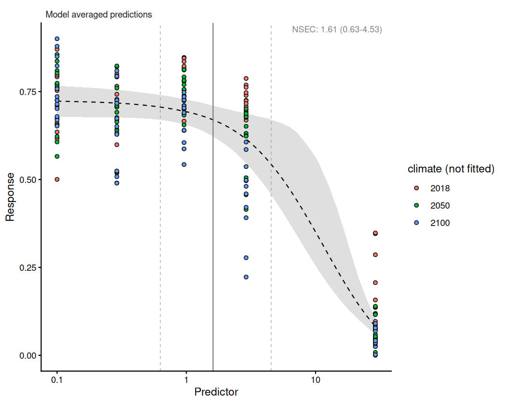
<p class="caption">plot of chunk fig-three-par</p>
</div>


``` r
autoplot(four_par, group = "climate", group_aes = "colour") + log_x
```

<div class="figure" style="text-align: center">
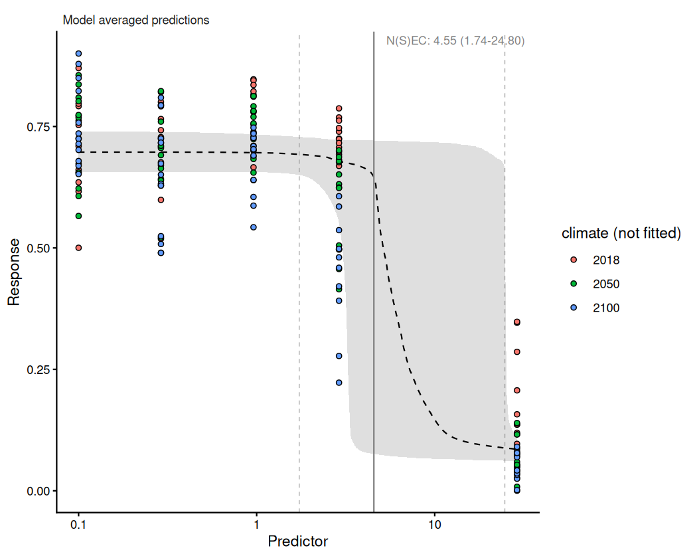
<p class="caption">plot of chunk fig-four-par</p>
</div>

The figures show where those divergences come from. Nothing between 2.9 and 29
µg/L tells a four-parameter equation where its lower asymptote sits, because the
colour design has no observation across that tenfold range. At 10 µg/L the
four-parameter credible band is 0.65 wide on a response that runs from 0 to
about 0.9, so it covers most of the values the endpoint can take; the
three-parameter band is 0.31 there. Both close to about 0.06 at the top of the
series, where the observations resume. A three-parameter equation fixes the
lower asymptote instead of estimating it, and so has nothing to place in the
gap.

The four-parameter equations are worse served than the gap alone suggests. What
they have to estimate a lower asymptote from is one concentration, and the
reading at that concentration is of fragments that had bleached completely.

The climate scenarios separate in these two figures where they did not in
`fit_pam`. The scenario means of `proportion` are 0.779, 0.737 and 0.672 at
0.96 µg/L and 0.728, 0.611 and 0.456 at 2.9, a spread of 0.27 on a response
running to about 0.9, and the 2100 points sit below the 2018 points at every
concentration above the control. @flores2021 report a probability of 0.956 and
0.970 that the colour index differs between the warming scenarios, against
0.615 and 0.539 for yield. Neither figure fits that difference: both curves are
pooled over the scenarios, and separating them would need `climate` in the
formula or a `bnec_group()` call over it.

The threshold estimates differ in the same way. The three-parameter set returns
an NSEC of 1.61 µg/L (0.63--4.53), as its figure reports. The four-parameter set
returns an N(S)EC of 4.55 (1.74--24.80): a median inside the unsampled interval
between 2.9 and 29 µg/L, and an upper bound of the same order as the highest
concentration tested, which is 29. Both sets were fitted to the same 180
observations.

#301 proposes restricting a model set by the number of curve parameters for
this reason.

The colour score has exactly one observation on the `Beta` boundary, which
follows from the rescaling described above, and the yield endpoint has 63
readings at zero.
Neither is a defect in the data; both are decisions about the response that have
to be made before the family is chosen, and `vignette("example6")` covers them.

# Case study 3

<small>*Phytotoxicity of photosystem II herbicides to coral*</small>

`herbicide` [@jones2003] holds the effective quantum yield of photosystem II in
the symbiotic dinoflagellates of the coral *Seriatopora hystrix*, measured after
a ten-hour exposure to each of seven photosystem II inhibiting herbicides. Three
replicate containers of four corals were held at each concentration. The report
is at <https://doi.org/10.3354/meps261149>.

The endpoint is the same quantity as `coral_pam`'s `yield`, and the two studies
are connected by more than that. @jones2003 found the effect of diuron to be
inversely related to temperature, which is the observation @flores2021 tested
two decades later by crossing diuron with warming.


``` r
data(herbicide)
ggplot(herbicide, aes(x = concentration, y = fvfm, colour = herbicide)) +
  geom_point(alpha = 0.6) +
  facet_wrap(~herbicide, ncol = 2, scales = "free_x") +
  log_x +
  scale_colour_hue(guide = "none") +
  theme_classic() +
  theme(panel.spacing.x = unit(1.2, "lines")) +
  labs(x = "Concentration (ug/L)", y = "Effective quantum yield")
```

<div class="figure" style="text-align: center">
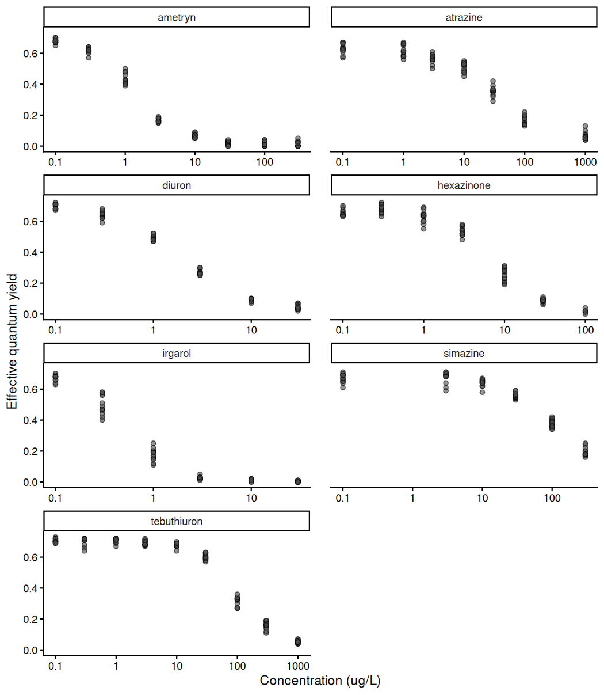
<p class="caption">plot of chunk fig-herbicide-raw</p>
</div>

Effective quantum yield declines with concentration in all seven, and the
concentration at which it does so differs by two orders of magnitude between
them. Yield is at half its lowest-dose mean by 1 µg/L of irgarol and 3 µg/L of
diuron or ametryn, against 100 µg/L of tebuthiuron and 300 of simazine, which is
the highest concentration simazine was tested at.

Seven herbicides are a fixed set chosen for their interest, not a sample from a
population of herbicides, so shrinking them towards a common curve answers a
different question from the one being asked, and their functional forms may
differ. `bnec_group()` fits each level separately and returns one object. This
call uses `decline` rather than `"all"`, which is what Figure 11 of @fisher2024
was fitted with.


``` r
fits_herb <- bnec_group(fvfm ~ crf(log(concentration), "decline"),
                        data = herbicide, group_var = "herbicide",
                        family = Beta(link = "identity"),
                        seed = 228, refresh = 0)
```

Each herbicide is screened separately because each was fitted separately. A
failed equation is removed from that herbicide without discarding successful
fits of the same equation for the other six.


``` r
fits_herb <- screen_models(fits_herb, group_action = "per_level")
#> Screening level "ametryn".
#> All 11 candidate models passed the sampler screen (Rhat <= 1.01, ESS >= 400, divergences <= 10).
#> Screening level "atrazine".
#> All 11 candidate models passed the sampler screen (Rhat <= 1.01, ESS >= 400, divergences <= 10).
#> Screening level "diuron".
#> All 11 candidate models passed the sampler screen (Rhat <= 1.01, ESS >= 400, divergences <= 10).
#> Screening level "hexazinone".
#> All 11 candidate models passed the sampler screen (Rhat <= 1.01, ESS >= 400, divergences <= 10).
#> Screening level "irgarol".
#> All 11 candidate models passed the sampler screen (Rhat <= 1.01, ESS >= 400, divergences <= 10).
#> Screening level "simazine".
#> All 11 candidate models passed the sampler screen (Rhat <= 1.01, ESS >= 400, divergences <= 10).
#> Screening level "tebuthiuron".
#> All 11 candidate models passed the sampler screen (Rhat <= 1.01, ESS >= 400, divergences <= 10).
```

Every equation passes for every herbicide, so each herbicide's model average is
taken over all eleven equations of `decline`.

`summary()` on a `bayesnecgroupfit` prints a full summary for every level, which
for seven herbicides is several hundred lines. What the sections below draw on
is the model weights, and those are worth seeing together:


``` r
herb_wi <- do.call(rbind, Map(function(f, lev) {
  w <- summary(f)$mod_weights[, "wi"]
  data.frame(herbicide = lev, equation = names(w), wi = as.numeric(w))
}, fits_herb$fits, fits_herb$levels))
# Ordered by the weight each equation takes over all seven, so that the
# equations the set actually uses sit together at the top.
herb_wi$equation <- reorder(factor(herb_wi$equation), herb_wi$wi, sum)

ggplot(herb_wi, aes(x = herbicide, y = equation, fill = wi)) +
  geom_tile(colour = "white", linewidth = 0.4) +
  geom_text(aes(label = ifelse(wi >= 0.05, sprintf("%.2f", wi), "")),
            size = 2.7, colour = "grey15") +
  scale_fill_gradient(low = "white", high = "#2c6a5a", name = "weight",
                      limits = c(0, 1)) +
  theme_classic() +
  theme(axis.text.x = element_text(angle = 30, hjust = 1),
        axis.line = element_blank(), axis.ticks = element_blank()) +
  labs(x = NULL, y = NULL)
```

<div class="figure" style="text-align: center">
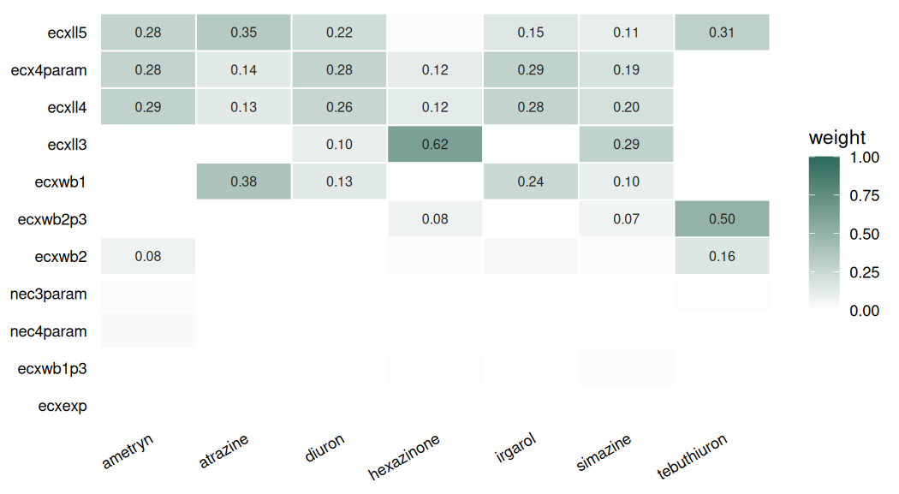
<p class="caption">plot of chunk fig-herb-weights</p>
</div>

The seven do not agree on which equation describes them. Tebuthiuron puts half
its weight on `ecxwb2p3`, which takes no more than 0.08 anywhere else, and
hexazinone puts 0.62 on `ecxll3`, which four of the others give less than 0.05.
Counting the labelled cells, those of 0.05 or more, ametryn and irgarol spread
their weight over four equations, diuron over five and simazine over six, and no
equation holds more than 0.29 at any of the four. That
is the case for fitting the levels separately rather than shrinking them towards
a common curve: the curve they would be shrunk towards is not one the data agree
on.

Toxicity estimates for the seven herbicides span two orders of magnitude.
`nec()` returns each herbicide's N(S)EC, back-transformed from the fitted scale:


``` r
nec(fits_herb, xform = exp)
#>         level        Q50      Q2.5      Q97.5 bound_Q50 bound_Q2.5 bound_Q97.5
#> 1     ametryn  0.1977117 0.1200018  0.6190542                                 
#> 2    atrazine  1.1204227 0.3391386  2.4749705                                 
#> 3      diuron  0.1518601 0.1101068  0.1952373                                 
#> 4  hexazinone  0.6309808 0.2358972  1.6390054                                 
#> 5     irgarol  0.1352690 0.1065716  0.1744017                                 
#> 6    simazine  4.3910362 1.1747670 11.4193765                                 
#> 7 tebuthiuron 10.5215413 4.2807827 14.0294702
```

It runs from irgarol at 0.135 µg/L (0.107--0.174) and diuron at 0.152
(0.110--0.195), through ametryn at 0.198, hexazinone at 0.631 and atrazine at
1.120, to simazine at 4.391 and tebuthiuron at 10.522 (4.281--14.029).

The N(S)EC is a threshold, the concentration at which the response first departs
from the control, and it is not what @jones2003 report. They report EC50s, the
concentration at which yield is halved, so the comparison with the source study
is against `ecx()`:


``` r
ecx(fits_herb, ecx_val = 50, xform = exp)
#>         level         Q50        Q2.5       Q97.5 bound_Q50 bound_Q2.5 bound_Q97.5
#> 1     ametryn   1.4979215   1.4119204   1.6003311                                 
#> 2    atrazine  39.4891915  34.9655932  44.3233018                                 
#> 3      diuron   2.0375062   1.9023437   2.1945167                                 
#> 4  hexazinone   7.4290120   6.7643451   8.1054997                                 
#> 5     irgarol   0.5397205   0.4909131   0.5984148                                 
#> 6    simazine 123.6660452 112.2513566 135.7756253                                 
#> 7 tebuthiuron  90.4028480  84.0568413  95.4276526
```

Their values are irgarol 0.7 µg/L, ametryn 1.7, diuron 2.3, hexazinone 8.8,
atrazine 45, simazine 150 and tebuthiuron 175. Six of the seven agree closely,
the published figure sitting between 13 and 30 per cent above the one here, and
the ordering of those six is the same in both. Tebuthiuron is the exception at
roughly half the published value, and it is also the herbicide whose ordering
differs: here it is more toxic than simazine, and in the source study less so.

The two are not derived the same way. @jones2003 interpolate linearly between
the tested concentrations, in ToxCalc 5.0, while the values above come from a
model average over eleven fitted curves. Linear interpolation across a
log-spaced series cuts the chord of a curve that is concave over that interval,
which places the half-effect concentration higher than a fitted curve does, and
the published value is higher in all seven. That six of the seven agree within a
third is the agreement worth having. Nothing in these data settles which
estimate is closer to the truth for tebuthiuron.


``` r
ggplot(group_curves(fits_herb), aes(x = x_e, colour = level, fill = level)) +
  geom_polygon(aes(y = y_ci), colour = NA, alpha = 0.3) +
  geom_line(aes(y = y_e), linetype = 2) +
  geom_point(aes(x = x_r, y = y_r), alpha = 0.6, size = 1.2) +
  geom_vline(aes(xintercept = nec_vals), colour = "grey50") +
  facet_wrap(~level, ncol = 2, scales = "free_x") +
  log_x +
  scale_colour_hue(guide = "none") +
  scale_fill_hue(guide = "none") +
  theme_classic() +
  theme(panel.spacing.x = unit(1.2, "lines")) +
  labs(x = "Concentration (ug/L)", y = "Effective quantum yield")
```

<div class="figure" style="text-align: center">
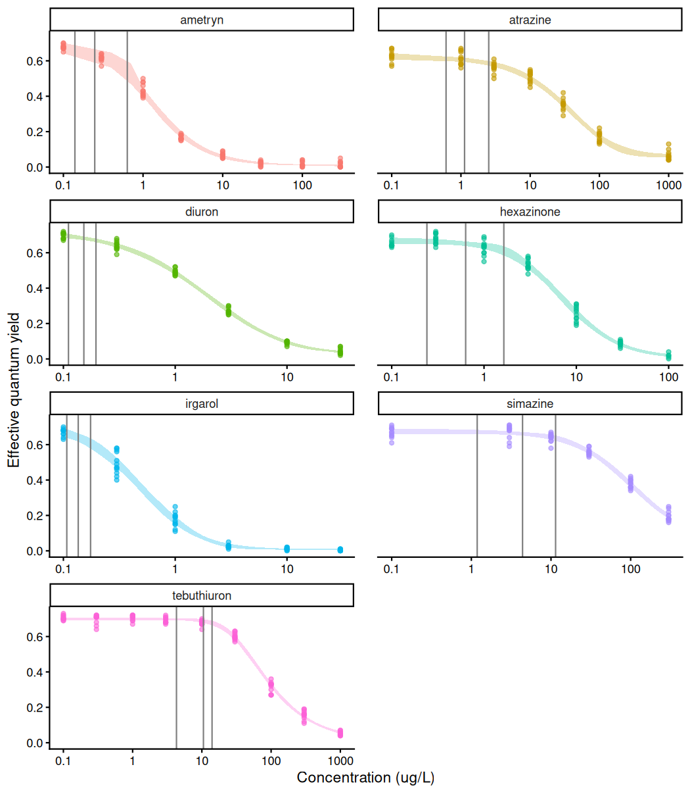
<p class="caption">plot of chunk fig-herbicides</p>
</div>

Yield declines with concentration in all seven, and the fitted band follows the
observations down in each, with the N(S)EC rule at or a little before the
concentration where the points leave the control level. The response axis is shared and the concentration axis
is not, so the panels are comparable in level and not in position: the seven
curves have much the same shape and sit at different concentrations. Fitting
each level separately is what allows the shape to differ between them. Here it
largely does not, and what separates the herbicides is where the curve falls
rather than how.


``` r
cmp_herb <- compare_posterior(fits_herb, comparison = "n(s)ec")
cmp_herb$prob_diff
#>                comparison        prob  prob_lower  prob_upper censored_first censored_second
#> 1        ametryn-atrazine 0.017752219 0.017752219 0.017752219              0               0
#> 2          ametryn-diuron 0.848981123 0.848981123 0.848981123              0               0
#> 3      ametryn-hexazinone 0.039754969 0.039754969 0.039754969              0               0
#> 4         ametryn-irgarol 0.926990874 0.926990874 0.926990874              0               0
#> 5        ametryn-simazine 0.011626453 0.011626453 0.011626453              0               0
#> 6     ametryn-tebuthiuron 0.008251031 0.008251031 0.008251031              0               0
#> 7         atrazine-diuron 0.988373547 0.988373547 0.988373547              0               0
#> 8     atrazine-hexazinone 0.837479685 0.837479685 0.837479685              0               0
#> 9        atrazine-irgarol 0.989498687 0.989498687 0.989498687              0               0
#> 10      atrazine-simazine 0.034879360 0.034879360 0.034879360              0               0
#> 11   atrazine-tebuthiuron 0.008876110 0.008876110 0.008876110              0               0
#> 12      diuron-hexazinone 0.012501563 0.012501563 0.012501563              0               0
#> 13         diuron-irgarol 0.726715839 0.726715839 0.726715839              0               0
#> 14        diuron-simazine 0.011001375 0.011001375 0.011001375              0               0
#> 15     diuron-tebuthiuron 0.008251031 0.008251031 0.008251031              0               0
#> 16     hexazinone-irgarol 0.988873609 0.988873609 0.988873609              0               0
#> 17    hexazinone-simazine 0.018002250 0.018002250 0.018002250              0               0
#> 18 hexazinone-tebuthiuron 0.008376047 0.008376047 0.008376047              0               0
#> 19       irgarol-simazine 0.010751344 0.010751344 0.010751344              0               0
#> 20    irgarol-tebuthiuron 0.008376047 0.008376047 0.008376047              0               0
#> 21   simazine-tebuthiuron 0.086510814 0.086510814 0.086510814              0               0
```

`prob_diff` gives the probability that the first level of each pair has the
higher estimate, so a value near 0 or 1 separates two herbicides and one near
0.5 does not. Of the 21 pairs the clearest are those of tebuthiuron against the
five most potent herbicides, from 0.0083 for ametryn and diuron to 0.0089 for
atrazine. The least separated is diuron against irgarol at 0.727, the two most
potent of the set, whose intervals overlap over most of their length; the next
are atrazine against hexazinone at 0.837 and ametryn against diuron at 0.849.

The 21 pairwise probabilities reduce seven posteriors to one number each, and
those posteriors are in `posterior_data`:


``` r
# Figure 11 of Fisher et al. (2024) is this display for these seven herbicides,
# and this reproduces it. The posteriors are on the fitted scale, log(ug/L), and
# exp() returns them to concentration so that the axis reads in the units the
# estimates are reported in, as every other figure here does.
herb_post <- cmp_herb$posterior_data
herb_post$value <- exp(herb_post$value)

ggplot(data = herb_post, mapping = aes(x = value)) +
  geom_density(mapping = aes(group = model, colour = model, fill = model),
               alpha = 0.3) +
  log_x +
  theme_classic() +
  labs(x = "Concentration (ug/L)", y = "Density",
       fill = "Model", colour = "Model")
```

<div class="figure" style="text-align: center">
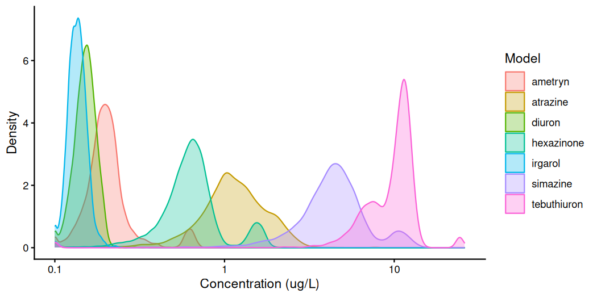
<p class="caption">plot of chunk fig-cmp-herbicides</p>
</div>

This reproduces Figure 11 of @fisher2024. Two things the pairwise probabilities
do not say are visible in the densities.

The two most potent overlap almost entirely. Irgarol at 0.135 and diuron at
0.152 have intervals of 0.107 to 0.174 and 0.110 to 0.195, so one sits almost
inside the other; that is what a `prob_diff` of 0.727 looks like as a
distribution. Ametryn overlaps both only in part: its median, 0.198, lies above
both of their upper bounds, and its interval runs on to 0.619.

The posteriors differ in width as much as in position. From end to end,
irgarol's interval spans a factor of 1.6 and diuron's 1.8, against 9.7 for
simazine and 7.3 for atrazine. Hexazinone and simazine are a factor of seven
apart in median and still overlap, because both are poorly determined:
hexazinone's interval spans a factor of 6.9.

Several are bimodal. Tebuthiuron has a second mode near 7 µg/L, simazine one
near 10 and hexazinone one near 1.6, which is the model-averaging mixture traced
in `fit_pam`: a low-weight equation placing its threshold elsewhere, visible in
the tail of the average and not in its median.

The pairing matters for what this comparison may be used on. `compare_posterior()`
pairs the draws of two posteriors by a random permutation, which approximates the
difference of two independent posteriors and is valid only where the posteriors
come from separate fits. `bnec_group()` fits every level separately, so that
holds here.

The two `bnec_group()` fits are screened per level, as specified in their calls.
Their independently fitted levels can retain different equation sets when an
equation samples adequately for one level and fails for another. Two levels of
a single fit share draws, and permuting them discards
the correlation between them, widening the difference and pulling `prob_diff`
towards 0.5 --- so a contrast between parts of one fit needs draw-wise
differencing and must not be routed through this function.

## Contrasts from a joint refit

That restriction is what a joint refit removes. `bnec_joint()` takes the
per-level fits and builds one model that includes every level at once, each level
keeping the equation its own weights favour and its own copy of that equation's
parameters. A difference between two levels is then a difference between
coefficients of one fit, taken draw by draw, and it needs no permutation.

No equation is named here. Each level's is read from the weights the
`bnec_group()` fit already computed, so the refit is of what each herbicide
separately favoured rather than of one form imposed on all seven. The call comes
after `screen_models()` above, so it refits the screened set --- the equations
each herbicide retained --- and not the set as first fitted.


``` r
herb_joint <- bnec_joint(fits_herb, seed = 228, refresh = 0)
```


``` r
herb_joint
#> Object of class bayesnecjointfit
#> 
#>   equations         : ametryn = ecxll4, atrazine = ecxwb1, diuron = ecx4param, hexazinone = ecxll3, irgarol = ecx4param, simazine = ecxll3, tebuthiuron = ecxwb2p3 
#>   grouping variable : herbicide 
#>   levels            : ametryn, atrazine, diuron, hexazinone, irgarol, simazine, tebuthiuron 
#>   family            : beta (link = identity) 
#>   dispersion        : per level 
#>   weight at level   : ametryn 0.293, atrazine 0.383, diuron 0.279, hexazinone 0.623, irgarol 0.291, simazine 0.292, tebuthiuron 0.504 
#> 
#> Each level has its own equation and its own curve parameters in
#> one posterior; read them from the draws as
#> b_<parameter><level tag>_Intercept, the tags being ametryn = ametrynLv1, atrazine = atrazineLv2, diuron = diuronLv3, hexazinone = hexazinoneLv4, irgarol = irgarolLv5, simazine = simazineLv6, tebuthiuron = tebuthiuronLv7.
#> ecx(), nsec() and nec() return one row per level, and autoplot()
#> draws one panel per level.
```

Five different equations are composed across the seven herbicides: `ecxll4`
for ametryn, `ecxwb1` for atrazine, `ecx4param` for diuron and irgarol, `ecxll3`
for hexazinone and simazine, and `ecxwb2p3` for tebuthiuron. That is the
reason to build the model this way rather than to fit one equation to all of
them. It is also what the herbicide set looks like generally: the weight each
chosen equation holds at its own level runs from 0.279 for diuron to 0.623 for
hexazinone, and is below 0.4 for five of the seven.

Every estimate from a joint refit reports per level, one row each, which is the
shape `bnec_group()` returns.


``` r
ecx(herb_joint, ecx_val = 50, xform = exp)
#>         level         Q50        Q2.5       Q97.5 bound_Q50 bound_Q2.5 bound_Q97.5
#> 1     ametryn   1.5040983   1.4216626   1.6062783                                 
#> 2    atrazine  40.0880590  35.9270004  44.5171742                                 
#> 3      diuron   2.0212941   1.9027720   2.1445013                                 
#> 4  hexazinone   7.4412827   6.8529383   8.0858175                                 
#> 5     irgarol   0.5379826   0.4939557   0.5946915                                 
#> 6    simazine 126.6209286 117.1441126 136.7584620                                 
#> 7 tebuthiuron  90.9676220  86.7387337  95.2485272
```

The contrast is then taken on the draws. `posterior = TRUE` returns the
per-level draws as a named list, and because they come from one fit they are
already aligned: draw *i* of one level and draw *i* of another were taken at the
same step of the same chain.


``` r
herb_draws <- ecx(herb_joint, ecx_val = 50, posterior = TRUE, xform = exp)
diuron_irgarol <- herb_draws[["diuron"]] - herb_draws[["irgarol"]]
c(prob_diuron_higher = mean(diuron_irgarol > 0),
  median_difference = median(diuron_irgarol),
  quantile(diuron_irgarol, c(0.025, 0.975)))
#> prob_diuron_higher  median_difference               2.5%              97.5% 
#>           1.000000           1.481583           1.353796           1.613279
```

Diuron exceeds irgarol in every draw, by 1.48 µg/L (1.35 to 1.61). Read on the
N(S)EC instead --- the quantity `compare_posterior()` was given above --- the
same pair gives:


``` r
herb_ne_draws <- nsec(herb_joint, posterior = TRUE, xform = exp)
diuron_irgarol_ne <- herb_ne_draws[["diuron"]] - herb_ne_draws[["irgarol"]]
c(prob_diuron_higher = mean(diuron_irgarol_ne > 0),
  median_difference = median(diuron_irgarol_ne),
  quantile(diuron_irgarol_ne, c(0.025, 0.975)))
#> prob_diuron_higher  median_difference               2.5%              97.5% 
#>         0.79162500         0.01951490        -0.03127141         0.06660047
```

a probability of 0.79 that diuron's is the higher, with a median difference of
0.020 µg/L (-0.031 to 0.067). `compare_posterior()` gave 0.727. The two routes
agree in direction, and neither separates this pair on the N(S)EC.

That split between the two estimates is the one the zinc case study met as well.
An ECx is a fixed drop from each level's own control and is read where the curve
is steep; the N(S)EC is a departure from a control band, and a small shift in
where that band ends puts the crossing a long way further along a curve that is
nearly flat there.

The joint refit sampled without difficulty, across a model estimating five
distinct functional forms and a separate dispersion for each of seven levels:


``` r
np <- brms::nuts_params(herb_joint$fit)
s_joint <- summary(herb_joint$fit)
pars <- rbind(s_joint$fixed, s_joint$spec_pars)
c(divergent = sum(np$Value[np$Parameter == "divergent__"]),
  post_warmup_draws = sum(np$Parameter == "divergent__"),
  max_rhat = max(pars$Rhat), min_bulk_ess = min(pars$Bulk_ESS))
#>         divergent post_warmup_draws          max_rhat      min_bulk_ess 
#>          0.000000       8000.000000          1.001624       5372.675436
```

no divergent transitions in 8000 post-warmup draws, a maximum R-hat of 1.002 and
a minimum bulk effective sample size of 5373.

One caution survives all of this. A joint refit conditions on one equation per
level, so the model uncertainty the per-level averages represent is absent from
it. Here the difference is small: irgarol's EC50 spans 0.494 to 0.595 µg/L in
the joint refit, a factor of 1.20, against 0.491 to 0.598 and a factor of 1.22
from `fits_herb`, because the equations irgarol's weight is spread over agree
closely on its EC50. Where they disagree, the joint refit's interval is narrower
than the per-level one by that disagreement. Where the chosen equation holds
most of a level's weight, that narrowing is a real gain in precision. Where it
holds 0.291, as irgarol's does, it would be uncertainty set aside rather than
resolved.

The two routes therefore answer different questions, and neither is a correction
of the other. `compare_posterior()` asks how two independently estimated
herbicides compare, each with its own model uncertainty, which is what a
reader wants when the seven were tested separately and are being ranked. The
joint refit asks how two levels of one model compare, holding the dispersion
structure and the sampling common between them, which is what a reader wants
when the question is whether these two differ. The herbicide case study reports
the model-averaged per-level estimates for the first reason; a controlled
contrast --- a treatment against its control, two sites of one experiment ---
is the second.


# Choosing a route for a factor

Three routes fit a factor, and they answer different questions. The choice is
made from the question rather than from the data, because all three will return
an answer on any dataset with enough levels.

| the question | the route | the call |
|---|---|---|
| Does the shape of the curve differ between levels? | separate fits | `bnec_group(y ~ crf(x, "all"), group_var = "site")` |
| What is the population curve, with the differences between levels treated as nuisance? | a group-level term | `y ~ crf(x, "all") + ogl(site)` |
| What is the difference between two named levels, within one posterior? | a joint refit | `bnec_joint(fits)` on a `bnec_group()` fit |

Separate fits are the only route that lets the functional form differ between
levels. Each level gets its own model set and its own weights, so one level may
be described by `nec3param` and another by `ecxll5`, and the herbicide case
study above is that case. In exchange nothing is shared: each level is
estimated from its own data alone, and a level with few observations is
estimated imprecisely.

A group-level term shares everything except the deviations it names. It is the
route for a grouping that is a nuisance rather than a subject --- plates,
chambers, tanks --- where the levels are exchangeable and the question is about
the population curve rather than about any level. `ogl()` displaces the whole
curve, `pgl()` gives every parameter its own deviation, and `(par | group)`
names one parameter. The zinc case study above chooses between them by fitting
all three and reading the group-level standard deviations, which is the general
method: the term is a claim about which differences exist, and the standard
deviations say whether the data support it.

A joint refit estimates every level's curve parameters in one posterior, with
no pooling between them. It is reached from a `bnec_group()` fit rather than
from a formula, so the equation is chosen against the per-level model weights
before it is refitted. Two things follow that neither other route gives. A
contrast between levels is a difference within one posterior rather than
between two independent ones, so it can condition on what the levels share.
And the dispersion can be estimated across levels rather than per level, which
is the right model where the measurement error is a property of the assay and
not of the level. See `?bnec_joint`.

The comparison in *Within-concentration grouping* and *Across-concentration
grouping* above is between the first two routes on one dataset, and its result
does not transfer: `ogl(conc_group)` widened the intervals and `ogl(plate)`
narrowed them, on the same response, because a grouping whose levels sit at one
concentration and a grouping whose levels span the series have different work to
do. What transfers is the method, which is to fit the alternatives and read the
standard deviations rather than to argue from the design.


# Provenance

Every fit shown was made when this vignette was precompiled, so the estimates
are those of the package version it ships with. The session that produced them
is recorded below.


``` r
packageVersion("bayesnec")
#> [1] '2.1.3.41'
packageVersion("brms")
#> [1] '2.23.0'
R.version.string
#> [1] "R version 4.6.1 (2026-06-24)"
```

The fits use `model = "all"`, which `bnec()` filters to the equations valid for
the family and predictor. Three groups of calls do not. The herbicide call uses
`decline`, to match Figure 11 of @fisher2024. The parameter-count contrast on
`coral_colour` names two equations on each side, because the contrast is the
point. The named-parameter fits on `zn15` name `nec3param` and `nec4param`. No
call names `iter`, `warmup` or `control`, so `bnec()`'s defaults apply: 4 chains
at 10000 iterations with 8000 warmup, under `seed = 228`. `bnec()` also raises
`adapt_delta` from Stan's 0.8 to 0.99 of its own accord for an equation whose
mean a group-level term could still place outside the family's support. Here
that is the hormesis equations `nechorme`, `nechorme4`, `nechormepwr01` and
`ecxhormebc4` in the fits with a group-level term; the other equations sampled
at 0.8. Under the package's previous default priors, `ecxll5` returned 880
divergent transitions of 16000 on the single-plate fit at 0.8. It now returns
none on that fit at the same 0.8, and holds 0.12 of the weight.

@luter2025 sampled the published `lum31` analysis longer again, at 20000
iterations with 19000 warmup and `adapt_delta = 0.99` named explicitly.

`ecxhormebc5` is excluded before fitting wherever the predictor reaches a
negative value and the response family requires a positive mean on an identity
link. Its hormesis term `exp(slope) * x` is negative wherever the predictor is,
and a starting value drawn from the prior then puts the mean below zero, which
neither a Gamma nor a `Beta` on an identity link can represent. That covers
every fit in this vignette on a logged predictor: the `lum31` concentrations
are in mg/L and negative on the log scale for 60 per cent of the zinc readings
at 15 minutes and 74 per cent of the copper ones,
and `log(diuron_adj)` is negative below 1 µg/L. `necsigm` and `ecxsigm` are
excluded on the same predictor for a different reason, that a fractional power
of a negative number is undefined. See #344.

`lum31` was built from the AIMS data repository deposit accompanying
@luter2025 by `data-raw/lum31.R`. `coral_colour` and `coral_pam` were built from
the records behind @flores2021 by `data-raw/coral_diuron.R`. Neither set of
source records is distributed with the package: the scripts are, and the
manual pages state what was derived and how.

# References
