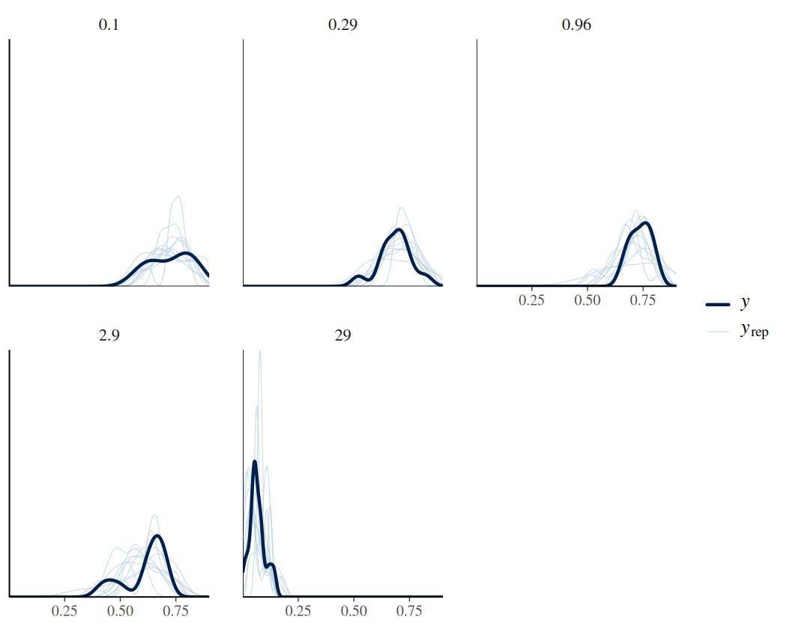
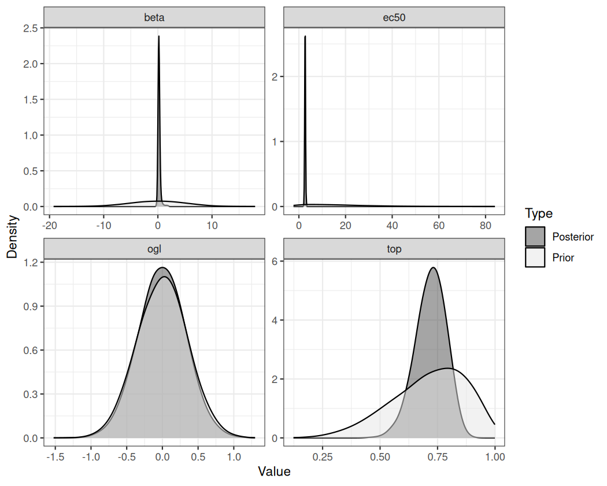
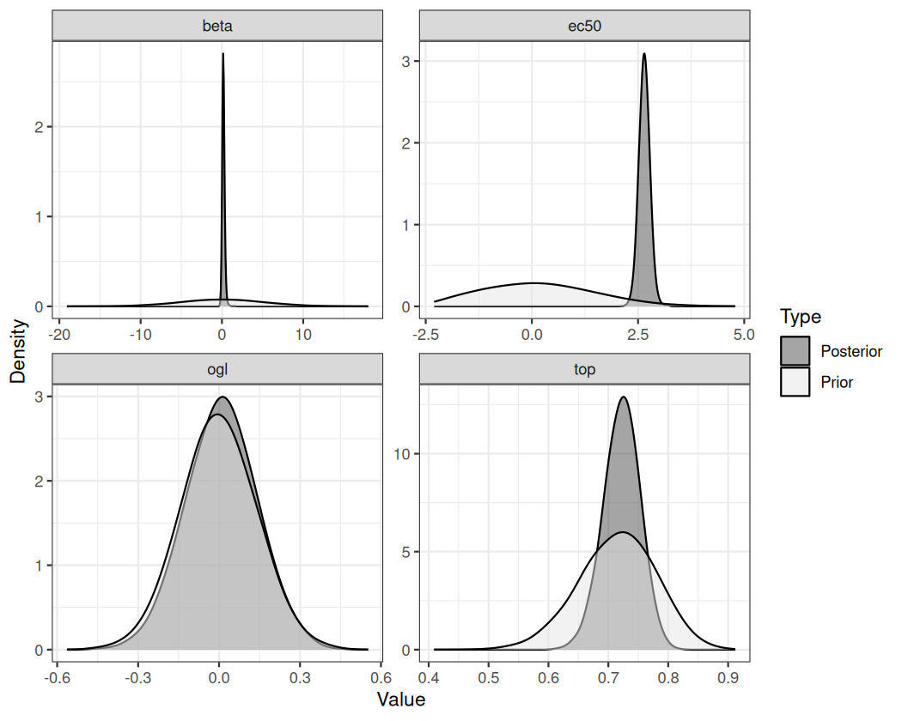
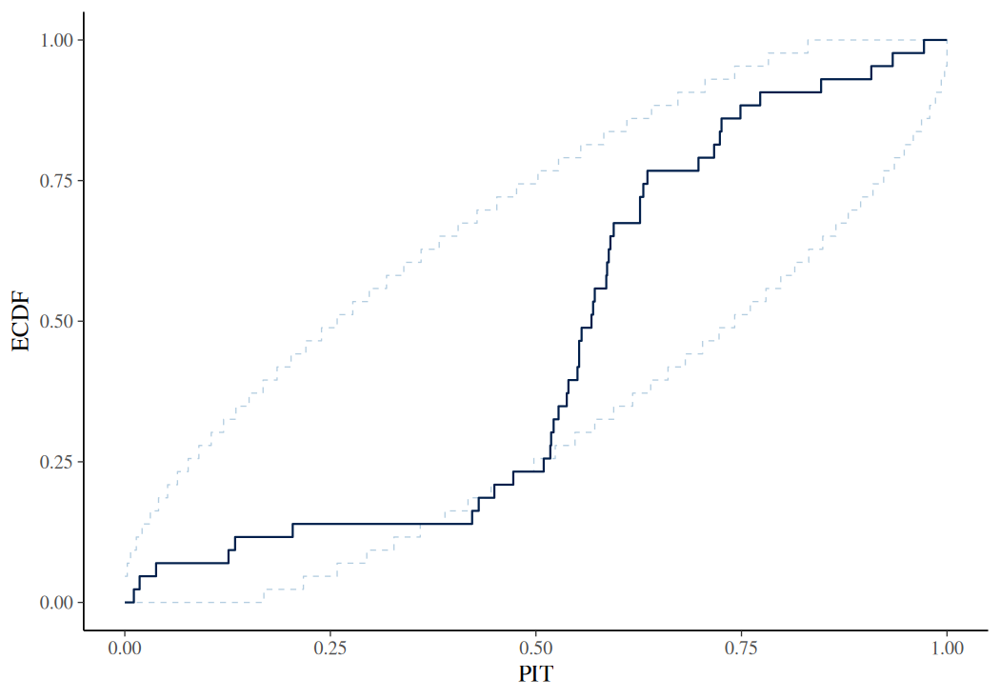
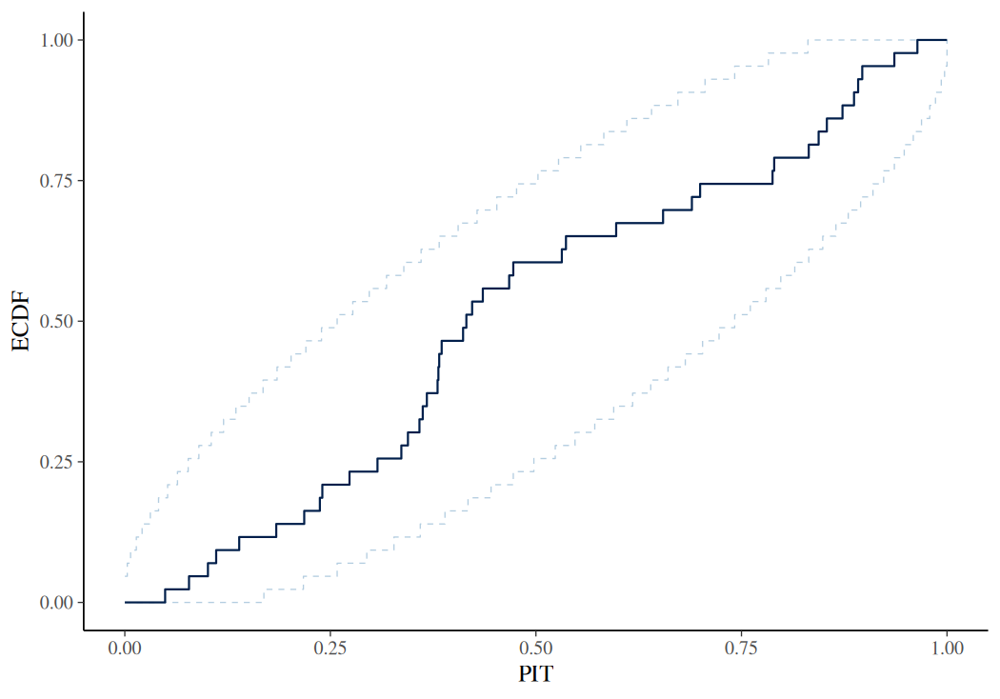
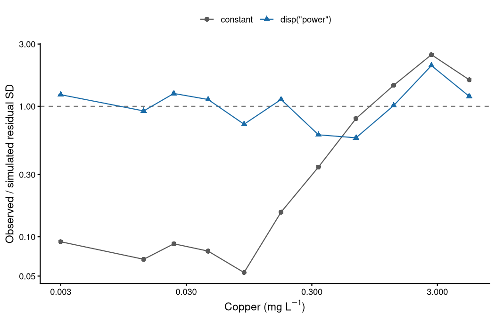

# Overview

The other vignettes each explain one part of `bayesnec` (what the model set is,
what a `bayesmanecfit` is, how priors are built, and how to handle a two-block
response). Here we run one analysis from the data through to a reportable
estimate, taking the steps in the order in which they occur:

1. Prepare the data and choose the family.
2. Fit the candidate set.
3. Check the sampler, and screen out the models that did not sample adequately.
4. Check the fit of the models that remain.
5. Report.

A review of the priors belongs before fitting, and a sensitivity comparison
follows the fitted diagnostics in step 5. `check_priors()` and the
construction of the default priors are described in the
[*Priors*](https://open-aims.github.io/bayesnec/articles/example3.html) vignette.

## The assumptions the diagnostics test

A Bayesian fit is usually judged on convergence, although convergence is not the
only thing that can be wrong with it. `rhat()`, `check_chains()` and
`check_sampling()` ask whether the sampler explored the posterior, and `loo` and
`waic` rank the candidate equations against one another. However, none of them
asks whether the variability implied by the fitted model matches the variability
in the data, and a threshold estimate depends on that assumption more than on any
other.

The *NSEC* depends on it most directly. `nsec()` sets its reference at a quantile
of the posterior of the control mean, and the width of that posterior is set by
the dispersion estimated at the control. If a model simulates more variability at
the control than the data show, the reference is placed lower, so the curve
crosses it further along and the reported concentration is higher and less
protective. If a model simulates less variability, the reference is placed higher
and a lower concentration is returned. The direction of the error is not known in
advance, and no convergence diagnostic reveals it (this point is also made, for
the choice between constant and non-constant dispersion, in [*Single model
usage*](https://open-aims.github.io/bayesnec/articles/example1.html)). The ECx
depends on this assumption less. Although it is also measured from the control
mean, it is measured at a fixed fraction of that mean and not at a quantile of its
posterior, so an error in the variance widens or narrows the ECx interval without
relocating the reference it is measured from.

A single ratio statistic for the whole fit does not detect this kind of error.
Each family with a free dispersion parameter (i.e., `gaussian`, `Gamma`,
`negbinomial`, `Beta` and `beta_binomial`) estimates that parameter from the
residuals that such a statistic summarises. The parameter therefore absorbs the
discrepancy, so that the ratio is near 1 while the fit simulates the wrong spread
at the concentrations that determine the estimate. For this reason the check is
made within concentration groups, which is what `check_fit()` does.

## The effect of exclusion

[*Multi model usage*](https://open-aims.github.io/bayesnec/articles/example2.html)
notes that there is little harm in leaving a poorly *shaped* model in the set with
a low weight. This is true for shape, but not for convergence. A model that has
not sampled contributes to the averaged prediction on the basis of a posterior the
sampler never explored, and because its weight is computed from that same
posterior, the weight provides no evidence that it is safe to keep. Removing such
a model changes the candidate set. `amend()` then recomputes the weights across
the models that remain (it does not rescale the weights of those retained), and
the reported *N(S)EC* changes accordingly.

Which models a screen will remove cannot be predicted before it is run, and the
reasons for removal differ between them. An equation given too few draws, an
equation whose posterior the sampler cannot traverse, and an equation the design
does not support are all reported under one failure flag, although
the appropriate response to each is different.

## Coverage

Steps 1 to 5 are worked on one climate level of `coral_colour`, including a
comparison of default and regularising priors. Two further responses follow. The
first is a count response, for which both the choice of family and the sampler
screen take a different form. The second is a response whose coefficient of
variation is not constant, although the family assumes that it is; here the
departure is detected with a posterior check, and corrected with a term written in
the model formula.

The threshold estimates themselves (*NEC*, *NSEC*, ECx, and the model-averaged
*N(S)EC* reported when a set mixes both kinds) are defined, together with the
candidate equations, in [*Model
details*](https://open-aims.github.io/bayesnec/articles/example2b.html).


``` r
library(bayesnec)
library(ggplot2)
```

# 1. Data preparation and family choice

The `coral_colour` data record a colour score for fragments of *Acropora
millepora* after 14 days of diuron exposure under three climate scenarios
[@flores2021]. A lower proportion indicates loss of colour. Here we use the
2050 scenario. The comparison among
scenarios, and a second endpoint measured on those fragments, are described
in [*Comparing posterior predictions*](https://open-aims.github.io/bayesnec/articles/example4.html).


``` r
data(coral_colour)
colour_2050 <- droplevels(subset(coral_colour, climate == "2050"))
with(colour_2050, table(diuron, chamber))
#>       chamber
#> diuron c16 c17 c18 c19 c20 c21 c22 c23 c24 c25 c26 c27 c28 c29 c30
#>   0      4   4   4   0   0   0   0   0   0   0   0   0   0   0   0
#>   0.29   0   0   0   4   4   4   0   0   0   0   0   0   0   0   0
#>   0.96   0   0   0   0   0   0   4   4   4   0   0   0   0   0   0
#>   2.9    0   0   0   0   0   0   0   0   0   4   4   4   0   0   0
#>   29     0   0   0   0   0   0   0   0   0   0   0   0   4   4   4
```

The design has five concentrations (four treatments and an untreated control:
0, 0.29, 0.96, 2.9 and 29 µg/L), with 12 fragments at each concentration.
Four fragments shared each chamber (three chambers per concentration), so there
are 15 independent chambers for assessing prediction of a new chamber. A
chamber received one concentration only; `ogl(chamber)` therefore estimates
variation among chambers at a concentration, without asking any chamber to
define a concentration-response curve on its own.


``` r
colour_plot <- transform(colour_2050,
                         plot_dose = ifelse(diuron == 0, 0.1, diuron))
ggplot(colour_plot, aes(x = plot_dose, y = proportion)) +
  geom_point(aes(colour = chamber), alpha = 0.75, size = 2) +
  scale_x_continuous(trans = "log10",
                     breaks = sort(unique(colour_plot$plot_dose)),
                     labels = c("0", "0.29", "0.96", "2.9", "29")) +
  guides(colour = "none") +
  labs(x = expression(paste("Diuron (", mu, "g ", L^-1, ")")),
       y = "Coral colour proportion") +
  theme_classic()
```

<div class="figure" style="text-align: center">

<p class="caption">plot of chunk coral-data-plot</p>
</div>

The zero control is drawn at 0.1 µg/L on this log axis but labelled as the
recorded zero; the model uses the same substitution, stated below.

For example, the mean proportion is 0.725
in the control and 0.066
at 29 µg/L. Most of the observed decline is between 2.9 and 29 µg/L (a
ten-fold step), where the experiment has no intermediate treatment. Although
the highest treatment has a low mean colour proportion and may be close to the
floor, the design does not show a flat lower limb.
We therefore use `asymptote_observed = FALSE` when constructing the default
priors. This declaration permits threshold and midpoint parameters above the
tested range; it does not assert that those values are supported by the data.

The response is continuous and bounded by zero and one. An identity-linked
`Beta` family is appropriate for values in the open interval (0, 1); it also
estimates a dispersion parameter. Values recorded as zero or one would
need separate consideration, because a Beta likelihood cannot represent them
as observed. The 2050 subset has no boundary values:


``` r
range(colour_2050$proportion)
#> [1] 0.008267699 0.855555963
fam <- Beta(link = "identity")
```

Unlike a binomial proportion, this colour score is not a count of successes
from a known number of trials. If a Beta response includes an exact zero,
`bnec()` substitutes one tenth of the smallest positive response; an exact
one is reduced by 0.001. Such changes appear in `bnec_record()` and must be
reported, particularly if boundary values represent a real outcome. The
[*Hurdle and zero-inflated concentration-response
models*](https://open-aims.github.io/bayesnec/articles/example6.html) vignette
addresses responses with substantive zeros, while [*Single model
usage*](https://open-aims.github.io/bayesnec/articles/example1.html) compares
the supported families.

The identity link keeps `top` and any estimated lower asymptote on the colour
response scale. A logit link would fit the concentration-response equation to
the logit of the mean instead. Since `Beta` estimates its own dispersion
parameter (`phi`), a pre-fit dispersion ratio is not needed here; we check the
simulated spread within concentrations after fitting. The count response below
uses a family for which that pre-fit decision matters.

The four positive diuron concentrations span two orders of magnitude (0.29 to
29 µg/L). To fit
on a log scale we replace the zero control by 0.1 µg/L, approximately one
half-log step below the lowest treatment (0.29 µg/L), and retain the recorded
concentration separately. This substitution positions the control on the log
predictor; a threshold estimated near 0.1 µg/L would depend on that choice.
Logging also changes the equation fitted to diuron and the scale of its default
predictor prior (not just the spacing of points on a plot). We therefore state
the transformation and the control substitution together.


``` r
colour_2050$diuron_adj <- ifelse(colour_2050$diuron == 0, 0.1,
                                  colour_2050$diuron)
sort(unique(colour_2050$diuron_adj))
#> [1]  0.10  0.29  0.96  2.90 29.00
```

# 2. The candidate set and its priors

We first request `model = "decline"`, which includes the constant equation
`ecxflat` (a response independent of dose) and the equations for a declining
response. The data show no clear
hormetic increase, so the hormesis equations are excluded from the request.
This deliberately broad set exposes the difficulty of estimating curve shape
from five concentrations. It is a diagnostic exercise; an equation that fits
or samples poorly is not made suitable merely by assigning it a small model
weight.

Some equations in `decline` estimate a lower asymptote (`bot`), whereas others
do not. Without observations on a flat lower limb, the data may not
distinguish these forms, and `bnec()` warns when the set contains both. Whether
a response can reach zero is a property of the endpoint and not a conclusion
from this fit. A more restricted set (e.g., `models()$zero_bounded` if a zero
response is biologically attainable) should be chosen on that basis for an
analysis intended to support a substantive toxicity estimate.

The family and logged predictor also rule out equations before sampling:
`neclin` and `ecxlin` can predict means outside the Beta family's bounds under
an identity link, and `ecxsigm` cannot evaluate its fractional power at the
negative logged control. `get_priors()` returns entries only for equations that
remain valid (see [*Model
details*](https://open-aims.github.io/bayesnec/articles/example2b.html) for
their equations and `?models` for the model groups).


``` r
coral_formula <- proportion ~ crf(log(diuron_adj), model = "decline") +
  ogl(chamber)
prior_default <- get_priors(coral_formula, data = colour_2050, family = fam,
                            prior_type = "uninformative",
                            asymptote_observed = FALSE)
prior_regular <- get_priors(coral_formula, data = colour_2050, family = fam,
                            prior_type = "regularizing",
                            asymptote_observed = FALSE)
names(prior_default)
#>  [1] "nec3param" "nec4param" "ecxexp"    "ecx4param" "ecxwb1"    "ecxwb2"    "ecxwb1p3"  "ecxwb2p3" 
#>  [9] "ecxll5"    "ecxll4"    "ecxll3"    "ecxflat"
```

The default and regularising priors differ for several parameters. For
example, the `ec50` prior is defined on log concentration (and returned on the
measured concentration scale), while the `top` prior is on the response scale.
Their entries for `ecxwb1p3` can be inspected before
fitting:


``` r
selected_priors <- function(x, label) {
  p <- as.data.frame(x[["ecxwb1p3"]])
  p <- p[p$nlpar %in% c("ec50", "top"),
         c("nlpar", "prior", "lb", "ub")]
  data.frame(prior_type = label, p, row.names = NULL)
}
rbind(selected_priors(prior_default, "uninformative"),
      selected_priors(prior_regular, "regularizing"))
#>      prior_type nlpar                                         prior                lb   ub
#> 1 uninformative   top                                    beta(5, 2)                 0    1
#> 2 uninformative  ec50 normal(-0.0408219945202552, 21.8880338198378) -2.30258509299405 <NA>
#> 3  regularizing   top                        beta(34.9717, 13.9149)                 0    1
#> 4  regularizing  ec50 normal(-0.0408219945202552, 1.46500781870893) -2.30258509299405 <NA>
```

These are distinct assumptions about the plausible range of the midpoint and
upper response. Sampling may be more stable under narrower priors on sparse data,
but they can also narrow the reported interval when the likelihood provides
little information. We fit both choices with identical data and sampling
settings below. [*Priors*](https://open-aims.github.io/bayesnec/articles/example3.html)
explains how the entries are constructed and how to inspect their relation to
the posterior.

## Fitting the full set

`bnec()` uses four chains and 10,000 iterations per chain by default (40,000
iterations in total). Its
warmup rule discards 8,000 iterations per chain, leaving 8,000 post-warmup
draws across the four chains. We use those defaults for both prior choices;
the seed controls Stan sampling and `set.seed()` controls the initial values
generated in R. The vignette precompile selects the `cmdstanr` backend through
`options(brms.backend = "cmdstanr")`. Set that option before running these
chunks in a separate R session to use the same backend; otherwise `brms`
defaults to `rstan`, and the diagnostic counts may differ.


``` r
set.seed(228)
fit_default <- bnec(coral_formula, data = colour_2050, family = fam,
                    prior_type = "uninformative",
                    asymptote_observed = FALSE, seed = 228, refresh = 0)
```

The record separates equations excluded before fitting from those attempted
and those that failed during fitting. It also records any values changed to
make the response compatible with the family. Here the 2050 colour values are
inside the Beta support, so no response substitution is expected.


``` r
record_default <- bnec_record(fit_default)
record_default$excluded
#>     model
#> 1  neclin
#> 2  ecxlin
#> 3 ecxsigm
#>                                                                                         reason
#> 1         decays by subtraction, so its mean is unbounded below for beta with an identity link
#> 2         decays by subtraction, so its mean is unbounded below for beta with an identity link
#> 3 raises the predictor to a fractional power, which is undefined for negative predictor values
record_default$attempted
#>  [1] "nec3param" "nec4param" "ecxexp"    "ecx4param" "ecxwb1"    "ecxwb2"    "ecxwb1p3"  "ecxwb2p3" 
#>  [9] "ecxll5"    "ecxll4"    "ecxll3"    "ecxflat"
record_default$substitutions
#> NULL
names(failed_models(fit_default))
#> NULL
```

The requested set is partitioned into `attempted` and `excluded$model`;
an attempted equation that did not fit remains in `attempted`.
`failed_models()` also retains the priors and initial values used for such
an equation, which are useful when investigating the failure. A different
initialisation or prior may allow a fit to start, although that does not show
that the resulting posterior is identified by these concentrations.

# 3. Sampler diagnostics and screening

An attempted equation that produces draws must still be checked. The package
screen uses maximum Rhat ≤ 1.01, minimum effective sample size (ESS) ≥ 400,
and at most ten divergent transitions. The Rhat and ESS cutoffs follow the
recommendations of @Vehtari2021; ten divergences is a `bayesnec` convention,
while Stan regards any divergence as evidence that some posterior geometry
was not traversed. A screen result is specific to the data, priors, sampler
settings and seed.


``` r
sampling_default <- check_sampling(fit_default)
sampling_default
#>        model max_rhat     min_ess min_ess_ratio n_divergent failed
#> 1  nec3param 1.005566  244.768390  0.0305960487          18   TRUE
#> 2  nec4param 1.014171  451.094165  0.0563867707         253   TRUE
#> 3     ecxexp 1.054527   26.040465  0.0032550582         973   TRUE
#> 4  ecx4param 1.003768 1443.385700  0.1804232125         132   TRUE
#> 5     ecxwb1 1.013484  314.187388  0.0392734235         504   TRUE
#> 6     ecxwb2 1.004523  588.150849  0.0735188561         174   TRUE
#> 7   ecxwb1p3 1.002475  991.868713  0.1239835892           3  FALSE
#> 8   ecxwb2p3 1.009621   78.989859  0.0098737324          26   TRUE
#> 9     ecxll5 1.008424  310.841613  0.0388552016        2552   TRUE
#> 10    ecxll4 1.198097    6.567891  0.0008209863         562   TRUE
#> 11    ecxll3 1.064216   13.952184  0.0017440230         178   TRUE
#> 12   ecxflat 1.006050 1007.087237  0.1258859046           0  FALSE
```

The `failed` column is `TRUE` if any cutoff is missed. For example, more
iterations may raise a low ESS where there are no divergences. Divergences describe a
different problem: additional draws visit that difficult geometry more
often, so increasing `iter` by itself is unlikely to remove them. A higher
`adapt_delta` may reduce them, although it cannot identify a lower asymptote that the
design did not observe. An equation that never initialises is recorded by
`failed_models()` and has no sampler diagnostics to screen. For example, a
chain rejected at initialisation cannot contribute to an ESS calculation.

The decision uses `min_ess` (an absolute count), not `min_ess_ratio` (a measure
of sampling efficiency). A model can meet the count after many draws while
still sampling inefficiently, so both columns are worth reading. The 1.01
Rhat convention also applies to `rhat()` and `summary()`.

The ESS floor and divergence allowance are absolute counts. At a fixed
divergence rate a longer run will record more divergences, while it may also
provide enough draws for an ESS above 400. Thus a comparison between runs
needs their chain counts, iterations and warmup beside the diagnostic table.
If Stan also warns about maximum tree depth, `max_treedepth` is the
relevant control to examine (see `?check_sampling`); it does not add
information about an unsampled concentration interval.

An equation failing Rhat or ESS without exceeding the divergence allowance
should be refitted under the original prior with more iterations before it is
excluded. The next check makes this requirement explicit. If any such equation
appears in a later run, the analysis stops here so it can be refitted and
screened again; changing the prior would not test whether the original run
was simply too short.


``` r
retry_only <- function(tab) {
  tab[tab$failed & tab$n_divergent <= 10 &
        (tab$max_rhat > 1.01 | tab$min_ess < 400), ]
}
retry_only(sampling_default)
#> [1] model         max_rhat      min_ess       min_ess_ratio n_divergent   failed       
#> <0 rows> (or 0-length row.names)
if (nrow(retry_only(sampling_default))) {
  stop("Refit the Rhat/ESS-only failures with more iterations before screening.")
}
```

With only five concentrations, the distinction between curve parameters is
most informative. `models()` returns their number for each fitted equation:


``` r
data.frame(
  model = sampling_default$model,
  curve_parameters = vapply(sampling_default$model, function(m)
    length(names(show_params(m)[[1]]$pforms)), integer(1)),
  failed = sampling_default$failed,
  row.names = NULL
)
#>        model curve_parameters failed
#> 1  nec3param                3   TRUE
#> 2  nec4param                4   TRUE
#> 3     ecxexp                2   TRUE
#> 4  ecx4param                4   TRUE
#> 5     ecxwb1                4   TRUE
#> 6     ecxwb2                4   TRUE
#> 7   ecxwb1p3                3  FALSE
#> 8   ecxwb2p3                3   TRUE
#> 9     ecxll5                5   TRUE
#> 10    ecxll4                4   TRUE
#> 11    ecxll3                3   TRUE
#> 12   ecxflat                1  FALSE
```

The four and five parameter equations (e.g., `nec4param` and `ecxll5`) require
the lower limb or its shape to be estimated largely across the unsampled
interval from 2.9 to 29 µg/L. Their poor sampling may therefore have a design
explanation, although the
diagnostics do not prove which parameter is responsible. We remove
equations that miss the stated cutoffs and retain a record of the reasons:


``` r
screened_default <- screen_models(fit_default)
#> Dropping 10 of 12 candidate models that failed the sampler screen:
#>   -  nec3param: ESS 244.8, 18 divergent transitions
#>   -  nec4param: Rhat 1.014, 253 divergent transitions
#>   -  ecxexp: Rhat 1.055, ESS 26, 973 divergent transitions
#>   -  ecx4param: 132 divergent transitions
#>   -  ecxwb1: Rhat 1.013, ESS 314.2, 504 divergent transitions
#>   -  ecxwb2: 174 divergent transitions
#>   -  ecxwb2p3: ESS 79, 26 divergent transitions
#>   -  ecxll5: ESS 310.8, 2552 divergent transitions
#>   -  ecxll4: Rhat 1.198, ESS 6.6, 562 divergent transitions
#>   -  ecxll3: Rhat 1.064, ESS 14, 178 divergent transitions
#> Fitted models are: ecxwb1p3 ecxflat
#> The fitted ecxflat curve does not fall to the control's 0.01 quantile within the predictor range for 7920 of 8000 draws. The NSEC summary is censored at 3.37: those draws keep their rank in it and are given no value.
summary(screened_default)
#> Object of class bayesmanecfit
#> 
#>  Family: beta  
#>   Links: mu = identity  
#> 
#> Number of posterior draws per model:  8000
#> 
#> Model weights (Method: pseudobma_bb_weights; each level of chamber left out):
#>             waic  elpd   wi
#> ecxwb1p3 -142.76 70.69 1.00
#> ecxflat  -134.02 43.86 0.00
#> 
#> 
#> Summary of weighted NSEC posterior estimates:
#>      Estimate Q2.5 Q97.5
#> NSEC     1.62 0.68  4.14
#> 
#> 
#> Bayesian R2 estimates:
#>          Estimate Est.Error Q2.5 Q97.5
#> ecxwb1p3     0.92      0.01 0.90  0.93
#> ecxflat      0.92      0.01 0.89  0.93
#> 
#> 
#> Divergent transitions after warmup:
#>          n_divergent
#> ecxwb1p3           3
#> ecxflat            0
#> 
#> 
#> Fitted by bayesnec 2.1.3.44, installed from a local source, which records no commit, under R 4.6.2.
```

`screen_models()` recomputes the model weights over the equations that pass.
For example, the flat equation may remain because it samples well, even if it
has almost no predictive weight. Screening asks whether posterior draws are reliable; it
does not select equations for good fit to the observed response. Its messages
name each excluded equation and the failed cutoffs; we leave them visible for
the analysis record. If all fitted equations fail, the function stops with
the reasons instead of returning a model average.

## Chamber-level model weights

The four fragments in each chamber are related observations (a grouping
omitted from an observation-wise leave-out calculation). Since
`ogl(chamber)` is in the formula, the default model weights leave out a whole
chamber at a time. Pareto *k* assesses whether the importance-sampling
approximation is reliable for each left-out chamber; an equation with a high
weight and *k* above 0.7 needs particular attention.

The `wi` column of `summary()` is the share of the model-averaged prediction
assigned to each equation (the weights sum to one). They are computed from
leave-one-chamber-out scores by the default pseudo-BMA method. A small weight
does not validate a poorly sampled equation, which is why we screen before
interpreting this table. We report each equation's weight, number of chambers
with *k* above 0.7 and largest *k*, then list any affected chambers.


``` r
pareto_by_chamber <- function(x) {
  w <- if (inherits(x, "bayesnecfit")) {
    setNames(1, names(models(x)))
  } else {
    summary(x)$mod_weights[, "wi"]
  }
  out <- lapply(names(models(x)), function(m) {
    z <- pull_brmsfit(x, model = m)$criteria$logo
    data.frame(model = m, weight = unname(w[m]),
               chamber = rownames(z$pointwise),
               pareto_k = z$diagnostics$pareto_k)
  })
  do.call(rbind, out)
}
pareto_summary <- function(z) {
  do.call(rbind, lapply(split(z, z$model), function(d) {
    data.frame(model = d$model[1], weight = d$weight[1],
               n_high_k = sum(d$pareto_k > 0.7),
               max_k = max(d$pareto_k), row.names = NULL)
  }))
}
k_default <- pareto_by_chamber(screened_default)
pareto_summary(k_default)
#>             model       weight n_high_k     max_k
#> ecxflat   ecxflat 9.473389e-11        0 0.4605884
#> ecxwb1p3 ecxwb1p3 1.000000e+00        0 0.4916756
high_k_default <- k_default[k_default$pareto_k > 0.7, ]
high_k_default
#> [1] model    weight   chamber  pareto_k
#> <0 rows> (or 0-length row.names)
```

If a contributing equation has a high *k*, `amend(x, loo_controls =
list(refit = TRUE))` refits it without each affected chamber and recomputes
the weights. This check belongs after screening, because weights for models
whose posterior was not sampled adequately should not be interpreted.


``` r
set.seed(228)
screened_default <- if (nrow(high_k_default)) {
  amend(screened_default, loo_controls = list(refit = TRUE))
} else {
  screened_default
}
summary(screened_default)
#> Object of class bayesmanecfit
#> 
#>  Family: beta  
#>   Links: mu = identity  
#> 
#> Number of posterior draws per model:  8000
#> 
#> Model weights (Method: pseudobma_bb_weights; each level of chamber left out):
#>             waic  elpd   wi
#> ecxwb1p3 -142.76 70.69 1.00
#> ecxflat  -134.02 43.86 0.00
#> 
#> 
#> Summary of weighted NSEC posterior estimates:
#>      Estimate Q2.5 Q97.5
#> NSEC     1.62 0.68  4.14
#> 
#> 
#> Bayesian R2 estimates:
#>          Estimate Est.Error Q2.5 Q97.5
#> ecxwb1p3     0.92      0.01 0.90  0.93
#> ecxflat      0.92      0.01 0.89  0.93
#> 
#> 
#> Divergent transitions after warmup:
#>          n_divergent
#> ecxwb1p3           3
#> ecxflat            0
#> 
#> 
#> Fitted by bayesnec 2.1.3.44, installed from a local source, which records no commit, under R 4.6.2.
```

## Chain mixing and fitted curves

The scalar diagnostics are followed by the chain traces for the
highest-weighted equation. We also inspect the fitted curves on the measured
concentration scale, where the interval between 2.9 and 29 µg/L is visible.


``` r
best_default <- pull_best(screened_default)
check_chains(best_default)
```

<div class="figure" style="text-align: center">

<p class="caption">plot of chunk coral-chains</p>
</div>

The displayed equation is an example. Before reporting a model average we
would inspect the traces of each retained equation; `check_chains()` can write
one page per model to a PDF for review:


``` r
check_chains(screened_default, filename = "coral_2050_chains")
```

In the trace panel draws from each chain should overlap throughout a stable range;
the autocorrelation panel shows how quickly draws cease to depend on earlier
draws. A satisfactory Rhat does not replace inspection of these plots.
`pull_best()` selects the highest-weighted equation, whose contribution
should be read beside the number of retained candidates in `summary()`.


``` r
autoplot(screened_default) +
  scale_x_continuous(trans = "log10",
                     breaks = sort(unique(colour_2050$diuron_adj))) +
  labs(x = expression(paste("Diuron (", mu, "g ", L^-1, ")")),
       y = "Coral colour proportion")
```

<div class="figure" style="text-align: center">

<p class="caption">plot of chunk coral-curves</p>
</div>

The interval between 2.9 and 29 µg/L occupies much of this axis without an
observed intermediate response. A narrow fitted band there would therefore
depend on curve shape and priors as well as on the data at either end.

# 4. Fit diagnostics

Good sampler diagnostics do not establish that the fitted response reproduces
the observations. For the highest-weighted equation, `pp_check()` compares
observed and simulated response distributions at each concentration. The
plotted grouping uses `diuron_adj`, which is the predictor supplied to the
fit; the zero control is labelled 0.1 on this scale (µg/L).


``` r
pp_check(best_default, type = "dens_overlay_grouped", group = "diuron_adj")
```

<div class="figure" style="text-align: center">

<p class="caption">plot of chunk coral-ppcheck</p>
</div>

The dark density in each panel comes from 12 observed fragments at one
concentration, and the lighter densities come from posterior simulations.
Irregular modes based on so few fragments need not imply poor fit; we use the
grouped mean and spread below to assess the discrepancy more directly.

`check_fit()` gives a more direct comparison of the mean and standard
deviation within each concentration. We read the control row separately
because both the NSEC and ECx are referenced to its fitted mean, and then
inspect any group with a posterior predictive p-value outside [0.05, 0.95].
The p-value is the fraction of simulated statistics at least as large as the
observed one (near 0.5 for a typical observation, near 0 or 1 in a tail).


``` r
cf_default <- check_fit(screened_default)
cf_default[cf_default$control, ]
#>      model wi group  n obs_mean sim_mean mean_ratio ppp_mean obs_sd sim_sd sd_ratio ppp_sd control
#> 1 ecxwb1p3  1   0.1 12    0.725    0.724      1.001    0.487  0.096  0.077    1.242  0.169    TRUE
#> 6  ecxflat  0   0.1 12    0.725    0.725      0.999    0.509  0.094  0.080    1.165  0.263    TRUE
cf_default[cf_default$ppp_mean < 0.05 | cf_default$ppp_mean > 0.95 |
             cf_default$ppp_sd < 0.05 | cf_default$ppp_sd > 0.95, ]
#>      model wi group  n obs_mean sim_mean mean_ratio ppp_mean obs_sd sim_sd sd_ratio ppp_sd control
#> 3 ecxwb1p3  1  0.96 12    0.737    0.706      1.045    0.130  0.045  0.079    0.568  0.982   FALSE
#> 8  ecxflat  0  0.96 12    0.737    0.732      1.007    0.436  0.039  0.081    0.483  0.996   FALSE
#> 
#> One or more groups show a posterior predictive p-value beyond 
#> [0.05, 0.95]. See ?check_fit.
```

The observed spread around 0.96 µg/L is smaller than the fitted equations
typically simulate in this analysis. This may indicate a local fit discrepancy,
but gives no reason to label their sampler draws divergent. With 12 fragments in three
chambers at each concentration, the comparison is useful but still uncertain;
it should accompany the threshold estimate rather than be concealed by the
good agreement in group means.


``` r
cf_best <- check_fit(best_default)
cf_best
#>   group  n obs_mean sim_mean mean_ratio ppp_mean obs_sd sim_sd sd_ratio ppp_sd control
#> 1   0.1 12    0.725    0.724      1.001    0.487  0.096  0.077    1.242  0.169    TRUE
#> 2  0.29 12    0.685    0.707      0.970    0.800  0.075  0.079    0.950  0.596   FALSE
#> 3  0.96 12    0.737    0.706      1.045    0.130  0.045  0.079    0.568  0.982   FALSE
#> 4   2.9 12    0.611    0.621      0.984    0.592  0.092  0.084    1.095  0.353   FALSE
#> 5    29 12    0.066    0.069      0.956    0.556  0.035  0.042    0.837  0.707   FALSE
#> 
#> One or more groups show a posterior predictive p-value beyond 
#> [0.05, 0.95]. See ?check_fit.
control_best <- cf_best[cf_best$control, ]
```

At the control the observed standard deviation is
0.096, against
0.077 simulated by the highest-weighted
equation (observed/simulated ratio
1.24). Its `ppp_sd` is
0.169, which
does not flag
the group by the posterior predictive cutoff. A difference in the control
spread may still affect the NSEC reference and should accompany the local
discrepancy at 0.96 µg/L in the report.


``` r
plot(cf_best)
```

<div class="figure" style="text-align: center">

<p class="caption">plot of chunk coral-checkfit-plot</p>
</div>

The plot compares an observed statistic with the 95% span of simulated
statistics (2.5 to 97.5 percentiles). A `check_fit()` message instead uses
posterior predictive p-values outside [0.05, 0.95]. An observation can be
flagged by that rule while remaining inside the plotted bar, so the alert is
a reason to examine the group, not a stand-alone rejection of the model.

# 5. Prior sensitivity and reporting

The concentration gap also limits how precisely a no-effect concentration can
be estimated. To assess the contribution of the prior, we fit the full
candidate request with `prior_type = "regularizing"` and screen it by the
same rules. Sampling may become more reliable for some equations and less so for
others; regularisation is
not a substitute for checking each fit.


``` r
set.seed(228)
fit_regular <- bnec(coral_formula, data = colour_2050, family = fam,
                    prior_type = "regularizing",
                    asymptote_observed = FALSE, seed = 228, refresh = 0)
```


``` r
sampling_regular <- check_sampling(fit_regular)
sampling_regular
#>        model max_rhat   min_ess min_ess_ratio n_divergent failed
#> 1  nec3param 1.003129  787.3064    0.09841330           0  FALSE
#> 2  nec4param 1.008089  206.1646    0.02577058          46   TRUE
#> 3     ecxexp 1.010064  342.9883    0.04287354         997   TRUE
#> 4  ecx4param 1.003537  670.8061    0.08385076         240   TRUE
#> 5     ecxwb1 1.002980  429.6491    0.05370614         576   TRUE
#> 6     ecxwb2 1.002837  551.0068    0.06887586          96   TRUE
#> 7   ecxwb1p3 1.002220 2803.2277    0.35040346           1  FALSE
#> 8   ecxwb2p3 1.009878   87.0990    0.01088737          77   TRUE
#> 9     ecxll4 1.003305  354.4141    0.04430176         213   TRUE
#> 10    ecxll3 1.001428 2476.2152    0.30952690           0  FALSE
#> 11   ecxflat 1.005285 1174.8697    0.14685872           0  FALSE
names(failed_models(fit_regular))
#> [1] "ecxll5"
retry_only(sampling_regular)
#> [1] model         max_rhat      min_ess       min_ess_ratio n_divergent   failed       
#> <0 rows> (or 0-length row.names)
if (nrow(retry_only(sampling_regular))) {
  stop("Refit the Rhat/ESS-only failures with more iterations before screening.")
}
```

For a direct comparison, the following table gives maximum Rhat, minimum
ESS and divergent transitions for each valid equation under both priors.
"Did not fit" is distinct from a fitted equation that missed the sampler
cutoffs.


``` r
diagnostic_label <- function(tab, model) {
  i <- match(model, tab$model)
  if (is.na(i)) return("did not fit")
  x <- tab[i, ]
  sprintf("%.3f / %.0f / %d%s", x$max_rhat, x$min_ess,
          x$n_divergent, if (x$failed) " (fail)" else " (pass)")
}
data.frame(
  model = names(prior_default),
  uninformative = vapply(names(prior_default), function(m)
    diagnostic_label(sampling_default, m), character(1)),
  regularizing = vapply(names(prior_default), function(m)
    diagnostic_label(sampling_regular, m), character(1)),
  row.names = NULL
)
#>        model             uninformative             regularizing
#> 1  nec3param   1.006 / 245 / 18 (fail)   1.003 / 787 / 0 (pass)
#> 2  nec4param  1.014 / 451 / 253 (fail)  1.008 / 206 / 46 (fail)
#> 3     ecxexp   1.055 / 26 / 973 (fail) 1.010 / 343 / 997 (fail)
#> 4  ecx4param 1.004 / 1443 / 132 (fail) 1.004 / 671 / 240 (fail)
#> 5     ecxwb1  1.013 / 314 / 504 (fail) 1.003 / 430 / 576 (fail)
#> 6     ecxwb2  1.005 / 588 / 174 (fail)  1.003 / 551 / 96 (fail)
#> 7   ecxwb1p3    1.002 / 992 / 3 (pass)  1.002 / 2803 / 1 (pass)
#> 8   ecxwb2p3    1.010 / 79 / 26 (fail)   1.010 / 87 / 77 (fail)
#> 9     ecxll5 1.008 / 311 / 2552 (fail)              did not fit
#> 10    ecxll4    1.198 / 7 / 562 (fail) 1.003 / 354 / 213 (fail)
#> 11    ecxll3   1.064 / 14 / 178 (fail)  1.001 / 2476 / 0 (pass)
#> 12   ecxflat   1.006 / 1007 / 0 (pass)  1.005 / 1175 / 0 (pass)
```

For this dataset the effect of the regularising choice differs among equations.
In particular, a reduction in divergences for one equation
cannot be taken as evidence that the whole set now samples well. We screen
again and check the groupwise Pareto *k* values before interpreting weights.


``` r
screened_regular <- screen_models(fit_regular)
#> Dropping 7 of 11 candidate models that failed the sampler screen:
#>   -  nec4param: ESS 206.2, 46 divergent transitions
#>   -  ecxexp: Rhat 1.01, ESS 343, 997 divergent transitions
#>   -  ecx4param: 240 divergent transitions
#>   -  ecxwb1: 576 divergent transitions
#>   -  ecxwb2: 96 divergent transitions
#>   -  ecxwb2p3: ESS 87.1, 77 divergent transitions
#>   -  ecxll4: ESS 354.4, 213 divergent transitions
#> Fitted models are: nec3param ecxwb1p3 ecxll3 ecxflat
#> The fitted ecxflat curve does not fall to the control's 0.01 quantile within the predictor range for 7920 of 8000 draws. The NSEC summary is censored at 3.37: those draws keep their rank in it and are given no value.
#> The leave-one-group-out score has Pareto k above 0.7 for 1 of 15 levels of chamber in nec3param (weight 0.39). The scores of those levels are approximate; loo_controls = list(refit = TRUE) replaces them by refitting the equation without each level.
k_regular <- pareto_by_chamber(screened_regular)
pareto_summary(k_regular)
#>               model       weight n_high_k     max_k
#> ecxflat     ecxflat 1.317523e-11        0 0.6664798
#> ecxll3       ecxll3 3.565697e-01        0 0.5888418
#> ecxwb1p3   ecxwb1p3 2.524731e-01        0 0.5500642
#> nec3param nec3param 3.909572e-01        1 0.7300682
high_k_regular <- k_regular[k_regular$pareto_k > 0.7, ]
high_k_regular
#>        model    weight chamber  pareto_k
#> 12 nec3param 0.3909572     c27 0.7300682
```

Where a high *k* occurs, the refit below replaces the approximate
leave-one-chamber-out score for that chamber. The code also works if no chamber
exceeds 0.7 in a later run, in which case no refit is needed.


``` r
set.seed(228)
screened_regular <- if (nrow(high_k_regular)) {
  amend(screened_regular, loo_controls = list(refit = TRUE))
} else {
  screened_regular
}
#> Fitted models are: nec3param ecxwb1p3 ecxll3 ecxflat
#> The fitted ecxflat curve does not fall to the control's 0.01 quantile within the predictor range for 7920 of 8000 draws. The NSEC summary is censored at 3.37: those draws keep their rank in it and are given no value.
#> Refitting nec3param 1 time, leaving out each level of chamber whose Pareto k exceeds 0.7.
summary(screened_regular)
#> Object of class bayesmanecfit
#> 
#>  Family: beta  
#>   Links: mu = identity  
#> 
#> Number of posterior draws per model:  8000
#> 
#> Model weights (Method: pseudobma_bb_weights; each level of chamber left out):
#>              waic  elpd   wi
#> nec3param -144.93 71.52 0.36
#> ecxwb1p3  -143.65 71.21 0.26
#> ecxll3    -144.55 71.66 0.37
#> ecxflat   -133.99 43.42 0.00
#> 
#> 
#> Summary of weighted N(S)EC posterior estimates:
#> NB: Model set contains a combination of ECx and NEC
#>     models, and is therefore a model averaged
#>     combination of NEC and NSEC estimates.
#>        Estimate Q2.5 Q97.5
#> N(S)EC     1.83 0.73  2.76
#> 
#> 
#> Bayesian R2 estimates:
#>           Estimate Est.Error Q2.5 Q97.5
#> nec3param     0.92      0.01 0.90  0.93
#> ecxwb1p3      0.92      0.01 0.90  0.93
#> ecxll3        0.92      0.01 0.90  0.93
#> ecxflat       0.92      0.01 0.89  0.93
#> 
#> 
#> Divergent transitions after warmup:
#>           n_divergent
#> nec3param           0
#> ecxwb1p3            1
#> ecxll3              0
#> ecxflat             0
#> 
#> 
#> Fitted by bayesnec 2.1.3.44, installed from a local source, which records no commit, under R 4.6.2.
```

Model averages over both screened sets differ in their prior choices
and the equations that survived. To isolate prior sensitivity in the reported
interval, we use the smooth equations that passed under both priors. The
specific passing equations may depend on the sampler backend and seed, so
we identify their intersection from the two diagnostic tables. Where several
remain, weights are recomputed for the common candidate set. Its
leave-one-chamber-out diagnostics are checked against the 0.7 cutoff for each fit.


``` r
shared_models <- intersect(names(models(screened_default)),
                           names(models(screened_regular)))
shared_models <- setdiff(shared_models[grepl("^ecx", shared_models)], "ecxflat")
if (!length(shared_models)) {
  stop("No common passing decline equation is available for the prior comparison.")
}
shared_models
#> [1] "ecxwb1p3"
make_common <- function(x, selected) {
  fits <- lapply(selected, function(m) pull_out(x, model = m))
  if (length(fits) == 1L) fits[[1]] else do.call(c, fits)
}
set.seed(228)
common_default <- make_common(screened_default, shared_models)
set.seed(228)
common_regular <- make_common(screened_regular, shared_models)
pareto_summary(pareto_by_chamber(common_default))
#>             model weight n_high_k     max_k
#> ecxwb1p3 ecxwb1p3      1        0 0.4916756
pareto_summary(pareto_by_chamber(common_regular))
#>             model weight n_high_k     max_k
#> ecxwb1p3 ecxwb1p3      1        0 0.5500642
correct_k <- function(x) {
  if (any(pareto_by_chamber(x)$pareto_k > 0.7)) {
    amend(x, loo_controls = list(refit = TRUE))
  } else {
    x
  }
}
set.seed(228)
common_default <- correct_k(common_default)
set.seed(228)
common_regular <- correct_k(common_regular)
```


``` r
rbind(uninformative = nsec(common_default),
      regularizing = nsec(common_regular))
#>                    Q50      Q2.5    Q97.5
#> uninformative 1.623470 0.6849574 4.144303
#> regularizing  1.368293 0.5478701 2.677408
```

Both rows estimate the NSEC from the `shared_models` set with identical
observations (i.e., with the candidate set fixed). A narrower interval under
the regularising prior may therefore reflect its stronger assumptions in
addition to information from the data;
it cannot be presented as precision supplied solely by the experiment. The
control fit should also be checked under both choices, because the NSEC
reference depends on it:


``` r
control_comparison <- function(x, label) {
  d <- as.data.frame(check_fit(x))
  if (!"model" %in% names(d)) d$model <- names(models(x))[1]
  d <- d[d$control, c("model", "obs_mean", "sim_mean", "obs_sd",
                        "sim_sd", "ppp_sd")]
  data.frame(prior_type = label, d, row.names = NULL)
}
rbind(control_comparison(common_default, "uninformative"),
      control_comparison(common_regular, "regularizing"))
#>      prior_type    model  obs_mean  sim_mean     obs_sd     sim_sd ppp_sd
#> 1 uninformative ecxwb1p3 0.7245502 0.7235962 0.09578117 0.07709904  0.169
#> 2  regularizing ecxwb1p3 0.7245502 0.7262343 0.09611317 0.07623846  0.166
```

The prior and posterior densities for one of these equations can be examined
directly:


``` r
check_priors(pull_out(screened_default, model = shared_models[1]))
```

<div class="figure" style="text-align: center">

<p class="caption">plot of chunk coral-check-priors</p>
</div>

``` r
check_priors(pull_out(screened_regular, model = shared_models[1]))
```

<div class="figure" style="text-align: center">

<p class="caption">plot of chunk coral-check-priors</p>
</div>

For the illustrative report, `summary()` returns the equations retained after the
default-prior screen and their weights. `nec()` returns the model-averaged
no-effect estimate; where a set contains threshold and smooth equations, it
is a mixture of NEC and NSEC draws (N(S)EC). The logged predictor is
back-transformed to diuron concentration by default.


``` r
summary(screened_default)
#> Object of class bayesmanecfit
#> 
#>  Family: beta  
#>   Links: mu = identity  
#> 
#> Number of posterior draws per model:  8000
#> 
#> Model weights (Method: pseudobma_bb_weights; each level of chamber left out):
#>             waic  elpd   wi
#> ecxwb1p3 -142.76 70.69 1.00
#> ecxflat  -134.02 43.86 0.00
#> 
#> 
#> Summary of weighted NSEC posterior estimates:
#>      Estimate Q2.5 Q97.5
#> NSEC     1.62 0.68  4.14
#> 
#> 
#> Bayesian R2 estimates:
#>          Estimate Est.Error Q2.5 Q97.5
#> ecxwb1p3     0.92      0.01 0.90  0.93
#> ecxflat      0.92      0.01 0.89  0.93
#> 
#> 
#> Divergent transitions after warmup:
#>          n_divergent
#> ecxwb1p3           3
#> ecxflat            0
#> 
#> 
#> Fitted by bayesnec 2.1.3.44, installed from a local source, which records no commit, under R 4.6.2.
nec(screened_default)
#>       Q50      Q2.5     Q97.5 
#> 1.6234634 0.6849541 4.1443232 
#> attr(,"toxicity_estimate")
#> [1] "nec"
ecx(screened_default, ecx_val = 10)
#>      Q50     Q2.5    Q97.5 
#> 2.275291 1.180549 7.527231 
#> attr(,"resolution")
#> [1] 500
#> attr(,"ecx_val")
#> [1] 10
#> attr(,"toxicity_estimate")
#> [1] "ecx"
ecx(screened_default, ecx_val = 50)
#>       Q50      Q2.5     Q97.5 
#> 10.590267  7.857453 17.222401 
#> attr(,"resolution")
#> [1] 500
#> attr(,"ecx_val")
#> [1] 50
#> attr(,"toxicity_estimate")
#> [1] "ecx"
curve_params(screened_default)
#>      model           wi dpar     link parameter   Estimate        Q2.5      Q97.5
#> 1 ecxwb1p3 1.000000e+00   mu identity       top  0.7236691  0.57688276  0.8348669
#> 2 ecxwb1p3 1.000000e+00   mu identity      beta  0.1978592 -0.09092084  0.8182654
#> 3 ecxwb1p3 1.000000e+00   mu identity      ec50 14.5047894 10.20641186 20.9566452
#> 4  ecxflat 9.473389e-11   mu identity       top  0.5906713  0.38941306  0.7614407
```

The no-effect estimate is in µg/L on the recorded concentration scale. To
see why the scale needs naming, compare it with `xform = identity`, which
returns the threshold on the logged predictor scale:


``` r
rbind(log_dose = nec(screened_default, xform = identity),
      diuron = nec(screened_default))
#>                Q50       Q2.5    Q97.5
#> log_dose 0.4845618 -0.3784035 1.421739
#> diuron   1.6234634  0.6849541 4.144323
```

`curve_params()` returns parameters by equation, with their model weights;
parameters that different equations do not share are not averaged. For
example, `top` is the upper response level, while `ec50` is a location on
the predictor scale. The latter is back-transformed after fitting a logged
predictor, whereas response-scale parameters remain in colour proportions.

The EC10 and EC50 are measured from the fitted control mean. The default
`type = "absolute"` measures the decline against zero; `"range"` instead
uses the fitted lower response, and `"relative"` and `"direct"` define
further targets (see `?ecx`). A flat curve may never reach an ECx target
within the tested range. Such draws keep their rank and have no finite
crossing; the warning names their number and the upper concentration bound
instead of treating them as measured ECx values. Here `ecxflat` has negligible
weight, but its censored result should still be reported.

A report should also state the 0.1 µg/L control substitution, the five
concentrations and 15 chambers, the Beta family and chamber term, the
unobserved-asymptote declaration, the requested and excluded equations, the sampler settings and
screening cutoffs, any equation that failed to fit and whether a retry was
attempted, the retained model weights, any high Pareto *k* correction,
the local fit discrepancy, and the estimate settings (`sig_val = 0.01` for
the default NSEC reference, `type`, and the prediction-grid `resolution`,
which defaults to 500). These details determine how much of the
reported interval can be attributed to the experiment, the model set and the
prior.

Given the unobserved lower limb, the estimate remains conditional on the
candidate equations and prior assumptions; it should not be presented as a
threshold determined by these five concentrations without those qualifications.

# A count response {#a-count-response}

When the response is a count out of a known number of trials, both the family
question and the sampler screen take a different form. The family question becomes
a question about dispersion, and the sampler screen can return an outcome that
more sampling does not fix. Here we use the `nassarius` data to demonstrate both.

The data are survival counts for the tropical marine snail *Nassarius dorsatus*
exposed to each of four contaminants, recorded per individual within replicate
tanks [@trenfield2016]. `?nassarius` documents the columns and the provenance of
the response.


``` r
data(nassarius)
a <- nassarius[nassarius$contaminant == "A", ]
table(a$record, a$alive)
#>                
#>                   0   1
#>   measured        0 166
#>   sentinel_code   8   0
#>   blank_rep       0   0
#>   absent_tank    12   0
#>   absent_dose    18   0
```

The `record` column is important. A death is recorded as `alive = 0`, but most of
those zeros were not read from the source file, because a treatment in which
nothing survived was not written down at all, and its rows were reinstated from
the test design. `record` gives how the fate of each snail was established
(`measured`, `sentinel_code`, `blank_rep`, `absent_tank` or `absent_dose`), and
the last two of these are the reinstated records (30 of the 38 deaths in
contaminant A). Each dose at which any snail died is largely or wholly
reconstructed, so the descending limb that determines the reported estimate is
derived almost entirely from reinstated records. This is a property of the data
and not of `bayesnec`, and it should be stated in the methods section of any
analysis based on these data. The corresponding sensitivity analysis, on
contaminant B, is run in [*Hurdle and zero-inflated concentration-response
models*](https://open-aims.github.io/bayesnec/articles/example6.html).

Survival is binary per individual, so the natural unit for a
concentration-response model is the tank: the number alive out of the number
exposed.


``` r
surv <- aggregate(alive ~ dose + tank + contaminant,
                  data = nassarius, FUN = function(x) c(suc = sum(x),
                                                        tot = length(x)))
surv <- do.call(data.frame, surv)
names(surv)[names(surv) == "alive.suc"] <- "suc"
names(surv)[names(surv) == "alive.tot"] <- "tot"
surv <- surv[surv$contaminant == "A", ]
head(surv)
#>   dose tank contaminant suc tot
#> 1 0.00  A-1           A   5   6
#> 2 0.02 A-10           A   6   6
#> 3 0.04 A-11           A   6   6
#> 4 0.04 A-12           A   6   6
#> 5 0.04 A-13           A   5   6
#> 6 0.08 A-14           A   6   6
```

A concentration series laid out as a dilution ladder is read on a logarithmic
axis, which is what spaces its steps evenly. However, a logarithm is undefined at
zero, so the control has to be given a plotting position. Here we use half the
lowest tested dose, marked on the axis as the control and not as a number, so that
nothing on the figure claims that the control was a dose it was not.

This substitution is made only for the figure. The fit uses the recorded dose,
including the control, and all estimates are reported in those units. The plotting
position and the recorded dose can differ safely because of the control convention
in `bayesnec`, which takes the control to be the lowest value of the predictor,
whatever that value is (as set out in step 4).


``` r
ctrl_pos <- min(surv$dose[surv$dose > 0]) / 2
surv$dose_plot <- ifelse(surv$dose == 0, ctrl_pos, surv$dose)
dose_breaks <- c(ctrl_pos, 0.01, 0.04, 0.16, 0.63, 2.5, 20)
# Most tanks sit at exactly 1 or exactly 0, so the points overplot and the
# number of tanks at each dose cannot be read. The vertical jitter is a display
# device and the seed is set so the figure is reproducible; no value shown is
# the value recorded, and the fit uses the recorded proportions.
set.seed(17)
ggplot(surv, aes(x = dose_plot, y = suc / tot)) +
  geom_point(size = 2, alpha = 0.6,
             position = position_jitter(width = 0, height = 0.015)) +
  # Axis spacing only: the transform is applied to the scale, so the spacing is
  # logarithmic while the labels stay in recorded units. Transforming the breaks
  # instead would relabel the axis without respacing it.
  scale_x_continuous(transform = "log", breaks = dose_breaks,
                     labels = c("0\n(control)", "0.01", "0.04", "0.16", "0.63",
                                "2.5", "20")) +
  labs(x = "Dose", y = "Proportion surviving") +
  theme_classic()
```

<div class="figure" style="text-align: center">

<p class="caption">plot of chunk exmp9-nass-data</p>
</div>

Survival is at or near complete for most of the series, and falls away over the
top two doses (2.5 and 20). Nine of the eleven doses have survival at or above
0.875, and the whole of the decline occurs between 1.25 and 2.5, with no dose
tested in between. The logarithmic axis is what makes that gap visible, because on
a linear axis the nine doses up to 1.25 would occupy the leftmost six per cent of
the plot and overlap into a single stack.

## The dispersion screen

The default family for successes out of trials is `binomial`, which fixes the
variance at $np(1-p)$ (where $n$ is the number of trials and $p$ the probability
of success). However, toxicity data often vary by more than that, for any of
several reasons: animals within a replicate share conditions, so the effective
sample size is smaller than the number of individuals; individuals differ in
susceptibility, so the probability of survival is not one number but a
distribution; and covariates that were not measured contribute similarly. The
`beta_binomial` family writes the second of these down explicitly (`p` varies
between units, drawn from a beta distribution), and in practice it accommodates
the others as well.

This correction works in one direction only. Mixing `p` over a beta distribution
can only *add* variance, so `beta_binomial` addresses over-dispersion, but not the
opposite case. A screen pointing below 1 therefore indicates something about the
fit, the design or the data-generating process, and not about the family.

The screen requires a single model, not the whole set.


``` r
screen <- bnec(suc | trials(tot) ~ crf(dose, model = "nec3param"),
               data = surv, family = binomial(link = "identity"),
               seed = 17)
```


``` r
dispersion(screen, summary = TRUE)
#>  Estimate      Q2.5     Q97.5     P(>1) 
#> 1.3358827 0.5659544 4.3883545 0.7303750
```

`dispersion()` returns, for each posterior draw, the ratio of the observed to the
simulated sum of squared Pearson residuals, summarised here as a median, an
equal-tailed 95% interval, and `P(>1)` (the posterior probability that the ratio
exceeds 1). The statistic centres near 1 when the variance assumption of the
family is met. Because a posterior is returned and not a point, the decision is
based on `P(>1)` and not on the point estimate, which gives no indication of how
well determined the ratio is.

Each draw of the statistic compares one observed residual sum against a single
simulated replicate, so the spread of the posterior is dominated by
replicate-to-replicate simulation noise rather than by uncertainty about a
dispersion parameter. At a design of this size --- 34 tanks across
11 doses --- its power to separate a genuine departure
from noise is low, and a rule that asks only whether the interval excludes 1 will
detect gross over-dispersion and nothing else. `P(>1)` is what the interval
cannot give: the share of the posterior lying above the null value, which
measures the evidence rather than settling the question. It is also symmetric, so
`1 - P(>1)` is the posterior probability of *under*-dispersion. `?dispersion`
sets this out.


``` r
disp <- dispersion(screen, summary = TRUE)
fam_nass <- "binomial"
```

The number is read, not thresholded. Here `P(>1)` is
0.73, with an interval running from
0.57 to 4.39 and a median of
1.34. We take `binomial` forward because the screen is
a single-equation pre-check, and this question is put to each candidate in the
fitted set, where `summary()` gives `dispersion_Estimate` and
`dispersion_P_over_1` for each equation. Had the probability been higher, or the
design larger, fitting both families and comparing them would have been a better
use of the computing time. The decision is the analyst's, but the workflow
requires that the number behind it is reported.

This is a pre-check, and it is conditional on the model, because it reads
dispersion from one shape, and a dispersion ratio cannot separate over-dispersion
from a shape that fits badly. The screening fit therefore has to sample adequately
before the dispersion it estimates is used.


``` r
check_sampling(screen)$failed
#> [1] TRUE
```

## Divergent transitions and the design

We fit the whole `decline` set at the defaults of `bnec()`, because there is no
reason to run short here, as this dataset supplies failures of its own.


``` r
fit_nass <- bnec(suc | trials(tot) ~ crf(dose, model = "decline"),
                 data = surv, family = fam_nass, seed = 17)
```


``` r
check_sampling(fit_nass)
#>        model max_rhat    min_ess min_ess_ratio n_divergent failed
#> 1  nec3param 1.003915  660.34761   0.082543451         138   TRUE
#> 2  nec4param 1.004827  838.81025   0.104851281         269   TRUE
#> 3     ecxexp 1.000439 3594.12816   0.449266020           0  FALSE
#> 4    ecxsigm 1.004021 1153.26067   0.144157584           8  FALSE
#> 5  ecx4param 1.002925 1330.27741   0.166284676        2216   TRUE
#> 6     ecxwb2 1.003701  468.85899   0.058607374        2128   TRUE
#> 7   ecxwb1p3 1.003925  379.40943   0.047426179         285   TRUE
#> 8   ecxwb2p3 1.035579   50.90133   0.006362667          93   TRUE
#> 9     ecxll5 1.009210  841.40113   0.105175142        5630   TRUE
#> 10    ecxll3 1.001405  863.92466   0.107990583         175   TRUE
#> 11   ecxflat 1.000234 3144.86558   0.393108198           0  FALSE
```


``` r
nass_screened <- screen_models(fit_nass)
#> Dropping 8 of 11 candidate models that failed the sampler screen:
#>   -  nec3param: 138 divergent transitions
#>   -  nec4param: 269 divergent transitions
#>   -  ecx4param: 2216 divergent transitions
#>   -  ecxwb2: 2128 divergent transitions
#>   -  ecxwb1p3: ESS 379.4, 285 divergent transitions
#>   -  ecxwb2p3: Rhat 1.036, ESS 50.9, 93 divergent transitions
#>   -  ecxll5: 5630 divergent transitions
#>   -  ecxll3: 175 divergent transitions
#> Fitted models are: ecxexp ecxsigm ecxflat
#> The fitted ecxsigm mean has zero variance at 3 of 34 observations (26, 27, 28) which the model reproduces exactly, in 7951 of 8000 draws. Such a term says nothing about dispersion in either direction, and is excluded from both sums in the draws where it arises; every draw is retained.
#> The fitted ecxflat curve does not fall to the control's 0.01 quantile within the predictor range for 7920 of 8000 draws. The NSEC summary is censored at 20: those draws keep their rank in it and are given no value.
```

The 2050 colour analysis also showed that a broad candidate set can contain
equations with divergent transitions at the default sampling length. In this
count response, most of the `decline` set still fails, with divergent
transitions in the hundreds and thousands for each failing equation (four of
the eight also miss the effective sample size threshold). These designs
leave different parts of the response curve unresolved.

More sampling makes this worse, not better. The divergence cutoff is an absolute
count over post-warmup draws, so at an unchanged divergence rate a longer run
records proportionally more of them. A divergence count describes the shape of the
posterior, and that shape does not change with the number of draws taken from it.

Here the shape of the posterior is a consequence of the design. Across the
untested interval from 1.25 to 2.5 the threshold is unidentified, and the
likelihood has a flat ridge there. Any equation with a threshold or a steep
mid-point has to place it somewhere on that ridge, and the difficulty the sampler
has is likely to follow from that. Raising `adapt_delta` reduces the step size,
but does not remove the ridge.

This is a result about the experiment, and it can be reported as one: the data
identify the threshold only to the interval between the last dose with no effect
and the first with near-total mortality.


``` r
nec(nass_screened)
#>       Q50      Q2.5     Q97.5 
#> 1.4575486 0.3269849 1.9155093 
#> attr(,"toxicity_estimate")
#> [1] "nec"
```

The interval is that gap. An analysis of these data should report it as such,
together with the equations excluded and the reason, instead of presenting a
narrower number obtained by loosening a threshold until enough equations survive.
The fitted set illustrates what this means.


``` r
# autoplot() returns the predictor as recorded, and the control is a true zero,
# which a logarithmic axis cannot place. The control is given the same plotting
# position the raw-data figure used, and the prediction grid is clipped there.
nass_plot <- ggbnec_data(nass_screened)
nass_plot$x_e[nass_plot$x_e == 0] <- ctrl_pos
nass_plot$x_r[nass_plot$x_r == 0] <- ctrl_pos
nass_plot <- nass_plot[is.na(nass_plot$x_e) | nass_plot$x_e >= ctrl_pos, ]
nass_nsec <- nec(nass_screened)

ggplot() +
  geom_polygon(data = subset(nass_plot, !is.na(y_ci)), aes(x = x_e, y = y_ci),
               fill = "grey80", alpha = 0.7) +
  geom_line(data = subset(nass_plot, !is.na(y_e)), aes(x = x_e, y = y_e),
            linetype = 2) +
  geom_point(data = subset(nass_plot, !is.na(x_r)), aes(x = x_r, y = y_r),
             size = 1.6, alpha = 0.6) +
  geom_vline(xintercept = nass_nsec[1], colour = "grey40") +
  geom_vline(xintercept = nass_nsec[2:3], colour = "grey40", linetype = 3) +
  scale_x_continuous(transform = "log", breaks = dose_breaks,
                     labels = c("0\n(control)", "0.01", "0.04", "0.16", "0.63",
                                "2.5", "20")) +
  labs(x = "Dose", y = "Proportion surviving") +
  theme_classic()
```

<div class="figure" style="text-align: center">

<p class="caption">plot of chunk exmp9-nass-autoplot</p>
</div>

The dashed line is the model-averaged prediction over the retained equations, and
the grey band is its 95% credible interval. The band is narrow wherever a dose was
tested, and opens across the interval from 1.25 to
2.5, where none was, because the curve has to fall
somewhere in that interval and the data do not indicate where. The solid line is
the model-averaged *N(S)EC*, and the dotted lines are its bounds, at
0.33 and 1.92, which lie
on either side of the lower end of that untested interval. The axis is the one
used for the raw-data figure, so the control keeps its marked position, and the
nine doses at or below 1.25 are legible instead of
stacked.

# A non-constant coefficient of variation {#a-non-constant-coefficient-of-variation}

In step 4 we compared the fitted spread with the observed spread within each
concentration group. The 2050 colour fit had a local discrepancy at 0.96 µg/L.
Here we work through a third response whose coefficient of variation changes
systematically across concentrations, although the fitted family initially
assumes that it is constant. No convergence diagnostic detects this departure.

In each family with a free dispersion parameter (e.g., `Gamma`, `Beta` or
`negbinomial`), that parameter is constant along the series unless the formula
specifies otherwise. For a `Gamma` family under the identity link, a constant
`shape` is a constant coefficient of variation (i.e., the standard deviation of a
replicate is a fixed multiple of the fitted mean at each concentration). Where
replicate variation does not behave in this way, a single `shape` is estimated as
a compromise between the low-concentration and high-concentration ends of the
series, and does not describe either end.

## The assay

The `lum31` data contain the results of acute copper and zinc toxicity tests run
on the Lum-31 bioluminescent bacterial assay [@luter2025]. A suspension of marine
bacteria is dosed in a microplate well and its light output is read after a fixed
exposure, so the response is luminescence in relative light units.

Here we work through one plate of the copper series at 15 minutes (plate
`Cu 19Mar24 Rep1B`). A plate is a complete test (i.e., eleven concentrations by
four replicate wells). Because the plate reader sets its gain for each read,
plates are not on a common vertical scale, and taking a single plate avoids that
difference instead of modelling it. The group-level terms that handle the whole
assay, and the left-censoring that the blank correction requires, are described in
[*Grouping and factor
covariates*](https://open-aims.github.io/bayesnec/articles/example8.html).


``` r
data(lum31)
cu <- droplevels(subset(lum31, plate == "Cu 19Mar24 Rep1B" & minutes == 15))
c(wells = nrow(cu), concentrations = length(unique(cu$conc)),
  at_the_floor = sum(cu$censoring != "none"))
#>          wells concentrations   at_the_floor 
#>             44             11              1
```

This plate is one of two in the arm of
16 with the
fewest readings at the floor of the instrument (one of 44). A reading
held at a bound contributes a smaller spread than the well would have shown, so a
plate with many such readings would understate the very quantity examined in this
section.

Each concentration on one plate has four wells, so a coefficient of variation
computed within a concentration involves no curve, and cannot be inflated by any
lack of fit in the mean.


``` r
cv_obs <- tapply(cu$rlu_cens, cu$conc, function(z) sd(z) / mean(z))
round(cv_obs, 3)
#>     0.003 0.0137424  0.023888  0.044776  0.086552 0.1707008 0.3389984    0.6744    1.3458    2.6886 
#>     0.046     0.033     0.046     0.042     0.030     0.084     0.168     0.465     1.271     0.958 
#>    5.3742 
#>     0.876
```

The coefficient of variation is between 0.030 and
0.046 over the five lowest concentrations, then
rises without interruption to 1.271 at
1.3 mg/L, and eases
to 0.876 at the bottom of the series. The
largest of these values is 28 times the control
value, whereas a `Gamma` fitted with one `shape` returns a single value for all of
them.

## Fitting and screening the set

The copper response falls from its control, so `decline` is the candidate set. The
zinc series in this dataset rises above its control at low concentrations and also
needs the hormesis equations, which is why `all` is fitted to it in *Grouping and
factor covariates*.


``` r
gfam <- Gamma(link = "identity")
set_const <- bnec(rlu_cens | cens(censoring) ~ crf(log(conc), model = "decline"),
                  data = cu, family = gfam, seed = 17)
```


``` r
screened_const <- screen_models(set_const)
#> Dropping 1 of 11 candidate models that failed the sampler screen:
#>   -  ecxwb1p3: 39 divergent transitions
#> Fitted models are: nec3param nec4param ecxexp ecx4param ecxwb1 ecxwb2 ecxwb2p3 ecxll4 ecxll3 ecxflat
#> The fitted ecxflat curve does not fall to the control's 0.01 quantile within the predictor range for 7920 of 8000 draws. The NSEC summary is censored at 1.68: those draws keep their rank in it and are given no value.
best_const <- pull_best(screened_const)
#> Highest-weighted model is ecxwb1, holding 0.223 of the weight of 10 candidate models.
#> Pulling out model(s): ecxwb1
```


``` r
copper_axis <- list(
  scale_x_continuous(transform = "log", breaks = c(0.003, 0.03, 0.3, 3),
                     labels = function(x) signif(x, 2)),
  scale_y_continuous(labels = function(x) {
    format(x, big.mark = ",", scientific = FALSE)
  }),
  labs(x = expression(paste("Copper (mg ", L^-1, ")")),
       y = "Relative light units")
)
autoplot(screened_const) + copper_axis
```

<div class="figure" style="text-align: center">

<p class="caption">plot of chunk exmp9-disp-autoplot-const</p>
</div>

The curve is the model-averaged prediction over the retained equations, shown with
its 95% credible band and with the model-averaged *N(S)EC* marked. The mean is
described well, with the response remaining above
91
per cent of its control value up to 0.045
mg/L, and falling to below one per cent by
0.34.

However, the band is the part of this figure to examine. It is a credible interval
on the *mean*, and at the control it is several hundred thousand relative light
units wide, whereas the four control wells span
117,000
between the lowest and the highest. An interval on a mean that is wider than the
observations from which the mean was estimated is what a dispersion parameter
fitted too large looks like once it is propagated to the curve. Below we test that
explanation, and examine what it does to the estimates.

15 equations were requested. `bnec_record()` shows that
3 were excluded before fitting and
1 failed to fit, which on 44
observations is the five-parameter equation, and the screen removed
1 more (all three mechanisms are covered
in steps 2 and 3).

## The probability integral transform

For a continuous response, the probability integral transform (PIT) value of an
observation is the proportion of the posterior predictive draws for that
observation that fall at or below it. A model that is right about the location and
the spread of each observation produces values spread uniformly over the unit
interval. A model that simulates more variability than the data contain produces
values crowded towards the middle, because an observation drawn from a narrower
distribution than the one simulated for it lands near the centre of those draws.
Conversely, a model that simulates less variability produces values crowded into
both ends.

`pp_check(type = "pit_ecdf")` plots the empirical distribution function of these
values against the uniform, between two dashed lines that a correctly specified
model stays inside with probability 0.99 over the whole interval at once.


``` r
pp_check(best_const, type = "pit_ecdf")
```

<div class="figure" style="text-align: center">

<p class="caption">plot of chunk exmp9-pit-const</p>
</div>


``` r
# pp_check() leaves the censored reading out, because the draws it compares it
# against are uncensored. The same subset is used here.
pit <- function(fit) {
  keep <- cu$censoring == "none"
  yrep <- posterior_predict(pull_brmsfit(fit))[, keep]
  colMeans(sweep(yrep, 2, cu$rlu_cens[keep], "<="))
}
pit_const <- pit(best_const)
round(c(middle_half = mean(pit_const > 0.25 & pit_const < 0.75),
        below_0.05 = mean(pit_const < 0.05),
        above_0.95 = mean(pit_const > 0.95)), 3)
#> middle_half  below_0.05  above_0.95 
#>       0.744       0.070       0.023
```

The curve runs along the lower dashed line from about 0.25 to 0.5, briefly falling
below it, and then rises steeply between about 0.55 and 0.65 towards the upper
line, without crossing it. This is the crowding towards the middle described
above, with 0.744 of the
values in the middle half of the interval, where 0.5 is expected, so the fit
simulates more variability than the observations contain. The band is wide because
it is drawn for 43 observations, and even so the
curve goes outside it.

## The concentrations the variance is wrong at

Because the transform pools all observations, it indicates that the calibration is
wrong, but not where along the series. That is answered by `check_fit()`, which
compares the observed spread within each concentration against the spread the fit
simulates there. On a single plate, each of its groups is the four wells at one
concentration, which is also the unit on which the coefficients of variation above
were computed.


``` r
cf_const <- check_fit(best_const)
cf_const[, c("group", "n", "obs_sd", "sim_sd", "sd_ratio", "ppp_sd", "control")]
#>        group n    obs_sd     sim_sd sd_ratio ppp_sd control
#> 1      0.003 4 48659.995 599854.829    0.081  0.999    TRUE
#> 2  0.0137424 4 34254.508 565623.746    0.061  1.000   FALSE
#> 3   0.023888 4 45273.800 542617.596    0.083  1.000   FALSE
#> 4   0.044776 4 40495.610 491427.679    0.082  0.998   FALSE
#> 5   0.086552 4 23064.931 314824.201    0.073  1.000   FALSE
#> 6  0.1707008 4 14403.575 107264.776    0.134  0.997   FALSE
#> 7  0.3389984 4  1143.009   3850.721    0.297  0.966   FALSE
#> 8     0.6744 4   221.393    205.997    1.075  0.460   FALSE
#> 9     1.3458 4   251.933    203.689    1.237  0.353   FALSE
#> 10    2.6886 4   513.008    202.938    2.528  0.040   FALSE
#> 11    5.3742 4   297.087    212.209    1.400  0.271   FALSE
```

`sd_ratio` is the observed spread divided by the simulated spread, so a value of 1
indicates agreement. Here it is between
0.06 and
0.08 over the five lowest
concentrations, then rises to a maximum of
2.53 at
2.7
mg/L, and 8 of the
11 groups are flagged. The fit simulates about
12 times the spread observed at
the control, and about 3 times too little where
the ratio is largest. A single `shape` cannot do both, which is what a constant
coefficient of variation requires of it.

## The dispersion sub-model

`disp("power")` writes `log(shape)` as a linear function of `log(mu)`, so that the
dispersion parameter becomes a function of the fitted mean instead of a constant.
The variance functions available, the families to which each applies, and what the
estimated exponent implies for a given family are described in [*Single model
usage*](https://open-aims.github.io/bayesnec/articles/example1.html).


``` r
set_power <- bnec(rlu_cens | cens(censoring) ~ crf(log(conc), model = "decline") +
                    disp("power"),
                  data = cu, family = gfam, seed = 17)
```


``` r
screened_power <- screen_models(set_power)
#> Dropping 1 of 11 candidate models that failed the sampler screen:
#>   -  ecxwb1: Rhat 1.013, ESS 108.8
#> Fitted models are: nec3param nec4param ecxexp ecx4param ecxwb2 ecxwb1p3 ecxwb2p3 ecxll4 ecxll3 ecxflat
#> The fitted ecxflat curve does not fall to the control's 0.01 quantile within the predictor range for 7920 of 8000 draws. The NSEC summary is censored at 1.68: those draws keep their rank in it and are given no value.
best_power <- pull_best(screened_power)
#> Highest-weighted model is ecxll4, holding 0.572 of the weight of 10 candidate models.
#> Pulling out model(s): ecxll4
```

The screen is run again, and not assumed. Here
1 equation fails it, and not the one that
failed before, because a dispersion sub-model changes the posterior from which
each equation is sampled. The highest-weighted equation also receives more of the
weight in this set than in the constant-dispersion set (the messages from
`pull_best()` name each), and the weights themselves are more concentrated: under
constant dispersion 5
equations share them, and under the sub-model
2 do.


``` r
brms::fixef(pull_brmsfit(best_power))[c("c0_Intercept", "c1_Intercept"), ]
#>               Estimate  Est.Error      Q2.5     Q97.5
#> c0_Intercept 4.5609622 0.25341306 4.0312072 5.0296814
#> c1_Intercept 0.7757112 0.07034322 0.6459906 0.9219484
```

`c1` is the exponent (a value of zero corresponds to the constant-dispersion
model), so an interval excluding zero supports non-constant dispersion. The
coefficients of variation computed above provide an estimate of this exponent that
involves no fit, because a power law makes `log(cv)` linear in `log(mu)`, with
slope `-c1/2`.


``` r
conc_mean <- tapply(cu$rlu_cens, cu$conc, mean)
obs_slope <- lm(log(cv_obs) ~ log(conc_mean))
# Multiplying by -2 reverses the order of the bounds, so the names confint()
# supplied would be attached to the wrong ends.
setNames(-2 * c(coef(obs_slope)[[2]], rev(confint(obs_slope)[2, ])),
         c("c1", "lower", "upper"))
#>        c1     lower     upper 
#> 0.7689298 0.6579071 0.8799526
c(r_squared = summary(obs_slope)$r.squared)
#> r_squared 
#> 0.9646321
```

The fitted and observed estimates agree. The fit gives
0.78
(0.65
to
0.92),
and the wells give 0.77
(0.66 to
0.88). This agreement indicates that
the sub-model describes the replicate variation the design measured, and does not
absorb a failure of the curve elsewhere in the series. A within-concentration
standard deviation involves no curve, which is what makes that comparison worth
making. Whether a power law is the right form for the relationship is a separate
question, which is answered here by the regression, with an R-squared of
0.965 on 9
degrees of freedom.


``` r
pp_check(best_power, type = "pit_ecdf")
```

<div class="figure" style="text-align: center">

<p class="caption">plot of chunk exmp9-pit-power</p>
</div>


``` r
pit_power <- pit(best_power)
round(c(middle_half = mean(pit_power > 0.25 & pit_power < 0.75),
        below_0.05 = mean(pit_power < 0.05),
        above_0.95 = mean(pit_power > 0.95)), 3)
#> middle_half  below_0.05  above_0.95 
#>       0.535       0.023       0.023
```

The curve stays between the dashed lines across the whole interval, and the middle
half contains 0.535 of
the values against the 0.5 expected, where the constant-dispersion fit placed
0.744. Because the
transform is computed from draws, on 43 observations
its tail counts are themselves noisy, and the middle half is the stable summary of
the three.

## The check repeated within concentrations

A transform computed over the whole fit is a weaker requirement than a comparison
made within each group, so we also repeat the group-wise check.


``` r
cf_power <- check_fit(best_power)
c(flagged = sum(cf_power$ppp_sd > 0.95 | cf_power$ppp_sd < 0.05),
  groups = nrow(cf_power),
  control_sd_ratio = round(cf_power$sd_ratio[cf_power$control], 3))
#>          flagged           groups control_sd_ratio 
#>            0.000           11.000            1.034
```

0 of the 11
groups are now flagged, against
8 before, and the control
is at 1.03 (as `sd_ratio`)
where it was 0.08. Both checks
therefore agree that the sub-model corrected what the checks found on the first
fit.

`plot()` draws each statistic against the spread that the fit simulates for it,
and takes both fits at once where a `model` column distinguishes the panels.
Because the response falls from about
1,060,000
relative light units at the control to about
198
at the bottom, we put the display on a logarithmic scale, as on a linear scale the
lower half of the series would be a row of points on the axis.


``` r
both <- rbind(cbind(cf_const, model = "constant"),
              cbind(cf_power, model = "disp(\"power\")"))
class(both) <- class(cf_const)
plot(both) +
  scale_y_log10(labels = function(x) {
    format(x, big.mark = ",", scientific = FALSE)
  })
```

<div class="figure" style="text-align: center">

<p class="caption">plot of chunk exmp9-disp-checkfit</p>
</div>

Each bar is the 95% span of the statistic simulated from the fit, and each point
is the observed value. In the location panels the bars are wider under constant
dispersion, but all observed means fall inside their bars under both structures,
so the curve reproduces the response at all concentrations whichever dispersion
structure is used, and the mean was never what was wrong. The scale panels differ.
Under constant dispersion the observed standard deviation falls below its bar at
the 7 concentrations where the response is highest,
and the gap at the control is more than an order of magnitude
(48,700
observed, against a simulated span reaching
1,620,000).
Under the sub-model the bars close on the points, and all observed standard
deviations fall inside their bars, including that of the control
(48,700
against a span of
15,300
to
97,600).
A model can therefore describe the mean of each group and still be wrong about the
spread of all of them, which is the case singled out in the Overview, and here it
is the case that the sub-model corrects.


``` r
sd_ratios <- rbind(cbind(cf_const, dispersion = "constant"),
                   cbind(cf_power, dispersion = "disp(\"power\")"))
# check_fit() returns the group as a character label, so it is converted back
# before it can be drawn on a concentration axis.
sd_ratios$conc <- as.numeric(sd_ratios$group)
ggplot(sd_ratios, aes(x = conc, y = sd_ratio, colour = dispersion,
                      shape = dispersion)) +
  geom_hline(yintercept = 1, linetype = 2, colour = "grey50") +
  geom_line() +
  geom_point(size = 2) +
  scale_x_continuous(transform = "log", breaks = c(0.003, 0.03, 0.3, 3)) +
  scale_y_continuous(transform = "log", breaks = c(0.05, 0.1, 0.3, 1, 3)) +
  scale_colour_manual(values = c("grey35", "#1b6ca8")) +
  labs(x = expression(paste("Copper (mg ", L^-1, ")")),
       y = "Observed / simulated residual SD", colour = NULL, shape = NULL) +
  theme_classic() +
  theme(legend.position = "top")
```

<div class="figure" style="text-align: center">

<p class="caption">plot of chunk exmp9-sdratio</p>
</div>

The constant-dispersion series climbs across three orders of magnitude of the
predictor, passing through agreement near
0.67
mg/L. The `disp("power")` series stays near the dashed line, although its points
are not on it: its ratios run from 0.47 to
1.94, and on a logarithmic axis the low end
is as far from agreement as the high end. None of those groups is flagged, and
this appears to be a consequence of the design and not of the fit. A standard
deviation computed from four values has a sampling standard deviation of about
41 per cent of
itself, so four wells do not resolve a spread more finely than that. The display
therefore supports the conclusion that the ratios no longer trend with
concentration, but not that each one is exactly 1.

## The reported estimates

The estimates come from the screened set under the sub-model, shown here with its
credible band.


``` r
autoplot(screened_power) + copper_axis
```

<div class="figure" style="text-align: center">

<p class="caption">plot of chunk exmp9-autoplot</p>
</div>

The curve is the model-averaged prediction over the retained equations, and the
band is its 95% credible interval, both returned on the recorded concentration
scale, although the formula fitted `log(conc)`. The response remains above
91 per cent of its
control value up to 0.045 mg/L, is at
16 per cent of it by
0.17, and is below one per cent by
0.34, so the whole decline occurs
over a factor of about
8 in
concentration. The vertical lines mark the model-averaged *N(S)EC* and its bounds.

Compared with the constant-dispersion curve shown earlier (under *Fitting and
screening the set*), the band has closed onto the observations, and the *N(S)EC*
annotated on the figure has fallen with it. The curves under constant dispersion
and under the sub-model describe a common mean, and differ in how wide each makes
the posterior at the control, which is measured below.

The diagnostics above were run on the highest-weighted equation, which is the
model that `pp_check()` and `check_fit()` take. However, as in step 5, the
estimates are read from the screened set, because the weights here are spread
across several equations and no one of them describes the model-averaged value on
its own.


``` r
round(summary(screened_const)$mod_weights[, "wi"], 3)
#> nec3param nec4param    ecxexp ecx4param    ecxwb1    ecxwb2  ecxwb2p3    ecxll4    ecxll3   ecxflat 
#>     0.000     0.166     0.000     0.214     0.223     0.177     0.000     0.220     0.000     0.000
```


``` r
rbind(constant = nsec(screened_const, xform = exp),
      power = nsec(screened_power, xform = exp))
#>                 Q50       Q2.5      Q97.5
#> constant 0.10710285 0.04171873 0.14515901
#> power    0.05435925 0.03827005 0.06231398
rbind(constant = ecx(screened_const, ecx_val = 10, xform = exp),
      power = ecx(screened_power, ecx_val = 10, xform = exp))
#>                 Q50       Q2.5      Q97.5
#> constant 0.08742473 0.01716959 0.13691591
#> power    0.07225912 0.06765485 0.07856309
```

The *NSEC* falls from 0.107 to
0.054 mg/L, a factor of
2.0.
The change arises through the quantity from which `nsec()` reads its reference,
which is the posterior of the control mean with any group-level deviation
excluded.


``` r
control_reference <- function(fit) {
  nd <- data.frame(conc = min(cu$conc), censoring = "none")
  post <- posterior_epred(pull_brmsfit(fit), newdata = nd, re_formula = NA)[, 1]
  c(sd = sd(post), cv = sd(post) / mean(post),
    reference_share = unname(quantile(post, 0.01) / mean(post)))
}
round(rbind(constant = control_reference(best_const),
            power = control_reference(best_power)), 4)
#>                 sd     cv reference_share
#> constant 228509.53 0.1978          0.6510
#> power     13217.66 0.0131          0.9692
```

Under constant dispersion that posterior is
17
times wider. Because `nsec()` sets its reference at a lower quantile of it, the
reference is at
0.65 of the
control mean under constant dispersion, against
0.97 under the
sub-model. A reference placed that far below the control is crossed further along
the curve, so the constant-dispersion fit returns the *less* protective figure,
and nothing in its sampler diagnostics indicates this.

The EC10 changes by less, from
0.087 to
0.072 mg/L,
whereas its interval narrows from
0.120
to
0.011
mg/L. Because the EC10 is measured at a fixed fraction of the control mean, and
not at a quantile of its posterior, the variance assumption affects it through the
precision of the curve, and not through the placement of its reference. This is
the difference between the *NSEC* and the ECx described in the Overview.

A methods section should state the dispersion structure under which each estimate
was fitted, because constant dispersion and the sub-model return different
estimates from the same data.

# Summary

The sampler screen returned different outcomes for both prior choices on
the 2050 colour data. At the default sampling length, it removed
10 of 12 fitted equations
under uninformative priors and 7 of
11 under regularising priors. On `nassarius`, also at
the defaults, it removed 8 of
11. The equations and reasons should be
reported for each fit; a prior choice that reduces failures in one model may worsen
another.

The three outcomes have three different causes, and the purpose of the step is to
separate them. An equation that fails only on effective sample size has not been
given enough draws, and the remedy is to give it more. An equation that fails on
divergent transitions, or that fails to fit at all, indicates something about the
posterior. Where it is also the most heavily parameterised equation in the set,
and the design has few distinct concentrations, the explanation is that the
experiment does not contain the information the equation needs, and adjusting the
settings further to retain it is not the right response. The exclusion of an
equation that fails at the cutoff reflects a decision the analyst has taken, and
needs to be reported as one.

The variance assumption is the one that no sampler diagnostic detects. On the
`lum31` copper plate the observed coefficient of variation ran from
0.046 at the control to
0.876 at the bottom of the series, and the
constant-dispersion fit passed the sampler screen while simulating about
12 times the spread observed at
the control. Adding `disp("power")` brought all groups inside the flag, and halved
the model-averaged *NSEC*, from
0.107 to
0.054 mg/L. A fit can
therefore pass all the checks the sampler screen applies and still simulate the
wrong spread at the concentration from which both estimators are referenced.

This distinction also applies to the decisions made around the fit.
`binomial` was retained after the dispersion screen because the screen detected
nothing, not because nothing was there; the family for a continuous bounded
response was chosen on the support of the data and not on a test; and the scale on
which each estimate is reported depends on `xform`. None of these is a result that
the workflow produces automatically, and each is a decision that the analysis
needs to record.

# References
