# Overview

The other vignettes each explain one part of `bayesnec` (e.g., what the model
set is, what a `bayesmanecfit` is, how priors are built, and how to handle a
two-block response). Here we run one analysis from the data through to a
reportable estimate, taking the steps in the order in which they occur:

1. Prepare the data and choose the family.
2. Choose the candidate set and its priors, and fit it.
3. Check the sampler, and screen out the models that did not sample adequately.
4. Check the fit of the models that remain.
5. Assess the influence of the priors, and report.

The construction of the default priors, and `check_priors()`, are described in
the [*Priors*](https://open-aims.github.io/bayesnec/articles/example3.html)
vignette.

## The assumptions the diagnostics test

A Bayesian fit is usually judged on convergence, although convergence is not the
only thing that can be wrong with it. `rhat()`, `check_chains()` and
`check_sampling()` ask whether the sampler explored the posterior, and `loo` and
`waic` rank the candidate equations against one another. However, none of them
asks whether the variability implied by the fitted model matches the variability
in the data. That assumption can affect a threshold estimate even when the
sampling diagnostics are satisfactory.

The *NSEC* depends on it most directly. `nsec()` sets its reference at a
quantile of the posterior of the control mean, and the width of that posterior
depends in part on the dispersion estimated at the control. If a model simulates
more variability at the control than the data show, the reference is placed
lower, so the curve crosses it further along and the reported concentration is
higher and less protective. If a model simulates less variability, the reference
is placed higher and a lower concentration is returned. The direction of the
error is not known in advance, and no convergence diagnostic reveals it (this
point is also made, for the choice between constant and non-constant dispersion,
in [*Single model
usage*](https://open-aims.github.io/bayesnec/articles/example1.html)). The ECx
depends on this assumption less. Although it is also measured from the control
mean, it is measured at a fixed fraction of that mean and not at a quantile of
its posterior, so an error in the variance widens or narrows the ECx interval
without relocating the reference it is measured from.

A single ratio statistic for the whole fit does not detect this kind of error.
Each family with a free dispersion parameter (i.e., `gaussian`, `Gamma`,
`negbinomial`, `Beta` and `beta_binomial`) estimates that parameter from the
residuals that such a statistic summarises. The parameter therefore absorbs the
discrepancy, so that the ratio is near 1 while the fit simulates the wrong
spread at the concentrations that determine the estimate. For this reason the
check is made within concentration groups, which is what `check_fit()` does.

## The effect of exclusion

[*Multi model
usage*](https://open-aims.github.io/bayesnec/articles/example2.html) notes that
a poorly shaped model with a low predictive weight may contribute little to a
model average. A model that has not sampled adequately, however, contributes on
the basis of a posterior the sampler has not explored reliably. Because its
weight is computed from that same posterior, the weight provides no evidence
that it is safe to keep. Removing such a model changes the candidate set, and
`amend()` then recomputes the weights across the models that remain (it does not
rescale the weights of those retained), and the reported *N(S)EC* changes
accordingly.

Which models a screen will remove cannot be predicted before it is run, and the
reasons for removal differ between them. An equation given too few draws, an
equation whose posterior the sampler cannot traverse, and an equation the design
does not support are all reported under one failure flag, although the
appropriate response to each is different.

## Coverage

Steps 1 to 5 are worked on the 2050 climate scenario of `coral_colour`, with the
candidate set fitted under both the default and the regularising priors. The
coral analysis ends with a draft of the methods and results text a paper might
give for it, in which steps 1 to 5 are presented as the supplementary material.
Two further responses follow. The first is a count response, for which both the
choice of family and the sampler screen take a different form. The second is a
response whose coefficient of variation is not constant, although the family
assumes that it is; here the departure is detected with a posterior check, and
corrected with a term written in the model formula.

The threshold estimates themselves (*NEC*, *NSEC*, ECx, and the model-averaged
*N(S)EC* reported when a set mixes both kinds) are defined, together with the
candidate equations, in [*Model
details*](https://open-aims.github.io/bayesnec/articles/example2b.html).


``` r
library(bayesnec)
library(ggplot2)
```

# 1. Data preparation and family choice

The `coral_colour` data record a colour index for fragments of the coral
*Acropora millepora* exposed to the herbicide diuron under three climate
scenarios [@flores2021]. The index is a proportion derived from photographs of
each fragment, and a lower value indicates a paler fragment (`?coral_colour`
documents the columns). Here we use the 2050 scenario. The comparison among
scenarios, and a second endpoint measured in that experiment, are described in
[*Comparing posterior
predictions*](https://open-aims.github.io/bayesnec/articles/example4.html).


``` r
data(coral_colour)
colour_2050 <- droplevels(subset(coral_colour, climate == "2050"))
doses <- sort(unique(colour_2050$diuron))
top_dose <- doses[length(doses)]
next_dose <- doses[length(doses) - 1]
colour_design <- data.frame(
  fragments = as.vector(table(colour_2050$diuron)),
  chambers = as.vector(tapply(colour_2050$chamber, colour_2050$diuron,
                              function(z) length(unique(z)))),
  mean_proportion = as.vector(tapply(colour_2050$proportion,
                                     colour_2050$diuron, mean)),
  row.names = doses
)
round(colour_design, 3)
#>      fragments chambers mean_proportion
#> 0           12        3           0.725
#> 0.29        12        3           0.685
#> 0.96        12        3           0.737
#> 2.9         12        3           0.611
#> 9.6         12        3           0.066
```

The design has 5 concentrations (an untreated control and
4 diuron treatments from 0.29 to 9.6 µg/L),
each with 12 fragments held in
3 chambers of
4. A chamber received
one concentration only, so the 15 chambers are the
independent units of the experiment. The `ogl(chamber)` term used below
therefore estimates the variation among chambers at a concentration, without
requiring any chamber to define a concentration-response curve on its own, and
the model weights in step 3 leave out one chamber at a time.


``` r
colour_plot <- transform(colour_2050,
                         plot_dose = ifelse(diuron == 0, 0.1, diuron))
ggplot(colour_plot, aes(x = plot_dose, y = proportion)) +
  geom_point(aes(colour = chamber), alpha = 0.75, size = 2) +
  scale_x_continuous(transform = "log10",
                     breaks = sort(unique(colour_plot$plot_dose)),
                     labels = as.character(doses)) +
  guides(colour = "none") +
  labs(x = expression(paste("Diuron (", mu, "g ", L^-1, ")")),
       y = "Coral colour proportion") +
  theme_classic()
```

<div class="figure" style="text-align: center">
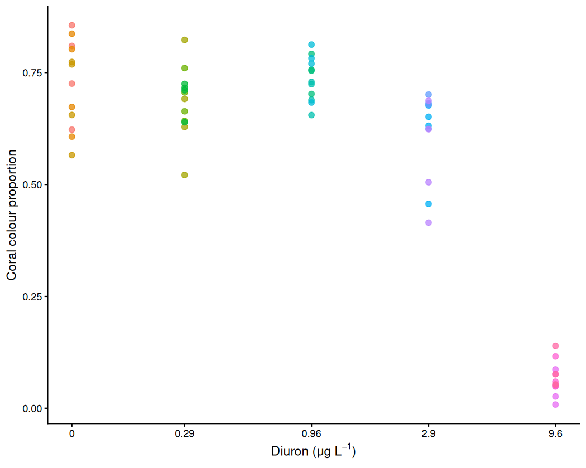
<p class="caption">plot of chunk coral-data-plot</p>
</div>

Each point is one fragment, coloured by chamber. The control is drawn at 0.1
µg/L on this logarithmic axis but labelled as the recorded zero (the model uses
this substitution too, as described below). The mean colour proportion is
between 0.69 and
0.74 from the control to
0.96 µg/L, and
0.61 at
2.9 µg/L (where the fragments are also more variable, from
0.41
to
0.70),
whereas at 9.6 µg/L it is
0.066. Most of the
observed decline is therefore between the two highest concentrations, and only
at the highest is the mean near zero.

Although the mean colour at 9.6 µg/L is near zero, the design has no
higher treatment to show whether the response would have remained there. We
retain the default `asymptote_observed = TRUE`, which declares that the lower
asymptote of the curve was reached within the tested range. This is plausible
given a mean so close to zero, but the design cannot verify it, and it is one of
the assumptions on which the estimates in step 5 depend. `bnec()` tests the
change between the two highest concentrations before fitting, and we read its
message in step 2.

The response is continuous and bounded by zero and one, so we use a `Beta`
family with an identity link. A `Beta` likelihood is defined on the open
interval (0, 1), and it estimates a dispersion parameter (`phi`) as well as the
mean. The 2050 subset has no value at either boundary:


``` r
range(colour_2050$proportion)
#> [1] 0.008267699 0.855555963
fam <- Beta(link = "identity")
```

This colour index is not a count of successes out of a known number of trials,
so the `binomial` and `beta_binomial` families do not apply. Where a Beta
response does include an exact zero, `bnec()` substitutes one tenth of the
smallest positive response, and it reduces an exact one by 0.001. Such changes
are recorded by `bnec_record()` and should be reported, particularly where a
boundary value represents a real outcome (e.g., a fragment that has lost all
colour). [*Hurdle and zero-inflated concentration-response
models*](https://open-aims.github.io/bayesnec/articles/example6.html) addresses
responses with substantive zeros, and [*Single model
usage*](https://open-aims.github.io/bayesnec/articles/example1.html) compares
the supported families.

The identity link keeps `top` and any estimated lower asymptote (`bot`) on the
scale of the colour proportion, whereas a logit link would fit the
concentration-response equation to the logit of the mean. Because `Beta`
estimates its own dispersion parameter, a dispersion check before fitting is not
needed here, and we instead compare the simulated and observed spread within
each concentration after fitting (step 4). The count response below uses a
family whose variance is fixed by its mean, so there the dispersion question
bears on the choice of family.

The positive concentrations span 1.5
orders of magnitude (0.29 to 9.6 µg/L), so we fit diuron on a
log scale. To do so we replace the zero control by 0.1 µg/L, approximately one
half-log step below the lowest treatment, and keep the recorded concentration in
its own column. This substitution places the control on the log predictor, and a
threshold estimated near 0.1 µg/L would depend on it. Logging also changes the
equation fitted to diuron and the scale of its default predictor prior (not only
the spacing of points on a plot), so a methods section should state the
transformation and the control substitution together.


``` r
colour_2050$diuron_adj <- ifelse(colour_2050$diuron == 0, 0.1,
                                  colour_2050$diuron)
sort(unique(colour_2050$diuron_adj))
#> [1] 0.10 0.29 0.96 2.90 9.60
```

# 2. The candidate set and its priors

We request `model = "decline"`, which includes the constant equation `ecxflat`
(a response independent of concentration) and the equations for a declining
response. The data show no rise above the control at low concentrations, so the
hormesis equations (which allow such a rise) are not requested. This broad set
exposes the difficulty of estimating the shape of a curve from 5
concentrations. An equation that fits or samples poorly is not made suitable by
being assigned a small model weight, and steps 3 and 4 check each one.

Some equations in `decline` estimate a lower asymptote (`bot`), whereas others
do not, and without observations on a flat lower limb the data may not
distinguish these forms. Whether a response can reach zero is a property of the
endpoint and not a conclusion from this fit. Where it is known, the set can be
restricted on that basis (e.g., `models()$zero_bounded` if a zero response is
biologically attainable). Here we keep the full `decline` set, and the screen in
step 3 removes the equations the design cannot support.

The family and the logged predictor also rule out equations before sampling, for
example where an equation can predict a mean the family cannot take. Under an
identity link `neclin` and `ecxlin` can predict means outside the bounds of the
Beta family (e.g., below zero at high concentrations), and `ecxsigm` cannot
evaluate its fractional power at the negative logged control. `get_priors()`
returns entries only for the equations that remain valid ([*Model
details*](https://open-aims.github.io/bayesnec/articles/example2b.html) gives
their equations, and `?models` the model groups).


``` r
coral_formula <- proportion ~ crf(log(diuron_adj), model = "decline") +
  ogl(chamber)
prior_default <- get_priors(coral_formula, data = colour_2050, family = fam,
                            prior_type = "uninformative")
prior_regular <- get_priors(coral_formula, data = colour_2050, family = fam,
                            prior_type = "regularizing")
names(prior_default)
#>  [1] "nec3param" "nec4param" "ecxexp"    "ecx4param" "ecxwb1"    "ecxwb2"    "ecxwb1p3"  "ecxwb2p3" 
#>  [9] "ecxll5"    "ecxll4"    "ecxll3"    "ecxflat"
```

We fit these 12 equations twice, under the default
`"uninformative"` priors and under `"regularizing"` priors. The regularising
priors are narrower, and they centre `top` and `bot` on the mean response at the
lowest and the highest concentrations (`?bnec` describes both sets). They
therefore provide the sampler with more information about plausible parameter
values, and we use them to show whether more equations can be fitted
successfully when the priors provide that information. The screened regularising
set is the one we use for inference (step 5), and the default priors provide the
comparison that shows how much the additional information changes the estimates.
For example, the `ec50` and `top` entries for `ecxwb1p3` are:


``` r
selected_priors <- function(x, label) {
  p <- as.data.frame(x[["ecxwb1p3"]])
  p <- p[p$nlpar %in% c("ec50", "top"),
         c("nlpar", "prior", "lb", "ub")]
  data.frame(prior_type = label, p, row.names = NULL)
}
rbind(selected_priors(prior_default, "uninformative"),
      selected_priors(prior_regular, "regularizing"))
#>      prior_type nlpar                                          prior                lb
#> 1 uninformative   top                                     beta(5, 2)                 0
#> 2 uninformative  ec50  normal(-0.0408219945202552, 18.0776750099551) -2.30258509299405
#> 3  regularizing   top                         beta(34.9717, 13.9149)                 0
#> 4  regularizing  ec50 normal(-0.0408219945202552, 0.989785370747016) -2.30258509299405
#>                 ub
#> 1                1
#> 2 2.26176309847379
#> 3                1
#> 4 2.26176309847379
```

The `ec50` entry is a normal prior on log concentration, bounded below by the
logged control and (because `asymptote_observed = TRUE`) above by the logged
highest concentration, and its standard deviation is much smaller under the
regularising priors. The `top` entry is a beta prior on the response scale,
which the regularising priors concentrate around the mean response at the lowest
concentrations. Narrower priors may stabilise sampling on sparse data, but they
can also narrow the reported interval where the likelihood provides little
information.
[*Priors*](https://open-aims.github.io/bayesnec/articles/example3.html) explains
how the entries are constructed and how to compare them with the posterior.

## Fitting the full set

`bnec()` uses four chains and 10,000 iterations per chain by default. Under its
warmup rule the first 8,000 iterations of each chain are discarded, so 8,000
post-warmup draws remain across the four chains. We use these defaults for both
prior choices, with identical data and seed. The `seed` argument controls Stan's
sampler, whereas `set.seed()` controls the initial values `bayesnec` generates
in R, so both are set. The precompiled vignette uses the `cmdstanr` backend
(through `options(brms.backend = "cmdstanr")`); without that option `brms` uses
`rstan`, and the diagnostic counts below may differ.


``` r
set.seed(228)
fit_default <- bnec(coral_formula, data = colour_2050, family = fam,
                    prior_type = "uninformative", seed = 228, refresh = 0)
#> Dropping the model(s) neclin, ecxlin as they are not valid in the case of a beta with identity link.
#> Dropping the model(s) ecxsigm as they are not valid for data with negative predictor (x) values.
#> The response is still declining at the top of the series: the mean proportion falls from 0.611 to 0.0661 as log(diuron_adj) rises from 1.06 to 2.26 (p = 1.8e-14, one-sided).
#> The lower asymptote may not be identified by this design: where an equation estimates bot its default prior is derived from the observed response, and the default nec and ec50 priors are bounded to the tested range, so they exclude a threshold above it. Inspect the entries with get_priors() and supply scientifically justified ones through the prior argument where information beyond the design is available. Where the design did stop before the asymptote, declare it with asymptote_observed = FALSE, which spans the bot prior from the floor of the response to the mean at the highest predictor level, removes the upper bound of the nec and ec50 priors, and widens the initial-value search to match.
#> Fitting 12 models in parallel over 8 workers, under the future plan already set.
#> Each model samples its chains in sequence (cores = 1); pass `cores` to bnec() to nest the two levels of parallelism.
#> Per-model messages from a worker may arrive out of order, or not at all. A model that fails is recorded either way; see ?failed_models.
#> Finding initial values which allow the response to be fitted using a nec3param model and a beta distribution.
#> Compiling Stan program...
#> Start sampling
#> Response variable modelled as a nec3param model using a beta distribution.
#> Finding initial values which allow the response to be fitted using a nec4param model and a beta distribution.
#> Compiling Stan program...
#> Start sampling
#> Response variable modelled as a nec4param model using a beta distribution.
#> Finding initial values which allow the response to be fitted using a ecxexp model and a beta distribution.
#> Compiling Stan program...
#> Start sampling
#> Response variable modelled as a ecxexp model using a beta distribution.
#> Finding initial values which allow the response to be fitted using a ecx4param model and a beta distribution.
#> Compiling Stan program...
#> Start sampling
#> Response variable modelled as a ecx4param model using a beta distribution.
#> Finding initial values which allow the response to be fitted using a ecxwb1 model and a beta distribution.
#> Compiling Stan program...
#> Start sampling
#> Response variable modelled as a ecxwb1 model using a beta distribution.
#> Finding initial values which allow the response to be fitted using a ecxwb2 model and a beta distribution.
#> Compiling Stan program...
#> Start sampling
#> Response variable modelled as a ecxwb2 model using a beta distribution.
#> Finding initial values which allow the response to be fitted using a ecxwb1p3 model and a beta distribution.
#> Compiling Stan program...
#> Start sampling
#> Response variable modelled as a ecxwb1p3 model using a beta distribution.
#> Finding initial values which allow the response to be fitted using a ecxwb2p3 model and a beta distribution.
#> Compiling Stan program...
#> Start sampling
#> Response variable modelled as a ecxwb2p3 model using a beta distribution.
#> Finding initial values which allow the response to be fitted using a ecxll5 model and a beta distribution.
#> Compiling Stan program...
#> Start sampling
#> Response variable modelled as a ecxll5 model using a beta distribution.
#> Finding initial values which allow the response to be fitted using a ecxll4 model and a beta distribution.
#> Compiling Stan program...
#> Start sampling
#> Response variable modelled as a ecxll4 model using a beta distribution.
#> Finding initial values which allow the response to be fitted using a ecxll3 model and a beta distribution.
#> Compiling Stan program...
#> Start sampling
#> Response variable modelled as a ecxll3 model using a beta distribution.
#> Finding initial values which allow the response to be fitted using a ecxflat model and a beta distribution.
#> Compiling Stan program...
#> Start sampling
#> Response variable modelled as a ecxflat model using a beta distribution.
#> Fitted models are: nec3param nec4param ecxexp ecx4param ecxwb1 ecxwb2 ecxwb1p3 ecxwb2p3 ecxll5 ecxll4 ecxll3 ecxflat
#> The fitted ecxexp curve does not fall to the control's 0.01 quantile within the predictor range for 1563 of 8000 draws. The NSEC summary is censored at 2.26: those draws keep their rank in it and are given no value.
#> The fitted ecxflat curve does not fall to the control's 0.01 quantile within the predictor range for 7920 of 8000 draws. The NSEC summary is censored at 2.26: those draws keep their rank in it and are given no value.
#> The leave-one-group-out score has Pareto k above 0.7 for 1 of 15 levels of chamber in ecxll3 (weight 0.15); 1 of 15 levels of chamber in ecxwb1 (weight 0.11); 2 of 15 levels of chamber in ecx4param (weight 0.054); 1 of 15 levels of chamber in ecxwb2 (weight 0.054). The scores of those levels are approximate; loo_controls = list(refit = TRUE) replaces them by refitting the equation without each level.
#> The control group's observed and simulated response differ by more than 15% for: nec3param, nec4param, ecx4param, ecxwb1, ecxwb2, ecxwb1p3, ecxwb2p3, ecxll5, ecxll4, ecxll3.
#> nsec() reads its reference from the control, so this is the region most likely to move a reported no-effect concentration.
#> See check_fit() for the per-group table. This is a modelling result, not a fault.
```


``` r
set.seed(228)
fit_regular <- bnec(coral_formula, data = colour_2050, family = fam,
                    prior_type = "regularizing", seed = 228, refresh = 0)
```

The messages shown are those of the first fit, and the second fit prints the
corresponding messages for the regularising priors. Before fitting, `bnec()`
names the equations it drops, for the reasons given above. It then compares the
mean colour at the two highest concentrations, and its message states that the
response is still declining at the top of the series. This test cannot tell
whether the curve flattens at 9.6 µg/L or continues to fall beyond it.
We keep the default declaration because the mean response at that concentration
is near the lower bound, while recognising that one concentration cannot
establish a plateau. The next message describes what the declaration does to the
priors: the `bot` prior is derived from the observed response, and the `nec` and
`ec50` priors are bounded to the tested range, so that a threshold above it is
excluded. Setting `asymptote_observed = FALSE` would be a different prior
assumption, because under it the `bot` prior changes and the `nec` and `ec50`
priors have no upper bound. The message asks for that assumption to be examined,
and does not change it.

The messages after fitting concern the fitted equations. They report, where any
occur, the draws for which a curve does not fall to the NSEC reference within
the tested range (those draws are censored in the NSEC summary), the chambers
whose Pareto *k* exceeds 0.7 (step 3), and the equations whose control mean or
spread is not reproduced within 15% (step 4).


``` r
record_default <- bnec_record(fit_default)
record_default$excluded
#>     model
#> 1  neclin
#> 2  ecxlin
#> 3 ecxsigm
#>                                                                                         reason
#> 1         decays by subtraction, so its mean is unbounded below for beta with an identity link
#> 2         decays by subtraction, so its mean is unbounded below for beta with an identity link
#> 3 raises the predictor to a fractional power, which is undefined for negative predictor values
is.null(record_default$substitutions)
#> [1] TRUE
```

`bnec_record()` gives the equations excluded before fitting, with the reasons
above, and any value changed to make the response compatible with the family
(`substitutions`, which is `NULL` here because the 2050 colour values are inside
the Beta support). Every requested equation is either excluded or `attempted`,
and an attempted equation that did not fit remains in `attempted`.
`failed_models()` lists such equations: in this run
no equation failed to fit under the regularising priors, and
no equation under the uninformative priors. It also keeps the
priors and initial values used for each failed equation, which are useful when
investigating the failure. A different initialisation or prior may allow such a
fit to start, although that does not show that the resulting posterior is
identified by these concentrations.

# 3. Sampler diagnostics and screening

An attempted equation that produces draws must still be checked. The package
screen uses a maximum Rhat of 1.01, a minimum effective sample size (ESS, the
smaller of the bulk and tail values) of 400, and at most ten divergent
transitions. The Rhat and ESS cutoffs follow the recommendations of
@Vehtari2021, whereas the allowance of ten divergences is a `bayesnec`
convention (Stan regards any divergence as evidence that some part of the
posterior was not explored). A screen result is specific to the data, priors,
sampler settings and seed. The table gives the curve parameters of each valid
equation and, for each prior, its maximum Rhat, minimum ESS and number of
divergent transitions, followed by the screen result.


``` r
sampling_default <- check_sampling(fit_default)
sampling_regular <- check_sampling(fit_regular)
diagnostic_label <- function(tab, model) {
  i <- match(model, tab$model)
  if (is.na(i)) return("did not fit")
  x <- tab[i, ]
  sprintf("%.3f / %.0f / %d %s", x$max_rhat, x$min_ess, x$n_divergent,
          if (x$failed) "fail" else "pass")
}
valid <- names(prior_default)
curve_parameters <- lapply(valid, function(m) names(show_params(m)[[1]]$pforms))
data.frame(
  model = valid,
  parameters = vapply(curve_parameters, paste, character(1), collapse = ", "),
  uninformative = vapply(valid, diagnostic_label, character(1),
                         tab = sampling_default),
  regularizing = vapply(valid, diagnostic_label, character(1),
                        tab = sampling_regular),
  row.names = NULL
)
#>        model              parameters           uninformative           regularizing
#> 1  nec3param          top, beta, nec    1.011 / 319 / 0 fail   1.001 / 829 / 0 pass
#> 2  nec4param     bot, top, beta, nec  1.044 / 180 / 837 fail 1.013 / 271 / 236 fail
#> 3     ecxexp               top, beta  1.041 / 97 / 1467 fail 1.082 / 37 / 1548 fail
#> 4  ecx4param    bot, ec50, top, beta  1.129 / 17 / 1479 fail 1.008 / 240 / 622 fail
#> 5     ecxwb1    bot, ec50, top, beta  1.004 / 334 / 628 fail  1.047 / 26 / 631 fail
#> 6     ecxwb2    bot, ec50, top, beta 1.012 / 497 / 1626 fail 1.026 / 134 / 573 fail
#> 7   ecxwb1p3         ec50, top, beta    1.002 / 636 / 0 pass  1.003 / 2375 / 0 pass
#> 8   ecxwb2p3         ec50, top, beta    1.003 / 655 / 0 pass  1.002 / 1746 / 0 pass
#> 9     ecxll5 bot, top, beta, ec50, f  1.076 / 29 / 3113 fail 1.076 / 37 / 1169 fail
#> 10    ecxll4    bot, top, beta, ec50  1.008 / 218 / 648 fail 1.020 / 186 / 361 fail
#> 11    ecxll3         top, beta, ec50    1.003 / 325 / 0 fail  1.002 / 2705 / 1 pass
#> 12   ecxflat                     top   1.003 / 1215 / 0 pass  1.006 / 1003 / 0 pass
```


"Did not fit" marks an attempted equation with no draws, which is distinct from
a fitted equation that missed a cutoff. Under the uninformative priors
3 of the 12 fitted
equations passed (`ecxwb1p3`, `ecxwb2p3` and `ecxflat`), and under the
regularising priors 5 of the
12 fitted equations passed
(`nec3param`, `ecxwb1p3`, `ecxwb2p3`, `ecxll3` and `ecxflat`). Of the
9 failures under the uninformative priors,
7 included more than ten divergent
transitions, as did 7 of the
7 under the regularising priors.

An equation with a `bot` parameter has to estimate the lower asymptote, or the
shape of the lower limb, from the single concentration (9.6 µg/L) at
which the mean response is near zero, so it may sample poorly on this design. Of
the 6 equations with a `bot` parameter,
0 passed under the uninformative
priors and 0 under the
regularising priors, against
3 and
5 of the
6 equations without one. The diagnostics do
not show which parameter is responsible for a failure. The regularising priors
provide more information about plausible parameter values, and of the
7 equations that failed under both priors,
5 had fewer divergent transitions under the regularising
priors, although each still failed a cutoff on the first run.

## Kinds of failure

The `failed` flag does not distinguish which cutoff was missed, although the
remedy differs between them. An equation that misses the Rhat or ESS cutoff with
few divergences may only have been given too few draws, and more iterations may
raise its ESS. Divergences describe a different problem: additional draws visit
the difficult part of the posterior more often, so increasing `iter` by itself
is unlikely to remove them. A higher `adapt_delta` (set through the `control`
argument, which `bnec()` already raises to 0.99 for an equation whose
group-level term could take a bounded mean outside its support) may reduce them,
although it cannot identify a lower asymptote that the design did not observe.
If Stan also warns about maximum tree depth, `max_treedepth` is the relevant
control to examine (see `?check_sampling`). An equation that never initialises
is recorded by `failed_models()`, and has no sampler diagnostics to screen.

The ESS floor and the divergence allowance are both absolute counts. At an
unchanged divergence rate a longer run will record more divergences, while it
may also provide enough draws for an ESS above 400. A comparison between runs
therefore needs their chain counts, iterations and warmup beside the diagnostic
table. The decision also uses `min_ess` (an absolute count) and not
`min_ess_ratio` (a measure of sampling efficiency), so a model can meet the
count after many draws while still sampling inefficiently; `check_sampling()`
returns both. The 1.01 Rhat cutoff is also the one used by `rhat()` and
`summary()`.

An equation that fails on Rhat or ESS with no more than ten divergent
transitions should be refitted under the same prior with more iterations before
it is excluded, because changing the prior would not test whether the original
run was too short. The chunk below refits any such equation with twice the
iterations and warmup, thinned by two so that it keeps the 8,000 draws of the
other equations (the model weights compare leave-out scores computed from equal
numbers of draws), and replaces it in the set before screening. An equation
with more than ten divergent transitions is instead refitted with the same
iterations at `adapt_delta = 0.99`, or at 0.999 for `neclin` and `ecxlin`,
which `bnec()` already fits at 0.99 because `ogl(chamber)` can take their mean
outside (0, 1).


``` r
retry_models <- function(tab) tab$model[tab$failed & tab$n_divergent <= 10]
tune_models <- function(tab) tab$model[tab$failed & tab$n_divergent > 10]
refit_failed <- function(fit, retry, tune) {
  if (!length(retry) && !length(tune)) return(fit)
  longer <- lapply(retry, function(m) {
    update(pull_out(fit, model = m), iter = 2e4, warmup = 1.6e4, thin = 2,
           refresh = 0)
  })
  tuned <- lapply(tune, function(m) {
    delta <- if (m %in% c("neclin", "ecxlin")) 0.999 else 0.99
    update(pull_out(fit, model = m), control = list(adapt_delta = delta),
           refresh = 0)
  })
  # c() keeps the first copy of an equation it is given twice, so the refits
  # come first.
  do.call(c, c(longer, tuned, list(fit)))
}
retry_default <- retry_models(sampling_default)
retry_regular <- retry_models(sampling_regular)
tune_default <- tune_models(sampling_default)
tune_regular <- tune_models(sampling_regular)
set.seed(228)
fit_default <- refit_failed(fit_default, retry_default, tune_default)
set.seed(228)
fit_regular <- refit_failed(fit_regular, retry_regular, tune_regular)
sampling_default <- check_sampling(fit_default)
sampling_regular <- check_sampling(fit_regular)
```


``` r
refit_default <- c(retry_default, tune_default)
refit_regular <- c(retry_regular, tune_regular)
retried <- rbind(
  sampling_default[sampling_default$model %in% refit_default, ],
  sampling_regular[sampling_regular$model %in% refit_regular, ]
)
if (nrow(retried)) {
  cbind(prior_type = rep(c("uninformative", "regularizing"),
                         c(sum(sampling_default$model %in% refit_default),
                           sum(sampling_regular$model %in% refit_regular))),
        retried)
}
#>       prior_type     model max_rhat    min_ess min_ess_ratio n_divergent failed
#> 1  uninformative nec3param 1.000809 1217.12613   0.152140766           0  FALSE
#> 2  uninformative    ecxll3 1.001065 2238.18643   0.279773304           0  FALSE
#> 3  uninformative nec4param 1.238353   12.99996   0.001624994         110   TRUE
#> 4  uninformative    ecxexp 1.007551 1179.95862   0.147494827           6  FALSE
#> 5  uninformative ecx4param 1.137331   13.10793   0.001638491         871   TRUE
#> 6  uninformative    ecxwb1 1.001521  837.41896   0.104677370         221   TRUE
#> 7  uninformative    ecxwb2 1.005243  617.52505   0.077190631         535   TRUE
#> 8  uninformative    ecxll5 1.017223  466.78958   0.058348697        2414   TRUE
#> 9  uninformative    ecxll4 1.001147  799.64956   0.099956195         268   TRUE
#> 10  regularizing nec4param 1.099542   27.86329   0.003482911          95   TRUE
#> 11  regularizing    ecxexp 1.003568  996.34340   0.124542925          62   TRUE
#> 12  regularizing ecx4param 1.002605 1554.15254   0.194269068         318   TRUE
#> 13  regularizing    ecxwb1 1.007792  599.34748   0.074918435          65   TRUE
#> 14  regularizing    ecxwb2 1.006069  651.26911   0.081408639         252   TRUE
#> 15  regularizing    ecxll5 1.004695  711.81116   0.088976395         206   TRUE
#> 16  regularizing    ecxll4 1.002764 1201.59868   0.150199835          98   TRUE
```

In this run the longer refit was applied to `nec3param` and `ecxll3` under
the uninformative priors and to none under the
regularising priors, and the refit at a higher `adapt_delta` to
`nec4param`, `ecxexp`, `ecx4param`, `ecxwb1`, `ecxwb2`, `ecxll5` and `ecxll4` and `nec4param`, `ecxexp`, `ecx4param`, `ecxwb1`, `ecxwb2`, `ecxll5` and `ecxll4` respectively.
The table above gives the diagnostics of each refitted equation after its refit, and the screen below uses those.

## Screening the model sets

`screen_models()` drops each equation that misses any cutoff, names it with the
cutoffs it failed, and recomputes the model weights over the equations that
pass. Its messages are the record a methods section should cite, so we leave
them visible. The constant equation `ecxflat` may remain because it samples
well, even where it has almost no predictive weight: the screen asks whether the
posterior draws are reliable, and does not select equations for their fit to the
observed response. If every fitted equation fails, the function stops with the
reasons instead of returning a model average.


``` r
screened_default <- screen_models(fit_default)
#> Dropping 6 of 12 candidate models that failed the sampler screen:
#>   -  nec4param: Rhat 1.238, ESS 13, 110 divergent transitions
#>   -  ecx4param: Rhat 1.137, ESS 13.1, 871 divergent transitions
#>   -  ecxwb1: 221 divergent transitions
#>   -  ecxwb2: 535 divergent transitions
#>   -  ecxll5: Rhat 1.017, 2414 divergent transitions
#>   -  ecxll4: 268 divergent transitions
#> Fitted models are: nec3param ecxll3 ecxexp ecxwb1p3 ecxwb2p3 ecxflat
#> The fitted ecxexp curve does not fall to the control's 0.01 quantile within the predictor range for 1216 of 8000 draws. The NSEC summary is censored at 2.26: those draws keep their rank in it and are given no value.
#> The fitted ecxflat curve does not fall to the control's 0.01 quantile within the predictor range for 7920 of 8000 draws. The NSEC summary is censored at 2.26: those draws keep their rank in it and are given no value.
#> The leave-one-group-out score has Pareto k above 0.7 for 1 of 15 levels of chamber in nec3param (weight 0.16). The scores of those levels are approximate; loo_controls = list(refit = TRUE) replaces them by refitting the equation without each level.
screened_regular <- screen_models(fit_regular)
#> Dropping 7 of 12 candidate models that failed the sampler screen:
#>   -  nec4param: Rhat 1.1, ESS 27.9, 95 divergent transitions
#>   -  ecxexp: 62 divergent transitions
#>   -  ecx4param: 318 divergent transitions
#>   -  ecxwb1: 65 divergent transitions
#>   -  ecxwb2: 252 divergent transitions
#>   -  ecxll5: 206 divergent transitions
#>   -  ecxll4: 98 divergent transitions
#> Fitted models are: nec3param ecxwb1p3 ecxwb2p3 ecxll3 ecxflat
#> The fitted ecxflat curve does not fall to the control's 0.01 quantile within the predictor range for 7920 of 8000 draws. The NSEC summary is censored at 2.26: those draws keep their rank in it and are given no value.
#> The leave-one-group-out score has Pareto k above 0.7 for 1 of 15 levels of chamber in ecxwb2p3 (weight 0.27); 1 of 15 levels of chamber in nec3param (weight 0.21). The scores of those levels are approximate; loo_controls = list(refit = TRUE) replaces them by refitting the equation without each level.
```


After the refit, the screen retained 6 equations
under the uninformative priors (`nec3param`, `ecxll3`, `ecxexp`, `ecxwb1p3`, `ecxwb2p3` and `ecxflat`)
and 5 under the regularising priors
(`nec3param`, `ecxwb1p3`, `ecxwb2p3`, `ecxll3` and `ecxflat`), so on these data the regularising priors reduced the number of equations available for the model average. Step 5
assesses what the additional information in the regularising priors does to the
estimates.

## Chamber-level model weights

The four fragments in each chamber are related observations, so leaving out one
fragment at a time would overstate how well a model predicts a new chamber.
Because `ogl(chamber)` is in the formula, the default model weights instead
leave out a whole chamber at a time, and are computed from those
leave-one-chamber-out scores by the default pseudo-BMA method. Pareto *k*
assesses whether the importance-sampling approximation to each left-out score is
reliable, and the score of a chamber with *k* above 0.7 is unreliable until an
exact refit replaces it. `check_fit()` returns these diagnostics for each
equation as its `"pareto"` attribute, and we show the model weight, the number
of chambers above 0.7 and the largest *k* for each retained equation. This check
belongs after screening, because the weights of models whose posterior was not
sampled adequately should not be interpreted.


``` r
round_cols <- function(x, digits = 3) {
  num <- vapply(x, is.numeric, logical(1))
  x[num] <- lapply(x[num], round, digits)
  x
}
pareto_rows <- function(x, label) {
  p <- attr(check_fit(x, ndraws = 100), "pareto")
  if (anyNA(p$n_high_k)) stop("Pareto diagnostics are unavailable")
  data.frame(prior_type = label, p[, c("model", "weight", "n_high_k", "max_k")])
}
pareto <- rbind(pareto_rows(screened_default, "uninformative"),
                pareto_rows(screened_regular, "regularizing"))
round_cols(pareto)
#>       prior_type     model weight n_high_k max_k
#> 1  uninformative nec3param  0.160        1 0.704
#> 2  uninformative    ecxll3  0.298        0 0.632
#> 3  uninformative    ecxexp  0.000        0 0.626
#> 4  uninformative  ecxwb1p3  0.283        0 0.585
#> 5  uninformative  ecxwb2p3  0.260        0 0.595
#> 6  uninformative   ecxflat  0.000        0 0.613
#> 7   regularizing nec3param  0.212        1 0.850
#> 8   regularizing  ecxwb1p3  0.232        0 0.629
#> 9   regularizing  ecxwb2p3  0.270        1 0.756
#> 10  regularizing    ecxll3  0.287        0 0.530
#> 11  regularizing   ecxflat  0.000        0 0.638
```

In this run 3 of the 11 retained
equations had at least one chamber with *k* above 0.7 (the largest *k* was
0.85). Where any chamber exceeds the cutoff,
`amend(x, loo_controls = list(refit = TRUE))` refits each affected equation
without that chamber and recomputes the weights from the exact scores. The chunk
below does so for each set that needs it, and gives the final weights.


``` r
refit_high_k <- function(x, label) {
  if (any(pareto$n_high_k[pareto$prior_type == label] > 0)) {
    amend(x, loo_controls = list(refit = TRUE))
  } else {
    x
  }
}
set.seed(228)
screened_default <- refit_high_k(screened_default, "uninformative")
set.seed(228)
screened_regular <- refit_high_k(screened_regular, "regularizing")
```


``` r
weights_of <- function(x, label) {
  w <- summary(x)$mod_weights
  setNames(data.frame(rownames(w), w[, "wi"]), c("model", label))
}
coral_weights <- merge(weights_of(screened_default, "uninformative"),
                       weights_of(screened_regular, "regularizing"), all = TRUE)
round_cols(coral_weights)
#>       model uninformative regularizing
#> 1    ecxexp         0.000           NA
#> 2   ecxflat         0.000        0.000
#> 3    ecxll3         0.300        0.289
#> 4  ecxwb1p3         0.285        0.231
#> 5  ecxwb2p3         0.262        0.273
#> 6 nec3param         0.153        0.206
```


The weights are the share of the model-averaged prediction assigned to each
equation, and sum to one within each set (an equation absent from a set is
`NA`). Under the regularising priors `ecxll3` has the highest
weight (0.29). A
small weight does not validate an equation that sampled poorly (e.g., an
equation with many divergent transitions can still be given a large weight),
which is why the weights are read only after screening.

## Chain mixing

The screen summarises each chain in a few numbers, whereas the traces show the
draws themselves. Here we inspect the traces for the highest-weighted equation
of the regularising set:


``` r
best_regular <- pull_best(screened_regular)
check_chains(best_regular)
```

<div class="figure" style="text-align: center">
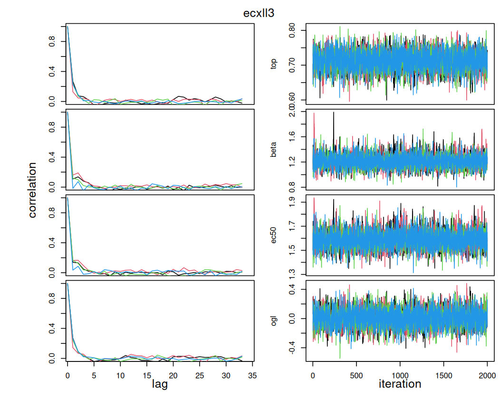
<p class="caption">plot of chunk coral-chains</p>
</div>

For `ecxll3` the four chains overlap throughout a
stable range in the trace panels, with brief excursions to larger values of some
parameters in single chains, and in the autocorrelation panels the dependence
between successive draws falls close to zero within about 15 lags. A
satisfactory Rhat does not replace inspection of these plots, and before
reporting a model average we would inspect the traces of each retained equation.
`check_chains()` can write one page per equation to a PDF for that review:


``` r
check_chains(screened_regular, filename = "coral_2050_chains")
```

# 4. Fit diagnostics

Sampler diagnostics concern the posterior draws, whereas `check_fit()` compares
the observed and simulated response within each concentration. We apply it to
the screened regularising set used for inference, so that each retained equation
is checked. The table shows the control rows (because the *N(S)EC* and ECx use
the fitted control mean as a reference) and any other row flagged by its
posterior predictive p-value.


``` r
cf_regular <- check_fit(screened_regular)
fit_cols <- c("model", "wi", "group", "obs_mean", "sim_mean",
              "obs_sd", "sim_sd", "sd_ratio", "ppp_mean", "ppp_sd")
flagged_regular <- cf_regular$ppp_mean < 0.05 | cf_regular$ppp_mean > 0.95 |
  cf_regular$ppp_sd < 0.05 | cf_regular$ppp_sd > 0.95
round_cols(as.data.frame(cf_regular[cf_regular$control | flagged_regular,
                                    fit_cols]))
#>        model    wi group obs_mean sim_mean obs_sd sim_sd sd_ratio ppp_mean ppp_sd
#> 1  nec3param 0.206   0.1    0.725    0.718  0.096  0.076    1.270    0.416  0.159
#> 3  nec3param 0.206  0.96    0.737    0.721  0.046  0.075    0.617    0.282  0.970
#> 6   ecxwb1p3 0.231   0.1    0.725    0.720  0.096  0.078    1.239    0.441  0.156
#> 8   ecxwb1p3 0.231  0.96    0.737    0.713  0.046  0.077    0.602    0.205  0.969
#> 11  ecxwb2p3 0.273   0.1    0.725    0.718  0.096  0.076    1.270    0.397  0.141
#> 13  ecxwb2p3 0.273  0.96    0.737    0.719  0.047  0.076    0.609    0.248  0.976
#> 16    ecxll3 0.289   0.1    0.725    0.719  0.096  0.076    1.267    0.394  0.167
#> 18    ecxll3 0.289  0.96    0.737    0.718  0.046  0.077    0.604    0.207  0.970
#> 21   ecxflat 0.000   0.1    0.725    0.727  0.094  0.082    1.142    0.522  0.291
#> 23   ecxflat 0.000  0.96    0.737    0.733  0.039  0.081    0.482    0.436  0.996
```


The posterior predictive p-value is the fraction of simulated group statistics
at least as large as the observed statistic, so values outside [0.05, 0.95]
identify concentrations worth inspecting. Of the 25 rows
(5 equations by 5
concentrations), 5 were flagged, at 0.96 µg/L. At the
control 0 rows were flagged, and the ratio of observed to
simulated standard deviation is
1.14 to 1.27 across the retained
equations, so each simulates less spread at the control than was observed. A fit that simulates too little spread at the control places the NSEC reference higher (see the Overview), so such a discrepancy is more likely to lower the NSEC than to raise it. With 12 fragments in
3 chambers at each concentration, a flag is not by
itself a reason to exclude an equation, but it shows whether a discrepancy
concerns the mean or the spread, and where. `check_fit()` simulates each
fragment with the fitted deviation of its chamber, so the comparison of means
reflects those deviations as well as the curve.

For a closer view, we plot the highest-weighted retained equation. The points
are the observed group statistics and the bars are 95% intervals of the
statistics simulated from that equation.


``` r
cf_best <- cf_regular[cf_regular$model == best_regular$model, , drop = FALSE]
plot(cf_best)
```

<div class="figure" style="text-align: center">
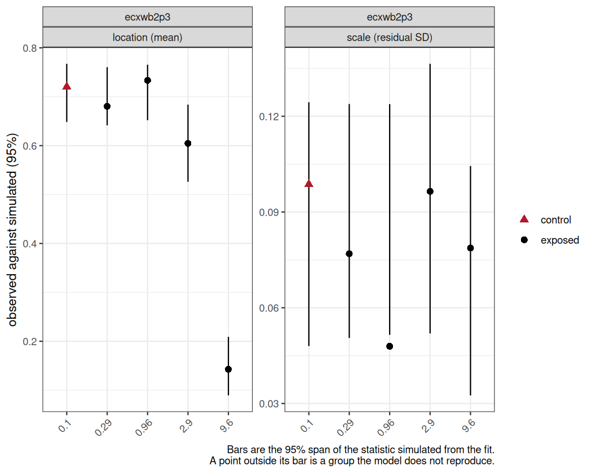
<p class="caption">plot of chunk coral-checkfit-plot</p>
</div>

A point may lie just inside its 95% interval even when its posterior predictive
p-value is beyond the [0.05, 0.95] flag threshold, because the table uses the
p-values whereas the plot shows the direction and size of a discrepancy. For
`ecxll3` the observed means lie within their intervals
at
5
of the 5 concentrations, and the observed standard deviations at
5.

# 5. Prior sensitivity and reporting

## The influence of the priors

Model averages over the uninformative and regularising sets differ both in their
priors and in the equations that passed the screen. To isolate the effect of the
priors, we compare the estimates from the smooth (ECx) equations that passed
under both priors, excluding `ecxflat`. The passing equations may depend on the
sampler backend and seed, so we take their intersection from the screened sets,
and recompute the weights for that common set (with the Pareto *k* check and
refit of step 3).


``` r
shared_models <- intersect(names(models(screened_default)),
                           names(models(screened_regular)))
shared_models <- setdiff(shared_models[grepl("^ecx", shared_models)], "ecxflat")
if (!length(shared_models)) {
  stop("No smooth equation passed the screen under both priors.")
}
make_common <- function(x, selected) {
  fits <- lapply(selected, function(m) pull_out(x, model = m))
  x <- if (length(fits) == 1L) fits[[1]] else do.call(c, fits)
  p <- attr(check_fit(x, ndraws = 100), "pareto")
  if (anyNA(p$n_high_k)) stop("Pareto diagnostics are unavailable")
  if (any(p$n_high_k > 0)) amend(x, loo_controls = list(refit = TRUE)) else x
}
set.seed(228)
common_default <- make_common(screened_default, shared_models)
set.seed(228)
common_regular <- make_common(screened_regular, shared_models)
```


``` r
estimate_rows <- function(x, label) {
  est <- rbind(EC10 = ecx(x, ecx_val = 10), EC50 = ecx(x, ecx_val = 50),
               NSEC = nsec(x))[, c("Q50", "Q2.5", "Q97.5")]
  data.frame(estimate = rownames(est), prior_type = label, est,
             row.names = NULL)
}
prior_effect <- rbind(estimate_rows(common_default, "uninformative"),
                      estimate_rows(common_regular, "regularizing"))
prior_effect <- prior_effect[order(prior_effect$estimate), ]
round_cols(prior_effect)
#>   estimate    prior_type   Q50  Q2.5 Q97.5
#> 1     EC10 uninformative 2.624 1.892 4.353
#> 4     EC10  regularizing 2.604 1.933 3.420
#> 2     EC50 uninformative 4.996 4.109 6.785
#> 5     EC50  regularizing 4.872 4.081 6.265
#> 3     NSEC uninformative 2.217 1.306 3.254
#> 6     NSEC  regularizing 2.145 1.206 2.774
```


Each pair of rows estimates one quantity from the common set
(`ecxll3`, `ecxwb1p3` and `ecxwb2p3`), fitted to identical observations, so the
difference between rows can be attributed to the priors within those equations.
The median NSEC is 2.22 µg/L under
the uninformative priors and 2.15
µg/L under the regularising priors, and the median EC50 is
5.00 and
4.87 µg/L. The upper bound of the
EC50 is 6.79 µg/L under the
uninformative priors and
6.27 µg/L under the
regularising priors, and the width of the NSEC interval is
1.95 and
1.57 µg/L. Where an
interval is narrower under the regularising priors, the difference may reflect
their stronger assumptions as well as information from the data, and cannot be
presented as precision supplied solely by the experiment. The control fit, from
which the NSEC reference is read, can be compared in the same way (the ratio of
observed to simulated standard deviation at the control is
1.26 to 1.27 across the common equations under the
uninformative priors, and 1.24 to 1.27 under the
regularising priors).

The final regularising set can contain equations that are not in the common set
(e.g., `ecxflat`, which the comparison excludes), so its model-averaged
estimates also reflect their weights and cannot be interpreted as a pure effect
of the priors.
[*Priors*](https://open-aims.github.io/bayesnec/articles/example3.html)
describes how the priors are constructed and how to compare their densities with
the posterior.

## The final model-averaged fit

We use the screened regularising set for inference. The first figure shows each
equation retained after screening, on the measured diuron scale, and the second
shows the model-averaged curve with its 95% credible band.


``` r
autoplot(screened_regular, model = screened_regular$success_models,
         average = FALSE, nec = FALSE) +
    scale_x_continuous(transform = "log10",
                     breaks = sort(unique(colour_2050$diuron_adj)),
                     labels = function(x) signif(x, 2)) +
  labs(x = expression(paste("Diuron (", mu, "g ", L^-1, ")")),
       y = "Coral colour proportion")
```

<div class="figure" style="text-align: center">
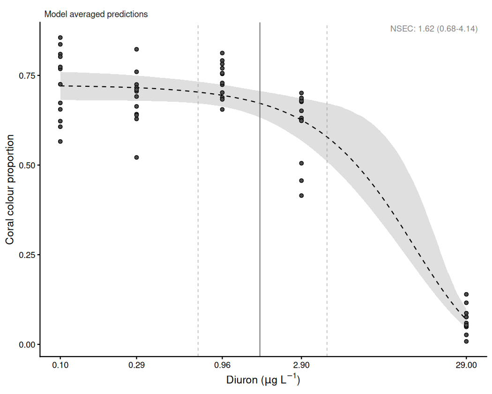
<p class="caption">plot of chunk coral-curves</p>
</div>

`autoplot()` draws one panel for each equation named in `model`, and
`average = FALSE` omits the model-averaged panel. The control is drawn at 0.1
µg/L, the value substituted before logging. The constant equation `ecxflat` does
not follow the decline (its weight is
0.00).
The other retained equations agree closely from the control to
0.96 µg/L, where the response is flat. Above that
concentration, where the response falls, the shapes of their declines differ,
and that difference is the model uncertainty the average incorporates.


``` r
autoplot(screened_regular, nec = FALSE) +
    scale_x_continuous(transform = "log10",
                     breaks = sort(unique(colour_2050$diuron_adj)),
                     labels = function(x) signif(x, 2)) +
  labs(x = expression(paste("Diuron (", mu, "g ", L^-1, ")")),
       y = "Coral colour proportion")
```

<div class="figure" style="text-align: center">
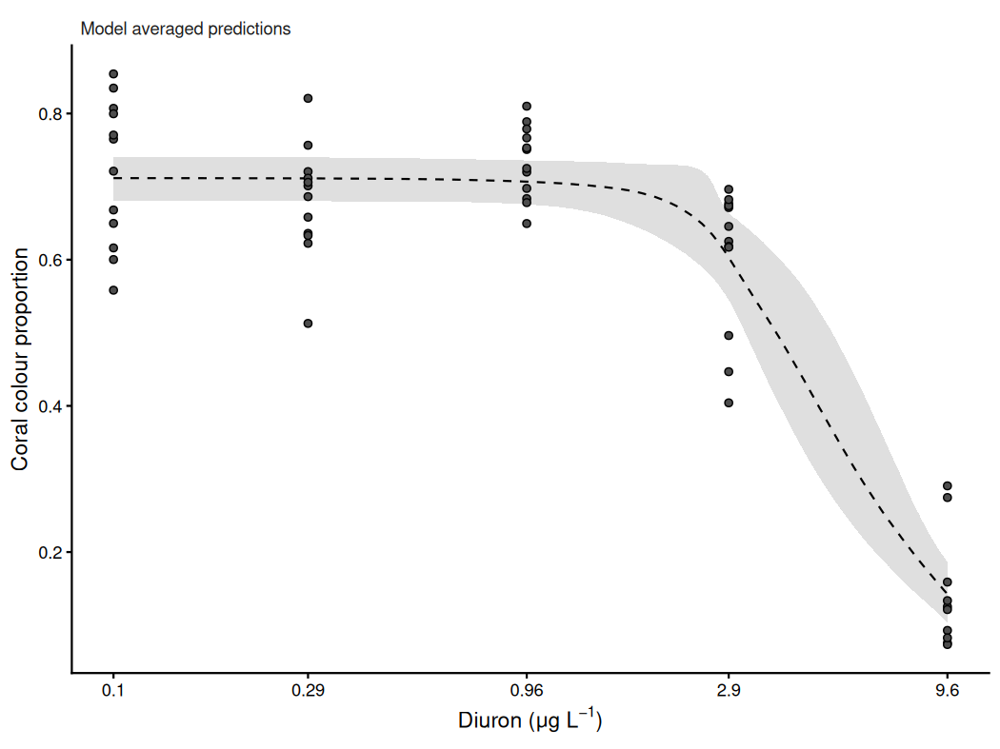
<p class="caption">plot of chunk coral-final-plot</p>
</div>

The model-averaged curve passes through the mean response at each concentration,
and its credible band is widest where the response falls, between 2.9
and 9.6 µg/L. The table gives the median and equal-tailed 95% credible
interval of the EC10, EC50 and NSEC (µg/L) from this set. Here `nsec()` applies
one control-reference definition to each retained equation, whereas, where a set
mixes threshold and smooth equations, `nec()` returns the model-averaged mixture
of NEC and NSEC draws that `summary()` labels N(S)EC.


``` r
coral_estimates <- rbind(
  EC10 = ecx(screened_regular, ecx_val = 10),
  EC50 = ecx(screened_regular, ecx_val = 50),
  NSEC = nsec(screened_regular)
)[, c("Q50", "Q2.5", "Q97.5")]
#> Warning: The ecxflat curve does not reach the absolute ECx10 target anywhere in the predictor range
#> for 8000 of 8000 draws. The estimate is censored at 9.6: those draws keep their rank in the summary
#> and are given no value.
#> Warning: The ecxflat curve does not reach the absolute ECx50 target anywhere in the predictor range
#> for 8000 of 8000 draws. The estimate is censored at 9.6: those draws keep their rank in the summary
#> and are given no value.
#> Warning: The ecxflat curve does not fall below the control's 0.01 quantile anywhere in the
#> predictor range for 7920 of 8000 draws. The NSEC is censored at 9.6: those draws keep their rank in
#> the summary and are given no value.
round(coral_estimates, 3)
#>        Q50  Q2.5 Q97.5
#> EC10 2.680 1.952 3.334
#> EC50 4.655 3.740 6.177
#> NSEC 2.287 1.269 2.842
```

The model-averaged EC10 is 2.68
µg/L (1.95 to
3.33), the EC50 is
4.66 µg/L
(3.74 to
6.18), and the NSEC is
2.29 µg/L
(1.27 to
2.84). The ECx values use the
default absolute response scale, and `type = "range"` would instead measure the
decline between the fitted upper and lower response levels. A flat equation may
have no ECx crossing within the tested range, in which case the messages and
warnings above report how many draws were censored.

These values depend on the substitution of 0.1 µg/L for the control before
logging, on `asymptote_observed = TRUE`, on the candidate set, and on the
regularising priors. In particular, only the highest concentration has a mean
near the lower response bound, so the EC50 rests on the assumption that the
response had reached its lower asymptote by 9.6 µg/L. The flatness
message from `bnec()` and the comparison of priors above should be reported with
the estimates.

# Draft methods and results text

Here we give a draft of how the analysis above might be described in a paper,
modelled on the way @flores2021 reported the original analysis of these data.
That paper summarised its model fitting in a few sentences of the methods,
reported each EC50 with its interval in the results, and placed further detail
in supplementary material. Our analysis includes more checks than theirs, and
the draft refers to steps 1 to 5 of this vignette as Supplementary Material S1
to S5 (e.g., the sampler diagnostics table of step 3 would be Table S3). The
values are those computed above, and would update with any change to the
analysis.

## Statistical analysis

Concentrations of diuron that reduced the colour index of *A. millepora* by 10%
and 50% (EC10 and EC50), and the no-significant-effect concentration (NSEC;
@fisherfox2023), were estimated for the 2050 climate scenario using the R
package `bayesnec` [@fisher2024], which fits concentration-response models in
Stan through `brms` [@Burkner2017]. The colour index (a proportion) was modelled
as a function of log diuron concentration, with the control set to 0.1 µg/L
before transformation, using a beta distribution with an identity link and a
group-level intercept for chamber
(4 fragments per
chamber and 3 chambers per concentration; S1). The
candidate model set comprised the 12 equations of the
`bayesnec` `decline` group that are valid for these data (declining equations
and one constant equation; S2), fitted with the package's regularising priors.
Each equation was fitted with four chains of 10,000 iterations, of which the
first 8,000 were discarded as warmup. Equations were excluded where the maximum
R-hat exceeded 1.01 or the minimum bulk or tail effective sample size was below
400 [@Vehtari2021], or where more than ten divergent transitions occurred; an
equation that failed only on R-hat or effective sample size was first refitted
with twice the number of iterations, and one with more than ten divergent
transitions with a target acceptance rate (`adapt_delta`) of 0.99, or 0.999
where the default fit had already used 0.99 (S3). Posterior predictions from the
retained equations were combined using pseudo-Bayesian model averaging weights
[@Yao2018] calculated from leave-one-chamber-out cross-validation
[@vehtari2017], with exact refits for chambers where the Pareto *k* diagnostic
exceeded 0.7 (S3). The fit of each retained equation was assessed by comparing
the observed mean and standard deviation of the response at each concentration
with those simulated from the posterior (S4). The sensitivity of the estimates
to the priors was assessed by also fitting the candidate set with the package's
default (uninformative) priors, and comparing the estimates from the smooth
(ECx) equations that passed the screen under both prior sets (S5). Both prior
sets assumed that the lower asymptote of the response was reached within the
tested concentration range (the package default), which bounds the NEC and EC50
priors to that range.

## Results

Of the 12 candidate equations, 12
were fitted successfully and 5 passed
the sampler screen under the regularising priors, compared with
6 of 12 under the
uninformative priors (S3). Of the 6 equations that estimate
a lower asymptote, 0 passed
under the regularising priors. The highest-weighted retained equation was
`ecxll3` (weight
0.29; S3). Colour
index declined from a mean of
0.72 in the controls to
0.066 at
9.6 µg/L, with most of the decline occurring between 2.9 and
9.6 µg/L (Fig. S1). The modelled concentrations that reduced colour
index by 10% and 50% (EC10 and EC50) were
2.68 (95% CI
1.95–3.33)
and 4.66
(3.74–6.18)
µg/L, respectively, and the NSEC was
2.29
(1.27–2.84)
µg/L (Table S5). For the equations that passed under both prior sets, the median
NSEC was 2.15 µg/L under the
regularising priors and 2.22 µg/L
under the uninformative priors, with upper 95% bounds of
2.77 and
3.25 µg/L (S5). Because
only the highest concentration had a mean colour index near zero, the shape of
the lower part of the curve, and hence the EC50, depends on the assumption that
the colour index had reached its lower asymptote at 9.6 µg/L.

# A count response {#a-count-response}

When the response is a count out of a known number of trials, both the family
question and the sampler screen take a different form. The family question
becomes a question about dispersion, and the sampler screen can return an
outcome that more sampling does not fix. Here we use the `nassarius` data to
demonstrate both.

The data are survival records for the tropical marine snail *Nassarius dorsatus*
exposed to each of four contaminants, with one row per individual
[@trenfield2016]. `?nassarius` documents the columns and the provenance of the
response.


``` r
data(nassarius)
a <- nassarius[nassarius$contaminant == "A", ]
table(a$record, a$alive)
#>                
#>                   0   1
#>   measured        0 166
#>   sentinel_code   8   0
#>   blank_rep       0   0
#>   absent_tank    12   0
#>   absent_dose    18   0
```

The `record` column is important. A death is recorded as `alive = 0`, but most
of those zeros were not read from the source file, because a treatment in which
nothing survived was not written down at all, and its rows were reinstated from
the test design. `record` gives how the fate of each snail was established
(`measured`, `sentinel_code`, `blank_rep`, `absent_tank` or `absent_dose`), and
the last two of these are the reinstated records (30 of the 38 deaths in
contaminant A). Each dose at which any snail died is largely or wholly
reconstructed, so the descending limb that determines the reported estimate is
derived almost entirely from reinstated records. This is a property of the data
and not of `bayesnec`, and it should be stated in the methods section of any
analysis based on these data. The corresponding sensitivity analysis, on
contaminant B, is run in [*Hurdle and zero-inflated concentration-response
models*](https://open-aims.github.io/bayesnec/articles/example6.html).

Survival is binary for each individual, and a binomial fit takes the number
alive out of the number exposed. The source file lists the snails of each
treatment in rows labelled as tanks, and we sum the snails in each row:


``` r
surv <- aggregate(alive ~ dose + tank + contaminant,
                  data = nassarius, FUN = function(x) c(suc = sum(x),
                                                        tot = length(x)))
surv <- do.call(data.frame, surv)
names(surv)[names(surv) == "alive.suc"] <- "suc"
names(surv)[names(surv) == "alive.tot"] <- "tot"
surv <- surv[surv$contaminant == "A", ]
head(surv)
#>   dose tank contaminant suc tot
#> 1 0.00  A-1           A   5   6
#> 2 0.02 A-10           A   6   6
#> 3 0.04 A-11           A   6   6
#> 4 0.04 A-12           A   6   6
#> 5 0.04 A-13           A   5   6
#> 6 0.08 A-14           A   6   6
```

Each row of contaminant A contains 6 snails. However, the
snails were mixed before they were recorded, so a row is not the tank in which a
snail was held. The row totals are valid binomial counts, but they contain no
information about variation between tanks, and the analysis below includes no
tank term.

A concentration series laid out as a dilution ladder is read on a logarithmic
axis, which spaces its steps evenly. However, a logarithm is undefined at zero,
so the control has to be given a plotting position. Here we use half the lowest
tested dose, marked on the axis as the control and not as a number, so that
nothing on the figure claims that the control was a dose it was not.

This substitution is made only for the figure. The fit uses the recorded dose,
including the control, and all estimates are reported in those units. The
plotting position and the recorded dose can differ safely because `bayesnec`
takes the control to be the lowest value of the predictor, whatever that value
is.


``` r
ctrl_pos <- min(surv$dose[surv$dose > 0]) / 2
surv$dose_plot <- ifelse(surv$dose == 0, ctrl_pos, surv$dose)
dose_breaks <- c(ctrl_pos, 0.01, 0.04, 0.16, 0.63, 2.5, 20)
# Most rows are at exactly 1 or exactly 0, so the points overplot and the
# number of rows at each dose cannot be read. The vertical jitter is for display
# only, with the seed set so the figure is reproducible; the fit uses the
# recorded proportions.
set.seed(17)
ggplot(surv, aes(x = dose_plot, y = suc / tot)) +
  geom_point(size = 2, alpha = 0.6,
             position = position_jitter(width = 0, height = 0.015)) +
  # Transform the scale, not the breaks: transforming the breaks would relabel
  # the axis without respacing it.
  scale_x_continuous(transform = "log", breaks = dose_breaks,
                     labels = c("0\n(control)", "0.01", "0.04", "0.16", "0.63",
                                "2.5", "20")) +
  labs(x = "Dose", y = "Proportion surviving") +
  theme_classic()
```

<div class="figure" style="text-align: center">
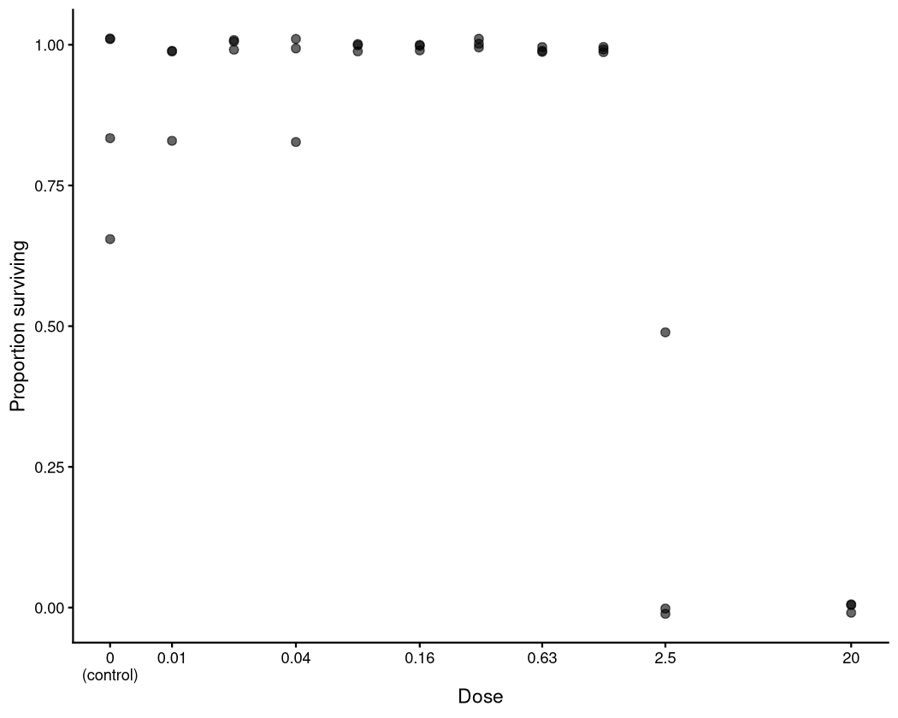
<p class="caption">plot of chunk exmp9-nass-data</p>
</div>

Survival is at or near complete for most of the series, and falls away over the
top two doses (2.5 and 20). Nine of the eleven doses have survival at or above
0.875, and the whole of the decline occurs between 1.25 and 2.5, with no dose
tested in between. The logarithmic axis makes that gap visible, because on a
linear axis the nine doses up to 1.25 would occupy the leftmost six per cent of
the plot and overlap into a single stack.

## Dispersion and the choice of family

The default family for successes out of trials is `binomial`, which fixes the
variance at $np(1-p)$ (where $n$ is the number of trials and $p$ the probability
of success). However, toxicity data often vary by more than that, for several
reasons. For example, animals within a replicate share conditions, so the
effective sample size is smaller than the number of individuals; individuals
differ in susceptibility, so the probability of survival is not one number but a
distribution; and covariates that were not measured contribute similarly. The
`beta_binomial` family writes the second of these down explicitly (`p` varies
between units, drawn from a beta distribution), and in practice it accommodates
the others as well. Because the rows of `nassarius` are not tanks, variation
among the rows at a dose cannot reflect conditions shared within a tank, and any
extra variation in these counts would appear as departures of whole doses from
the fitted curve.

This correction works in one direction only. Mixing `p` over a beta distribution
can only *add* variance, so `beta_binomial` addresses over-dispersion, but not
the opposite case. A dispersion ratio below 1 therefore indicates something
about the fit, the design or the data-generating process, and not about the
family.

We fit the `binomial` family to the full candidate set and then inspect the
dispersion statistic of each equation. `dispersion()` compares the observed and
simulated sums of squared Pearson residuals for each posterior draw, and
`summary()` gives the median and 95% interval of that ratio for each equation
(`dispersion_Estimate`, `dispersion_Q2.5` and `dispersion_Q97.5`), together with
`dispersion_P_over_1`, the proportion of draws with a ratio above one. The
statistic depends on the shape of the curve as well as on the family, because a
curve that fits the mean response poorly leaves residual variation that the
statistic counts as dispersion. We therefore read it beside the fitted curves,
and the `beta_binomial` family would be a candidate if the equations that
describe the response well indicated over-dispersion.

## The fitted set and its screen

We fit the full `decline` set with the default sampling settings, as in the
coral analysis.


``` r
set.seed(17)
fit_nass <- bnec(suc | trials(tot) ~ crf(dose, model = "decline"),
                 data = surv, family = "binomial", seed = 17)
```


``` r
nass_screened <- screen_models(fit_nass)
#> Dropping 8 of 11 candidate models that failed the sampler screen:
#>   -  nec3param: ESS 138, 140 divergent transitions
#>   -  nec4param: 269 divergent transitions
#>   -  ecx4param: 2285 divergent transitions
#>   -  ecxwb2: 1957 divergent transitions
#>   -  ecxwb1p3: 249 divergent transitions
#>   -  ecxwb2p3: ESS 182.5, 108 divergent transitions
#>   -  ecxll5: 5655 divergent transitions
#>   -  ecxll3: ESS 378.8, 268 divergent transitions
#> Fitted models are: ecxexp ecxsigm ecxflat
#> The fitted ecxsigm mean has zero variance at 3 of 34 observations (26, 27, 28) which the model reproduces exactly, in 7917 of 8000 draws. Such a term says nothing about dispersion in either direction, and is excluded from both sums in the draws where it arises; every draw is retained.
#> The fitted ecxflat curve does not fall to the control's 0.01 quantile within the predictor range for 7920 of 8000 draws. The NSEC summary is censored at 20: those draws keep their rank in it and are given no value.
```

`summary()` of the fitted set gives the dispersion statistic for each equation,
including those the screen removed. The table below takes those columns, and
adds each equation's screen result and its weight in the screened set (`NA` for
an equation the screen removed).


``` r
nass_sampling <- check_sampling(fit_nass)
nass_summary <- summary(fit_nass)$mod_weights
nass_weights <- summary(nass_screened)$mod_weights
nass_disp <- data.frame(
  screen = ifelse(nass_sampling$failed[match(rownames(nass_summary),
                                             nass_sampling$model)],
                  "fail", "pass"),
  weight = nass_weights[match(rownames(nass_summary), rownames(nass_weights)),
                        "wi"],
  nass_summary[, c("dispersion_Estimate", "dispersion_Q2.5",
                   "dispersion_Q97.5", "dispersion_P_over_1")],
  row.names = rownames(nass_summary)
)
round_cols(nass_disp)
#>           screen weight dispersion_Estimate dispersion_Q2.5 dispersion_Q97.5 dispersion_P_over_1
#> nec3param   fail     NA               1.360           0.565            4.793               0.732
#> nec4param   fail     NA               1.343           0.597            4.110               0.746
#> ecxexp      pass  0.015               1.759           0.806            3.902               0.928
#> ecxsigm     pass  0.985               1.340           0.582            4.392               0.737
#> ecx4param   fail     NA               1.373           0.606            3.934               0.763
#> ecxwb2      fail     NA               1.353           0.594            3.866               0.748
#> ecxwb1p3    fail     NA               1.353           0.570            4.555               0.737
#> ecxwb2p3    fail     NA               1.367           0.573            4.577               0.739
#> ecxll5      fail     NA               1.301           0.570            3.847               0.722
#> ecxll3      fail     NA               1.347           0.582            4.428               0.740
#> ecxflat     pass  0.000               5.139           3.067            8.848               1.000
```

To see which equations describe the response, we plot each fitted equation,
including those the screen removed. The square-root axis spreads the low doses
while keeping the control at zero.


``` r
autoplot(fit_nass, model = fit_nass$success_models, average = FALSE,
         nec = FALSE) +
  scale_x_continuous(transform = "sqrt") +
  labs(x = "Dose", y = "Proportion surviving")
```

<div class="figure" style="text-align: center">
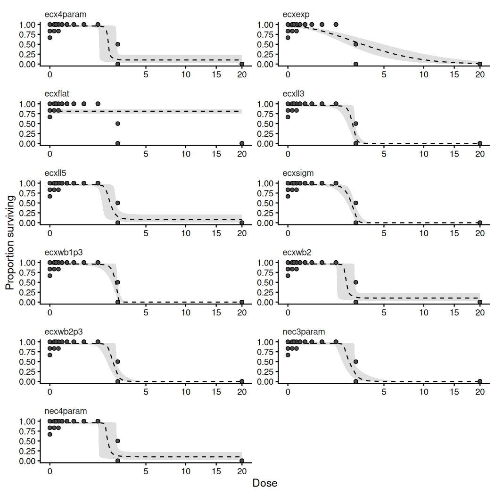
<p class="caption">plot of chunk exmp9-nass-all-curves</p>
</div>


Two equations cannot follow the observed response. `ecxflat` has no decline at
all, and `ecxexp`, whose exponential decay begins at the control, cannot remain
flat to 1.25 and then fall steeply. Each of the other 9
equations follows the decline, and their dispersion statistics agree closely
whether or not they passed the screen (medians from
1.30 to
1.37, with
`P(>1)` from
0.72 to
0.76). The
larger ratios belong to `ecxexp`
(1.76) and `ecxflat`
(5.14), so their
excess is likely to be residual variation from a curve that does not fit, and
not evidence about the family. The statistics of the equations the screen
removed come from posteriors that were not explored reliably, so we read them
only as a check on those of the retained equations, which they match.

The ratio near
1.4 in the
equations that fit suggests some variation beyond the binomial, although the 95%
intervals are wide (from
0.58 to
4.39 for
`ecxsigm`, the highest-weighted equation after screening, and
with lower bounds below 1 in
9 of these
9 equations). We retain `binomial` for this worked
analysis. With 34 rows across 11 doses, a
`beta_binomial` fit would be a useful sensitivity check before using this
estimate for a decision.

## Divergent transitions and the design

In the coral analysis a broad candidate set contained equations with divergent
transitions at the default sampling length. In this count response most of the
`decline` set fails the screen (8 of
11 fitted equations), with
108 to
5655 divergent transitions
in each failing equation. Increasing iterations alone is unlikely to resolve
these divergences. The cutoff is an absolute count over post-warmup draws, so at
an unchanged divergence rate a longer run would record more of them, and their
occurrence calls for examining the posterior geometry and the equations.

No dose was tested between 1.25 and 2.5, where the observed response changes
sharply. This sparse coverage may contribute to difficult posterior geometry for
equations that estimate a threshold or a steep midpoint, although the sampler
diagnostics do not identify the cause. Raising `adapt_delta` can reduce
divergences, but cannot supply an observation within that gap, so the gap should
be reported with any model-based no-effect estimate.


``` r
nass_nsec <- nec(nass_screened)
nass_nsec
#>       Q50      Q2.5     Q97.5 
#> 1.4446216 0.4168116 1.9112661 
#> attr(,"toxicity_estimate")
#> [1] "nec"
```

The model-averaged *N(S)EC* is 1.44
(0.42 to 1.91), with
`ecxsigm` holding 0.99
of the weight. Its upper bound is in the untested interval between 1.25 and 2.5,
and its lower bound extends below it, to doses at which every snail survived. An
analysis of these data should report the interval as such, with the equations
excluded and the reason, and not a narrower estimate obtained by loosening the
screen until more equations are retained. The fitted set illustrates what this
means.


``` r
# The control is a true zero, which a logarithmic axis cannot place. It takes
# the plotting position of the raw-data figure, and the prediction grid is
# clipped there.
nass_plot <- ggbnec_data(nass_screened)
nass_plot$x_e[nass_plot$x_e == 0] <- ctrl_pos
nass_plot$x_r[nass_plot$x_r == 0] <- ctrl_pos
nass_plot <- nass_plot[is.na(nass_plot$x_e) | nass_plot$x_e >= ctrl_pos, ]

ggplot() +
  geom_polygon(data = subset(nass_plot, !is.na(y_ci)), aes(x = x_e, y = y_ci),
               fill = "grey80", alpha = 0.7) +
  geom_line(data = subset(nass_plot, !is.na(y_e)), aes(x = x_e, y = y_e),
            linetype = 2) +
  geom_point(data = subset(nass_plot, !is.na(x_r)), aes(x = x_r, y = y_r),
             size = 1.6, alpha = 0.6) +
  geom_vline(xintercept = nass_nsec[1], colour = "grey40") +
  geom_vline(xintercept = nass_nsec[2:3], colour = "grey40", linetype = 3) +
  scale_x_continuous(transform = "log", breaks = dose_breaks,
                     labels = c("0\n(control)", "0.01", "0.04", "0.16", "0.63",
                                "2.5", "20")) +
  labs(x = "Dose", y = "Proportion surviving") +
  theme_classic()
```

<div class="figure" style="text-align: center">
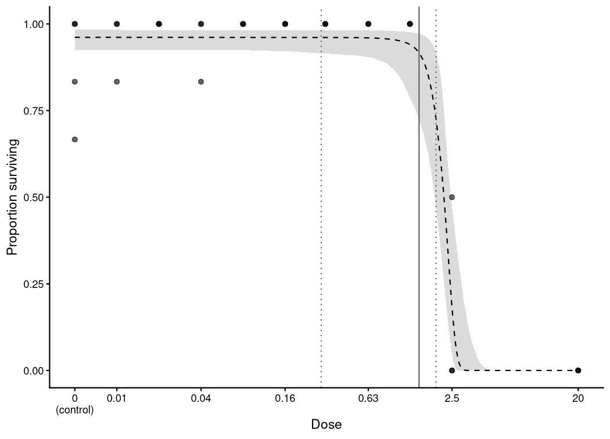
<p class="caption">plot of chunk exmp9-nass-autoplot</p>
</div>

The dashed line is the model-averaged prediction over the retained equations,
and the grey band is its 95% credible interval. The band is narrow at each dose
up to 1.25 and opens across the interval from there
to 2.5, where no dose was tested, and it remains
wide at 2.5, because the curve has to fall
somewhere in that interval and the data do not indicate where. The solid line is
the model-averaged *N(S)EC*, and the dotted lines are its bounds, at
0.42 and 1.91. The
axis is the one used for the raw-data figure, so the control keeps its marked
position, and the nine doses at or below 1.25 are
legible instead of stacked.

# A non-constant coefficient of variation {#a-non-constant-coefficient-of-variation}

In step 4 we compared the fitted spread with the observed spread within each
concentration. Here we work through a third response, whose coefficient of
variation changes systematically across concentrations although the family
fitted first assumes that it is constant. No convergence diagnostic detects this
departure.

In each family with a free dispersion parameter (e.g., `Gamma`, `Beta` or
`negbinomial`), that parameter is constant along the series unless the formula
specifies otherwise. For a `Gamma` family under the identity link, a constant
`shape` is a constant coefficient of variation (i.e., the standard deviation of
a replicate is a fixed multiple of the fitted mean at each concentration). Where
replicate variation does not behave in this way, a single `shape` is estimated
as a compromise between the low-concentration and high-concentration ends of the
series, and may describe neither.

## The assay

The `lum31` data contain the results of acute copper and zinc toxicity tests run
on the Lum-31 bioluminescent bacterial assay [@luter2025]. A suspension of
marine bacteria is dosed in a microplate well and its light output is read after
a fixed exposure, so the response is luminescence in relative light units.

Here we work through one plate of the copper series at 15 minutes (plate
`Cu 19Mar24 Rep1B`). A plate is a complete test (i.e., eleven concentrations by
four replicate wells). Because the plate reader sets its gain for each read,
plates are not on a common vertical scale, and taking a single plate avoids that
difference instead of modelling it. The group-level terms that handle the whole
assay, and the left-censoring that the blank correction requires, are described
in [*Grouping and factor
covariates*](https://open-aims.github.io/bayesnec/articles/example8.html).


``` r
data(lum31)
cu <- droplevels(subset(lum31, plate == "Cu 19Mar24 Rep1B" & minutes == 15))
c(wells = nrow(cu), concentrations = length(unique(cu$conc)),
  at_the_floor = sum(cu$censoring != "none"))
#>          wells concentrations   at_the_floor 
#>             44             11              1
```

This plate is one of two in the arm of
16 with
the fewest readings at the floor of the instrument (one of 44). A
reading held at a bound contributes a smaller spread than the well would have
shown, so a plate with many such readings would understate the quantity examined
in this section.

The four wells at a concentration share one cell of the plate, and readings from
one cell can vary together. Each fit below therefore includes `ogl(conc_group)`,
a deviation for each cell, so that the cell (and not the well) is the
observation at each concentration ([*Grouping and factor
covariates*](https://open-aims.github.io/bayesnec/articles/example8.html)
describes the term and how the model weights are computed under it). The
dispersion parameter then describes the spread of the wells within a cell.

A coefficient of variation computed from the four wells at one concentration
involves no curve, and cannot be inflated by any lack of fit in the mean. It
measures the same within-cell spread.


``` r
cv_obs <- tapply(cu$rlu_cens, cu$conc, function(z) sd(z) / mean(z))
round(cv_obs, 3)
#>     0.003 0.0137424  0.023888  0.044776  0.086552 0.1707008 0.3389984    0.6744    1.3458    2.6886 
#>     0.046     0.033     0.046     0.042     0.030     0.084     0.168     0.465     1.271     0.958 
#>    5.3742 
#>     0.876
```

The coefficient of variation is between 0.030
and 0.046 over the five lowest concentrations,
then rises without interruption to 1.271 at
1.3 mg/L, and
falls to 0.876 at the highest
concentration. The largest of these values is 28
times the control value, whereas a `Gamma` fitted with one `shape` returns a
single value for all of them.

## Fitting and screening the set

The copper response falls from its control, so `decline` is the candidate set
(the zinc series in this dataset rises above its control at low concentrations,
which is why `all` is fitted to it in *Grouping and factor covariates*).


``` r
gfam <- Gamma(link = "identity")
set.seed(17)
set_const <- bnec(rlu_cens | cens(censoring) ~ crf(log(conc), model = "decline") +
                    ogl(conc_group),
                  data = cu, family = gfam, seed = 17)
```


``` r
screened_const <- screen_models(set_const)
#> Dropping 2 of 11 candidate models that failed the sampler screen:
#>   -  ecxexp: 18 divergent transitions
#>   -  ecxwb1p3: 625 divergent transitions
#> Fitted models are: nec3param nec4param ecx4param ecxwb1 ecxwb2 ecxwb2p3 ecxll4 ecxll3 ecxflat
#> The fitted ecxflat curve does not fall to the control's 0.01 quantile within the predictor range for 7920 of 8000 draws. The NSEC summary is censored at 1.68: those draws keep their rank in it and are given no value.
#> The leave-one-group-out score has Pareto k above 0.7 for 2 of 11 levels of conc_group in ecxll4 (weight 0.32); 3 of 11 levels of conc_group in ecxwb1 (weight 0.23); 3 of 11 levels of conc_group in nec4param (weight 0.17); 4 of 11 levels of conc_group in ecx4param (weight 0.16); 4 of 11 levels of conc_group in ecxwb2 (weight 0.11). The scores of those levels are approximate; loo_controls = list(refit = TRUE) replaces them by refitting the equation without each level.
best_const <- pull_best(screened_const)
#> Highest-weighted model is ecxll4, holding 0.322 of the weight of 9 candidate models.
#> Pulling out model(s): ecxll4
```


15 equations were requested. `bnec_record()` shows
that 3 were excluded before fitting,
`ecxll5` failed to fit on these 44 observations,
and the screen removed 2 more (steps 2
and 3 describe all three mechanisms). Because a cell here is a whole
concentration, leaving out one cell removes a point on the curve, and the Pareto
*k* of such a score is often above 0.7 (the model-set check below counts the
retained equations with at least one such cell). Where it is, the model weights
are approximate. `amend(loo_controls = list(refit = TRUE))` would replace those
scores by exact refits, as in step 3, which requires one refit of an equation
for each cell above the cutoff, and we do not run it here.


``` r
copper_axis <- list(
  scale_x_continuous(transform = "log", breaks = c(0.003, 0.03, 0.3, 3),
                     labels = function(x) signif(x, 2)),
  scale_y_continuous(labels = function(x) {
    format(x, big.mark = ",", scientific = FALSE)
  }),
  labs(x = expression(paste("Copper (mg ", L^-1, ")")),
       y = "Relative light units")
)
autoplot(screened_const) + copper_axis
```

<div class="figure" style="text-align: center">
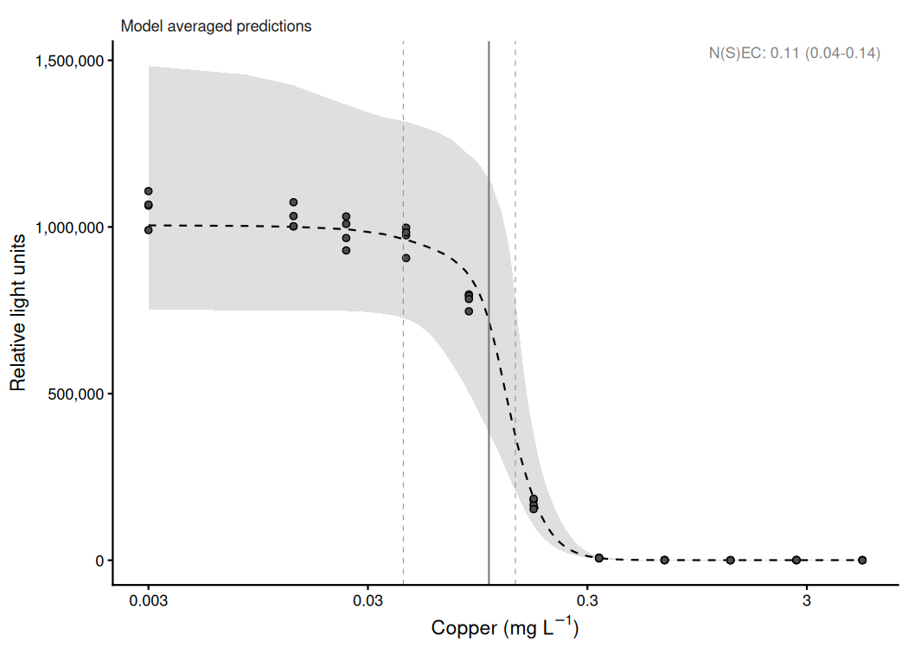
<p class="caption">plot of chunk exmp9-disp-autoplot-const</p>
</div>

The curve is the model-averaged prediction over the retained equations, shown
with its 95% credible band and with the model-averaged *N(S)EC* marked. The mean
is described well, with the response remaining above
91
per cent of its control value up to
0.045 mg/L, and falling to below one per
cent by 0.34. The credible band
describes uncertainty in the fitted mean, and its width near the control
motivates a closer check of the variation between wells there. Comparing the
band with the range of four wells is not a test of the Gamma variance
assumption, however, and we use `check_fit()` for that comparison.

## Checking variability by concentration

A constant Gamma `shape` implies a constant coefficient of variation. We use
`check_fit()` to compare the observed spread within each concentration with the
spread of replicate responses simulated from the highest-weighted equation,
`ecxll4`. The model-set check below extends this
comparison to each retained equation.


``` r
cf_const <- check_fit(best_const)
cf_const[, c("group", "n", "obs_sd", "sim_sd", "sd_ratio", "ppp_sd", "control")]
#>        group n    obs_sd     sim_sd sd_ratio ppp_sd control
#> 1      0.003 4 48659.995 537620.904    0.091  0.997    TRUE
#> 2  0.0137424 4 34254.508 524139.572    0.065  1.000   FALSE
#> 3   0.023888 4 45273.800 520883.160    0.087  0.998   FALSE
#> 4   0.044776 4 40495.610 510924.631    0.079  0.999   FALSE
#> 5   0.086552 4 23064.931 432336.791    0.053  1.000   FALSE
#> 6  0.1707008 4 14403.575  91266.743    0.158  0.994   FALSE
#> 7  0.3389984 4  1143.009   3401.405    0.336  0.937   FALSE
#> 8     0.6744 4   221.393    271.833    0.814  0.639   FALSE
#> 9     1.3458 4   251.933    173.770    1.450  0.243   FALSE
#> 10    2.6886 4   513.008    196.850    2.606  0.044   FALSE
#> 11    5.3742 4   297.087    182.787    1.625  0.183   FALSE
```

`sd_ratio` is the observed spread divided by the simulated spread, so a value of
1 indicates agreement. Here it is between
0.05 and
0.09 over the five lowest
concentrations, then rises to a maximum of
2.61 at
2.7
mg/L, and 7 of the
11 groups are flagged. The fit simulates about
11 times the spread observed at
the control, and about 3 times too little where
the ratio is largest. A single `shape` cannot do both, and a constant
coefficient of variation requires it to.

## The dispersion sub-model

`disp("power")` writes `log(shape)` as a linear function of `log(mu)`, so that
the dispersion parameter becomes a function of the fitted mean instead of a
constant. The variance functions available, the families to which each applies,
and what the estimated exponent implies for a given family are described in
[*Single model
usage*](https://open-aims.github.io/bayesnec/articles/example1.html).


``` r
set.seed(17)
set_power <- bnec(rlu_cens | cens(censoring) ~ crf(log(conc), model = "decline") +
                    ogl(conc_group) + disp("power"),
                  data = cu, family = gfam, seed = 17)
```


``` r
screened_power <- screen_models(set_power)
#> Dropping 1 of 11 candidate models that failed the sampler screen:
#>   -  ecxexp: 61 divergent transitions
#> Fitted models are: nec3param nec4param ecx4param ecxwb1 ecxwb2 ecxwb1p3 ecxwb2p3 ecxll4 ecxll3 ecxflat
#> The fitted ecxflat curve does not fall to the control's 0.01 quantile within the predictor range for 7920 of 8000 draws. The NSEC summary is censored at 1.68: those draws keep their rank in it and are given no value.
#> The leave-one-group-out score has Pareto k above 0.7 for 3 of 11 levels of conc_group in ecxll4 (weight 0.51); 3 of 11 levels of conc_group in ecx4param (weight 0.46); 3 of 11 levels of conc_group in nec4param (weight 0.015); 3 of 11 levels of conc_group in ecxwb2 (weight 0.01). The scores of those levels are approximate; loo_controls = list(refit = TRUE) replaces them by refitting the equation without each level.
best_power <- pull_best(screened_power)
#> Highest-weighted model is ecxll4, holding 0.514 of the weight of 10 candidate models.
#> Pulling out model(s): ecxll4
```


The screen is run again, and not assumed, because a dispersion sub-model changes
the posterior from which each equation is sampled. Under the sub-model it
removed 1 of the
11 fitted equations, against
2 of 11
under constant dispersion. The highest-weighted equation is
`ecxll4`, with 0.51 of the
weight, against 0.32 for
`ecxll4` under constant dispersion, and
4 equations have a weight above 0.01, against
5.


``` r
brms::fixef(pull_brmsfit(best_power))[c("c0_Intercept", "c1_Intercept"), ]
#>               Estimate  Est.Error      Q2.5     Q97.5
#> c0_Intercept 4.8669396 0.33865682 4.1884883 5.5153802
#> c1_Intercept 0.8162669 0.06889577 0.6855049 0.9556025
```

`c1` is the exponent, and a value of zero corresponds to the constant-dispersion
model. The default prior bounds `c1` to the range 0 to 2 for a `Gamma` response,
so an interval well inside that range reflects the data and not the bound. The
coefficients of variation computed above provide an estimate of this exponent
that involves no fit, because a power law makes `log(cv)` linear in `log(mu)`,
with slope `-c1/2`.


``` r
conc_mean <- tapply(cu$rlu_cens, cu$conc, mean)
obs_slope <- lm(log(cv_obs) ~ log(conc_mean))
# Multiplying by -2 reverses the order of the bounds, so the names confint()
# supplied would be attached to the wrong ends.
setNames(-2 * c(coef(obs_slope)[[2]], rev(confint(obs_slope)[2, ])),
         c("c1", "lower", "upper"))
#>        c1     lower     upper 
#> 0.7689298 0.6579071 0.8799526
c(r_squared = summary(obs_slope)$r.squared)
#> r_squared 
#> 0.9646321
```

The fitted and observed estimates agree. The fit gives
0.82
(0.69
to
0.96),
and the wells give 0.77
(0.66 to
0.88). This agreement indicates
that the sub-model describes the replicate variation the design measured, and
does not absorb a failure of the curve elsewhere in the series. A
within-concentration standard deviation involves no curve, which is what makes
that comparison informative. Whether a power law is the right form for the
relationship is a separate question, which the regression addresses here with an
R-squared of 0.965 on
9 degrees of freedom.

## Checking the dispersion sub-model

We repeat the within-concentration check after fitting `disp("power")`.


``` r
cf_power <- check_fit(best_power)
c(flagged = sum(cf_power$ppp_sd > 0.95 | cf_power$ppp_sd < 0.05),
  groups = nrow(cf_power),
  control_sd_ratio = round(cf_power$sd_ratio[cf_power$control], 3))
#>          flagged           groups control_sd_ratio 
#>            0.000           11.000            1.251
```

For the highest-weighted equation, the number of groups flagged for scale falls
from 7 to
0, and the control ratio
changes from 0.09 to
1.25. Because the final
estimates use model averages, we also check each retained equation:


``` r
cf_const_set <- check_fit(screened_const)
cf_power_set <- check_fit(screened_power)
fit_scale_summary <- function(x, label) {
  parts <- split(as.data.frame(x), x$model)
  out <- do.call(rbind, lapply(parts, function(d) {
    data.frame(model = d$model[1], wi = d$wi[1],
               ctrl_ratio = d$sd_ratio[d$control],
               n_flag = sum(d$ppp_sd < 0.05 | d$ppp_sd > 0.95, na.rm = TRUE))
  }))
  names(out)[-1] <- paste(names(out)[-1], label, sep = "_")
  out
}
scale_summary <- merge(fit_scale_summary(cf_const_set, "const"),
                       fit_scale_summary(cf_power_set, "power"), all = TRUE)
round_cols(scale_summary)
#>        model wi_const ctrl_ratio_const n_flag_const wi_power ctrl_ratio_power n_flag_power
#> 1  ecx4param    0.162            0.094            7    0.459            1.226            0
#> 2    ecxflat    0.000            0.083            7    0.000            0.084            6
#> 3     ecxll3    0.000            0.083            7    0.000            1.260            0
#> 4     ecxll4    0.322            0.091            7    0.514            1.251            0
#> 5     ecxwb1    0.229            0.081            7    0.002            1.266            0
#> 6   ecxwb1p3       NA               NA           NA    0.000            1.261            1
#> 7     ecxwb2    0.112            0.093            6    0.010            1.211            0
#> 8   ecxwb2p3    0.000            0.082            7    0.000            1.197            0
#> 9  nec3param    0.000            0.082            7    0.000            1.180            0
#> 10 nec4param    0.174            0.091            7    0.015            1.223            0
high_k <- c(const = sum(attr(cf_const_set, "pareto")$n_high_k > 0),
            power = sum(attr(cf_power_set, "pareto")$n_high_k > 0))
```

The table gives, for each equation under each structure, its weight (`wi`), the
ratio of observed to simulated standard deviation at the control (`ctrl_ratio`),
and the number of concentrations flagged for scale (`n_flag`), with `NA` where
the screen removed the equation. Under constant dispersion the control ratio is
below 0.5 in 9 of the
9 retained equations, and under
the sub-model in 1 of
10. These counts show how far the
discrepancy found in the highest-weighted equation is shared by the rest of each
set. At least one cell has Pareto *k* above 0.7 in 8 of the
retained equations under constant dispersion, and in 10 under
the sub-model.

`plot()` draws each statistic against the spread that the fit simulates for it,
and takes both fits at once where a `model` column distinguishes the panels.
Because the response falls from about
1,060,000
relative light units at the control to about
198
at its lowest, we put the display on a logarithmic scale, as on a linear scale
the lower half of the series would be a row of points on the axis.


``` r
both <- rbind(cbind(cf_const, model = "constant"),
              cbind(cf_power, model = "disp(\"power\")"))
class(both) <- class(cf_const)
plot(both) +
  scale_y_log10(labels = function(x) {
    format(x, big.mark = ",", scientific = FALSE)
  })
```

<div class="figure" style="text-align: center">
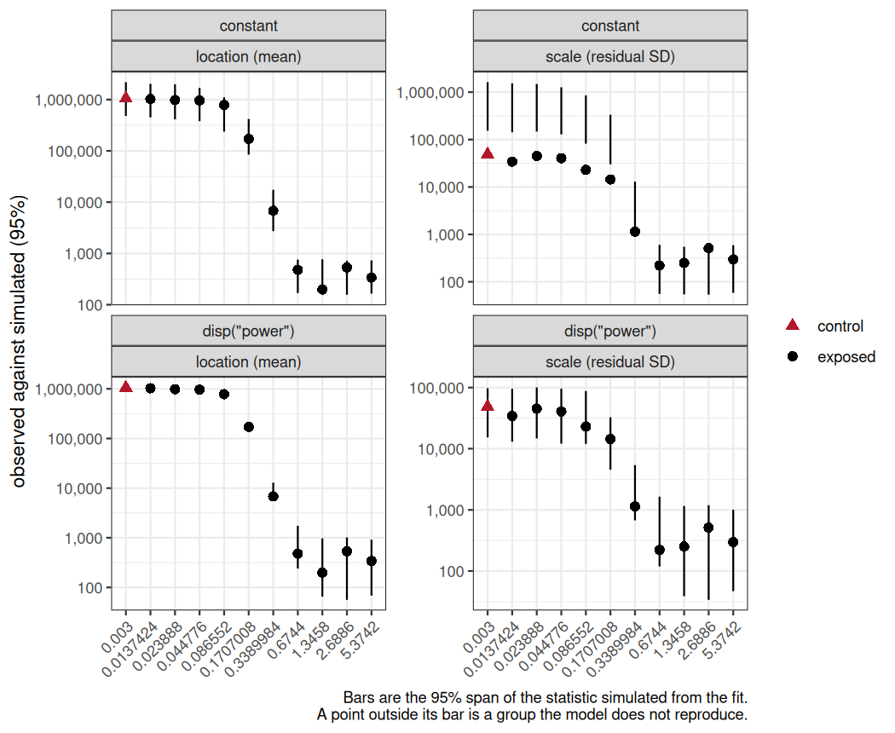
<p class="caption">plot of chunk exmp9-disp-checkfit</p>
</div>

Each bar is the 95% span of the statistic simulated from the fit, and each point
is the observed value. The observed means fall inside their bars under both
structures, although the bars are far wider under constant dispersion. This
agreement says little about the curve, because `check_fit()` simulates each
concentration with its fitted cell deviation, which can absorb a departure of
the mean from the curve. The spread of the four wells within a cell is
unaffected by that deviation, so the scale panels remain a test of the
dispersion structure, and they differ between the two structures. Under constant
dispersion the observed standard deviation falls below its bar at the
6 concentrations where the response is highest,
and the gap at the control is more than an order of magnitude
(48,700
observed, against a simulated span reaching
1,470,000).
Under the sub-model the bars close on the points, and the observed standard
deviations fall inside their bars, including that of the control
(48,700
against a span of
12,400
to
85,500).
A model can therefore reproduce the mean of each group and still be wrong about
the spread of all of them, which is the case described in the Overview, and here
the sub-model corrects it.

## The reported estimates

The estimates come from the screened set under the sub-model, shown here with
its credible band.


``` r
autoplot(screened_power) + copper_axis
```

<div class="figure" style="text-align: center">
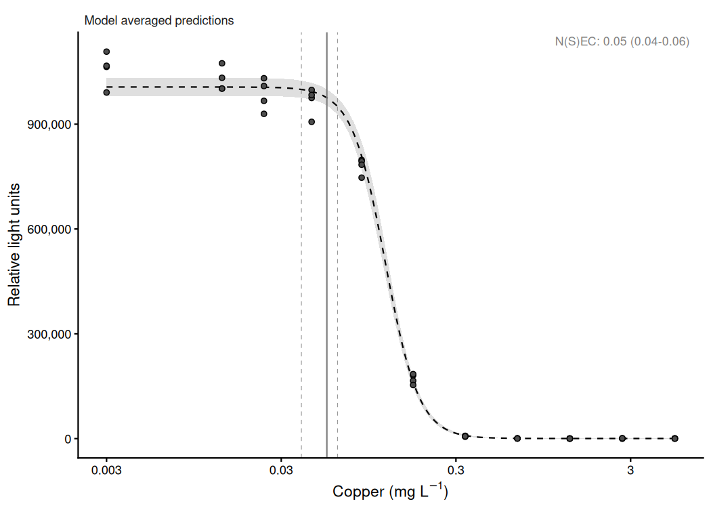
<p class="caption">plot of chunk exmp9-autoplot</p>
</div>

The curve is the model-averaged prediction over the retained equations, and the
band is its 95% credible interval, both returned on the recorded concentration
scale although the formula fitted `log(conc)`. The response remains above
91 per cent of its
control value up to 0.045 mg/L, is
at 16 per cent of it
by 0.17, and is below one per cent
by 0.34, so the whole decline
occurs over a factor of about
8 in
concentration. The vertical lines mark the model-averaged *N(S)EC* and its
bounds.

Compared with the constant-dispersion curve shown earlier, the band has narrowed
onto the observations, and the *N(S)EC* marked on the figure is lower. The
curves under constant dispersion and under the sub-model describe a common mean,
and differ in how wide each makes the posterior at the control, which is
measured below. The checks above were made on the highest-weighted equation and
on each retained equation, whereas the estimates are read from the screened
sets, because no single equation represents the model average.


``` r
copper_estimates <- rbind(
  constant_NSEC = nsec(screened_const),
  power_NSEC = nsec(screened_power),
  constant_EC10 = ecx(screened_const, ecx_val = 10),
  power_EC10 = ecx(screened_power, ecx_val = 10)
)[, c("Q50", "Q2.5", "Q97.5")]
round(copper_estimates, 3)
#>                 Q50  Q2.5 Q97.5
#> constant_NSEC 0.110 0.049 0.150
#> power_NSEC    0.076 0.058 0.098
#> constant_EC10 0.085 0.016 0.139
#> power_EC10    0.076 0.068 0.094
```

The *NSEC* falls from
0.110 to
0.076 mg/L, a factor of
1.4.
The change arises through the quantity from which `nsec()` reads its reference,
which is the posterior of the control mean with any group-level deviation
excluded.


``` r
control_reference <- function(fit) {
  nd <- data.frame(conc = min(cu$conc), censoring = "none")
  post <- posterior_epred(pull_brmsfit(fit), newdata = nd, re_formula = NA)[, 1]
  c(sd = sd(post), cv = sd(post) / mean(post),
    reference_share = unname(quantile(post, 0.01) / mean(post)))
}
control_posterior <- rbind(constant = control_reference(best_const),
                           power = control_reference(best_power))
round(control_posterior, 4)
#>                 sd     cv reference_share
#> constant 172826.67 0.1709          0.6680
#> power     38535.97 0.0386          0.8954
```

For the highest-weighted equations, this posterior is
4
times wider under constant dispersion. Because `nsec()` sets its reference at a
lower quantile of it, the reference is at
0.67 of the
control mean under constant dispersion, against
0.90 under the
sub-model. A reference placed that far below the control is crossed further
along the curve, so the constant-dispersion fit returns the *less* protective
figure, and nothing in its sampler diagnostics indicates this.

The EC10 changes by less, from
0.085 to
0.076 mg/L, whereas its
interval narrows from a width of
0.123
to 0.026
mg/L. Because the EC10 is measured at a fixed fraction of the control mean, and
not at a quantile of its posterior, the variance assumption affects it through
the precision of the curve, and not through the placement of its reference. This
is the difference between the *NSEC* and the ECx described in the Overview.

A methods section should state the dispersion structure under which each
estimate was fitted, because constant dispersion and the sub-model return
different estimates from the same data.

# Summary

The sampler screen gave a different outcome for each fit in this vignette. On
the 2050 colour data at the default sampling length it removed
6 of the 12 fitted
equations under the uninformative priors and 7 of
12 under the regularising priors. On `nassarius` it
removed 8 of 11, and on the
copper plate 2 of
11 under constant dispersion and
1 of 11
under the dispersion sub-model. Which equations fail cannot be predicted before
the screen is run, so the equations removed, and the reasons, should be reported
for each fit; a prior choice that reduces failures in one equation may increase
them in another.

The diagnostic table separates inadequate effective sample size from divergent
transitions and failed initialisation. A longer run may resolve an ESS-only
failure, whereas divergences call for examining posterior geometry, priors and
parameterisation. Sparse concentration designs may contribute to these
difficulties, particularly for equations that estimate a lower asymptote or have
more curve parameters, but the diagnostics alone do not establish that
explanation. Excluding an equation at the stated cutoff is an analysis decision
that should be reported.

The variance assumption is the one that no sampler diagnostic detects. On the
`lum31` copper plate the observed coefficient of variation ran from
0.046 at the control to
0.876 at the highest concentration, and
the constant-dispersion fit passed the sampler screen for most of its equations
while its highest-weighted equation simulated about
11 times the spread observed at
the control. Adding `disp("power")` removed the groupwise flags for that
equation and reduced the model-averaged *NSEC* from
0.110 to
0.076 mg/L. A fit can
therefore pass the checks the sampler screen applies and still simulate the
wrong spread at the concentration from which both estimators are referenced.

Several decisions made around the fits also determine the estimates. For the
colour index, the family was chosen on the support of the data and not on a
test, the influence of the priors was assessed in step 5,
`asymptote_observed = TRUE` was declared although this design cannot verify it,
and the control was substituted before logging. For the counts, `binomial` was
retained after examining dispersion across the fitted equations. None of these
is a result the workflow produces automatically, and each is a decision that the
analysis needs to record.

# References
