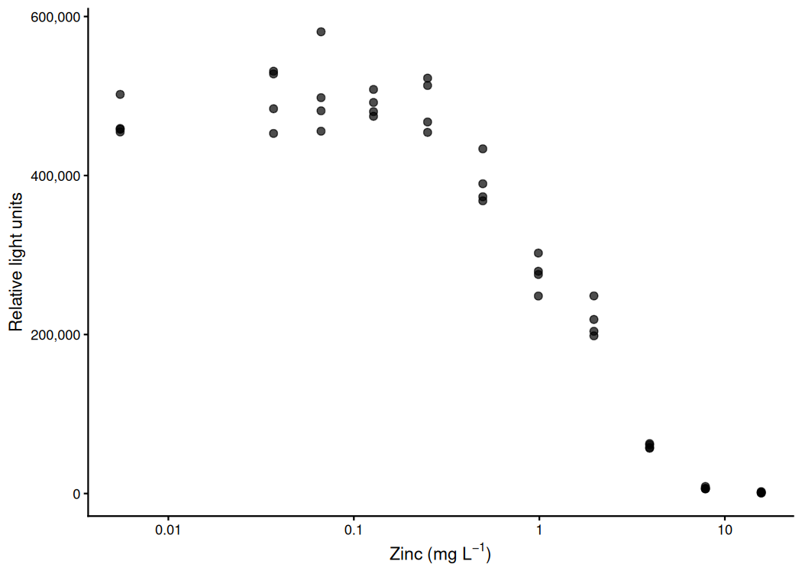
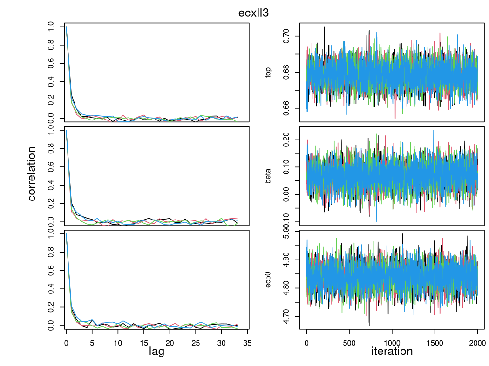

# Overview

The other vignettes each explain one part of `bayesnec` (e.g., what the model
set is, what a `bayesmanecfit` is, how priors are built, and how to handle a
two-block response). Here we run one analysis, on one plate of a bioluminescence
toxicity test, from the data through to a reportable estimate, taking the steps
in the order in which they occur:

1. Prepare the data, and choose the family, the dispersion structure and the
   terms the design requires.
2. Fit the candidate set under the default priors, and read its summary.
3. Check the sampler, refit the equations whose failure has a remedy, and screen
   out those that still fail.
4. Refit the set under regularising priors, check the sampler again, and choose
   the prior set used for inference.
5. Check the fit of the retained equations, including whether the dispersion
   structure reproduces the spread of the wells.
6. Assess the influence of the priors, and report.

The construction of the default priors, and `check_priors()`, are described in
the [*Priors*](https://open-aims.github.io/bayesnec/articles/example3.html)
vignette.

## The assumptions the diagnostics test

A Bayesian fit is usually judged on convergence, although convergence is not the
only thing that can be wrong with it. `rhat()`, `check_chains()` and
`check_sampling()` ask whether the sampler explored the posterior, and `loo` and
`waic` rank the candidate equations against one another. However, none of them
asks whether the variability implied by the fitted model matches the variability
in the data. That assumption can affect a threshold estimate even when the
sampling diagnostics are satisfactory.

The *NSEC* depends on it most directly. `nsec()` sets its reference at a
quantile of the posterior of the control mean, and the width of that posterior
depends in part on the dispersion estimated at the control. If a model simulates
more variability at the control than the data show, the reference is placed
lower, so the curve crosses it further along and the reported concentration is
higher and less protective. If a model simulates less variability, the reference
is placed higher and a lower concentration is returned. The direction of the
error is not known in advance, and no convergence diagnostic reveals it (this
point is also made, for the choice between constant and non-constant dispersion,
in [*Single model
usage*](https://open-aims.github.io/bayesnec/articles/example1.html)). The ECx
depends on this assumption less. Although it is also measured from the control
mean, it is measured at a fixed fraction of that mean and not at a quantile of
its posterior, so an error in the variance widens or narrows the ECx interval
without relocating the reference it is measured from.

A single ratio statistic for the whole fit does not detect this kind of error.
Each family with a free dispersion parameter (i.e., `gaussian`, `Gamma`,
`negbinomial`, `Beta` and `beta_binomial`) estimates that parameter from the
residuals that such a statistic summarises. The parameter therefore absorbs the
discrepancy, so that the ratio is near 1 while the fit simulates the wrong
spread at the concentrations that determine the estimate. For this reason the
check is made within concentration groups, which is what `check_fit()` does.

## The effect of exclusion

[*Multi model
usage*](https://open-aims.github.io/bayesnec/articles/example2.html) notes that
a poorly shaped model with a low predictive weight may contribute little to a
model average. A model that has not sampled adequately, however, contributes on
the basis of a posterior the sampler has not explored reliably. Because its
weight is computed from that same posterior, the weight provides no evidence
that it is safe to keep. Removing such a model changes the candidate set, and
`amend()` then recomputes the weights across the models that remain (it does not
rescale the weights of those retained), and the reported *N(S)EC* changes
accordingly.

Which models a screen will remove cannot be predicted before it is run, and the
reasons for removal differ between them. An equation given too few draws, an
equation whose posterior the sampler cannot traverse, and an equation the design
does not support are all reported under one failure flag, although the
appropriate response to each is different.

## The case study

The analysis uses one plate of the zinc series of the `lum31` bioluminescence
assay, read at 15 minutes. [*Grouping and factor
covariates*](https://open-aims.github.io/bayesnec/articles/example8.html) fits
the same plate to compare group-level terms, and here we take it through a
complete analysis. It ends with a draft of the methods and results text a paper
might give for it, in which steps 1 to 6 are presented as the supplementary
material. The threshold estimates themselves (*NEC*, *NSEC*, ECx, and the
model-averaged *N(S)EC* reported when a set mixes both kinds) are defined,
together with the candidate equations, in [*Model
details*](https://open-aims.github.io/bayesnec/articles/example2b.html).


``` r
library(bayesnec)
library(ggplot2)
```

# 1. Data, design and family

The `lum31` data contain the results of acute copper and zinc toxicity tests run
on the Lum-31 bioluminescent bacterial assay [@luter2025]. A suspension of
marine bacteria is dosed in a microplate well and its light output is read after
a fixed exposure, so the response is luminescence in relative light units
(`?lum31` documents the columns).

We use one plate of the zinc series read at 15 minutes (plate
`Zn 23Apr24 Rep6B`). A plate is a complete test (i.e., eleven concentrations by
four replicate wells). Because the plate reader sets its gain for each read,
plates are not on a common vertical scale, and taking a single plate avoids that
difference instead of modelling it. The plate terms that model it are described
in *Grouping and factor covariates*.


``` r
data(lum31)
zn <- droplevels(subset(lum31, plate == "Zn 23Apr24 Rep6B" & minutes == 15))
c(wells = nrow(zn), concentrations = length(unique(zn$conc)),
  at_the_floor = sum(zn$censoring != "none"))
#>          wells concentrations   at_the_floor 
#>             44             11              0
```


``` r
zinc_axis <- list(
  scale_x_continuous(transform = "log", breaks = c(0.01, 0.1, 1, 10),
                     labels = function(x) signif(x, 2)),
  scale_y_continuous(labels = function(x) {
    format(x, big.mark = ",", scientific = FALSE)
  }),
  labs(x = expression(paste("Zinc (mg ", L^-1, ")")),
       y = "Relative light units")
)
ggplot(zn, aes(x = conc, y = rlu_cens)) +
  geom_point(alpha = 0.7, size = 2) +
  zinc_axis +
  theme_classic()
```

<div class="figure" style="text-align: center">

<p class="caption">plot of chunk exmp9-zinc-data</p>
</div>

Each point is one well. The mean response rises above its control value at low
concentrations, to 1.08 times the control at
0.067 mg/L, remains above 90 per cent of the
control up to
0.25 mg/L, and falls to
0.3 per cent of it at the
highest concentration (15.7 mg/L). The mean at each
of the second to fifth concentrations is above the mean at the lowest on
8 of the 17 zinc plates of this assay read at 15
minutes, so a rise of this kind is common in the assay, and step 2 includes
equations that allow it.

The four wells at a concentration share one cell of the plate, and readings from
one cell can vary together. Each fit below therefore includes `ogl(conc_group)`,
a deviation for each cell, so that the cell (and not the well) is the
observation at each concentration. *Grouping within a concentration* in
[*Grouping and factor
covariates*](https://open-aims.github.io/bayesnec/articles/example8.html)
compares fits of this plate with and without the term, and describes how the
model weights are computed under it. The dispersion parameter then describes the
spread of the wells within a cell.

Concentrations are measured dissolved zinc, and the lowest
(0.0055 mg/L) serves as the control, because `bayesnec` takes the
control to be the lowest value of the predictor. The concentrations span
3.5 orders of
magnitude, so we fit zinc on a log scale, and because the lowest value is
positive no substitution is needed before taking logarithms.

Luminescence is continuous and positive, so we use a `Gamma` family with an
identity link, which keeps `top` and any estimated lower asymptote (`bot`) on
the scale of relative light units. Readings were blank-corrected, and on some
plates a well emitting less light than the blank was recorded as zero. Such a
reading is below the floor of the instrument and is not an absence of light, so
it is left-censored: `rlu_cens | cens(censoring)` replaces it by the smallest
positive reading on the plate and declares that the true value is below that
bound (`?lum31`, and *Censoring* in [*Single model
usage*](https://open-aims.github.io/bayesnec/articles/example1.html)).
No reading on this plate is at the floor, so the censoring term changes nothing here, and we keep it so that the same call fits any plate.

A `Gamma` family with one `shape` parameter assumes a constant coefficient of
variation (i.e., the standard deviation of a well is a fixed multiple of the
fitted mean at each concentration). The coefficient of variation computed from
the four wells at one concentration involves no curve, so it can be read before
any fit:


``` r
cv_obs <- tapply(zn$rlu_cens, zn$conc, function(z) sd(z) / mean(z))
round(cv_obs, 3)
#>             0.0055 0.0369017711781889 0.0665589995131451   0.12761799902629   0.24973599805258 
#>              0.048              0.075              0.107              0.030              0.069 
#>  0.495716538948393  0.987677620740019   1.96811069863681   3.93072139727361   7.85594279454722 
#>              0.076              0.080              0.103              0.046              0.204 
#>   15.7063855890944 
#>              0.603
```


Up to 3.9 mg/L the coefficient of variation is
between 0.03 and
0.11, and at
the 2 higher concentrations
it is 0.20 and 0.60, as the response falls
towards zero. One `shape` cannot describe both, so each fit below includes
`disp("power")`, which lets the dispersion parameter change with the fitted mean
(see *Non-constant dispersion* in [*Single model
usage*](https://open-aims.github.io/bayesnec/articles/example1.html)).
[*Grouping and factor
covariates*](https://open-aims.github.io/bayesnec/articles/example8.html) fits
the zinc plates of this assay with the same term, and step 5 compares it with
constant dispersion.

# 2. The candidate set and its priors

The zinc response rises above its control before it falls (step 1), so we
request `model = "all"`. It adds the hormesis equations, which allow such a
rise, to the equations for a declining response and the constant equation
`ecxflat` (a response independent of concentration). An equation that fits or
samples poorly is not made suitable by being assigned a small model weight, and
steps 3 to 5 check each one.

Some equations estimate a lower asymptote (`bot`), whereas the others decline
towards zero. Here the response is near zero only at the highest
concentrations (step 1), so the design includes little of the lower limb from
which `bot` is estimated.

The family and the logged predictor also rule out equations before sampling, for
example an equation that can predict a negative mean under an identity link,
which a `Gamma` family cannot take, or one that raises a negative logged
concentration to a fractional power. `bnec_record()` lists those excluded, with
the reasons, after the fit below. `get_priors()` returns entries only for the
equations that remain valid ([*Model
details*](https://open-aims.github.io/bayesnec/articles/example2b.html) gives
their equations, and `?models` the model groups).


``` r
gfam <- Gamma(link = "identity")
zinc_formula <- rlu_cens | cens(censoring) ~
  crf(log(conc), model = "all") + ogl(conc_group) + disp("power")
prior_default <- get_priors(zinc_formula, data = zn, family = gfam,
                            prior_type = "uninformative")
names(prior_default)
#>  [1] "nec3param"   "nec4param"   "nechorme"    "nechorme4"   "ecxexp"      "ecx4param"  
#>  [7] "ecxwb1"      "ecxwb2"      "ecxwb1p3"    "ecxwb2p3"    "ecxll5"      "ecxll4"     
#> [13] "ecxll3"      "ecxhormebc4" "ecxflat"
```

We fit these 15 equations first under the default
`"uninformative"` priors (`?bnec` describes the set). Step 4 fits them again
under the `"regularizing"` priors, which provide the sampler with more
information about plausible parameter values, to test whether that information
allows the equations that fail in step 3 to be sampled. For example, the default
entries for the `top`, `bot`, `ec50` and `f` parameters of `ecxll5` are:


``` r
selected_priors <- function(x) {
  p <- as.data.frame(x[["ecxll5"]])
  p <- p[p$nlpar %in% c("top", "bot", "ec50", "f"),
         c("nlpar", "prior", "lb", "ub")]
  rownames(p) <- NULL
  p
}
entries_default <- selected_priors(prior_default)
entries_default
#>   nlpar                                       prior                lb               ub
#> 1   top              gamma(2, 4.16172894867444e-06)                 0             <NA>
#> 2   bot              gamma(2, 3.20461413161126e-05)                 0             <NA>
#> 3  ec50 normal(-0.70175100967784, 24.4000626374049) -5.20300718674371 2.75406735508393
#> 4     f                                normal(0, 5)              <NA>             <NA>
```

`top` and `bot` are gamma priors on the response scale. `ec50` is a normal prior
on log concentration, bounded below by the logged control and (because
`asymptote_observed = TRUE`, the default) above by the logged highest
concentration. `f`, the exponent that sets the asymmetry of `ecxll5`, is
normal(0, 5).
[*Priors*](https://open-aims.github.io/bayesnec/articles/example3.html) explains
how the entries are constructed and how to compare them with the posterior.

## Fitting the full set

`bnec()` uses four chains and 10,000 iterations per chain by default. Under its
warmup rule the first 8,000 iterations of each chain are discarded, so 8,000
post-warmup draws remain across the four chains. We use these defaults here and
for the refits in steps 4 and 5, with identical data and seed. The `seed`
argument controls Stan's sampler, whereas `set.seed()` controls the initial
values `bayesnec` generates in R, so both are set. The precompiled vignette uses
the `cmdstanr` backend
(through `options(brms.backend = "cmdstanr")`); without that option `brms` uses
`rstan`, and the diagnostic counts below may differ.


``` r
set.seed(17)
fit_default <- bnec(zinc_formula, data = zn, family = gfam,
                    prior_type = "uninformative", seed = 17, refresh = 0)
#> Dropping the model neclin, neclinhorme, nechormepwr01, ecxlin as they are not valid in the case of a Gamma with identity link.
#> Dropping the model(s) necsigm, nechormepwr, nechorme4pwr, ecxsigm as they are not valid for data with negative predictor (x) values.
#> Dropping the model ecxhormebc5 because it cannot be reliably initialised for a Gamma with identity link when the predictor (x) contains negative values. Use a scientifically appropriate non-negative predictor scale or select another equation.
#> The response is still declining at the top of the series: the mean rlu_cens falls from 6800 to 1360 as log(conc) rises from 2.06 to 2.75 (p = 0.0015, one-sided).
#> The lower asymptote may not be identified by this design: where an equation estimates bot its default prior is derived from the observed response, and the default nec and ec50 priors are bounded to the tested range, so they exclude a threshold above it. Inspect the entries with get_priors() and supply scientifically justified ones through the prior argument where information beyond the design is available. Where the design did stop before the asymptote, declare it with asymptote_observed = FALSE, which spans the bot prior from the floor of the response to the mean at the highest predictor level, removes the upper bound of the nec and ec50 priors, and widens the initial-value search to match.
#> Fitted models are: nec3param nec4param nechorme nechorme4 ecxexp ecx4param ecxwb1 ecxwb2 ecxwb1p3 ecxwb2p3 ecxll5 ecxll4 ecxll3 ecxhormebc4 ecxflat
#> The fitted ecxflat curve does not fall to the control's 0.01 quantile within the predictor range for 7920 of 8000 draws. The NSEC summary is censored at 2.75: those draws keep their rank in it and are given no value.
#> The leave-one-group-out score has Pareto k at or above 0.7 for 3 of 11 levels of conc_group in ecxwb1 (weight 0.57); 4 of 11 levels of conc_group in ecxll5 (weight 0.37); 1 of 11 levels of conc_group in ecxll3 (weight 0.031); 4 of 11 levels of conc_group in ecxhormebc4 (weight 0.02). The affected scores are approximate; loo_controls = list(refit = TRUE) replaces them by refitting the equation without each level.The control group's observed and simulated response differ by more than 15% for: nec3param, nec4param, nechorme, nechorme4, ecxexp, ecx4param, ecxwb1, ecxwb2, ecxwb1p3, ecxwb2p3, ecxll5, ecxll4, ecxll3, ecxhormebc4, ecxflat.
#> nsec() reads its reference from the control, so this is the region most likely to move a reported no-effect concentration.
#> See check_fit() for the per-group table. This is a modelling result, not a fault.
```

While fitting, `bnec()` also prints a line as it begins and completes each
equation, and the sampler prints its own warnings, including the number of
divergent transitions; those lines are omitted above, and step 3 examines the
same diagnostics with `check_sampling()`. Before fitting, `bnec()` names the
equations it drops, for the reasons given above. The messages after fitting
concern the fitted equations. They report, where any occur, the draws for which
a curve does not fall to the NSEC reference within the tested range (those
draws are censored in the NSEC summary), the cells whose Pareto *k* is at or
above 0.7 (step 3), and the equations whose control mean or spread is not
reproduced within 15% (step 5).


``` r
record_default <- bnec_record(fit_default)
record_default$excluded
#>           model
#> 1        neclin
#> 2   neclinhorme
#> 3 nechormepwr01
#> 4        ecxlin
#> 5       necsigm
#> 6   nechormepwr
#> 7  nechorme4pwr
#> 8       ecxsigm
#> 9   ecxhormebc5
#>                                                                                                       reason
#> 1                                                                  not valid for Gamma with an identity link
#> 2                                                                  not valid for Gamma with an identity link
#> 3                                                                  not valid for Gamma with an identity link
#> 4                                                                  not valid for Gamma with an identity link
#> 5               raises the predictor to a fractional power, which is undefined for negative predictor values
#> 6               raises the predictor to a fractional power, which is undefined for negative predictor values
#> 7               raises the predictor to a fractional power, which is undefined for negative predictor values
#> 8               raises the predictor to a fractional power, which is undefined for negative predictor values
#> 9 cannot be reliably initialised for Gamma with an identity link when the predictor contains negative values
is.null(record_default$substitutions)
#> [1] TRUE
```

`bnec_record()` gives the equations excluded before fitting, with the reasons
above, and any value changed to make the response compatible with the family
(`substitutions`, which is `NULL` here because `rlu_cens` is strictly positive).
Every requested equation is either excluded or `attempted`, and an attempted
equation that did not fit remains in `attempted`. `failed_models()` lists such
equations, and in this run no equation failed to fit. It also
keeps the priors and initial values used for each failed equation, which are
useful when investigating the failure. A different initialisation or prior may
allow such a fit to start (step 4 refits the set under other priors), although
that does not show that the resulting posterior is identified by these
concentrations.

## The summary of the fitted set

`summary()` gives the model weights, computed from leave-one-cell-out scores,
the model-averaged *N(S)EC*, and the Bayesian R² and number of divergent
transitions of each equation. It ends with a warning that names each equation
whose maximum Rhat exceeds 1.01 or which has more than ten divergent
transitions, and each equation whose control mean or spread is not reproduced
within 15%.


``` r
summary_default <- summary(fit_default)
```


``` r
summary_default
#> Object of class bayesmanecfit
#> 
#>  Family: gamma  
#>   Links: mu = identity; shape = log  
#> 
#> Number of posterior draws per model:  8000
#> 
#> Model weights (Method: pseudobma_bb_weights; each level of conc_group left out):
#>                waic    elpd   wi
#> nec3param    981.24 -505.91 0.00
#> nec4param    984.07 -511.81 0.00
#> nechorme     981.71 -506.47 0.00
#> nechorme4    984.27 -511.24 0.00
#> ecxexp       998.11 -531.20 0.00
#> ecx4param    982.71 -506.13 0.00
#> ecxwb1       981.48 -497.19 0.57
#> ecxwb2       983.40 -508.09 0.00
#> ecxwb1p3     988.08 -511.04 0.00
#> ecxwb2p3     981.01 -504.25 0.00
#> ecxll5       979.70 -497.66 0.37
#> ecxll4       983.19 -505.60 0.00
#> ecxll3       980.87 -501.94 0.03
#> ecxhormebc4  981.19 -502.22 0.02
#> ecxflat     1043.81 -557.08 0.00
#> 
#> 
#> Summary of weighted N(S)EC posterior estimates:
#> NB: Model set combines sampled NEC and curve-read NSEC
#>     estimates in proportion to model weight.
#>        Estimate Q2.5 Q97.5
#> N(S)EC     0.37 0.14  1.03
#> 
#> 
#> Bayesian R2 estimates:
#>             Estimate Est.Error Q2.5 Q97.5
#> nec3param       0.98      0.00 0.97  0.99
#> nec4param       0.98      0.00 0.97  0.99
#> nechorme        0.98      0.00 0.97  0.99
#> nechorme4       0.98      0.00 0.97  0.99
#> ecxexp          0.98      0.00 0.97  0.98
#> ecx4param       0.98      0.00 0.97  0.99
#> ecxwb1          0.98      0.00 0.97  0.99
#> ecxwb2          0.98      0.00 0.97  0.99
#> ecxwb1p3        0.98      0.00 0.97  0.99
#> ecxwb2p3        0.98      0.00 0.97  0.99
#> ecxll5          0.98      0.00 0.97  0.99
#> ecxll4          0.98      0.00 0.97  0.99
#> ecxll3          0.98      0.00 0.97  0.99
#> ecxhormebc4     0.98      0.00 0.97  0.99
#> ecxflat         0.95      0.02 0.91  0.98
#> 
#> 
#> Divergent transitions after warmup:
#>             n_divergent
#> nec3param             0
#> nec4param            89
#> nechorme              0
#> nechorme4            17
#> ecxexp               66
#> ecx4param             0
#> ecxwb1                0
#> ecxwb2                0
#> ecxwb1p3              0
#> ecxwb2p3              0
#> ecxll5             1284
#> ecxll4                0
#> ecxll3                0
#> ecxhormebc4           0
#> ecxflat               0
#> 
#> 
#> Fitted by bayesnec 2.1.3.44, installed from a local source, which records no commit, under R 4.6.1.
#> Warning in print.manecsummary(x): Rhat > 1.01 (no convergence):
#>   -  nec4param
#>   -  ecxll5
#> 
#> Divergent transitions > 10 (see ?check_sampling):
#>   -  nec4param (89, model weight 0.00)
#>   -  nechorme4 (17, model weight 0.00)
#>   -  ecxexp (66, model weight 0.00)
#>   -  ecxll5 (1284, model weight 0.37)
#> 
#> control observed/simulated ratio beyond 1.15 (see ?check_fit):
#>   -  nec3param
#>   -  nec4param
#>   -  nechorme
#>   -  nechorme4
#>   -  ecxexp
#>   -  ecx4param
#>   -  ecxwb1
#>   -  ecxwb2
#>   -  ecxwb1p3
#>   -  ecxwb2p3
#>   -  ecxll5
#>   -  ecxll4
#>   -  ecxll3
#>   -  ecxhormebc4
#>   -  ecxflat
#> Sampler failures should be dropped (see ?amend or ?screen_models).
#> A control mis-fit is a result, not a fault: inspect it with check_fit().
```


These weights are computed over every fitted equation, including any that the
warning names. In this run the warning names 4 of the 15 fitted equations for their Rhat or divergent transitions, and together they hold 0.37 of the model weight. The model-averaged *N(S)EC* in the summary therefore includes equations whose posteriors the sampler may not have explored reliably, and it is not an estimate to report. Step 3 examines the sampler diagnostics of each
equation and removes those that fail them before any estimate is read.

# 3. Sampler diagnostics and screening

An attempted equation that produces draws must still be checked. The package
screen uses a maximum Rhat of 1.01, a minimum effective sample size (ESS, the
smaller of the bulk and tail values) of 400, and at most ten divergent
transitions. The Rhat and ESS cutoffs follow the recommendations of
@Vehtari2021, whereas the allowance of ten divergences is a `bayesnec`
convention (Stan regards any divergence as evidence that some part of the
posterior was not explored). A screen result is specific to the data, priors,
sampler settings and seed. The table gives the curve parameters of each valid
equation, its maximum Rhat, minimum ESS and number of divergent transitions
under the default priors, and whether it failed the screen.


``` r
round_cols <- function(x, digits = 3) {
  num <- vapply(x, is.numeric, logical(1))
  x[num] <- lapply(x[num], round, digits)
  x
}
sampling_default <- check_sampling(fit_default)
valid <- names(prior_default)
curve_parameters <- lapply(valid, function(m) names(show_params(m)[[1]]$pforms))
first_run <- sampling_default[match(valid, sampling_default$model), ]
data.frame(
  model = valid,
  parameters = vapply(curve_parameters, paste, character(1), collapse = ", "),
  max_rhat = round(first_run$max_rhat, 3),
  min_ess = round(first_run$min_ess),
  n_divergent = first_run$n_divergent,
  failed = first_run$failed,
  row.names = NULL
)
#>          model                 parameters max_rhat min_ess n_divergent failed
#> 1    nec3param             top, beta, nec    1.002    1514           0  FALSE
#> 2    nec4param        bot, top, beta, nec    1.016     107          89   TRUE
#> 3     nechorme      top, beta, nec, slope    1.005    1292           0  FALSE
#> 4    nechorme4 bot, top, beta, nec, slope    1.007     795          17   TRUE
#> 5       ecxexp                  top, beta    1.006    1489          66   TRUE
#> 6    ecx4param       bot, ec50, top, beta    1.003    1714           0  FALSE
#> 7       ecxwb1       bot, ec50, top, beta    1.002    1795           0  FALSE
#> 8       ecxwb2       bot, ec50, top, beta    1.003    1687           0  FALSE
#> 9     ecxwb1p3            ec50, top, beta    1.005     938           0  FALSE
#> 10    ecxwb2p3            ec50, top, beta    1.001    1868           0  FALSE
#> 11      ecxll5    bot, top, beta, ec50, f    1.148      18        1284   TRUE
#> 12      ecxll4       bot, top, beta, ec50    1.004    1897           0  FALSE
#> 13      ecxll3            top, beta, ec50    1.003    1647           0  FALSE
#> 14 ecxhormebc4     top, beta, ec50, slope    1.003    1892           0  FALSE
#> 15     ecxflat                        top    1.006    1235           0  FALSE
```


A row of `NA` marks an attempted equation with no draws, which is distinct from
a fitted equation that missed a cutoff. Under the default priors
11 of the 15 fitted
equations passed (`nec3param`, `nechorme`, `ecx4param`, `ecxwb1`, `ecxwb2`, `ecxwb1p3`, `ecxwb2p3`, `ecxll4`, `ecxll3`, `ecxhormebc4` and `ecxflat`), and
4 of the
4 that failed had more than ten divergent
transitions. Of the 7 equations with a `bot` parameter,
4 passed, against
7 of the
8 equations without one. The diagnostics do
not show which parameter is responsible for a failure.

## Kinds of failure

The `failed` flag does not distinguish which cutoff was missed, although the
remedy differs between them. An equation that misses the Rhat or ESS cutoff with
few divergences may only have been given too few draws, and more iterations may
raise its ESS. Divergences describe a different problem: additional draws visit
the difficult part of the posterior more often, so increasing `iter` by itself
is unlikely to remove them. A higher `adapt_delta` (set through the `control`
argument) makes the sampler take smaller steps and may reduce them. If Stan also
warns about maximum tree depth, `max_treedepth` is the relevant control to
examine (see `?check_sampling`). An equation that never initialises is recorded
by `failed_models()`, and has no sampler diagnostics to screen.

The ESS floor and the divergence allowance are both absolute counts. At an
unchanged divergence rate a longer run will record more divergences, while it
may also provide enough draws for an ESS above 400. A comparison between runs
therefore needs their chain counts, iterations and warmup beside the diagnostic
table. The decision also uses `min_ess` (an absolute count) and not
`min_ess_ratio` (a measure of sampling efficiency), so a model can meet the
count after many draws while still sampling inefficiently; `check_sampling()`
returns both. The 1.01 Rhat cutoff is also the one used by `rhat()` and
`summary()`.

An equation that fails on Rhat or ESS with no more than ten divergent
transitions should be refitted under the same prior with more iterations before
it is excluded, because changing the prior would not test whether the original
run was too short. The chunk below refits any such equation with twice the
iterations and warmup, thinned by two so that it keeps the 8,000 draws of the
other equations (the model weights compare leave-out scores computed from equal
numbers of draws), and replaces it in the set before screening. An equation
with more than ten divergent transitions is instead refitted with the same
iterations at `adapt_delta = 0.99`, or at 0.999 if its first fit already used
0.99. Steps 4 and 5 apply the same rules to their refits.


``` r
retry_models <- function(tab) tab$model[tab$failed & tab$n_divergent <= 10]
tune_models <- function(tab) tab$model[tab$failed & tab$n_divergent > 10]
refit_failed <- function(fit, retry, tune) {
  if (!length(retry) && !length(tune)) return(fit)
  longer <- lapply(retry, function(m) {
    update(pull_out(fit, model = m), iter = 2e4, warmup = 1.6e4, thin = 2,
           refresh = 0)
  })
  tuned <- lapply(tune, function(m) {
    first <- brms::control_params(pull_brmsfit(fit, model = m))$adapt_delta
    delta <- if (isTRUE(first >= 0.99)) 0.999 else 0.99
    update(pull_out(fit, model = m), control = list(adapt_delta = delta),
           refresh = 0)
  })
  # c() keeps the first copy of an equation it is given twice, so the refits
  # come first.
  do.call(c, c(longer, tuned, list(fit)))
}
retry_default <- retry_models(sampling_default)
tune_default <- tune_models(sampling_default)
set.seed(17)
refit_default <- refit_failed(fit_default, retry_default, tune_default)
sampling_default_refit <- check_sampling(refit_default)
```


``` r
refitted_default <- c(retry_default, tune_default)
if (length(refitted_default)) {
  round_cols(sampling_default_refit[sampling_default_refit$model %in%
                                      refitted_default, ])
}
#>       model max_rhat  min_ess min_ess_ratio n_divergent failed
#> 1 nec4param    1.148   11.072         0.001         272   TRUE
#> 2 nechorme4    1.008  721.932         0.090           4  FALSE
#> 3    ecxexp    1.002 1320.768         0.165           0  FALSE
#> 4    ecxll5    1.006 1527.431         0.191           0  FALSE
```

In this run the longer refit was applied to
no equation, and the refit at a higher
`adapt_delta` to `nec4param`, `nechorme4`, `ecxexp` and `ecxll5`.
The table above gives the diagnostics of each refitted equation after its refit, and the screen below uses those.

## Screening the model set

`screen_models()` drops each equation that misses any cutoff, names it with the
cutoffs it failed, and recomputes the model weights over the equations that
pass. Its messages are the record a methods section should cite, so we leave
them visible. The constant equation `ecxflat` may remain because it samples
well, even where it has almost no predictive weight: the screen asks whether the
posterior draws are reliable, and does not select equations for their fit to the
observed response. If every fitted equation fails, the function stops with the
reasons instead of returning a model average.


``` r
screened_default <- screen_models(refit_default)
#> Dropping 1 of 15 candidate models that failed the sampler screen:
#>   -  nec4param: Rhat 1.148, ESS 11.1, 272 divergent transitions
#> Fitted models are: nechorme4 ecxexp ecxll5 nec3param nechorme ecx4param ecxwb1 ecxwb2 ecxwb1p3 ecxwb2p3 ecxll4 ecxll3 ecxhormebc4 ecxflat
#> The fitted ecxflat curve does not fall to the control's 0.01 quantile within the predictor range for 7920 of 8000 draws. The NSEC summary is censored at 2.75: those draws keep their rank in it and are given no value.
#> The leave-one-group-out score has Pareto k at or above 0.7 for 3 of 11 levels of conc_group in
#> ecxwb1 (weight 0.7); 4 of 11 levels of conc_group in ecxll5 (weight 0.23); 1 of 11 levels of
#> conc_group in ecxll3 (weight 0.036); 4 of 11 levels of conc_group in ecxhormebc4 (weight 0.023).
#> The affected scores are approximate; loo_controls = list(refit = TRUE) replaces them by refitting
#> the equation without each level.
```

After the refits, the screen retained
14 of the
15 fitted equations
(`nechorme4`, `ecxexp`, `ecxll5`, `nec3param`, `nechorme`, `ecx4param`, `ecxwb1`, `ecxwb2`, `ecxwb1p3`, `ecxwb2p3`, `ecxll4`, `ecxll3`, `ecxhormebc4` and `ecxflat`).

## Cell-level model weights

The four wells in a cell are related observations, so leaving out one well at a
time would overstate how well a model predicts a new cell. Because
`ogl(conc_group)` is in the formula, the default model weights instead leave out
a whole cell at a time, and are computed from those leave-one-cell-out scores by
the default pseudo-BMA method. A cell here is a whole concentration, so leaving
it out removes a point on the curve. Pareto *k* assesses whether the
importance-sampling approximation to each left-out score is reliable, and the
score of a cell with *k* at or above 0.7 is unreliable until an exact refit
replaces it. `check_fit()` returns these diagnostics for each equation as its
`"pareto"` attribute, and we show the model weight, the number of cells at or
above 0.7 and the largest *k* for each retained equation. This check belongs
after screening, because the weights of models whose posterior was not sampled
adequately should not be interpreted.


``` r
pareto_rows <- function(x) {
  p <- attr(check_fit(x, ndraws = 100), "pareto")
  if (anyNA(p$n_high_k)) stop("Pareto diagnostics are unavailable")
  p[, c("model", "weight", "n_high_k", "max_k")]
}
pareto_default <- pareto_rows(screened_default)
round_cols(pareto_default)
#>          model weight n_high_k max_k
#> 1    nechorme4  0.000        5 0.958
#> 2       ecxexp  0.000        2 1.128
#> 3       ecxll5  0.235        4 0.926
#> 4    nec3param  0.001        3 0.936
#> 5     nechorme  0.000        3 0.947
#> 6    ecx4param  0.001        4 1.154
#> 7       ecxwb1  0.696        3 0.902
#> 8       ecxwb2  0.000        3 0.976
#> 9     ecxwb1p3  0.004        2 1.170
#> 10    ecxwb2p3  0.003        1 0.845
#> 11      ecxll4  0.001        4 0.938
#> 12      ecxll3  0.036        1 0.859
#> 13 ecxhormebc4  0.023        4 0.827
#> 14     ecxflat  0.000        1 1.760
```

In this run 14 of the
14 retained equations had at least one cell with *k* at or
above 0.7 (the largest *k* was
1.76).
`amend(x, loo_controls = list(refit = TRUE))` replaces each such score by
refitting the equation without that cell, which takes one refit for each cell at
or above the cutoff. The weights of this set are used only to compare it with
later fits, so we make the exact refits only for the set the reported estimates
come from (step 4), and the weights below are approximate.


``` r
weights_of <- function(x, label) {
  w <- summary(x)$mod_weights
  setNames(data.frame(rownames(w), w[, "wi"], row.names = NULL),
           c("model", label))
}
weights_default <- weights_of(screened_default, "uninformative")
round_cols(weights_default)
#>          model uninformative
#> 1    nechorme4         0.000
#> 2       ecxexp         0.000
#> 3       ecxll5         0.235
#> 4    nec3param         0.001
#> 5     nechorme         0.000
#> 6    ecx4param         0.001
#> 7       ecxwb1         0.696
#> 8       ecxwb2         0.000
#> 9     ecxwb1p3         0.004
#> 10    ecxwb2p3         0.003
#> 11      ecxll4         0.001
#> 12      ecxll3         0.036
#> 13 ecxhormebc4         0.023
#> 14     ecxflat         0.000
```


The weights are the share of the model-averaged prediction assigned to each
equation, and sum to one. `ecxwb1` has the highest weight
(0.70). A small weight does
not validate an equation that sampled poorly (e.g., an equation with many
divergent transitions can still be given a large weight), which is why the
weights are read only after screening.

## Chain mixing

The screen summarises each chain in a few numbers, whereas the traces show the
draws themselves. Here we inspect the traces for the highest-weighted equation:


``` r
best_default <- pull_best(screened_default)
check_chains(best_default)
```

<div class="figure" style="text-align: center">

<p class="caption">plot of chunk exmp9-chains</p>
</div>


For `ecxwb1` the maximum Rhat is
1.002 and the minimum ESS
1795, and the autocorrelation between draws
five iterations apart is at most 0.06 for its
population-level parameters (averaged over the chains). The trace panels show
whether the four chains share one stable range, which a satisfactory Rhat
summarises but does not replace, and before reporting a model average we would
inspect the traces of each retained equation.
`check_chains()` can write one page per equation to a PDF for that review:


``` r
check_chains(screened_default, filename = "zinc_chains")
```

# 4. The regularising priors


After the refits of step 3, 1 of the 15 fitted equations still failed the screen under the default priors (`nec4param`). The `"regularizing"` priors (`?bnec`) are narrower than the
defaults, and they centre `top` and `bot` on the mean response at the lowest
and the highest concentrations. They therefore provide the sampler with more
information about plausible parameter values, and refitting under them tests whether the equations that failed can be fitted and sampled when the priors provide that information. The
entries for `ecxll5` that correspond to those of step 2 are:


``` r
prior_regular <- get_priors(zinc_formula, data = zn, family = gfam,
                            prior_type = "regularizing")
entries_regular <- selected_priors(prior_regular)
entries_regular
#>   nlpar                                       prior                lb               ub
#> 1   top                  gamma(13.8081, 2.7338e-05)                 0             <NA>
#> 2   bot                 gamma(1.07984, 5.88682e-05)                 0             <NA>
#> 3  ec50 normal(-0.70175100967784, 1.93490243969714) -5.20300718674371 2.75406735508393
#> 4     f                                normal(0, 1)              <NA>             <NA>
```

The bounds of `ec50` are unchanged and its standard deviation is smaller, `top`
and `bot` are concentrated around the mean response at the lowest and the
highest concentrations, and `f` is
normal(0, 1) instead of
normal(0, 5). Narrower priors may
stabilise sampling on sparse data, but they can also narrow the reported
interval where the likelihood provides little information.

We refit the whole candidate set under these priors, and not only the equations
that failed. Step 6 compares the estimates of the equations that pass under both
prior sets, which requires each of them to be fitted under both. The model
weights of a set that combined equations fitted under different priors would
depend on those priors as well as on the shapes of the curves, so such a set
could not be reported as fitted under one prior set.


``` r
set.seed(17)
fit_regular <- bnec(zinc_formula, data = zn, family = gfam,
                    prior_type = "regularizing", seed = 17, refresh = 0)
```


This fit prints the same kinds of message as the fit of step 2, and they are not
shown. In this run no equation failed to fit under the
regularising priors.

## Sampler diagnostics under both prior sets

The table compares the first run under each prior set, before any refit. Each
entry gives the maximum Rhat, the minimum ESS and the number of divergent
transitions, followed by the screen result, and "did not fit" marks an attempted
equation with no draws.


``` r
sampling_regular <- check_sampling(fit_regular)
diagnostic_label <- function(tab, model) {
  i <- match(model, tab$model)
  if (is.na(i)) return("did not fit")
  x <- tab[i, ]
  sprintf("%.3f / %.0f / %d %s", x$max_rhat, x$min_ess, x$n_divergent,
          if (x$failed) "fail" else "pass")
}
data.frame(
  model = valid,
  uninformative = vapply(valid, diagnostic_label, character(1),
                         tab = sampling_default),
  regularizing = vapply(valid, diagnostic_label, character(1),
                        tab = sampling_regular),
  row.names = NULL
)
#>          model          uninformative            regularizing
#> 1    nec3param  1.002 / 1514 / 0 pass   1.002 / 1856 / 0 pass
#> 2    nec4param  1.016 / 107 / 89 fail   1.003 / 1102 / 0 pass
#> 3     nechorme  1.005 / 1292 / 0 pass   1.004 / 1716 / 1 pass
#> 4    nechorme4  1.007 / 795 / 17 fail   1.003 / 1077 / 4 pass
#> 5       ecxexp 1.006 / 1489 / 66 fail 1.004 / 1193 / 109 fail
#> 6    ecx4param  1.003 / 1714 / 0 pass   1.002 / 1571 / 0 pass
#> 7       ecxwb1  1.002 / 1795 / 0 pass   1.003 / 1554 / 0 pass
#> 8       ecxwb2  1.003 / 1687 / 0 pass   1.002 / 1899 / 0 pass
#> 9     ecxwb1p3   1.005 / 938 / 0 pass   1.005 / 1013 / 0 pass
#> 10    ecxwb2p3  1.001 / 1868 / 0 pass   1.002 / 1994 / 0 pass
#> 11      ecxll5 1.148 / 18 / 1284 fail   1.004 / 1702 / 4 pass
#> 12      ecxll4  1.004 / 1897 / 0 pass   1.002 / 2020 / 0 pass
#> 13      ecxll3  1.003 / 1647 / 0 pass   1.002 / 1994 / 0 pass
#> 14 ecxhormebc4  1.003 / 1892 / 0 pass   1.003 / 1928 / 1 pass
#> 15     ecxflat  1.006 / 1235 / 0 pass   1.005 / 1046 / 0 pass
```


On the first run 14 of the
15 fitted equations passed under the regularising
priors, against 11 of
15 under the default priors, and `nec4param`, `nechorme4` and `ecxll5` passed only under the regularising priors. Of the
1 equations that failed under both prior sets,
0 had fewer divergent transitions under the regularising
priors.

Stan also records the time each chain spent in warmup and in sampling, and
`rstan::get_elapsed_time()` reads it from the `stanfit` held in each equation's
`brmsfit`. The table gives the sum over the four chains, in seconds, for the
same first run. These times exclude compiling each Stan program and searching
for initial values, and they depend on the machine and on what else it was
running, so they are given for comparison between equations and prior sets
only.


``` r
sampling_seconds <- function(fit) {
  vapply(valid, function(m) {
    if (!m %in% fit$success_models) return(NA_real_)
    sum(rstan::get_elapsed_time(pull_brmsfit(fit, model = m)$fit))
  }, numeric(1))
}
seconds_default <- sampling_seconds(fit_default)
seconds_regular <- sampling_seconds(fit_regular)
data.frame(model = valid, uninformative = round(seconds_default),
           regularizing = round(seconds_regular), row.names = NULL)
#>          model uninformative regularizing
#> 1    nec3param            93           53
#> 2    nec4param           111           69
#> 3     nechorme           293          179
#> 4    nechorme4           523          223
#> 5       ecxexp           218          202
#> 6    ecx4param            93           50
#> 7       ecxwb1            83           41
#> 8       ecxwb2           102           61
#> 9     ecxwb1p3            87           48
#> 10    ecxwb2p3            92           52
#> 11      ecxll5           175          189
#> 12      ecxll4            92           50
#> 13      ecxll3            81           43
#> 14 ecxhormebc4           244          130
#> 15     ecxflat            48           46
```


Warmup and sampling took 39 min in total under
the default priors and 24 min under the
regularising priors, and 44%
and 14% of those totals were
spent on the equations that failed the screen.

## Refits and screening under the regularising priors

The equations that failed under the regularising priors are refitted by the
rules of step 3, and the set is then screened, and its cell-level weights
checked, in the same way.


``` r
retry_regular <- retry_models(sampling_regular)
tune_regular <- tune_models(sampling_regular)
set.seed(17)
refit_regular <- refit_failed(fit_regular, retry_regular, tune_regular)
sampling_regular_refit <- check_sampling(refit_regular)
```


``` r
screened_regular <- screen_models(refit_regular)
#> All 15 candidate models passed the sampler screen (Rhat <= 1.01, ESS >= 400, divergences <= 10).
```


``` r
pareto_regular <- pareto_rows(screened_regular)
round_cols(pareto_regular)
#>          model weight n_high_k max_k
#> 1       ecxexp  0.000        1 1.168
#> 2    nec3param  0.000        4 0.954
#> 3    nec4param  0.000        5 0.944
#> 4     nechorme  0.000        4 0.991
#> 5    nechorme4  0.000        5 1.148
#> 6    ecx4param  0.003        5 1.350
#> 7       ecxwb1  0.796        4 0.886
#> 8       ecxwb2  0.000        5 1.092
#> 9     ecxwb1p3  0.008        2 1.116
#> 10    ecxwb2p3  0.003        4 0.874
#> 11      ecxll5  0.144        4 0.883
#> 12      ecxll4  0.005        4 1.065
#> 13      ecxll3  0.020        4 0.873
#> 14 ecxhormebc4  0.021        3 1.038
#> 15     ecxflat  0.000        1 1.561
```


``` r
zinc_weights <- merge(weights_default,
                        weights_of(screened_regular, "regularizing"),
                        all = TRUE)
round_cols(zinc_weights)
#>          model uninformative regularizing
#> 1    ecx4param         0.001        0.003
#> 2       ecxexp         0.000        0.000
#> 3      ecxflat         0.000        0.000
#> 4  ecxhormebc4         0.023        0.021
#> 5       ecxll3         0.036        0.020
#> 6       ecxll4         0.001        0.005
#> 7       ecxll5         0.235        0.144
#> 8       ecxwb1         0.696        0.796
#> 9     ecxwb1p3         0.004        0.008
#> 10      ecxwb2         0.000        0.000
#> 11    ecxwb2p3         0.003        0.003
#> 12   nec3param         0.001        0.000
#> 13   nec4param            NA        0.000
#> 14    nechorme         0.000        0.000
#> 15   nechorme4         0.000        0.000
```

In this run the longer refit was applied to
no equation under the regularising priors, and
the refit at a higher `adapt_delta` to
`ecxexp`. After these refits the screen
retained 15 equations
(`ecxexp`, `nec3param`, `nec4param`, `nechorme`, `nechorme4`, `ecx4param`, `ecxwb1`, `ecxwb2`, `ecxwb1p3`, `ecxwb2p3`, `ecxll5`, `ecxll4`, `ecxll3`, `ecxhormebc4` and `ecxflat`), against
14 under the default priors. Under
the regularising priors 15 of the retained
equations had at least one cell with *k* at or above 0.7, and as in step 3 the
weights of both sets are approximate. They sum to one within each set, and an
equation absent from a set is `NA`.

## The set used for inference

We choose the prior set used for inference by a rule fixed before any estimate
is read. The set whose screen retains more equations after the refits is used,
because more of the candidate set is then available to the model average. Where
both screens retain the same number, the set that needed fewer refits is used,
and where those are also equal, the set on which the sampler spent less time,
first run and refits together. The rule depends on the screens and the sampler
alone, so the choice of prior set does not depend on the estimates.


``` r
refit_seconds <- function(refit, models) {
  sum(sampling_seconds(refit)[models], na.rm = TRUE)
}
refitted_regular <- c(retry_regular, tune_regular)
prior_rule <- data.frame(
  prior_type = c("uninformative", "regularizing"),
  retained = c(length(screened_default$success_models),
               length(screened_regular$success_models)),
  refits = c(length(refitted_default), length(refitted_regular)),
  minutes = c(sum(seconds_default, na.rm = TRUE) +
                refit_seconds(refit_default, refitted_default),
              sum(seconds_regular, na.rm = TRUE) +
                refit_seconds(refit_regular, refitted_regular)) / 60
)
prior_rule$minutes <- round(prior_rule$minutes, 1)
prior_rule
#>      prior_type retained refits minutes
#> 1 uninformative       14      4    79.8
#> 2  regularizing       15      1    33.6
use_regular <- with(prior_rule, {
  if (retained[2] != retained[1]) {
    retained[2] > retained[1]
  } else if (refits[2] != refits[1]) {
    refits[2] < refits[1]
  } else {
    minutes[2] < minutes[1]
  }
})
screened_final <- if (use_regular) screened_regular else screened_default
final_prior <- if (use_regular) "regularizing" else "uninformative"
```


The screen retained 14 equations under the default priors and 15 under the regularising priors, so the analysis continues with the regularising priors. Whichever set the rule selects, the regularising priors needed 1 refit against 4 under the default priors, and 33.6 min of sampler time against 79.8. The times depend on the machine, as noted above.

The weights of the chosen set are used for the reported estimates, so the cells
with Pareto *k* at or above 0.7 are now refitted exactly, which takes one refit
of an equation for each such cell.


``` r
refit_high_k <- function(x, p) {
  if (any(p$n_high_k > 0)) amend(x, loo_controls = list(refit = TRUE)) else x
}
set.seed(17)
screened_final <- refit_high_k(screened_final,
                               if (use_regular) pareto_regular else pareto_default)
```


``` r
weights_final <- weights_of(screened_final, final_prior)
round_cols(weights_final)
#>          model regularizing
#> 1       ecxexp        0.000
#> 2    nec3param        0.002
#> 3    nec4param        0.000
#> 4     nechorme        0.002
#> 5    nechorme4        0.000
#> 6    ecx4param        0.001
#> 7       ecxwb1        0.765
#> 8       ecxwb2        0.000
#> 9     ecxwb1p3        0.005
#> 10    ecxwb2p3        0.004
#> 11      ecxll5        0.106
#> 12      ecxll4        0.001
#> 13      ecxll3        0.050
#> 14 ecxhormebc4        0.063
#> 15     ecxflat        0.000
best_final <- pull_best(screened_final)
```

With the exact scores, `ecxwb1` has the highest weight
(0.77).

# 5. Fit diagnostics

Sampler diagnostics concern the posterior draws, whereas `check_fit()` compares
the observed and simulated response within each concentration. We apply it
first to the highest-weighted equation of the set chosen in step 4, and then to
each retained equation. For a censored reading, `check_fit()` uses the bound in
both the observed and the simulated statistics, and it gives the number of such
readings in each group as `n_cens`. No reading on this plate is censored, so every concentration enters the checks unchanged.

## Spread by concentration

`check_fit()` compares the observed spread within each concentration with the
spread of replicate responses simulated from the highest-weighted equation,
fitted with `disp("power")`.


``` r
cf_power <- check_fit(best_final)
cf_power[, c("group", "n", "obs_sd", "sim_sd", "sd_ratio", "ppp_sd", "control")]
#>                 group n    obs_sd    sim_sd sd_ratio ppp_sd control
#> 1              0.0055 4 22434.081 30492.290    0.736  0.732    TRUE
#> 2  0.0369017711781889 4 37464.135 30830.194    1.215  0.334   FALSE
#> 3  0.0665589995131451 4 54082.173 31358.456    1.725  0.104   FALSE
#> 4    0.12761799902629 4 14890.359 31709.399    0.470  0.917   FALSE
#> 5    0.24973599805258 4 33579.664 31380.593    1.070  0.444   FALSE
#> 6   0.495716538948393 4 29708.262 26216.347    1.133  0.401   FALSE
#> 7   0.987677620740019 4 22150.891 20703.973    1.070  0.444   FALSE
#> 8    1.96811069863681 4 22479.608 18098.118    1.242  0.318   FALSE
#> 9    3.93072139727361 4  2747.361  7653.628    0.359  0.963   FALSE
#> 10   7.85594279454722 4  1387.255  1702.597    0.815  0.656   FALSE
#> 11   15.7063855890944 4   817.993   569.450    1.436  0.286   FALSE
```


`sd_ratio` is the observed spread divided by the simulated spread, so a value of
1 indicates agreement, and a concentration is flagged where the posterior
predictive p-value of its standard deviation is outside [0.05, 0.95]. Here the
ratio is between 0.36 and
1.72, it is
0.74 at the control, and 1 of the 11 concentrations is flagged (at 3.9 mg/L). With
four wells at each concentration, a single flag is not by itself a reason to
change the model, and the next section compares this fit with one that assumes
a constant coefficient of variation.

## The dispersion sub-model

`disp("power")` writes `log(shape)` as a linear function of `log(mu)`, so that
the dispersion parameter becomes a function of the fitted mean instead of a
constant. The variance functions available, the families to which each applies,
and what the estimated exponent implies for a given family are described in
[*Single model
usage*](https://open-aims.github.io/bayesnec/articles/example1.html).


``` r
brms::fixef(pull_brmsfit(best_final))[c("c0_Intercept", "c1_Intercept"), ]
#>               Estimate Est.Error      Q2.5     Q97.5
#> c0_Intercept 5.0814799 0.2974875 4.4607948 5.6283859
#> c1_Intercept 0.6724017 0.1271646 0.4446969 0.9551326
```

`c1` is the exponent, and a value of zero corresponds to the constant-dispersion
model. The default prior bounds `c1` to the range 0 to 2 for a `Gamma` response,
so an interval well inside that range reflects the data and not the bound. The
coefficients of variation computed in step 1 provide an estimate of this
exponent that involves no fit, because a power law makes `log(cv)` linear in
`log(mu)`, with slope `-c1/2`.


``` r
conc_mean <- tapply(zn$rlu_cens, zn$conc, mean)
obs_slope <- lm(log(cv_obs) ~ log(conc_mean))
# Multiplying by -2 reverses the order of the bounds, so the names confint()
# supplied would be attached to the wrong ends.
setNames(-2 * c(coef(obs_slope)[[2]], rev(confint(obs_slope)[2, ])),
         c("c1", "lower", "upper"))
#>        c1     lower     upper 
#> 0.6537501 0.3093311 0.9981690
c(r_squared = summary(obs_slope)$r.squared)
#> r_squared 
#> 0.6719781
```


The fit gives 0.67
(0.44 to 0.96)
for `ecxwb1`, and the wells give
0.65 (0.31 to
1.00), so the two intervals
overlap.
This agreement indicates that the sub-model describes the replicate variation the design measured, and does not absorb a failure of the curve elsewhere in the series.
Whether a power law is the right form for the relationship is a separate
question, which the regression addresses with an R-squared of
0.672 on
9 degrees of freedom.

## Checking the dispersion sub-model

To show what the sub-model changes, we refit the same equation with a constant
`shape`, under the same priors, and repeat the check.


``` r
const_formula <- as.formula(paste0(
  "rlu_cens | cens(censoring) ~ crf(log(conc), model = \"", best_final$model,
  "\") + ogl(conc_group)"
))
set.seed(17)
fit_const <- bnec(const_formula, data = zn, family = gfam,
                  prior_type = final_prior, seed = 17, refresh = 0)
```


``` r
cf_const <- check_fit(fit_const)
cf_const[, c("group", "n", "obs_sd", "sim_sd", "sd_ratio", "ppp_sd", "control")]
#>                 group n    obs_sd    sim_sd sd_ratio ppp_sd control
#> 1              0.0055 4 22434.081 92675.773    0.242  0.983    TRUE
#> 2  0.0369017711781889 4 37464.135 88594.966    0.423  0.939   FALSE
#> 3  0.0665589995131451 4 54082.173 87688.539    0.617  0.845   FALSE
#> 4    0.12761799902629 4 14890.359 85456.399    0.174  0.997   FALSE
#> 5    0.24973599805258 4 33579.664 82503.608    0.407  0.949   FALSE
#> 6   0.495716538948393 4 29708.262 71142.427    0.418  0.943   FALSE
#> 7   0.987677620740019 4 22150.891 54028.004    0.410  0.940   FALSE
#> 8    1.96811069863681 4 22479.608 34833.492    0.645  0.808   FALSE
#> 9    3.93072139727361 4  2747.361 11188.112    0.246  0.986   FALSE
#> 10   7.85594279454722 4  1387.255  1165.099    1.191  0.371   FALSE
#> 11   15.7063855890944 4   817.993   245.065    3.338  0.001   FALSE
```


With a constant `shape`, `ecxwb1`
simulates about 4.1 times the spread observed at the control and about 3.3 times too little at 15.7 mg/L, and 4 of the
11 concentrations are flagged, against 1
with `disp("power")`. The control ratio is
0.24 with a constant `shape` and
0.74 with the sub-model. Because the estimates use
model averages, we also check each equation retained in the set used for
inference:


``` r
cf_power_set <- check_fit(screened_final)
scale_summary <- do.call(rbind, lapply(
  split(as.data.frame(cf_power_set), cf_power_set$model),
  function(d) {
    data.frame(model = d$model[1], wi = d$wi[1],
               ctrl_ratio = d$sd_ratio[d$control], n_flag = flagged_sd(d))
  }
))
rownames(scale_summary) <- NULL
round_cols(scale_summary)
#>          model    wi ctrl_ratio n_flag
#> 1    ecx4param 0.001      0.716      1
#> 2       ecxexp 0.000      1.339      2
#> 3      ecxflat 0.000      0.259      5
#> 4  ecxhormebc4 0.063      0.716      0
#> 5       ecxll3 0.050      0.739      1
#> 6       ecxll4 0.001      0.729      1
#> 7       ecxll5 0.106      0.735      1
#> 8       ecxwb1 0.765      0.736      1
#> 9     ecxwb1p3 0.005      0.776      1
#> 10      ecxwb2 0.000      0.716      1
#> 11    ecxwb2p3 0.004      0.728      1
#> 12   nec3param 0.002      0.716      1
#> 13   nec4param 0.000      0.696      1
#> 14    nechorme 0.002      0.714      1
#> 15   nechorme4 0.000      0.715      1
```

The table gives, for each retained equation, its weight (`wi`), the ratio of
observed to simulated standard deviation at the control (`ctrl_ratio`) and the
number of concentrations flagged for spread (`n_flag`). The control ratio is
0.26 to 1.34 across the
15 equations, and
2 of them have more than one flagged
concentration.

`plot()` draws each statistic against the spread that the fit simulates for it,
and takes both fits at once where a `model` column distinguishes the panels.
Because the response falls from about
504,000
relative light units at the control to about
1,360 at
its lowest, we put the display on a logarithmic scale, as on a linear scale the
lower half of the series would be a row of points on the axis.


``` r
both <- rbind(cbind(cf_power, model = "disp(\"power\")"),
              cbind(cf_const, model = "constant"))
class(both) <- class(cf_power)
plot(both) +
  scale_y_log10(labels = function(x) {
    format(x, big.mark = ",", scientific = FALSE)
  })
```

<div class="figure" style="text-align: center">

<p class="caption">plot of chunk exmp9-disp-checkfit</p>
</div>


Each bar is the 95% span of the statistic simulated from the fit, and each point
is the observed value. Of the 11 concentrations, the observed
mean falls inside its bar at 11 with the sub-model
and at 11 with a constant `shape`. This says little
about the curve, because `check_fit()` simulates each concentration with its
fitted cell deviation, which can absorb a departure of the mean from the curve.
The spread of the four wells within a cell is unaffected by that deviation, so
the scale panels remain a test of the dispersion structure. The observed
standard deviation falls inside its bar at 11 of those
concentrations with the sub-model and at 7 with a
constant `shape`. A model can reproduce the mean of each group and still be
wrong about the spread, which is the case described in the Overview.

# 6. Prior sensitivity and reporting

## The influence of the priors

Model averages over the default and regularising sets differ both in their
priors and in the equations that passed the screen. To isolate the effect of the
priors, we compare the estimates from the smooth (ECx) equations that passed
under both prior sets, excluding `ecxflat`, and then compare the model average of
the set used for inference with that of the other set. The weights of the
common sets, and of the default set, are computed without exact refits,
so they may be approximate (step 3).


``` r
shared_models <- intersect(names(models(screened_default)),
                           names(models(screened_regular)))
shared_models <- setdiff(shared_models[grepl("^ecx", shared_models)], "ecxflat")
if (!length(shared_models)) {
  stop("No smooth equation passed the screen under both priors.")
}
make_common <- function(x, selected) {
  fits <- lapply(selected, function(m) pull_out(x, model = m))
  if (length(fits) == 1L) fits[[1]] else do.call(c, fits)
}
common_default <- make_common(screened_default, shared_models)
common_regular <- make_common(screened_regular, shared_models)
```


``` r
estimate_rows <- function(x, label) {
  est <- rbind(EC10 = ecx(x, ecx_val = 10), EC50 = ecx(x, ecx_val = 50),
               NSEC = nsec(x))[, c("Q50", "Q2.5", "Q97.5")]
  data.frame(estimate = rownames(est), prior_type = label, est,
             row.names = NULL)
}
prior_effect <- rbind(estimate_rows(common_default, "uninformative"),
                      estimate_rows(common_regular, "regularizing"))
prior_effect <- prior_effect[order(prior_effect$estimate), ]
round_cols(prior_effect)
#>   estimate    prior_type   Q50  Q2.5 Q97.5
#> 1     EC10 uninformative 0.296 0.177 0.909
#> 4     EC10  regularizing 0.282 0.174 0.835
#> 2     EC50 uninformative 1.501 1.186 2.014
#> 5     EC50  regularizing 1.480 1.182 1.924
#> 3     NSEC uninformative 0.357 0.126 1.082
#> 6     NSEC  regularizing 0.294 0.101 0.968
```


Each pair of rows estimates one quantity from the common set
(`ecxexp`, `ecxll5`, `ecx4param`, `ecxwb1`, `ecxwb2`, `ecxwb1p3`, `ecxwb2p3`, `ecxll4`, `ecxll3` and `ecxhormebc4`), fitted to identical observations, so the
difference between rows can be attributed to the priors within those equations.
The median NSEC is 0.357 mg/L under
the default priors and 0.294 mg/L
under the regularising priors, and the median EC50 is
1.501 and
1.480 mg/L. The width of the NSEC
interval is 0.955 and
0.867 mg/L. Where an
interval is narrower under the regularising priors, the difference may reflect
their stronger assumptions as well as information from the data, and cannot be
presented as precision supplied solely by the experiment.

## The final model-averaged fit

We report the estimates of the screened set fitted under the regularising
priors (step 4), shown here with its credible band.


``` r
autoplot(screened_final) + zinc_axis
```

<div class="figure" style="text-align: center">

<p class="caption">plot of chunk exmp9-autoplot</p>
</div>

The curve is the model-averaged prediction over the retained equations, and the
band is its 95% credible interval, both returned on the recorded concentration
scale although the formula fitted `log(conc)`. The vertical lines mark the
model-averaged *N(S)EC* and its bounds. That estimate mixes the sampled NEC of
any monotone threshold equation retained (`nec3param` or `nec4param`) with an
NSEC read off the fitted curve for each smooth equation and for any hormesis
threshold equation retained (`nechorme` or `nechorme4`). The table gives the
median and
equal-tailed 95% credible interval of the EC10, EC50 and NSEC (mg/L) from this
set, for which `nsec()` applies one control-reference definition to every
retained equation.


``` r
zinc_estimates <- rbind(
  EC10 = ecx(screened_final, ecx_val = 10),
  EC50 = ecx(screened_final, ecx_val = 50),
  NSEC = nsec(screened_final)
)[, c("Q50", "Q2.5", "Q97.5")]
round(zinc_estimates, 4)
#>         Q50   Q2.5  Q97.5
#> EC10 0.2859 0.1755 0.9448
#> EC50 1.4920 1.1876 2.0078
#> NSEC 0.2991 0.1004 1.0747
```

The model-averaged EC10 is 0.286
mg/L (0.175 to
0.945), the EC50 is
1.492 mg/L
(1.188 to
2.008), and the NSEC is
0.299 mg/L
(0.100 to
1.075). The ECx values use the
default absolute response scale, and `type = "range"` would instead measure the
decline between the fitted upper and lower response levels. A flat equation may
have no ECx crossing within the tested range, in which case the messages and
warnings above report how many draws were censored.


The model average over the default set gives an EC10 of
0.296, an EC50 of
1.502 and an NSEC of
0.353 mg/L
(0.124 to
1.066), so the choice of priors
changes the median EC10 by 3 per cent, the median EC50 by
1 per cent and the median NSEC by 18
per cent. That comparison includes any difference between the equations the two
screens retained, as well as the priors.

## The dispersion structure and the estimates

The fits of `ecxwb1` with and without the sub-model
describe a common mean, and differ in how wide each makes the posterior at the
control.


``` r
dispersion_estimates <- rbind(
  power_NSEC = nsec(best_final),
  constant_NSEC = nsec(fit_const),
  power_EC10 = ecx(best_final, ecx_val = 10),
  constant_EC10 = ecx(fit_const, ecx_val = 10)
)[, c("Q50", "Q2.5", "Q97.5")]
round(dispersion_estimates, 4)
#>                  Q50   Q2.5  Q97.5
#> power_NSEC    0.2759 0.0871 0.4183
#> constant_NSEC 0.3034 0.0824 0.4766
#> power_EC10    0.2672 0.1753 0.3902
#> constant_EC10 0.2672 0.1725 0.3990
```


``` r
control_reference <- function(fit) {
  nd <- data.frame(conc = min(zn$conc), censoring = "none")
  post <- posterior_epred(pull_brmsfit(fit), newdata = nd, re_formula = NA)[, 1]
  c(sd = sd(post), cv = sd(post) / mean(post),
    reference_share = unname(quantile(post, 0.01) / mean(post)))
}
control_posterior <- rbind(power = control_reference(best_final),
                           constant = control_reference(fit_const))
round(control_posterior, 4)
#>                sd     cv reference_share
#> power    22342.74 0.0446          0.8949
#> constant 26947.59 0.0536          0.8830
```


For `ecxwb1` the median *NSEC* is
0.276 mg/L with the sub-model and
0.303 mg/L with a constant `shape`. The difference
arises through the quantity from which `nsec()` reads its reference, which is
the posterior of the control mean with any group-level deviation excluded. This
posterior is 1.2 times as wide with a constant
`shape` as with the sub-model. Because `nsec()` sets its reference at a lower
quantile of it, the reference is at
0.89 of the
control mean with the sub-model, against
0.88 with a
constant `shape`. A reference placed lower is crossed further along the curve, so the constant-dispersion fit returns the *less* protective figure, and nothing in its sampler diagnostics indicates this.

The EC10 is 0.267 mg/L
with the sub-model and
0.267 mg/L with a
constant `shape`, with interval widths of
0.215
and
0.226
mg/L. Because the EC10 is measured at a fixed fraction of the control mean, and
not at a quantile of its posterior, the variance assumption affects it through
the precision of the curve, and not through the placement of its reference. This
is the difference between the *NSEC* and the ECx described in the Overview.

These values depend on the cell term, on `asymptote_observed = TRUE`, on the
candidate set, on the regularising priors and on the dispersion sub-model,
and they describe one plate. A methods section should state each of these.

# Draft methods and results text

Here we give a draft of how the analysis above might be described in a paper.
It refers to steps 1 to 6 of this vignette as Supplementary Material S1 to S6
(e.g., the sampler diagnostics table of step 3 would be Table S3). The values
are those computed above, and would update with any change to the analysis.

## Statistical analysis


Concentrations of zinc that reduced the luminescence of the Lum-31 assay by 10%
and 50% (EC10 and EC50), and the no-significant-effect concentration (NSEC;
@fisherfox2023), were estimated for one plate read at 15 minutes using the R
package `bayesnec` [@fisher2024], which fits concentration-response models in
Stan through `brms` [@Burkner2017]. Luminescence (relative light units) was
modelled as a function of log measured zinc concentration, using a gamma
distribution with an identity link and a group-level intercept for the four
wells at each concentration. Because the coefficient of variation among the
wells rose as the response fell, the logarithm of the gamma shape parameter was
modelled as a linear function of the logarithm of the mean (a power-law
dispersion sub-model; S1). The candidate model set comprised the
15 equations of the `bayesnec` `all` group that are valid
for these data (declining equations, equations that allow a rise above the
control at low concentrations, and one constant equation; S2), fitted first with
the package's default (uninformative) priors. Each equation was fitted with four
chains of 10,000 iterations, of which the first 8,000 were discarded as warmup.
Equations were excluded where the maximum R-hat exceeded 1.01 or the minimum
bulk or tail effective sample size was below 400 [@Vehtari2021], or where more
than ten divergent transitions occurred; an equation that failed only on R-hat
or effective sample size was first refitted with twice the number of
iterations, and one with more than ten divergent transitions with a target
acceptance rate (`adapt_delta`) of 0.99, or 0.999 where its first fit had
already used 0.99 (S3). Because equations still failed after these refits, the candidate set was refitted with the
package's regularising priors, which are narrower and centre the upper and lower
response levels on the mean response at the lowest and highest concentrations,
and screened in the same way. The prior set whose screen retained more equations
was used for inference; on a tie, the set that needed fewer refits, and then the
set with less sampler time (S4). Posterior predictions from the retained
equations were combined using pseudo-Bayesian model averaging weights [@Yao2018]
calculated from cross-validation that left out the four wells of one
concentration at a time [@vehtari2017], with exact refits where the Pareto *k*
diagnostic was at or above 0.7 (S4). The fit of each retained equation was
assessed by comparing the observed mean and standard deviation of the response
at each concentration with those simulated from the posterior, and the
highest-weighted equation was refitted with a constant shape parameter for
comparison (S5). The sensitivity of the estimates to the priors was assessed by
comparing the estimates from the smooth (ECx) equations that passed the screen
under both prior sets, and the model averages of the two sets (S6). Both prior
sets bounded the NEC and EC50 priors to the tested concentration range (the
package default).

## Results


Mean luminescence was
469,000
relative light units in the controls, rose to
1.08 times that value at
0.067 mg/L, and fell to
0.3 per cent of it at
15.7 mg/L. The coefficient of variation among the
four wells at a concentration was 0.048 at the control
and reached 0.603 at
15.7 mg/L (S1).
Under the default priors 11 of the 15 candidate equations passed the sampler screen on the first run and 14 after 4 refits (S3); under the regularising priors 14 passed on the first run and 15 after 1 refit (S4). The sampler took 79.8 min under the default priors and 33.6 min under the regularising priors, first run and refits together. The analysis therefore used the regularising priors, under which `ecxwb1` had the highest weight (0.77; S4).

With the dispersion sub-model, the ratio of observed to simulated standard deviation for that equation was 0.74 at the control and 1 of 11 concentrations were flagged by the posterior predictive p-value of the standard deviation; with a constant shape parameter the ratio was 0.24 and 4 concentrations were flagged. The estimated exponent of the sub-model was 0.67 (95% CI 0.44–0.96), against 0.65 (0.31–1.00) estimated from the wells without a fitted curve (S5). The modelled concentrations that reduced luminescence by 10% and
50% (EC10 and EC50) were
0.286 (95% CI
0.175–0.945)
and 1.492
(1.188–2.008)
mg/L, respectively, and the NSEC was
0.299
(0.100–1.075)
mg/L (Table S6). The model average under the default priors gave a
median NSEC of 0.353 mg/L, and
for the smooth equations that passed under both prior sets
(`ecxexp`, `ecxll5`, `ecx4param`, `ecxwb1`, `ecxwb2`, `ecxwb1p3`, `ecxwb2p3`, `ecxll4`, `ecxll3` and `ecxhormebc4`) the median NSEC was
0.357 mg/L under the default priors
and 0.294 mg/L under the regularising
priors (S6).

# Summary


The sampler screen was applied to the candidate set under each prior set. After
the refits of step 3 it removed 1 of the
15 fitted equations under the default priors and
0 of 15 under
the regularising priors. Which equations fail cannot be predicted before the
screen is run, so the equations removed, and the reasons, should be reported for
each fit; a prior choice that reduces failures in one equation may increase them
in another.

The diagnostic table separates inadequate effective sample size from divergent
transitions, and both from a failure to fit. A longer run may resolve an
ESS-only failure, whereas divergences call for examining posterior geometry,
priors and parameterisation. An equation that does not fit has no diagnostics,
so none of the refits of step 3 applies to it, and a change of priors is the
remedy available. On this plate the regularising priors needed
1 refits against 4 under the
default priors, and 33.6 min of sampler time against
79.8, and the rule of step 4 selected the
regularising priors. Excluding an equation at the stated cutoff is an
analysis decision that should be reported.

The variance assumption is the one that no sampler diagnostic detects. On this
plate the coefficient of variation among the wells rose from
0.048 at the control to
0.603, and the highest-weighted equation refitted
with a constant `shape` simulates about 4.1 times the spread observed at the control. With `disp("power")`,
1 concentrations were flagged for spread in that
equation against 4 with a constant `shape`, and its
*NSEC* was 0.276 mg/L against
0.303 mg/L. A fit can therefore pass the checks the
sampler screen applies and still simulate the wrong spread.

Several decisions made around the fits also determine the estimates: the family
was chosen on the support of the response, the dispersion structure on the
spread of the wells, the candidate set included the hormesis equations because
the response rose above the control, one plate was analysed so that no term for
the gain of the plate reader was needed, the cell term set the unit of
replication, the prior set was chosen by a rule fixed before the estimates were
read, and `asymptote_observed = TRUE` was kept. None of these is a result the
workflow produces automatically, and each is a decision that the analysis needs
to record.

# References
